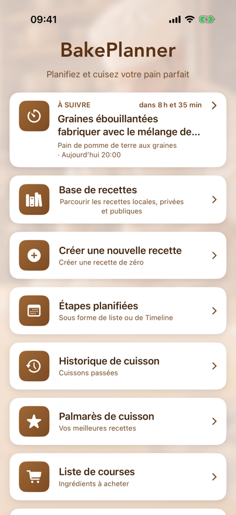
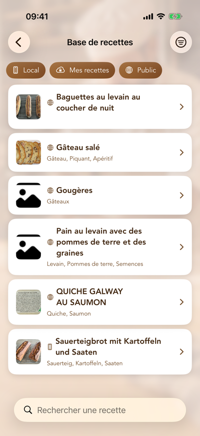
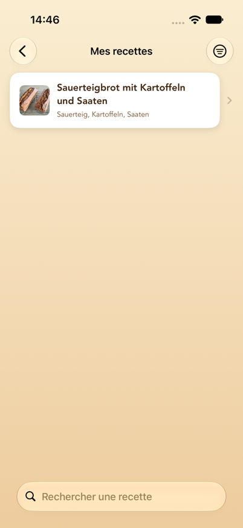
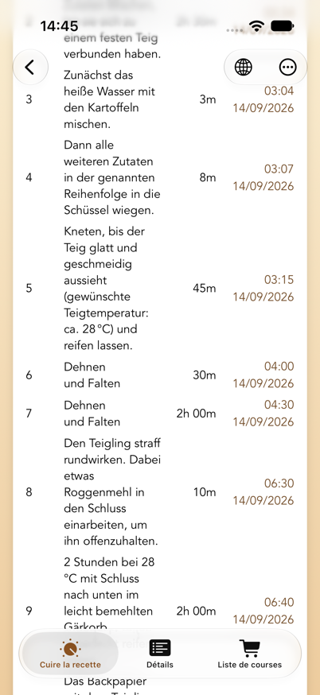
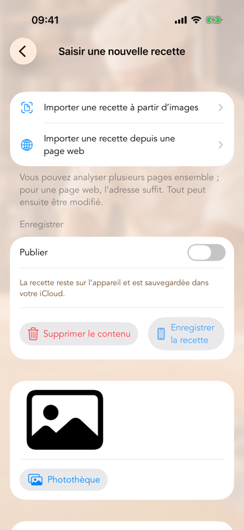
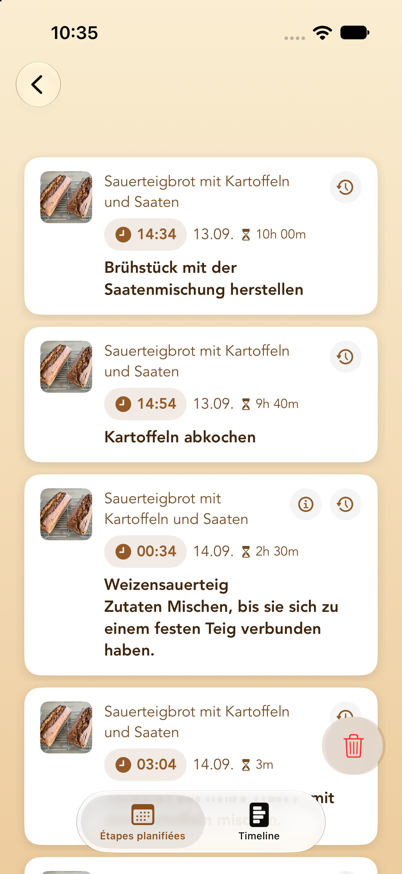
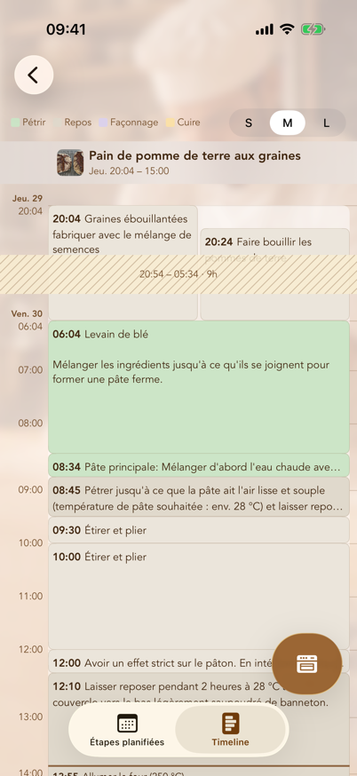

# BakePlanner – Manuel de l’utilisateur

Révision : 28 octobre 2026 · version 2.0 de l’app

> Traduit de l’original allemand, `Benutzerhandbuch.md`. En cas de divergence,
> la version allemande fait foi.

---

## Sommaire

1. [Ce que fait BakePlanner](#1-ce-que-fait-bakeplanner)
2. [Configuration requise](#2-configuration-requise)
3. [Notions de base](#3-notions-de-base)
4. [Le menu principal](#4-le-menu-principal)
5. [Base de recettes](#5-base-de-recettes)
6. [Mes recettes](#6-mes-recettes)
7. [Instructions de cuisson et rappels](#7-instructions-de-cuisson-et-rappels)
8. [Créer une nouvelle recette](#8-créer-une-nouvelle-recette)
9. [Modifier une recette](#9-modifier-une-recette)
10. [Étapes planifiées (liste et timeline)](#10-étapes-planifiées-liste-et-timeline)
11. [Rappels sur l’écran verrouillé](#11-rappels-sur-lécran-verrouillé)
12. [Historique de cuisson et palmarès](#12-historique-de-cuisson-et-palmarès)
13. [Liste de courses](#13-liste-de-courses)
14. [Réglages](#14-réglages)
15. [Unités, quantités et tailles de portion](#15-unités-quantités-et-tailles-de-portion)
16. [Confidentialité, modération et conditions d’utilisation](#16-confidentialité-modération-et-conditions-dutilisation)
17. [Questions fréquentes et dépannage](#17-questions-fréquentes-et-dépannage)
18. [Limitations connues](#18-limitations-connues)

---

## 1. Ce que fait BakePlanner

BakePlanner est une app de planification pour le pain, les petits pains et la pâtisserie. Ce qui la distingue d’un simple recueil de recettes, c’est qu’elle **prend en charge le calcul des horaires** :

- Une recette ne se compose pas seulement d’ingrédients, mais d’**étapes de préparation avec des durées**.
- À partir de ces durées, l’app calcule l’**heure de début de chaque étape**.
- Vous pouvez planifier à rebours : « le pain doit être prêt à 18 h » — et l’app vous dit quand lancer le levain.
- Chaque étape reçoit un **rappel local**, y compris les étapes insérées automatiquement « allumer le four » et « la cuisson est terminée ».

S’y ajoutent : une base de recettes publique commune, vos propres recettes sur l’appareil, l’import d’ingrédients depuis des photos et des pages web, des listes de courses triées par rayon, un historique de cuisson avec photos et mesures, un journal du levain chef pour les levains rafraîchis à intervalle régulier, trois calculateurs de boulanger (température de la pâte, remplacer la farine, TA du levain chef), la traduction des recettes publiques sur l’appareil avec un glossaire des termes de boulangerie, ainsi que des commandes Siri pour la prochaine étape et le nourrissage du levain (voir [chapitre 11](#11-rappels-sur-lécran-verrouillé)).

### Démarrage rapide : votre premier plan de cuisson en cinq étapes

1. Ouvrez **Base de recettes** et choisissez une recette — ou créez la vôtre sous **Créer une nouvelle recette**.
2. Dans la recette, ouvrez l’onglet **Cuire** ou **Cuire la recette**.
3. Choisissez **Commencer à** ou **Terminé pour** et réglez la date et l’heure.
4. Vérifiez les heures de début calculées, puis touchez **Définir les rappels**.
5. Ouvrez **Étapes planifiées** pour contrôler tous les horaires sous forme de liste ou de timeline.

Les rappels supposent que BakePlanner soit autorisé à envoyer des notifications. Les explications détaillées se trouvent au [chapitre 7](#7-instructions-de-cuisson-et-rappels), au [chapitre 10](#10-étapes-planifiées-liste-et-timeline) et au [chapitre 17](#17-questions-fréquentes-et-dépannage).

---

## 2. Configuration requise

| Élément | Valeur |
|---------|--------|
| Appareils | iPhone (y compris iPhone Duo, plié et déplié) et iPad |
| Système d’exploitation | iOS/iPadOS 26.0 ou ultérieur |
| Orientation | iPhone : portrait et paysage · iPad : toutes les orientations |
| Langues | allemand, anglais, français (commutables dans les Réglages) |
| Apparence | mode clair et sombre, tailles de texte dynamiques |
| Internet | Nécessaire pour la base de recettes publique et la synchronisation iCloud. Vos propres recettes, la planification et les rappels fonctionnent entièrement hors ligne ; les modifications se synchronisent plus tard. |
| iCloud | Vos recettes, étapes planifiées, listes de courses et historiques de cuisson se synchronisent via iCloud entre tous les appareils utilisant le même compte Apple, si iCloud est activé. Les rappels eux-mêmes sont locaux à chaque appareil. |
| Autorisations | notifications (pour les rappels), photothèque et appareil photo (pour les images de recettes) |
| Connexion | **Pas** nécessaire pour cuisiner, pour vos propres recettes ni pour la base publique. La connexion avec Apple est facultative : avec elle, vous êtes l’auteur de vos recettes publiées sur tous vos appareils (voir [chapitre 14](#14-réglages)). |

L’app demande l’autorisation d’envoyer des notifications au premier lancement. Sans elle, les étapes de cuisson sont tout de même calculées et affichées dans « Étapes planifiées », mais **aucun rappel n’apparaît**.

---

## 3. Notions de base

Ces six notions reviennent partout dans l’app :

**Recette**
L’unité de plus haut niveau : nom, description, image, note, tags, lien facultatif vers la source, poids total et durée de travail.

**Composant**
Une préparation partielle au sein d’une recette — « levain », « poolish », « pâte principale », « ébouillantage », par exemple. Chaque composant possède un numéro (son ordre de tri) et sa propre liste d’ingrédients. C’est le cœur du modèle de données : BakePlanner est conçu pour les pâtes à plusieurs étapes.

**Ingrédient**
Appartient toujours à un composant. Il comprend un numéro, une quantité, une unité, un nom et éventuellement une fraction (numérateur/dénominateur, notés **Z / N** dans l’app).

**Étape de préparation**
Une instruction de travail avec un numéro d’étape et une durée. La durée est enregistrée en minutes ; vous pouvez aussi la saisir en heures et minutes (« 1:30 », « 1h 30 », « 1,5 h »), voir [chapitre 8](#8-créer-une-nouvelle-recette). Le numéro d’étape est un nombre décimal et a une signification particulière :

- **Les nombres entiers (1, 2, 3…) sont les étapes principales.** Elles se succèdent dans le temps.
- **Les décimales (2.1, 2.2, 2.3) sont des étapes parallèles au sein d’une étape principale.** Elles se déroulent en même temps ; seule la durée *la plus longue* du groupe compte pour la durée totale. Les étapes qui préparent un composant (levain, pré-pâte, trempage …) démarrent à 5 minutes d’intervalle, dans l’ordre de leurs numéros : personne ne pèse quatre pré-pâtes à la même minute, et les rappels arrivent décalés d’autant. Toutes les autres étapes parallèles se terminent en même temps que leur groupe.

Exemple : si vous lancez en même temps un levain (12 h) et un ébouillantage (2 h), attribuez-leur les étapes 1.1 et 1.2. L’étape principale suivante, 2, commence après un peu plus de 12 heures et non après 14.

**Taille de portion**
Un facteur d’échelle pour toutes les quantités : 0,5 / 1,0 / 1,5 / 2,0. **1,0 correspond à la recette telle qu’elle est enregistrée.** 2,0 double toutes les quantités et le poids total affiché. Au lieu d’un facteur, vous pouvez saisir un **poids de pâte** en grammes. Le choix vaut pour tous les onglets de la recette ouverte : Détails, Cuire et Liste de courses calculent avec le même facteur (voir [chapitre 15](#15-unités-quantités-et-tailles-de-portion)).

**Emplacement**
L’endroit où se trouve une recette. Il existe deux possibilités, et le commutateur **Publier** au moment d’enregistrer détermine qui peut la voir :

| Emplacement | Qui la voit ? | Où se trouve-t-elle ? | Modifiable ? |
|-------------|---------------|-----------------------|--------------|
| **Uniquement sur l’appareil** (commutateur désactivé) | vous seul | sur l’appareil, sauvegardée via votre iCloud | oui, à tout moment |
| **Public pour tous** (commutateur activé) | tous les utilisateurs de l’app | dans la base de recettes | oui, par vous en tant qu’auteur |

Une recette que vous **n’avez pas le droit de publier** — tirée d’un livre, par exemple — reste sur l’appareil. Grâce à iCloud, elle est tout de même présente sur tous vos appareils, et la sauvegarde (voir [chapitre 14](#14-réglages)) l’exporte sous forme de fichier.

---

## 4. Le menu principal

Au lancement, le menu principal apparaît avec dix cartes :

*Le menu principal est le point de départ pour les recettes, la planification, l’historique et les réglages.*

| Carte | Rôle |
|-------|------|
| **Base de recettes** | Toutes les recettes dans une seule liste : les vôtres sur l’appareil, celles que vous avez publiées et les recettes publiques de tous — avec les puces de filtre **Local / Publiées par moi / Public** |
| **Créer une nouvelle recette** | Créer une recette de zéro ou l’importer depuis des photos ou une page web |
| **Étapes planifiées** | Toutes les étapes de cuisson programmées, en liste ou en timeline |
| **Historique de cuisson** | Les cuissons passées avec commentaires et photos |
| **Palmarès de cuisson** | Les recettes classées par nombre de cuissons |
| **Liste de courses** | Toutes les listes de courses créées |
| **Température de la pâte** | Calculateur : la température de l’eau de coulage pour une température de pâte souhaitée |
| **Remplacer la farine** | Calculateur : changer de farine, ajuster l’eau |
| **TA du levain chef** | Calculateur : utiliser un levain chef d’un autre rendement de pâte, ajuster l’eau |
| **Réglages** | Langue, valeurs par défaut, planification, sauvegarde, compte |

**La barre « À suivre ».** Dès qu’un plan de cuisson est en cours, une barre flotte au bord inférieur de l’écran avec l’étape qui vient : le texte de l’étape, le nom de la recette, l’heure et un compte à rebours en minutes (« dans 42 min »). Les cartes du menu défilent en dessous, la barre reste toujours visible. Quand l’heure d’une étape est arrivée, elle passe pendant une heure à **« À faire maintenant »** avec le temps écoulé (« depuis 5 min ») — jusqu’à ce que vous marquiez l’étape comme terminée dans la notification ou que l’étape suivante soit due. Toucher la barre ouvre « Étapes planifiées ». Sans étape à venir, elle reste masquée et le menu ressemble à l’illustration ci-dessus.

La flèche de retour en haut à gauche vous ramène au menu principal depuis n’importe quelle section.

---

## 5. Base de recettes

Depuis la version 2.0, la base de recettes est **une seule liste pour toutes les recettes** : les recettes publiques que vous ou d’autres avez partagées, et vos propres recettes sur l’appareil (voir [chapitre 6](#6-mes-recettes)). Triée par ordre alphabétique, avec trois puces de filtre sous le champ de recherche — **Local**, **Publiées par moi**, **Public** — qui s’activent et se désactivent séparément et conservent leur état.

Un symbole devant chaque nom indique la source : un iPhone pour les recettes sur l’appareil, un personnage pour celles que vous avez publiées et un globe pour les recettes publiques des autres utilisateurs. Désactivez **Public** et il reste, à côté de vos recettes locales, la liste de ce que vous avez publié vous-même.

*Dans la base de recettes, vous pouvez rechercher et ouvrir des recettes publiques.*

### Rechercher et filtrer

- **Champ de recherche** en haut : recherche dans les noms de recettes.
- **Changer le périmètre de recherche** : sous le champ, vous pouvez choisir entre **Nom** et **Tags**. Avec « Tags », la recherche porte sur les mots-clés (« seigle », « complet », « levain », par exemple).
- **Puces de filtre** sous le champ de recherche : **Local** (recettes sur l’appareil), **Publiées par moi** (vos propres recettes dans la base) et **Public** (les recettes des autres utilisateurs). Chaque puce active ou désactive sa source séparément ; une recette publique relève toujours d’exactement une des deux puces cloud.
- **Icône de filtre** en haut à droite : note minimale (toutes les notes, 1 à 5 étoiles et plus). Lorsqu’un filtre est actif, l’icône est affichée pleine.
- **Tirer vers le bas** actualise la liste depuis le cloud.

Si « Aucune recette chargée » s’affiche, c’est qu’il n’y avait pas de connexion internet au lancement — tirez la liste vers le bas une fois. Si vous lisez « Aucune recette correspondante », c’est qu’un filtre est actif.

### Ouvrir une recette publique

Une recette s’ouvre sur l’onglet **Détails**. Trois onglets figurent en bas :

- **Cuire la recette** — les instructions de cuisson avec la planification (voir [chapitre 7](#7-instructions-de-cuisson-et-rappels)). La planification n’est calculée que lorsque vous choisissez cet onglet.
- **Détails** — un aperçu des ingrédients, des composants et des étapes
- **Liste de courses** — ajouter les ingrédients à une liste de courses

### Traduire une recette

Par défaut, BakePlanner traduit automatiquement les recettes publiques dans la langue de votre app — **entièrement sur l’appareil** (Traduction Apple) — et cela porte sur le nom de la recette, la description, les tags, les noms de composants et d’ingrédients ainsi que les textes des étapes. Vous pouvez désactiver cela sous *Réglages → Traduction → Traduire automatiquement les recettes publiques* (voir [chapitre 14](#14-réglages)).

- **Activé (par défaut) :** la base de recettes traduit déjà en arrière-plan les noms, descriptions et tags des recettes écrites dans une autre langue, et à l’ouverture d’une recette l’app traduit automatiquement le reste — composants, ingrédients et étapes — s’il n’existe pas encore de traduction. S’il en existe une, elle apparaît aussitôt. Si l’app est en allemand, une recette allemande reste naturellement telle quelle. La langue étant déjà déterminée ainsi, l’icône de globe n’apparaît pas dans ce mode.
- **Désactivé :** une recette s’affiche d’abord toujours dans la langue dans laquelle elle a été écrite. L’**icône de globe** apparaît alors en haut à droite, vous permettant de choisir vous-même entre Deutsch, English et Français. Une coche dans le menu indique quelle langue est affichée ; sélectionnez-la de nouveau pour revenir directement à l’original.

Remarques :

- **Les unités** ne sont pas concernées par la traduction de la recette. L’app les affiche de toute façon dans sa propre langue (voir [chapitre 15](#15-unités-quantités-et-tailles-de-portion)).
- La première traduction dans une langue prend un instant (un léger délai pour une traduction automatique, ou un indicateur de progression remplaçant le globe pour une traduction manuelle). Elle est ensuite mise en cache et disponible immédiatement.
- La première fois, iOS peut demander l’autorisation de télécharger les paquets de langue nécessaires. Si vous refusez, les recettes restent dans leur langue d’origine ; avec la traduction automatique désactivée, elle pourra être rattrapée plus tard via l’icône de globe.
- **Les termes de boulangerie sont traduits par un glossaire.** Des mots comme Brühstück, Quellstück, Kochstück, Anstellgut, Stockgare ou Stückgare — y compris dans des composés comme Weizenanstellgut ou Roggensauerteig — ne passent pas par la traduction automatique mais sont remplacés par le terme propre à la langue cible (échaudage, trempage, levain chef, pointage …). Une traduction plus ancienne où un tel mot était encore faux est refaite à l’ouverture de la recette.
- **L’original n’est jamais écrasé.** L’original est la langue dans laquelle la recette est écrite — et non la langue sur laquelle votre app était réglée. L’app le déduit du texte de la recette : une recette française reste donc un original français même si quelqu’un l’a saisie dans une app en allemand.

### Reprendre une recette

L’onglet **Cuire la recette** propose le bouton **Enregistrer comme ma recette**. Une copie complète — image, composants, ingrédients et étapes comprises — arrive alors dans « Mes recettes ». Seule cette copie est modifiable.

L’app le confirme par **« La recette a été enregistrée »** et précise que vous pouvez modifier la copie sans toucher à la recette publique. Si l’enregistrement échoue, un message d’erreur apparaît à la place — rien ne disparaît en silence.

### Modifier une de vos recettes

Les recettes provenant de *votre* compte se modifient directement dans la base de recettes : **menu « … »** en haut à droite → **Modifier la recette**. Le formulaire est celui de la saisie d’une recette : image, nom, description, lien, tags, composants avec leurs ingrédients et étapes. Composants, ingrédients, tags et étapes peuvent être ajoutés et supprimés. **Enregistrer** écrit les modifications dans la base, **Annuler** les abandonne ; jusque-là, la recette affichée reste inchangée.

À noter :

- Vous modifiez toujours l’**original**, dans la langue dans laquelle la recette a été écrite — même si vous la consultez traduite. Les traductions existantes sont abandonnées et recréées au prochain changement de langue.
- Heures de début, durée totale et poids total sont recalculés à l’enregistrement.
- Une nouvelle image remplace l’ancienne dans la base.
- La version sous « Mes recettes » sur l’appareil n’est pas concernée ; elle reste une recette à part.

Pour les recettes d’autres auteurs, l’entrée n’apparaît pas — sauf pour les administrateurs (voir ci-dessous).

### Signaler, bloquer, supprimer

Via le **menu « … »** en haut à droite :

- **Signaler la recette** — vous choisissez un motif (offensant/insultant, spam, atteinte au droit d’auteur, autre). Le signalement part pour examen chez l’exploitant, et la recette est masquée **immédiatement pour tous les utilisateurs**, et non seulement après l’examen. Elle ne redevient visible que si un administrateur la réaffiche.
- **Bloquer l’auteur** — toutes les recettes de cet auteur disparaissent de votre liste. Cela n’agit **que sur votre appareil** ; les autres utilisateurs continuent de les voir.
- **Modifier la recette** — n’apparaît que pour les recettes provenant de *votre* compte (voir ci-dessus).
- **Supprimer ma recette** — de même, uniquement pour vos propres recettes. La recette est retirée définitivement de la base.

Les deux diffèrent donc par leur portée : **bloquer agit localement, signaler agit pour tous.** Les deux peuvent être annulés dans *Réglages → Modération* (voir [chapitre 14](#14-réglages)).

### Fonction d’administrateur

Si vous êtes connecté en tant qu’administrateur (voir [chapitre 14](#14-réglages)), vous pouvez retirer n’importe quelle recette publique — prévu pour la modération des contenus signalés. Il existe trois façons de le faire : l’entrée **Supprimer la recette (admin)** dans le menu ⋯ de la recette, le bouton du même nom en bas de l’onglet **Détails**, et dans la base de recettes un balayage vers la gauche sur la ligne. Chacune demande d’abord confirmation ; dans la liste, la question nomme la recette. L’image de la recette est supprimée du stockage avec elle. Via **Modifier la recette** dans le même menu, vous pouvez aussi corriger une recette publique — une faute de frappe ou une quantité erronée, par exemple — sans la supprimer. Un administrateur n’a aucun accès aux recettes que les autres utilisateurs conservent sur leurs appareils ; elles ne sont pas partagées et ne relèvent donc pas de la modération.

**Les recettes signalées** restent visibles dans la liste pour les administrateurs, alors qu’elles sont masquées pour tous les autres. En bas de l’onglet **Détails** apparaît alors « Cette recette a été signalée et est masquée pour tous les autres utilisateurs. » Si le signalement est fondé, supprimez la recette. S’il ne l’est pas, **Réafficher la recette** la rend aussitôt de nouveau visible pour tous.

---

## 6. Mes recettes

Mes recettes sont les recettes de votre appareil : celles que vous avez créées, importées ou reprises de la base. Vous les trouvez sous **Menu principal → Base de recettes** avec la puce de filtre **Local** (voir [chapitre 5](#5-base-de-recettes)) ; désactivez les puces **Publiées par moi** et **Public** et il ne reste que la liste de vos propres recettes.

Là où seules vos propres recettes entrent en ligne de compte — les écrans vides de la liste de courses et de l’historique de cuisson —, **Ouvrir mes recettes** ouvre une liste limitée à celles-ci. Tant qu’elle est vide, elle propose directement les deux chemins vers une première recette : **Ouvrir la base de recettes** et **Créer une nouvelle recette**.

### Rechercher et filtrer

- **Champ de recherche** avec commutation **Nom / Tags**.
- **Icône de filtre** en haut à droite : choisir une note minimale (toutes les notes, 1 à 5 étoiles et plus). Lorsqu’un filtre est actif, l’icône est affichée pleine.

La recherche ignore les majuscules et trouve aussi des fragments de mots : « seigle » trouve « Pain de seigle », et pour les tags une partie du mot-clé suffit. Les filtres de recherche et de note se combinent.

### Supprimer une recette

Balayez la ligne vers la gauche → **Supprimer**. Une demande de confirmation suit, avec le nom de la recette, afin qu’un balayage involontaire ne détruise rien. Supprimer une recette supprime aussi ses composants, ses ingrédients, ses étapes de préparation et ses entrées d’historique.

Les étapes déjà planifiées pour cette recette restent toutefois dans « Étapes planifiées » — supprimez-les séparément si vous n’en avez plus besoin.

### Les onglets d’une de vos recettes

| Onglet | Contenu |
|--------|---------|
| **Cuire** | Instructions de cuisson avec planification et « Définir les rappels » |
| **Détails** | Note, description, total des ingrédients, composants, aperçu des étapes, **Partager la recette** en PDF, **Exporter la recette** en fichier ; les lignes de farine et de levain chef se touchent (voir [chapitre 15](#15-unités-quantités-et-tailles-de-portion)) |
| **Modifier** | Modifier la recette (voir [chapitre 9](#9-modifier-une-recette)) |
| **Liste de courses** | Ajouter les ingrédients de cette recette — dans la taille de portion choisie — à une liste de courses (voir [chapitre 13](#13-liste-de-courses)) |
| **+ Historique** | Consigner une cuisson avec date, commentaire, photos et mesures (température ambiante et de la pâte, pousse, farine, mie) |
| **Nourrissage** | Uniquement pour les recettes de levain chef : le journal du levain chef (voir [chapitre 9](#9-modifier-une-recette)) |

Taille de portion et poids de pâte sont les mêmes dans tous les onglets : ce que vous réglez sous Détails vaut aussi sous Cuire et pour la liste de courses.

Une recette s’ouvre sur l’onglet **Détails**. La planification de l’onglet **Cuire** n’est calculée que lorsque vous le choisissez ; seul **Replanifier** dans « Étapes planifiées » y mène directement.

Dans l’onglet **Détails**, vous pouvez toucher l’image de la recette pour l’afficher en grand.

---

## 7. Instructions de cuisson et rappels

C’est le cœur de l’app. La structure est la même pour vos recettes et pour les recettes publiques.

*La vue de cuisson met en regard la durée et le début calculé de chaque étape.*

### De haut en bas

1. **Image et nom** — toucher l’image l’affiche en grand.
2. **Taille de portion** (0,5 / 1,0 / 1,5 / 2,0) ou **poids de pâte**, le **poids en grammes** qui en découle, — s’il est renseigné — le **lien vers la recette** et **Partager la recette** : ce dernier produit un PDF avec l’image, les composants et leurs ingrédients, le total des ingrédients et les étapes de préparation, à la taille de portion choisie, et le propose dans la feuille de partage — Messages, Mail, impression ou « Enregistrer dans Fichiers ». La même fonction existe pour vos propres recettes dans l’onglet « Détails ». En dessous figure **« TA 172 · hydratation 72 % »**, le rendement de la pâte et l’hydratation sur tous les composants ; un appui ouvre le détail (voir [chapitre 15](#15-unités-quantités-et-tailles-de-portion)).
3. **Total des ingrédients** — tous les ingrédients de tous les composants, additionnés. Cette liste sert aux courses et à la pesée. L’eau est volontairement omise, de même que les ingrédients qui sont eux-mêmes un produit intermédiaire d’un composant (« levain » comme ingrédient de la pâte principale, par exemple) — sinon les quantités seraient comptées deux fois.
4. **Composants** — triés par numéro, chacun avec ses ingrédients à la taille de portion choisie.
5. **La dernière fois** (vos recettes uniquement, dès que la recette a été cuite une fois) — comment s’est passée la dernière cuisson de cette recette : température ambiante et de la pâte, pointage et apprêt réels, farine, mie/développement au four et commentaire de l’historique, avec la date. **Compléter** ouvre l’entrée ; si rien n’est encore noté, la carte le demande et propose **Noter maintenant**. Seule une cuisson déjà passée compte — l’entrée créée en définissant les rappels reste dans le futur jusqu’à la fin de la cuisson.
6. **Barre de commande** — voir ci-dessous.
7. **Étapes de préparation** — un tableau avec l’étape, la description, la durée et le **début** calculé. La dernière ligne indique « Terminé » avec l’heure de fin.
8. **Cuissons précédentes** (vos recettes uniquement) — toutes les entrées d’historique, la plus récente en premier, chacune avec sa date, les mesures sur une ligne et le commentaire ; une entrée encore à venir est marquée « planifiée ».
9. **Définir les rappels**.

### La barre de commande

| Élément | Fonction |
|---------|----------|
| **Modifier la durée** | Un commutateur. Actif, il fait apparaître un champ « Durée » pour chaque étape. |
| **Commencer à / Terminé pour** | Détermine comment la date ci-dessous est interprétée. Abrégé sur iPhone en portrait. |
| **Date et heure** | Le point de référence de la planification, au choix entre aujourd’hui et un an plus tard. |

**Commencer à** signifie : je commence à ce moment — quand aurai-je terminé ?
**Terminé pour** signifie : je veux avoir terminé à ce moment — quand dois-je commencer ? La colonne « Début » calcule alors à rebours.

Modifiez l’heure et observez la colonne « Début » s’ajuster immédiatement. Rien n’est encore enregistré.

### Ajuster les durées

1. Activez **Modifier la durée**.
2. Saisissez de nouvelles durées dans les champs de la colonne de droite — en minutes (« 90 ») ou en heures et minutes (« 1:30 », « 1h 30 », « 1,5 h », « 14 heures »). Les champs vides et les valeurs inférieures ou égales à 0 sont ignorés, et la valeur précédente est conservée.
3. Touchez **Appliquer la durée**.

L’app recalcule alors toutes les heures de début et la durée de travail totale. Pour vos recettes, les nouvelles durées sont enregistrées durablement ; pour les recettes publiques, elles ne valent que pour la planification en cours.

### Ce que l’app reproche à un plan

Des remarques apparaissent au-dessus du tableau des étapes dès que l’heure choisie aboutit à un plan peu pratique. Elles se mettent à jour à chaque modification de la date, de l’heure ou des durées — avant même que vous ne touchiez « Définir les rappels ».

| Signe | Signification |
|-------|---------------|
| ⚠️ orange | **Remarque.** Le plan fonctionne, mais vous devriez le savoir. |
| ⛔️ rouge | **Erreur.** Plus de cuissons se dérouleraient en même temps que vous n’avez de fours. En définissant les rappels, l’app vous le demande alors ; **Planifier malgré tout** définit tout de même le plan — par exemple quand plusieurs pâtes passent ensemble au four à la même température. |

Trois points sont vérifiés :

- **Étapes en dehors de votre journée.** Si une étape tombe avant le **début de journée** ou après la **fin de journée** définis dans les Réglages, elle est nommée : « “Rabattre la pâte” commence le 11/09/26 à 03:07, soit avant le début de journée (06:00). » Avec de longues fermentations, c’est normal et il n’y a pas lieu de s’inquiéter — cela vous montre simplement pourquoi il faudrait vous lever la nuit.
- **Temps de cuisson qui se chevauchent.** Chaque four accueille une cuisson à la fois. Avec un seul four (par défaut), tout chevauchement avec une autre recette planifiée est une erreur : deux pains ne tiennent pas en même temps à deux températures différentes. Si vous avez indiqué plusieurs **Fours** dans les Réglages, autant de cuissons peuvent se dérouler en parallèle. Un chevauchement qui tient encore dans un four libre n’est alors signalé que comme remarque (« … et nécessite donc un four supplémentaire ») ; seule la cuisson pour laquelle aucun four n’est plus libre est une erreur.
- **Pause de cuisson trop courte.** S’il s’écoule entre deux cuissons dans le même four moins de temps que la **pause de cuisson** réglée, une remarque apparaît. Le four a besoin de ce temps pour changer de température. Avec plusieurs fours, la remarque disparaît tant qu’un autre four est libre pendant ce temps — le pain va simplement dans le four froid.

Les remarques n’empêchent rien — vous pouvez définir le plan quand même. Elles vous épargnent seulement la surprise à trois heures du matin.

**Suggestions pour éviter la nuit.** Si une étape commence avant le début ou après la fin de journée, l’app cherche l’horaire le plus proche, plus tôt et plus tard, auquel toutes les étapes tombent dans votre journée, et les affiche sous les remarques, par exemple :

> **Terminé pour sam. 10 oct., 13:45**
> 1 h et 45 min plus tard · Début ven. 9 oct., 18:05 · fin sam. 10 oct., 13:45

**Appliquer** règle la date et l’heure ci-dessus en conséquence ; la recette reste inchangée. La recherche avance par quarts d’heure jusqu’à un jour plus tôt ou plus tard, jamais avant maintenant, et jamais de sorte que la cuisson demande plus de fours que vous n’en avez. S’il n’existe aucun horaire de ce type — par exemple parce que la pâte demande plus de temps que votre journée —, l’app vous le signale.

### Définir les rappels

Toucher **Définir les rappels** déclenche plusieurs choses à la fois :

1. Un rappel local est défini pour **chaque étape de préparation**, à l’heure de début calculée.
2. L’étape **« allumer le four »** est insérée automatiquement — le **temps de préchauffage** réglé avant l’**étape de cuisson** (15 minutes par défaut, modifiable dans les Réglages). L’étape de cuisson est celle qui décrit la cuisson, pas forcément la dernière : si « laisser refroidir » suit, le four est quand même préchauffé avant la cuisson.
   - Si la recette indique une **température de four**, elle est ajoutée, par exemple « Allumer le four (250 °C) ». Avec « cuire à 250 °C puis 220 °C », c’est la première. La température peut aussi figurer dans l’étape précédente (« enfourner, four à 250 °C »).
   - Si la recette comporte déjà **sa propre étape de préchauffage**, aucune seconde n’est ajoutée. L’étape de la recette sert alors de rappel de préchauffage et reçoit la température si elle ne l’indique pas encore.
   - Si la cuisson commence dans un **four froid** (« enfourner dans le four froid »), le temps de préchauffage est supprimé.
   - Si l’étape de cuisson indique une **température descendante** (« enfourner à 250 °C, après 10 minutes baisser à 220 °C »), l’app insère en plus **« Baisser le four à 220 °C »** — à la minute indiquée dans la phrase qui donne la température la plus basse ; « immédiatement » signifie au début de la cuisson, et sans indication ce sont dix minutes après le début. Si l’étape mentionne la buée ou la vapeur, le texte devient « …, évacuer la buée » ; pas avec « sans buée ». Si la recette a une **étape à elle pour évacuer la buée** (« Évacuer la buée » 20 minutes après l’enfournement), le four est baissé à l’enfournement et l’étape insérée ne parle pas de buée — c’est la recette qui dit quand la buée s’évacue. Une température de chaleur tournante indiquée à côté (« 230 °C sole/voûte, chaleur tournante 210 °C ») ne compte pas comme une baisse.
3. **« La cuisson est terminée »** est également planifié pour l’heure de fin.
4. Toutes les étapes arrivent dans **Étapes planifiées**.
5. Pour vos recettes, une **entrée d’historique** est créée avec la date de fin et le commentaire provisoire « aucun commentaire saisi », que vous pourrez compléter plus tard.

Une confirmation apparaît ensuite, par exemple :

> **Les rappels ont été définis**
> 12 rappels définis.
> Allumer le four à 16:45 (250 °C).
> Terminé à 18:10.

Les textes « allumer le four », « baisser le four » et « la cuisson est terminée » apparaissent dans la langue active (pour les recettes publiques, dans la langue dans laquelle vous consultez la recette).

> **Une recette, un plan — ou plusieurs.** Si vous touchez « Définir les rappels » alors qu’un plan est déjà en cours pour cette recette, l’app vous demande : **Remplacer le plan existant** écarte les anciennes étapes et leurs rappels et met le nouveau plan à leur place — la voie à suivre pour décaler le pain à un autre jour. **Planifier en plus** conserve le plan existant et place le nouveau à côté, pour samedi et dimanche par exemple. Dans « Étapes planifiées », chaque plan reçoit alors sa propre puce de filtre avec son heure de début, et « Décaler » comme « Supprimer » n’agissent que sur le plan sélectionné.

> **Pour l’Apple Watch : définissez les rappels sur l’iPhone.** Les rappels sont créés sur l’appareil où vous touchez « Définir les rappels » et y restent. Seul un iPhone transmet ses notifications à une Apple Watch jumelée — un iPad n’est pas jumelé à la montre et ne peut pas le faire. Si vous planifiez sur l’iPad, les rappels de cuisson n’apparaissent donc que sur l’iPad, même si vous portez une Apple Watch.
>
> Un plan déjà défini ne peut pas être transféré vers un autre appareil — dans ce cas, définissez simplement les rappels une nouvelle fois sur l’iPhone. La recette elle-même se trouve de toute façon sur les deux appareils grâce à iCloud.

---

## 8. Créer une nouvelle recette

Via **Menu principal → Créer une nouvelle recette**. Le formulaire se parcourt de haut en bas.

*Dans le formulaire de recette, vous pouvez importer une recette depuis des images ou une page web, ou tout saisir manuellement.*

### Importer une recette depuis des images

Tout en haut : **Importer une recette à partir d’images**. Cela permet de lire une recette imprimée ou photographiée.

1. **Sélectionner des images** (jusqu’à 10 pages ; l’ordre de sélection est conservé) ou **Prendre une photo** pour un nouveau cliché.
2. Les pages choisies apparaissent dans la liste « Pages sélectionnées » ; on peut en retirer individuellement avec l’icône de corbeille.
3. **« Analyser … image(s) »** lance la reconnaissance de texte. Elle s’exécute sur l’appareil, affiche « Lecture de l’image x sur y… » et peut être interrompue à tout moment.
4. L’app affiche ensuite un **récapitulatif** : nom reconnu, nombre de composants, d’ingrédients et d’étapes, ainsi que les composants reconnus avec leurs ingrédients et la planification détectée.
5. **Vérifier les données dans le formulaire de recette** reprend le tout dans le formulaire habituel. **Sélectionner d’autres images** recommence.

L’app lit les images avec chacun des types de source qu’elle connaît et retient le résultat qui correspond aux indications de la page. Des photos droites et bien lisibles donnent les meilleurs résultats.

#### Choisir le nom vous-même

Quelle ligne constitue le titre ne se devine pas toujours : un logo, un en-tête d’impression et un intertitre ressemblent tous à un titre. Si le nom reconnu est incorrect, **touchez la ligne « Nom » dans le récapitulatif**. La page apparaît alors telle que vous l’avez photographiée, avec un cadre autour de chaque ligne reconnue :

- **Toucher** choisit une ligne comme nom de la recette.
- **Écarter deux doigts** agrandit la page jusqu’à six fois, si les lignes sont serrées.
- Pour les recettes de plusieurs pages, une barre en haut permet de passer d’une **page** à l’autre.
- Si le nom ne figure pas du tout sur la page, saisissez-le en bas dans le champ **Nom de la recette**.

**Soignez le cadrage.** Coupez tout ce qui ne fait pas partie de la recette : logos, en-têtes et pieds de page, numéros de page, adresses web et fragments de texte d’articles voisins. Cela vous évite la correction d’emblée. Les **recettes manuscrites** ne peuvent pas être lues de façon fiable par la reconnaissance de texte.

Vérifiez ensuite impérativement **les quantités, les unités, les températures et les durées** — rien n’est enregistré avant que vous ne choisissiez « Enregistrer la recette » dans le formulaire.

#### Mode d’analyse : IA cloud protégée ou sur cet appareil uniquement

Au-dessus de la sélection d’images, vous choisissez comment les pages sont analysées :

- **IA cloud protégée** — les images sont envoyées de manière chiffrée via le serveur BackPlaner à Google Vertex AI (Gemini), qui les structure. Cela donne en général les résultats les plus complets, y compris pour des composants comme la pré-pâte et le levain. Avant la première utilisation, l’app explique le transfert de données et vous demande votre consentement ; vous pouvez le retirer sous Réglages › Confidentialité et IA.
- **Sur cet appareil uniquement** — rien ne quitte l’appareil. Selon la disponibilité, l’app utilise Apple Intelligence ou la reconnaissance de texte locale ; la reconnaissance peut être moins précise.

L’app retient ce choix pour les deux voies d’importation.

### Importer une recette depuis une page web

Juste en dessous : **Importer une recette depuis une page web**. BakePlanner lit ainsi une recette directement sur une page de recette en ligne, par exemple un blog de boulangerie.

1. **Coller l’adresse** : copiez l’adresse de la page de recette dans Safari et collez-la avec le bouton Coller à côté du champ, ou saisissez-la. « https:// » peut être omis ; l’app le complète.

   **Plus rapide, directement depuis Safari :** sur la page de recette, touchez **Partager** et choisissez **BakePlanner**. Une petite feuille affiche la page ; **Importer** bascule vers BakePlanner, où l’adresse est déjà renseignée et l’analyse démarre d’elle-même. Cela fonctionne depuis n’importe quel navigateur et depuis toute app qui partage une adresse Internet. Si BakePlanner n’apparaît pas dans la rangée d’apps, touchez **Plus** et activez-y BakePlanner.
2. Choisissez le **mode d’analyse** comme pour l’import d’images. Avec « Sur cet appareil uniquement », le texte de la page n’est pas transmis ; sans Apple Intelligence, l’app ne reprend alors que les données de recette structurées fournies par la page elle-même.
3. **Charger et analyser la page** charge la page sur l’appareil, en extrait les données de recette et le texte visible, et les transmet à l’analyse choisie. La photo de la recette est reprise elle aussi.
4. Le même **récapitulatif** que pour l’import d’images apparaît ensuite ; à la place du type de source reconnu, il indique la source (l’adresse web). **Charger une autre page** recommence.
5. **Vérifier les données dans le formulaire de recette** reprend le tout dans le formulaire. L’adresse de la page est automatiquement placée dans le champ « Lien URL » de la recette.

**Ce qui fonctionne bien :** la plupart des pages de recettes et des blogs de boulangerie fournissent des données de recette structurées ; les ingrédients et les étapes sont alors presque toujours justes. L’IA cloud sépare aussi pré-pâte, levain et pâte principale en composants distincts.

**Numéros d’étape :** les composants qui entrent dans la pâte principale (levain, pré-pâtes, trempages et ébouillantages) sont regroupés par l’import chacun en une étape parallèle 1.1, 1.2, 1.3 … couvrant la préparation et la maturation. Les étapes de la pâte principale suivent en 2, 3, 4 …. Une recette avec quatre pré-pâtes pour la nuit dure ainsi douze heures et non deux jours. Les pré-pâtes sont lancées à cinq minutes d’intervalle dans le plan ; les premières reçoivent une durée allongée d’autant, afin que toutes soient prêtes ensemble pour la pâte principale. Les étapes sans durée reconnue reçoivent une minute.

**Ce qui ne fonctionne pas :** les pages derrière une connexion, un mur payant ou un simple bandeau de cookies ne livrent pas de texte lisible, et certains sites bloquent la récupération par les apps. BakePlanner affiche alors « Importation impossible » avec le motif. Dans ce cas, l’import d’images à partir d’une capture d’écran de la page aide.

> **Droit d’auteur :** pour votre usage personnel, vous pouvez importer n’importe quelle recette. C’est pourquoi le commutateur « Publier » est d’abord désactivé. Ne publiez les recettes d’autrui qu’avec l’autorisation de leurs auteurs.

### Emplacement : sur l’appareil ou publiée

La section **Enregistrer** comporte le commutateur **Publier** (voir aussi le tableau du [chapitre 3](#3-notions-de-base)). Une phrase en dessous explique ce que sa position implique. La valeur par défaut vient des Réglages (*Publier les nouvelles recettes*).

- **Commutateur désactivé** — la recette reste sur l’appareil, est sauvegardée via votre iCloud et reste modifiable à tout moment.
- **Commutateur activé** — la recette devient visible par tous. Auparavant apparaît la question **« Publier la recette ? »**, avec la précision qu’en tant qu’auteur vous pourrez ensuite la modifier ou la supprimer dans la base de recettes. La première fois, vous devez en outre accepter les conditions d’utilisation (voir [chapitre 16](#16-confidentialité-modération-et-conditions-dutilisation)).

Lors d’un import depuis des images ou une page web, le commutateur est toujours désactivé au départ. L’icône du bouton « Enregistrer la recette » change avec sa position.

### Image de la recette

**Photothèque** ou **appareil photo** (le bouton d’appareil photo uniquement sur les appareils qui en ont un).

> **Une image est obligatoire.** Sans image de recette, l’enregistrement affiche le message « Image requise ».

### Données de base et tags

- **Nom** — champ obligatoire. Tant qu’il est vide, « Enregistrer la recette » reste désactivé.
- **Description** — champ de texte multiligne.
- **Lien URL** — lien facultatif vers la source ; apparaît ensuite sous « Lien vers la recette ».
- **Tags** — saisir un mot-clé, toucher **+**. Les tags sont ensuite consultables par la recherche.

### Composants et ingrédients

D’abord le composant, puis ses ingrédients :

1. Saisissez le numéro et le nom du composant (`1` / `Levain`, par exemple) et touchez **+**. Le numéro s’incrémente automatiquement.
2. Sous chaque composant apparaît la ligne de saisie des ingrédients, avec ces colonnes :

| Colonne | Signification |
|---------|---------------|
| **N°** | Ordre de tri au sein du composant |
| **Quantité / Poids** | La valeur numérique de la quantité ; un champ vide signifie 0 |
| **Unité** | Un menu ; voir [chapitre 15](#15-unités-quantités-et-tailles-de-portion) |
| **Ingrédient** | Le nom de l’ingrédient |
| **Z / N** | La fraction — numérateur et dénominateur, 1 / 2 pour « ½ » |

3. **+** ajoute l’ingrédient, l’icône de corbeille le retire. Les lignes déjà saisies sont directement modifiables.

Seul le **nom** est obligatoire — un ingrédient sans quantité ni unité est permis (« sel selon le goût »). Utilisez soit la quantité/le poids, **soit** les champs de fraction, pas les deux pour la même indication.

### Étapes de préparation

Colonnes **Étape**, **Description**, **Durée**. Saisissez la durée en minutes (« 90 ») ou en heures et minutes : « 1:30 », « 1h 30 », « 1 h 30 min », « 1,5 h », « 14 heures » — un nombre sans unité vaut des minutes, un nombre décimal sans unité des heures. Ce sont toujours des minutes qui sont enregistrées ; en quittant le champ, on y lit « 1 h 30 min ». Après un ajout, le numéro d’étape se poursuit automatiquement : d’un nombre entier au suivant, d’une décimale par pas de 0,1. Vous saisissez ainsi commodément des sous-étapes parallèles en 2.1, 2.2, 2.3.

Souvenez-vous de la règle du [chapitre 3](#3-notions-de-base) : les étapes décimales se déroulent en parallèle, les nombres entiers se succèdent.

**Rabats pendant un repos.** Si une étape décrit plusieurs rabats pendant un repos de la pâte — « laisser reposer 3 heures, rabattre après 30 et 60 minutes », « conserver 8 à 12 heures à 9 °C et rabattre dans les 30 et 60 premières minutes » ou « rabattre toutes les 30 minutes, 4x » —, l’app crée à l’enregistrement une étape par rabat : 3.1 « Étirer et rabattre la pâte (après 30 minutes) », 3.2 « … (après 60 minutes) » et ainsi de suite, chacune avec son propre rappel. L’étape de repos garde sa durée complète ; les étapes de rabat portent ce qui reste du repos à partir de leur moment. Il en va de même à l’import depuis des photos et des pages web et lors de la modification d’une étape (voir [chapitre 9](#9-modifier-une-recette)). Si la consigne de rabat figure dans une étape à part après le repos, elle est rattachée au dernier repos cité et développée là.

### Enregistrer

- **Enregistrer la recette** — enregistre localement ou téléverse dans la base. Lors d’un téléversement, « La recette est en cours de téléversement... » apparaît ; ensuite soit « La recette a été enregistrée », soit un message d’erreur précis.
- **Supprimer le contenu** — vide entièrement le formulaire (sans demander confirmation).

---

## 9. Modifier une recette

Accessible via **Mes recettes → recette → onglet « Modifier »**.

### Enregistrement automatique

Les modifications du **nom, de la description, du lien URL, des tags et de la note** sont enregistrées automatiquement — peu après la saisie et au plus tard en quittant l’écran. Aucun message de confirmation n’apparaît pour cela.

Une nouvelle **image de recette** est enregistrée dès que vous la choisissez.

### Note

Touchez les étoiles en haut à droite : de 1 à 5 étoiles. Toucher de nouveau la première étoile remet la note à 0. La note est ce sur quoi s’appuie le filtre de note dans les listes.

### Rafraîchir régulièrement

Pour les recettes que vous cuisez ou lancez à intervalles fixes — le levain chef avant tout —, il y a le commutateur **Rafraîchir régulièrement** (**Planifier régulièrement** pour les pains) avec un intervalle en jours (1 à 60). Activé, l’app **planifie automatiquement la prochaine date après la dernière cuisson** : dès que la dernière cuisson est terminée, le prochain rafraîchi apparaît avec ses rappels dans « Étapes planifiées ». Le rythme est calé sur le **début de la première étape** : nourrissez votre levain chef aujourd’hui à 8 h et, avec « tous les 1 jour », vous le nourrissez de nouveau demain à 8 h — quelle que soit la durée de la recette, et même au changement d’heure. L’intervalle compte toujours à partir de la dernière cuisson réelle ; un nourrissage plus tôt ou plus tard décale d’autant la prochaine date.

Pour qu’une date dans deux semaines n’encombre pas les listes, « Étapes planifiées », la timeline, la carte « À suivre », le widget, l’activité en direct et le mode cuisson retiennent les étapes planifiées automatiquement **jusqu’à deux jours avant l’échéance**. Les rappels, eux, arrivent quand même à l’heure. Les étapes planifiées à la main ne sont pas concernées.

La date du prochain rafraîchi s’affiche en haut des onglets **Détails** et **Modifier** sur la ligne **« Prochain nourrissage : Demain 08:00 »** (« Prochaine cuisson : … » pour les pains) — il s’agit du début de la première étape. Tant qu’un plan est encore en cours, la ligne indique déjà la date d’après ; avant la première cuisson, on y lit « après la première cuisson ».

**Ce qui fait d’une recette un levain chef** se décide d’après ses ingrédients, pas d’après le commutateur : ils donnent un ratio de nourrissage de levain chef (ou levain, starter — les noms se valent), de farine et d’eau, et rien n’est cuit. Une recette composée uniquement de ces trois-là est toujours un levain chef, même si une étape mentionne le four (« laisser mûrir dans le four éteint, lumière allumée », « garder au frais jusqu’à la prochaine cuisson »). Seules une température de four ou une étape de préchauffage — ou d’autres ingrédients comme le sel — en font un pain. Un tag comme « Levain chef », « Starter » ou « Rafraîchi » tranche à la main en cas de doute ; un tag « Levain » ne suffit pas, les pains le portent aussi.

Les recettes de levain chef reçoivent l’onglet supplémentaire **Nourrissage** : le **journal du levain chef**. En haut figure le ratio de nourrissage « levain chef : farine : eau », calculé à partir des ingrédients de la recette et donc non modifiable à la main. En dessous, vous notez pour chaque nourrissage le **temps de maturation jusqu’au pic** en minutes, au besoin le **test de flottaison** et une note sur l’odeur et la consistance. Les nourrissages précédents sont listés dessous, les plus récents en premier — vous voyez ainsi si votre levain chef accélère ou ralentit.

### Modifier les composants

- **Ajouter** : saisir un numéro et un nom, **+**.
- **Modifier** : toucher la ligne du composant. « Modifier le composant » s’ouvre avec le numéro, le nom et la liste complète des ingrédients. Vous pouvez y ajouter des ingrédients (**+**), les supprimer (corbeille) et en modifier un en le touchant, dans la boîte de dialogue « Modifier l’ingrédient ». **Terminé** applique, **Annuler** abandonne.
- **Supprimer** : la corbeille à côté du composant. Le poids total de la recette est ensuite recalculé.

### Modifier les étapes de préparation

- **Ajouter** : saisir l’étape, la description, la durée, **+**. La durée comme à la création, en minutes ou en heures (« 1:30 », « 1,5 h »). Les heures de début sont recalculées automatiquement.
- **Modifier** : toucher la ligne de l’étape → « Modifier l’étape de préparation ». Après **Terminé**, l’app recalcule toutes les heures de début et la durée de travail. Si l’étape décrit des rabats pendant un repos (« rabattre après 30 et 60 minutes »), les étapes de rabat du [chapitre 8](#8-créer-une-nouvelle-recette) sont créées à ce moment — pour une recette ancienne aussi, dès que vous ouvrez l’étape et la confirmez par **Terminé**.
- **Supprimer** : la corbeille à côté de la ligne.

### Enregistrer manuellement

La section **Enregistrer** comporte deux boutons. Vous les retrouvez également en haut à droite de la barre de navigation, dans le menu derrière l’icône d’enregistrement.

- **Local** — enregistre tout, image comprise, recalcule le poids total et confirme par « La recette a été enregistrée ».
- **Public** — téléverse une copie de la recette pour la rendre visible par tous. La question « Publier la recette ? » apparaît ici aussi.
- **Supprimer** (en haut à gauche) — vide le contenu de la recette.

Après un téléversement réussi, **« Public » est désactivé**, car la recette possède désormais une copie dans la base — une recette n’est publiée qu’une seule fois ; les modifications se font ensuite dans la base de recettes (voir [chapitre 5](#5-base-de-recettes)).

Si cette copie est supprimée plus tard (par vous ou par la modération), l’app le détecte à la prochaine ouverture et réactive le bouton.

---

## 10. Étapes planifiées (liste et timeline)

**Menu principal → Étapes planifiées.** On trouve ici toutes les étapes de cuisson de toutes les recettes pour lesquelles vous avez défini des rappels — dans l’ordre chronologique, toutes recettes confondues. En bas, vous passez d’une vue à l’autre ; la timeline s’ouvre en premier. Les rafraîchis planifiés automatiquement (voir [chapitre 9](#9-modifier-une-recette)) n’apparaissent que deux jours avant leur date.

*Dans son état vide, la vue en liste indique aussi où se créent les nouvelles planifications.*

### La vue « Étapes planifiées » (liste)

Chaque étape est une carte avec l’image de la recette, son nom, l’heure de début, la date, la durée et l’instruction. La toucher ouvre la vue détaillée avec la recette, le début, le numéro d’étape, la durée et la description complète.

**Consulter les ingrédients d’un composant** — via le **symbole i** sur la carte. Il n’apparaît que sur les étapes qui mélangent un composant de la recette, par exemple « Préparer le pré-ferment A » ou « Préparer la pâte finale ». Le toucher ouvre les ingrédients de ce composant précis avec leurs quantités, pour peser directement depuis le plan sans ouvrir la recette. Les quantités sont celles de la taille de portion ou du poids de pâte avec lesquels vous avez défini le plan — à ×2, le double, exactement comme dans les rappels.

L’app reconnaît une telle étape de mélange au fait que le nom d’un composant de la recette figure dans le texte de l’étape. Les étapes issues de l’import d’image savent de toute façon à quel composant elles appartiennent. Une étape comme « Rabattre la pâte », sans nom de composant, n’a pas de symbole i.

**Décaler une étape dans le temps** — via l’icône d’horloge sur la carte. La fiche affiche en haut la recette, l’étape et son heure actuelle (« Actuellement ») et, dès que vous avez saisi des minutes, la nouvelle (« Nouveau ») :

1. Saisissez des minutes (1440 au maximum, soit 24 heures).
2. Choisissez le sens : **Plus tôt** ou **Plus tard**.
3. Choisissez les **étapes concernées** : **Uniquement cette étape** ou **Toutes les suivantes** (toutes les étapes ultérieures du même plan se décalent d’autant, y compris « La cuisson est terminée » et les étapes qui commencent à la même minute mais viennent après dans l’ordre). Une note sous le choix explique son effet.
4. **Appliquer**.

Les rappels correspondants se décalent automatiquement. Si le nouveau moment est dans le passé, l’app refuse avec « Décalage impossible ».

**Cocher une étape comme terminée** — via le **symbole de coche** sur la carte, ou en balayant la ligne vers la **droite** et en touchant « Terminé ». L’étape quitte le plan, son rappel est supprimé avec elle, et la carte « À suivre » du menu principal ainsi que le widget passent à l’étape suivante. C’est la même action que « Terminé » dans la notification, mais directement dans la liste.

**Supprimer :**

- **Une seule étape** : balayez la ligne vers la gauche. Le rappel associé est supprimé avec elle.
- **Toutes les étapes** : le bouton corbeille en bas à droite, puis « Tout supprimer ». Cela retire toutes les étapes planifiées **et** tous les rappels en attente — y compris ceux de recettes que vous ne voulez plus cuire.

### La vue « Timeline »

Les mêmes étapes sous forme de **planning de projet** : chaque plan a sa propre voie avec l’image et le nom de la recette, chaque étape une barre aussi longue que dure l’étape. La couleur dit ce qu’il y a à faire — pétrissage en vert, repos et apprêt en gris, façonnage en violet, four en bleu, cuisson en jaune ; une légende figure en haut. La barre porte l’heure et l’instruction. Les sous-étapes qui tombent dans une autre étape — les rabats pendant le pointage, « Allumer le four » pendant l’apprêt, la baisse du four à l’enfournement — apparaissent comme un repère avec leur heure sur la barre de leur étape. Un drapeau à damier marque « La cuisson est terminée », une ligne rouge l’instant présent.

L’axe du temps montre les heures pleines, avec le jour de la semaine et la date au changement de jour. Les étapes courtes reçoivent assez de place pour que leur heure reste lisible ; une longue plage sans aucune étape — la nuit où le levain mûrit — se replie en une bande hachurée qui indique ce qu’elle saute (« 22:45 – 08:35 · 10h »). **S / M / L** en haut à droite règle l’échelle.

En portrait, le temps s’écoule de haut en bas : l’axe est à gauche, les plans sont des colonnes et vous faites défiler comme dans la liste. En paysage, le temps s’écoule de gauche à droite avec une ligne par plan, sur iPad comme sur iPhone. Les étapes qui se déroulent en même temps — l’échaudage pendant que le levain mûrit — se partagent la voie côte à côte. Toucher une barre ou un repère ouvre le détail de l’étape ; un appui long affiche le texte complet de l’étape et propose **Marquer comme terminé** et **Décaler**, comme la carte de la liste. Avec une souris ou un trackpad, il suffit de survoler une barre pour lire tout le texte.

*L’onglet du bas permet de passer de la liste à la timeline.*

Si aucune étape n’est planifiée, les deux vues indiquent : « Aucune étape planifiée — Définissez un rappel dans les instructions de cuisson d’une recette. »

### Mode cuisson

Pour le travail en cuisine, il y a le bouton **Démarrer le mode cuisson** : dans la liste, il flotte en barre au bord inférieur, à côté de la corbeille « Supprimer les étapes planifiées » ; dans la timeline, c’est le bouton rond avec le four en bas à droite. Il ouvre l’étape en cours en plein écran et en grands caractères : en haut le nom de la recette et « Étape 3 sur 12 », en dessous l’heure avec un compte à rebours (« dans 42 min ») ou « depuis 5 min » dès que l’étape est due, puis le texte de l’étape. Si l’étape mélange un composant, ses ingrédients et quantités suivent juste en dessous — les mêmes que derrière le symbole i.

En bas se trouvent de grands boutons que l’on atteint même avec de la farine sur les mains :

- **Retour** et **Suivant** parcourent toutes les étapes du plan.
- **Lire à voix haute** énonce l’étape et, le cas échéant, les ingrédients par le haut-parleur, dans la langue de l’app choisie. Une seconde pression (**Stop**) interrompt. La lecture fonctionne aussi appareil en mode silencieux. Pour s’en passer, désactivez *Réglages → Planification → Lecture vocale en mode cuisson* ; le bouton disparaît alors.
- **Terminé** retire l’étape et son rappel du plan et passe à la suivante.

Le mode cuisson s’ouvre sur l’étape du moment et respecte le filtre de recette de la liste. Tant qu’il est ouvert, l’écran reste allumé. **Fermer** en haut à droite ramène à la liste.

### Le widget « Prochaine étape de cuisson »

Vous voyez la prochaine étape sans ouvrir l’app : BakePlanner fournit un widget pour l’écran d’accueil et l’écran verrouillé. Il affiche la même information que la carte « À suivre » du menu principal — l’étape à venir avec son heure et un compte à rebours en cours (« dans 1:42:10 »), ou, une fois l’heure arrivée, **« À faire maintenant »** avec le temps écoulé. Le toucher ouvre directement « Étapes planifiées ».

- **Petit** : texte de l’étape, jour et heure, compte à rebours.
- **Moyen** : en plus, le nom de la recette.
- **Écran verrouillé** : en widget rectangulaire avec le texte de l’étape et le compte à rebours, ou en affichage sur une ligne à côté de l’horloge.

Pour l’ajouter : maintenez l’écran d’accueil → **Modifier** → **Ajouter un widget** → choisissez **BakePlanner** → choisissez la taille → **Ajouter le widget**. Le widget se met à jour de lui-même dès qu’une étape commence ou devient due, et à chaque modification du plan dans l’app. Sans étape planifiée, il indique « Aucune étape planifiée ».

Le widget utilise la **langue du système** de l’appareil, et non la langue de l’app choisie dans les réglages.

---

## 11. Rappels sur l’écran verrouillé

Chaque rappel apparaît comme une notification intitulée **« Rappel de cuisson »**, avec le sous-titre « Maintenez pour Terminé ou Décaler » et le texte de l’étape comme contenu.

**Les ingrédients dans le rappel.** Si l’étape mélange un composant, les ingrédients de ce composant avec leurs quantités suivent sous le texte de l’étape — les mêmes que derrière le symbole i dans « Étapes planifiées » :

> **Rappel de cuisson**
> Préparer le pré-ferment A
>
> Ingrédients pour « Pré-ferment A » :
> • 200 g de farine de blé T55
> • 200 g d’eau
> • 2 g de levure

La bannière ne montre que les premières lignes. Maintenez la notification ou dépliez-la dans le centre de notifications pour voir toute la liste. Les quantités correspondent au nombre de portions choisi dans les instructions de cuisson au moment où les rappels ont été définis.

**Maintenez la notification appuyée** pour obtenir deux actions :

- **Marquer comme terminé** — l’étape est retirée de « Étapes planifiées ».
- **Décaler de…** — saisissez les minutes directement dans la notification. Une question suit alors : **« Toutes les étapes suivantes de cette recette doivent-elles également être décalées ? »**, avec les options **Uniquement cette étape** et **Toutes les suivantes**.

Le décalage est toujours compté à partir de **maintenant** : « 30 minutes » signifie « dans 30 minutes ». Avec « Toutes les suivantes », toutes les étapes ultérieures de la même recette se décalent du même écart — une fermentation reste ainsi cohérente, même si vous êtes en retard.

Les notifications s’affichent aussi lorsque l’app est au premier plan.

### Activité en direct

Pendant qu’un plan est en cours, BakePlanner affiche aussi l’étape à venir comme **activité en direct** : en vignette sur l’écran verrouillé, et en haut de l’écran sur les iPhone à Dynamic Island. On y voit le texte de l’étape, le nom de la recette, l’heure, l’étape suivante (« Ensuite 00:36 · Weizensauerteig … ») et un compte à rebours en cours. Quand l’heure est arrivée, la vignette passe à **« À faire maintenant »** et compte le temps écoulé. Un toucher ouvre « Étapes planifiées » ; sur la Dynamic Island, un appui long déplie la vue.

L’activité en direct apparaît dès qu’une étape est à moins de huit heures — iOS met fin aux activités en direct au plus tard après huit heures, d’où cette limite. Elle est mise à jour quand vous ouvrez l’app, marquez une étape comme terminée ou la décalez, et se termine quand plus aucune étape n’est à portée. La première fois, iOS demande si BakePlanner peut afficher des activités en direct. Sous *Réglages → Planification → Activité en direct sur l’écran verrouillé*, elle peut être désactivée complètement.

**Apple Watch.** Les rappels de cuisson apparaissent sur la montre si vous les avez définis sur l’**iPhone** — les notifications de l’iPhone sont transmises à la montre jumelée. Les rappels définis sur l’iPad restent sur l’iPad. Plus de détails au [chapitre 7](#7-instructions-de-cuisson-et-rappels).

### Siri

Les mains dans la pâte, vous n’avez pas à toucher l’appareil : BakePlanner comprend quelques phrases via **Siri**, sans rien configurer. Chaque phrase nomme l’app, c’est ainsi que Siri sait qu’il s’agit de BakePlanner. Les phrases existent en allemand, en anglais et en français ; Siri comprend celles de sa propre langue.

| Ce que vous dites | Ce qui se passe |
|---|---|
| « Prochaine étape dans BakePlanner » · « Qu’est-ce qui vient ensuite dans BakePlanner » | Siri nomme l’étape à venir avec la recette et l’heure, ou « à faire maintenant » si c’est le moment. |
| « Étape terminée dans BakePlanner » | Marque l’étape due comme terminée et nomme la suivante. Si l’étape n’est pas encore due, Siri demande confirmation. |
| « Retarder la prochaine étape dans BakePlanner » · « Devancer la prochaine étape dans BakePlanner » | Décale l’étape à venir de quelques minutes vers l’arrière ou vers l’avant. Siri demande « De combien de minutes ? » ; les étapes suivantes suivent. |
| « Quand enfourner dans BakePlanner » | Donne le début de cuisson prévu avec l’heure. |
| « J’ai nourri Levain de seigle dans BakePlanner » · « J’ai nourri mon levain dans BakePlanner » | Consigne un nourrissage dans le journal du levain chef. Sans nom, Siri demande quel levain ; comptent les recettes de levain chef (voir [chapitre 9](#9-modifier-une-recette)). |
| « J’ai nourri tous les levains dans BakePlanner » | Consigne un nourrissage pour chaque levain. Un levain déjà consigné dans l’heure écoulée est ignoré. |
| « Quand ai-je nourri Levain de seigle dans BakePlanner » · « Dernier nourrissage dans BakePlanner » | Donne la date et l’heure du dernier nourrissage. |

Les mêmes commandes figurent dans l’app **Raccourcis** sous BakePlanner et peuvent y entrer dans vos propres raccourcis. Tout s’exécute en arrière-plan, l’app n’a pas besoin d’être ouverte. Ce que Siri modifie apparaît aussitôt dans « Étapes planifiées », le widget et l’activité en direct.

---

## 12. Historique de cuisson et palmarès

### Historique de cuisson

**Menu principal → Historique de cuisson.** Toutes les cuissons, la plus récente en premier, au choix en **liste** avec date, nom de la recette, commentaire et photos — ou en **galerie** : des vignettes avec la première photo de la cuisson (à défaut l’image de la recette), le nom de la recette, la date, la note et le commentaire, deux par rangée sur iPhone et davantage sur iPad. Passez de l’une à l’autre avec le symbole en haut à droite ; le choix est mémorisé. Tant qu’aucune cuisson n’existe, l’écran vide explique d’où viennent les entrées et mène à vos recettes.

- **Toucher une entrée** (ligne ou vignette) → les notes de cuisson : modifier le commentaire, renseigner **Mesures et résultat** (voir ci-dessous) et ajouter des photos via la **photothèque**. Les photos se touchent et se parcourent en grand. **Enregistrer** confirme par « L’historique a été enregistré ».
- **Supprimer une entrée** : balayez la ligne vers la gauche.
- **Rechercher et filtrer** : le champ de recherche (Nom/Tags) et le filtre de note en haut à droite.

Dans la liste et la galerie, les mesures d’une entrée figurent sur une ligne sous le commentaire, par exemple « Ambiante 22 °C · Pâte 25 °C · Pointage 3h 30m · Apprêt 1h 00m · Blé T55 · ouverte, bon développement ».

### Mesures et résultat

Le texte libre et les étoiles ne suffisent pas pour faire mieux la fois suivante. Chaque entrée comporte donc une section **Mesures et résultat** :

| Champ | Contenu |
|-------|---------|
| **Température ambiante**, **Température de la pâte** | En °C, avec virgule ou point (« 22,5 »). Vide signifie « non mesurée ». |
| **Pointage**, **Apprêt** | La durée réelle en minutes ; à partir de 60 minutes, la conversion s’affiche dessous (« = 3h 30m »). |
| **Farine** | La farine utilisée, en texte libre (« Blé T55, épeautre T80 »). |
| **Mie / développement** | Deux ou trois mots-clés, séparés par des virgules. Sous le champ, des pastilles de mots pour la **mie** (ouverte, serrée, moelleuse, sèche, régulière, à grandes alvéoles, collante) et le **développement au four** (bon développement, peu de développement, déchiré, resté plat) ; toucher une pastille met le mot dans le champ ou le retire, un mot choisi porte une coche. Vous pouvez ajouter vos propres mots. |

Les champs numériques n’ont pas de touche Retour ; **Terminé** apparaît à côté du champ en cours de saisie pour fermer le clavier.

La vue de cuisson affiche ces informations dans la carte **La dernière fois** lors de la prochaine planification de la même recette (voir [chapitre 7](#7-instructions-de-cuisson-et-rappels)).

### Consigner une cuisson après coup

**Mes recettes → recette → onglet « + Historique ».** Choisissez la date de cuisson (jusqu’à 10 ans en arrière), écrivez un commentaire, renseignez les mesures et le résultat, ajoutez des photos depuis la photothèque, **Enregistrer**.

Une entrée est en outre créée automatiquement lorsque vous définissez des rappels dans les instructions de cuisson — d’abord avec le texte provisoire « aucun commentaire saisi » et sans mesures. Après la cuisson, la carte « La dernière fois » de la vue de cuisson vous rappelle de la compléter.

### Palmarès de cuisson

**Menu principal → Palmarès de cuisson.** Affiche toutes les recettes déjà cuites au moins une fois, classées par nombre de cuissons — vos classiques en tête. Pour chaque recette figurent le nom, le nombre et les photos des historiques. La recherche et le filtre de note fonctionnent comme dans les autres listes.

---

## 13. Liste de courses

### Mettre des ingrédients sur une liste

S’il n’existe encore aucune liste, l’écran vide sous « Liste de courses » explique la marche à suivre et mène directement aux recettes avec **Ouvrir mes recettes**.

**Recette → onglet « Liste de courses »** — pour vos recettes comme pour les recettes publiques.

1. **Taille de portion.** En haut se trouve la même commande de taille de portion que sous Détails et Cuire, avec le poids total. Les ingrédients arrivent sur la liste **avec ce facteur ou ce poids de pâte** ; à ×2, les quantités doublées. Le texte en pied nomme le facteur.
2. **Nouvelle liste** : choisissez une date, **Créer**. S’il existe déjà une liste pour cette date, les ingrédients y sont ajoutés.
3. **Liste existante** : basculez sur « Liste existante » et touchez **+** en face de la liste voulue. Pour en supprimer une, balayez la ligne vers la gauche.

La confirmation indique « Les ingrédients ont été ajoutés à la liste de courses » et, pour un facteur différent de 1,0, ajoute « Les quantités correspondent au facteur … ». Le renvoi **Afficher les listes de courses** apparaît ensuite.

### La liste parle votre langue

Les noms des ingrédients figurent sur la liste **toujours dans la langue de l’app**, même si la recette est en allemand ou en anglais. Pour les recettes publiques, l’app utilise la traduction qu’elle a déjà ; sinon elle traduit les noms sur l’appareil à la création de la liste — « Traduction des noms des ingrédients … » s’affiche brièvement. Le glossaire des termes de boulangerie s’applique (voir [chapitre 5](#5-base-de-recettes)). Si la traduction échoue, par exemple sans pack linguistique et sans réseau, les noms arrivent sur la liste dans la langue de la recette, et la confirmation le dit. Ainsi, les ingrédients d’une recette allemande et d’une recette anglaise peuvent aussi se regrouper sur une même liste.

### Ce qui arrive sur la liste — et ce qui n’y arrive pas

L’app filtre volontairement, et ce dans toutes les langues :

- **Ne sont pas repris** l’**eau** (y compris eau de coulage, Wasser, water), le **sel** (y compris sel de mer, Salz, salt) et tout ce que l’on prépare soi-même : **levain chef, levain, Anstellgut, lievito madre, poolish, biga**. Ce qui n’en a que le nom s’achète — l’eau de rose, le lait de coco, le beurre salé, le levain déshydraté ou l’extrait de levain restent sur la liste.
- **Ne sont pas repris** les ingrédients sans unité ou sans quantité exploitable.
- **Les œufs sont comptés à la pièce**, dans toutes les langues : « 120 g d’œufs » deviennent « 2 pcs œufs », arrondis au supérieur, à ×2 quatre pièces.
- **Les ingrédients identiques sont regroupés.** Les indications de température sont alors retirées du nom : « lait 30 °C » et « lait » comptent pour le même ingrédient. Les majuscules et les trémas n’ont aucune importance.
- **Les unités sont converties** lorsqu’elles partagent la même unité de base : 0,5 kg + 200 g s’additionnent, les cuillerées à soupe et les millilitres également. Les grammes et les millilitres restent séparés.

### Consulter les listes de courses

**Menu principal → Liste de courses.** Chaque liste indique sa date, les recettes qu’elle contient et, en dessous, les ingrédients avec quantité et unité — **regroupés par rayon**, dans l’ordre d’un tour de magasin : farines & céréales, produits laitiers & œufs, ingrédients de pâtisserie, noix, graines & fruits secs, fruits & légumes, épices & herbes, huiles, matières grasses & liquides, divers. L’app lit le rayon dans le nom de l’ingrédient, de sorte que les listes plus anciennes sont elles aussi regroupées.

Toucher un ingrédient ouvre **Modifier la quantité** : quantité, unité et fraction valent alors pour cette liste, la recette reste inchangée ; l’ingrédient peut aussi y être retiré. L’icône de corbeille à côté de la ligne le retire directement. **Supprimer** retire toute la liste après confirmation.

---

## 14. Réglages

**Menu principal → Réglages.**

*Les Réglages rassemblent la langue, les valeurs par défaut et les paramètres de la planification. Les sections Confidentialité et IA, Modération et Compte suivent plus bas.*

### Général

| Réglage | Description |
|---------|-------------|
| **Langue** | Langue du système, allemand, anglais ou français. Agit sur l’interface ainsi que sur les formats de date et d’heure. |
| **Publier les nouvelles recettes** | La position par défaut du commutateur **Publier** à la création d’une recette. Par défaut : désactivé — les nouvelles recettes restent sur l’appareil. |

### Recettes

| Réglage | Description |
|---------|-------------|
| **Taille de portion par défaut** | La valeur avec laquelle les recettes s’ouvrent : 0,5 / 1,0 / 1,5 / 2,0. Par défaut : 1,0. |
| **Utiliser la vue détaillée** | Activé : les composants et les étapes de toutes les recettes publiques sont chargés avec la liste — les recettes s’ouvrent plus vite, mais le premier chargement est plus long et consomme plus de données. Désactivé : les détails ne sont chargés qu’à l’ouverture d’une recette. Par défaut : activé. |
| **Afficher les pourcentages boulanger** | Ajoute dans la vue des composants, derrière chaque ingrédient pesé, sa part de la farine du composant (voir [chapitre 15](#15-unités-quantités-et-tailles-de-portion)). Par défaut : désactivé. |
| **Levain chef** | Rendement de pâte (TA) de votre levain chef, utilisé pour répartir une quantité de levain en farine et en eau quand la recette n’indique pas son TA. De 120 à 300 par pas de cinq. Par défaut : TA 200. |
| **Lievito madre** | Idem pour le lievito madre. Par défaut : TA 150. |
| **Mes TA de levain chef** | Les rendements de pâte auxquels vous entretenez vos levains chefs, séparés par des virgules (« 190, 210, 220 »). Ils sont proposés comme raccourcis lors de l’ajustement de la TA du levain chef (voir [chapitre 15](#15-unités-quantités-et-tailles-de-portion)). Par défaut : 150, 180, 200, 220. |
| **Unités personnalisées** | Indique combien vous en avez créées et mène à leur gestion. Voir [chapitre 15](#15-unités-quantités-et-tailles-de-portion). |

### Sauvegarde

| Entrée | Effet |
|--------|-------|
| **Sauvegarder toutes mes recettes** | Écrit toutes les recettes de l’appareil, images comprises, dans un fichier et le propose dans la feuille de partage — pour « Enregistrer dans Fichiers », Mail ou AirDrop, par exemple. |
| **Restaurer depuis une sauvegarde** | Lit un tel fichier ou une recette exportée seule. Les recettes importées arrivent comme **nouvelles** recettes à vous ; les recettes existantes ne sont jamais écrasées. |

Une recette seule s’exporte dans l’onglet **Détails** via **Exporter la recette** (à côté de « Partager la recette »). Le fichier peut être transmis à quelqu’un d’autre, qui le lit via « Restaurer depuis une sauvegarde » — une voie en dehors de la base de recettes, par exemple pour des recettes tirées de livres.

### Traduction

| Réglage | Description |
|---------|-------------|
| **Traduire automatiquement les recettes publiques** | Concerne uniquement la base de recettes. Activé : les recettes sont traduites automatiquement dans la langue de votre app, et l’icône de globe n’apparaît pas. Désactivé : une recette affiche d’abord la langue dans laquelle elle a été écrite, et vous choisissez vous-même la langue via l’icône de globe (voir [chapitre 5](#5-base-de-recettes)). Par défaut : activé. |

### Planification de cuisson

| Réglage | Description |
|---------|-------------|
| **Temps de préchauffage** | 0 à 120 minutes par pas de 5. Utilisé lors de la définition des rappels, pour placer l’étape automatique « allumer le four » avant la dernière étape. Par défaut : 15 minutes. |
| **Pause de cuisson** | 0 à 120 minutes. Écart minimal entre deux cuissons dans le même four. Par défaut : 10 minutes. |
| **Fours** | 1 à 6. Nombre de cuissons pouvant se dérouler en même temps. Le contrôle du plan ne signale une erreur que si plus de recettes cuisent en même temps qu’il n’y a de fours ; la pause de cuisson s’applique par four. Par défaut : 1. |
| **Début de journée** | 0 à 23 h. À partir de quand vous êtes disponible le matin. Par défaut : 6 h. |
| **Fin de journée** | Entre le début de journée et 23 h. Par défaut : 23 h. |
| **Lecture vocale en mode cuisson** | Affiche ou masque le bouton « Lire à voix haute » du mode cuisson. Par défaut : activé. |
| **Activité en direct sur l’écran verrouillé** | Affiche l’étape à venir comme activité en direct sur l’écran verrouillé et dans la Dynamic Island. Désactiver met fin immédiatement à une activité en cours. Par défaut : activé. |

> **Remarque :** seul le **temps de préchauffage** décale réellement des étapes. La **pause de cuisson, les fours, le début et la fin de journée** ne modifient pas le plan — l’app le contrôle toutefois par rapport à eux et vous avertit dans la vue de cuisson si une étape tombe pendant votre nuit ou si plus de cuissons coïncident que vous n’avez de fours (voir [chapitre 7](#7-instructions-de-cuisson-et-rappels)).

### Confidentialité et IA

Ici figure si l’**IA cloud protégée** peut être utilisée lors de l’importation de recettes (voir [chapitre 8](#8-créer-une-nouvelle-recette)).

| Entrée | Effet |
|--------|-------|
| **Analyse IA à l’importation de recettes** | **Autorisée** si vous avez consenti à l’IA cloud, sinon **Local uniquement**. Un toucher ouvre la page **Confidentialité de l’IA**. |
| **Retirer le consentement à l’IA cloud** | N’apparaît qu’après un consentement. Le retire et règle le mode d’analyse sur « Sur cet appareil uniquement ». |

La page **Confidentialité de l’IA** explique quelles données une analyse cloud transmet, à qui, dans quel but et ce qui en reste enregistré (résumé au [chapitre 16](#16-confidentialité-modération-et-conditions-dutilisation)). Vous pouvez aussi y retirer votre consentement. Celui-ci n’est donné que lors d’une importation, après que l’app a expliqué le transfert. Le retrait vaut pour toutes les analyses futures ; les analyses déjà effectuées ne sont pas concernées.

### Compte

C’est ici que vous vous connectez avec Apple. La connexion est **facultative** et sert à deux choses :

- **L’identité d’auteur.** Sans connexion, vos recettes publiées appartiennent à l’identifiant anonyme de cette installation — il disparaît avec l’app et diffère sur un deuxième appareil. Connecté, elles appartiennent à votre compte Apple : vous pouvez les modifier et les supprimer sur chaque appareil où vous êtes connecté, même après une réinstallation.
- **Les droits de modération.** Si votre identifiant y a été autorisé, la mention **Administrateur** apparaît en plus, et les recettes publiques peuvent être supprimées — via le menu ⋯, l’onglet Détails ou un balayage dans la base de recettes.

**Ni votre nom ni votre adresse e-mail ne sont demandés** — l’app n’a besoin que de l’identifiant lui-même. Si votre utilisation était anonyme jusque-là, elle est conservée à la connexion : les recettes déjà publiées depuis cet appareil vous appartiennent toujours ensuite.

| Bouton | Effet |
|--------|-------|
| **Se connecter avec Apple** | Crée ou associe votre compte. |
| **Se déconnecter** | Retour à l’utilisation anonyme. Les recettes publiées sous le compte restent dans la base ; vous pourrez de nouveau les modifier dès que vous serez reconnecté. L’app confirme par **« Déconnexion effectuée »** ; elle ne demande **pas** de vous reconnecter pour confirmer — cela ne concerne que la suppression du compte. |
| **Supprimer le compte** | Supprime le compte définitivement (voir ci-dessous). |

**Supprimer le compte** demande d’abord confirmation. Ensuite, voici ce qui se passe :

- La connexion est dissociée et le compte supprimé ; l’app continue de fonctionner de façon anonyme.
- **Les recettes publiées restent** visibles par tous. Elles n’appartiennent plus à aucun compte, vous ne pouvez donc plus les supprimer vous-même — faites-le avant si vous ne voulez pas les laisser dans la base.
- **Les recettes présentes sur l’appareil sont conservées.** Elles appartiennent à l’appareil et à votre iCloud, pas au compte.

Cette action est irréversible. Si votre dernière connexion est ancienne, Apple exige par sécurité une nouvelle connexion — la feuille « Se reconnecter » apparaît, puis la suppression se poursuit d’elle-même.

Pour cuisiner normalement, pour vos propres recettes et pour parcourir la base publique, **aucune connexion n’est nécessaire**.

### Modération

C’est ici que vous annulez ce que vous avez masqué dans la base de recettes.

| Entrée | Effet |
|--------|-------|
| **Auteurs bloqués** | Le nombre d’auteurs que vous avez bloqués. |
| **Débloquer tous les auteurs** | Lève tous les blocages. Les recettes de ces auteurs réapparaissent **immédiatement** dans la liste. |
| **Recettes que vous avez signalées** | Le nombre de recettes que vous avez signalées. |
| **Effacer les signalements sur cet appareil** | Retire le masquage que votre appareil a mémorisé. |

**La différence est importante :** bloquer est un simple réglage de l’appareil, c’est pourquoi la levée prend effet aussitôt. Un signalement masque en revanche la recette pour tous les utilisateurs — et seul un administrateur peut l’annuler. Votre effacement ici ne prend donc effet qu’*après* que la recette a été réaffichée ; jusque-là elle reste invisible, pour vous aussi.

Les deux listes ne valent que pour cet appareil et ne sont pas synchronisées via iCloud.

### Aide

D’ici, vous ouvrez dans le navigateur le **Manuel de l’utilisateur** (ce document), la page **Aide et contact** avec l’adresse e-mail pour vos questions et signalements, la **politique de confidentialité** et les **mentions légales**. Toutes ces pages s’affichent dans la langue réglée dans l’app.

---

## 15. Unités, quantités et tailles de portion

### Taille de portion ou poids de pâte

Chaque vue de recette met les quantités à l’échelle de deux façons :

- **Taille de portion** — le facteur 0,5 / 1,0 / 1,5 / 2,0 comme avant ; 1,0 est la recette telle qu’enregistrée.
- **Poids de pâte** — à côté se trouve un champ qui affiche le poids total actuel en valeur par défaut. Saisissez un poids cible en grammes, par exemple 2000, et l’app recalcule tous les ingrédients pour ce poids de pâte ; le sélecteur de portion n’affiche alors plus de sélection. Toucher un facteur efface le champ.

Les quantités recalculées sont arrondies comme on les pèse : en grammes entiers à partir de 10 g, à une décimale en dessous (« 2,7 g de levure »). Les fractions comme « 1/2 cube » restent des fractions aux facteurs 0,5 à 2,0 (« 3/4 cube ») et deviennent des décimales avec un poids de pâte libre (« 0,7 cube »). Taille de portion et poids de pâte s’appliquent à **tous les onglets de la recette** — Détails, Cuire et Liste de courses —, aux ingrédients des rappels que vous définissez ensuite, et aux fiches « Remplacer la farine » et « Ajuster la TA du levain chef » lorsque vous les ouvrez depuis la recette.

### Pourcentages boulanger

Sous *Réglages → Recettes → Afficher les pourcentages boulanger*, la vue des composants ajoute derrière chaque ingrédient pesé sa part de la farine du composant, par exemple « 319 g Wasser · 62 % ». Compte comme farine tout ce qui porte « Mehl », « Schrot », « Grieß », « Dunst », « flour » ou « farine » dans son nom, ainsi que le pain rassis et la chapelure (farine déjà cuite une fois, comme dans un Brühstück) — mais pas les graines de lin moulues, les flocons, le son ni les farines de noix ou d’amande. Un composant sans farine n’affiche pas de pourcentages ; les pièces et les composants entiers utilisés comme ingrédient (« 1 gesamtes Brühstück ») non plus. Les pourcentages ne changent pas avec la taille de portion.

### Rendement de la pâte et hydratation

Dans l’onglet **Détails**, sous le poids, figure la ligne **« TA 172 · hydratation 72 % »** : le rendement de la pâte (TA, de l’allemand Teigausbeute : farine plus eau pour 100 g de farine) et l’hydratation (eau par rapport à la farine) sur **tous les composants** de la recette. Un appui ouvre le détail avec la farine et l’eau en grammes, la valeur propre de chaque composant, les parts de levain chef et les ingrédients non comptés.

La convention des boulangers s’applique :

- **La farine** est ce que les pourcentages boulanger comptent comme farine (voir ci-dessus).
- **Les liquides versés comptent intégralement** : eau, lait, babeurre, bière, vin, petit-lait, jus et eau de levure — même si le lait n’est physiquement composé que d’environ 90 % d’eau. Les chiffres correspondent ainsi à ceux des livres et des blogs. Le lait en poudre et la crème de tartre ne comptent pas.
- **Le levain chef est réparti** : 20 g de levain à TA 200 font 10 g de farine et 10 g d’eau ; à TA 150, 13 g de farine et 7 g d’eau. L’app lit le TA dans le nom de l’ingrédient s’il indique « TA 200 » ou « 100 % hydratation » ; sinon elle prend *Réglages → Recettes → Levain chef* ou *Lievito madre*. Biga (TA 150), poolish (TA 200) et pâte fermentée (TA 165) ont leur TA par définition. Le détail indique pour chaque levain d’où vient son TA.
- **Graines, flocons, matières grasses, œufs, sucre et sel** ne comptent ni comme farine ni comme eau. Les plus lourds figurent dans le détail sous « Non comptés », pour que vous voyiez ce que le chiffre ne contient pas.
- **Chaque composant compte exactement une fois.** Si la pâte finale indique « gesamter Sauerteig » (tout le levain), le levain entre par cette ligne, pas deux fois. Si elle indique « 200 g Sauerteig » alors que le composant en donne 300 g, les deux tiers comptent. Si la pâte finale ne nomme pas du tout le levain, les composants sont simplement additionnés.

La ligne est absente pour les recettes sans farine reconnue. L’import d’images compare le même calcul au rendement imprimé dans le livre et avertit en cas d’écart.

### Remplacer la farine

Pas de farine de blé 1050 à la maison, mais de la farine d’épeautre 630 ? Les farines s’échangent **1:1 au poids** ; ce qui change, c’est l’eau, car chaque farine absorbe différemment. Deux voies :

- **Dans la recette :** dans l’onglet **Détails**, les lignes de farine se touchent (icône de flèche derrière). La fiche **Remplacer la farine** montre la farine reconnue, laisse choisir la farine de remplacement par céréale et par type, et calcule : la variation d’eau du composant (« +20 g » ou « −20 g »), rendement de pâte et hydratation avant et après. Si le composant n’a pas d’eau, l’app prend son liquide versé (lait, bière) ; s’il n’en a pas, elle le dit. **Créer une copie avec la substitution** inscrit l’échange dans une nouvelle recette à vous, datée dans son nom (« … – Dinkelmehl 630 (14 oct. 2026) »), et l’ouvre ; l’original reste inchangé. Dans cette copie, le bouton s’appelle **Appliquer la modification** : une deuxième farine ou un ajustement du levain chef modifie la copie elle-même, la mention dans le nom est complétée (« … – Dinkelmehl 630, TA 210 (…) »), et aucune autre copie n’est créée.
- **Comme calculateur :** **Menu principal → Remplacer la farine** pour une quantité libre — quantité, farine de la recette, farine de remplacement.

S’y ajoutent des conseils de conduite : pétrir l’épeautre moins longtemps et envisager un trempage ou un empois, acidifier le seigle, cuire l’amidonnier et l’engrain en moule, laisser gonfler la farine complète, incorporer l’eau supplémentaire petit à petit. Les valeurs d’eau sont indicatives, relatives au blé 550 (épeautre 630 −4 %, blé complet +10 %, seigle 1150 +12 % …) — les farines varient selon le moulin et la récolte, la pâte a le dernier mot.

### Ajuster la TA du levain chef

Si une recette demande « 100 g de levain chef TA 150 » mais que vous entretenez le vôtre à TA 210, le compte n’y est plus : votre levain chef plus souple apporte moins de farine et plus d’eau. L’app compense pour que **la farine apportée par le levain chef reste la même** : quantité de levain chef = quantité de la recette × TA disponible ÷ TA de la recette, ici 140 g au lieu de 100 g, et les 40 g d’eau en plus sont retirés de l’eau du même composant. Le rendement de pâte et le poids total de la pâte restent ceux de la recette ; avec un levain chef plus ferme, c’est l’inverse.

- **Dans la recette :** dans l’onglet **Détails**, les lignes avec levain chef, levain ou lievito madre se touchent (icône de goutte). La fiche **Ajuster la TA du levain chef** montre la TA reconnue — lue dans le nom de l’ingrédient ou, à défaut, dans les réglages, ce que la fiche précise. En dessous, vous choisissez la TA disponible : vos **TA de levain chef** des réglages comme raccourcis, à côté un pas-à-pas pour toute autre valeur. Le résultat indique le levain chef avant → après, la variation d’eau, le rendement de pâte et l’hydratation. **Créer une copie avec l’ajustement** inscrit le tout dans une nouvelle recette à vous, datée dans son nom, et l’ouvre — dans une copie déjà ajustée, le bouton s’appelle **Appliquer la modification** et modifie la copie elle-même ; la nouvelle TA figure alors dans le nom de l’ingrédient (« Anstellgut TA 210 ») pour que le rendement de pâte continue de la lire correctement.
- **Comme calculateur :** **Menu principal → TA du levain chef** pour une quantité libre — quantité, TA de la recette, TA disponible.

L’ajustement n’est pas proposé pour les lignes qui renvoient à un composant de la recette (« 200 g de levain » avec un composant « Levain ») : sa TA découle du composant lui-même. Poolish et biga ont leur TA par définition. Si l’eau du composant ne suffit pas, l’app ne descend pas sous zéro et indique les grammes manquants. S’y ajoutent des conseils : un levain chef plus souple fermente plus vite et plus doux, un plus ferme plus lentement et plus fort ; en cas de grand écart de TA, convertir d’abord le levain chef en un ou deux rafraîchis.

### Température de la pâte

**Menu principal → Température de la pâte** calcule, selon la formule des boulangers, la température que doit avoir l’**eau de coulage** pour que la pâte atteigne la température voulue après le pétrissage. Vous saisissez la **température cible** de la pâte, la **température ambiante**, la température de la farine (en général celle de la pièce) et, pour les recettes avec levain ou pré-ferment, sa température. La **chaleur de friction** est la chaleur que la pâte gagne en plus au pétrissage : comparez la température de pâte mesurée après le pétrissage à la cible et ajustez la valeur — calibrée une fois, elle vaut pour toutes les recettes et reste mémorisée. Si le calcul donne une eau trop froide ou trop chaude, le calculateur le signale.

### Unités disponibles

L’unité se choisit dans un **menu** (abréviation – forme longue). Vous ne pouvez pas la saisir au clavier : une unité porte une conversion et pas seulement un nom, et l’app doit la connaître. S’il vous en manque une, vous la créez comme **unité personnalisée** (voir ci-dessous).

Si une recette importée ou reprise de la base contient une unité que l’app ne connaît pas, le champ affiche un **triangle d’avertissement** et un cadre rouge. La conversion manque alors, et cet ingrédient n’entre pas dans le poids total.

**À l’écran et dans la recette.** Une recette enregistre toujours l’abréviation allemande (colonne « Enregistrée comme ») ; l’app l’affiche dans sa propre langue, au pluriel le cas échéant (« 2 pincées »). Les recettes ne changent pas lorsque vous changez de langue : le changement s’applique aussitôt à toutes les recettes, y compris aux recettes publiques d’autres auteurs.

**À l’importation** depuis des images ou une page web, l’app convertit les unités anglaises et françaises en les siennes : « tsp », « teaspoon » et « c. à c. » deviennent c. à c., « tbsp » et « c. à s. » deviennent c. à s., « cup » devient tasse, « pinch » et « pincée » deviennent pincée, et ainsi de suite. Les livres et onces anglaises (lb, oz) sont converties directement en grammes, car la livre anglaise (454 g) n’est pas la livre de 500 g du tableau. Les unités qu’elle ne connaît pas sont reprises telles quelles ; elles portent alors le triangle d’avertissement.

**Au poids (base : grammes)**

| Abrév. | Unité | Enregistrée comme | Équivaut à |
|---|---|---|---|
| g | gramme | g | 1 g |
| kg | kilogramme | kg | 1000 g |
| mg | milligramme | mg | 0,001 g |
| livre | livre (500 g) | pfd | 500 g |
| pincée | pincée | Pr | 1 g |
| pointe | pointe de couteau | Msp | 0,05 g |
| botte | botte | Bd | 10 g |
| tranche | tranche | Sc | 25 g |
| rouleau | rouleau | Rolle | 275 g |
| sachet | sachet | Pck | 11 g |
| poignée | poignée | Handvoll | 25 g |
| œuf | œuf | ei | 60 g |
| œuf (S) | œuf, calibre S | ei(s) | 50 g |
| œuf (M) | œuf, calibre M | ei(m) | 60 g |
| œuf (L) | œuf, calibre L | ei(l) | 70 g |
| œuf (XL) | œuf, calibre XL | ei(xl) | 80 g |

**Au volume (base : millilitres)**

| Abrév. | Unité | Enregistrée comme | Équivaut à |
|---|---|---|---|
| ml | millilitre | ml | 1 ml |
| cl | centilitre | cl | 10 ml |
| dl | décilitre | dl | 100 ml |
| l | litre | l | 1000 ml |
| Mass | Mass (1 l) | mass | 1000 ml |
| c. à c. | cuillère à café | TL | 5 ml |
| c. à s. | cuillère à soupe | EL | 15 ml |
| tasse | tasse | Tas | 200 ml |
| giclée | giclée | Ss | 10 ml |
| trait | trait | Sp | 0,27 ml |
| goutte | goutte | Tr | 0,067 ml |

**Comptées**

| Abrév. | Unité | Enregistrée comme | Équivaut à |
|---|---|---|---|
| pce | pièce | St | compté |

### Unités personnalisées

S’il vous manque une unité — un « bol », par exemple, ou un cube de levure —, vous la créez vous-même : **Réglages → Recettes → Unités personnalisées**.

| Champ | Signification |
|-------|---------------|
| **Nom** | La forme longue, « bol » par exemple. |
| **Abréviation** | Ce qui figure dans le menu et dans les listes d’ingrédients, « bol » par exemple. Elle doit être encore libre. |
| **Mesurée en** | **grammes**, **millilitres** ou **comptée**. |
| **Conversion** | Ce que contient une unité — environ 250 millilitres pour un bol. Avec « comptée », le champ disparaît. |

Pourquoi la conversion est obligatoire : le total des ingrédients, les pourcentages boulangers et la liste de courses en dépendent. Sans elle, « 2 bols de farine » compterait pour 2 grammes.

Vos unités personnalisées figurent ensuite dans le menu à côté de celles fournies. Pour en retirer une, balayez l’entrée vers la gauche ou touchez **Modifier** en haut à droite. Elles ne valent que sur cet appareil et ne sont pas synchronisées via iCloud.

> **Prudence à la suppression :** les recettes qui utilisent une unité supprimée la conservent sous forme de texte — mais l’app ne la connaît plus et affiche le triangle d’avertissement. Il suffit alors de la recréer.

### Conversion en poids

Pour le **poids total** de la recette, l’app convertit les volumes en grammes en tenant compte de la densité des ingrédients de boulangerie courants — par exemple farine 0,66, eau 1,0, huile 0,8, miel 1,3, sucre 1,0, sucre glace 0,6, beurre 1,0, cacao 0,6, amidon 0,6, noix et amandes 0,5, semoule 0,5, lait 1,0, jus 1,0, confiture 1,33. Le facteur est reconnu d’après le nom de l’ingrédient : « Weizenmehl 550 » est traité comme de la farine.

Une tasse de farine compte donc pour 200 ml × 0,66 = 132 g, une tasse d’eau pour 200 g.

### Fractions (Z / N)

Pour des indications comme « ½ œuf » ou « ¾ de cube de levure », utilisez les champs **Z** (numérateur) et **N** (dénominateur). L’app met les fractions à l’échelle avec la taille de portion et les simplifie automatiquement ; 2/2 devient 1, et le reste s’affiche sous forme de fraction (« 1 1/2 »).

### Mise à l’échelle

La taille de portion agit sur le total des ingrédients, sur les listes d’ingrédients des composants et sur le poids total affiché. Elle n’agit **pas** sur les durées — une pâte ne lève pas plus vite parce qu’on en fait moins.

**1,0 correspond toujours à la recette enregistrée.** La taille de portion est une pure option d’affichage : elle ne modifie pas la recette.

---

## 16. Confidentialité, modération et conditions d’utilisation

### Où se trouvent vos données

- **Vos recettes, étapes planifiées, listes de courses et historiques de cuisson** se trouvent sur l’appareil et dans votre base iCloud privée. Ils ne sont visibles que par vous et vos propres appareils, pas par les autres utilisateurs de l’app.
- **Les recettes publiques** se trouvent dans la base cloud commune et sont visibles par tous les utilisateurs de l’app. Aucune autre recette n’est conservée dans le cloud.
- **Les traductions** sont produites sur l’appareil.
- **Importation de recettes :** avec « Sur cet appareil uniquement », les images et le texte des pages restent sur l’appareil. Ce n’est que si vous avez consenti à l’**IA cloud protégée** que les images choisies, ou le texte de recette et l’adresse d’une page web, sont envoyés de manière chiffrée via une fonction Firebase de BackPlaner (région europe-west1) à Google Vertex AI (Gemini, site UE). Ils y sont traités uniquement pour créer le brouillon de recette et ne sont pas enregistrés. Seul un compteur servant à la limitation d’utilisation horaire reste enregistré avec votre identifiant pseudonyme. Vous pouvez retirer votre consentement sous *Réglages → Confidentialité et IA*.
- L’app utilise un identifiant anonyme afin que vous puissiez supprimer vos propres recettes publiques et que d’autres utilisateurs puissent bloquer des auteurs. Un compte utilisateur n’est pas nécessaire pour cuisiner. La connexion avec Apple est facultative — elle fait de votre compte Apple l’auteur de vos recettes publiées et débloque les droits de modération ; ni votre nom ni votre adresse e-mail ne sont demandés à cette occasion.
- **Vous pouvez supprimer votre compte vous-même à tout moment** — Réglages → Compte → « Supprimer le compte ». Détails au [chapitre 14](#14-réglages).

### Conditions d’utilisation des recettes publiques

Avant d’enregistrer une recette publiquement pour la première fois, vous devez accepter les conditions. L’essentiel :

- Une recette partagée publiquement est visible par tous les utilisateurs de la base de recettes.
- Une politique de **tolérance zéro** s’applique aux contenus offensants, insultants, illégaux ou portant atteinte au droit d’auteur.
- Vous êtes seul responsable des contenus que vous partagez.
- Les contenus signalés sont examinés et supprimés **dans un délai de 24 heures**.
- Les auteurs qui enfreignent ces règles de manière répétée peuvent être exclus.

Avec **Refuser**, rien n’est téléversé ; la recette reste dans le formulaire et peut être enregistrée sur l’appareil.

### Ce que vous pouvez faire contre les contenus indésirables

Via le menu « … » d’une recette publique : **Signaler la recette** (avec un motif) ou **Bloquer l’auteur**. Les deux prennent effet aussitôt — le signalement masque la recette **pour tous les utilisateurs**, le blocage uniquement sur votre appareil. Vous pouvez annuler les deux dans *Réglages → Modération*. Détails aux [chapitre 5](#5-base-de-recettes) et [chapitre 14](#14-réglages).

---

## 17. Questions fréquentes et dépannage

**Aucun rappel n’arrive.**
Vérifiez dans *Réglages → Notifications → BakePlanner* que les notifications sont autorisées. Vérifiez également s’il y a bien des étapes dans « Étapes planifiées » — seul un appui sur « Définir les rappels » crée des rappels. Et notez que les rappels dont l’heure est passée ne se déclenchent pas.

**Rien n’arrive sur l’Apple Watch.**
Les rappels restent sur l’appareil où vous les avez définis. Seules les notifications de l’**iPhone** jumelé sont transmises à la montre — si vous avez planifié sur l’iPad, les rappels de cuisson n’apparaissent que là. Dans ce cas, définissez de nouveau les rappels sur l’iPhone.

**La base de recettes est vide (« Aucune recette chargée »).**
Il n’y avait pas de connexion internet au lancement. Tirez la liste vers le bas pour recharger.

**J’ai téléversé ma recette dans la base et je veux la corriger.**
Ouvrez la recette dans la base de recettes et choisissez « … » → **Modifier la recette** (voir [chapitre 5](#5-base-de-recettes)). Cela fonctionne pour toutes les recettes provenant de votre compte. La version sur l’appareil ne change pas ; pour l’aligner, modifiez-la séparément sous « Mes recettes ».

**« Modifier la recette » manque sur une recette que j’ai publiée moi-même.**
La recette appartient à un autre identifiant — par exemple l’identifiant anonyme d’un autre appareil ou d’une installation précédente. Si vous l’avez publiée en étant connecté, connectez-vous avec le même compte Apple : *Réglages → Compte → Se connecter avec Apple*, puis tirez la liste vers le bas une fois.

**J’ai touché « Définir les rappels » deux fois par erreur.**
Au second toucher, l’app demande si le nouveau plan doit remplacer l’existant ou s’ajouter à lui. Si vous avez choisi « Planifier en plus » alors que vous ne vouliez qu’un seul plan, sélectionnez le plan en trop dans « Étapes planifiées » via sa puce et supprimez-le avec la corbeille via « Supprimer seulement “…” ».

**Je veux planifier la même recette pour deux dates différentes.**
Définissez les rappels pour la première date, réglez ensuite la seconde et touchez de nouveau « Définir les rappels » : l’app demande si le nouveau plan doit remplacer l’existant ou s’y **ajouter** (voir [chapitre 7](#7-instructions-de-cuisson-et-rappels)).

**Le poids total ne correspond pas.**
En général, c’est une unité que l’app ne connaît pas — le champ d’unité affiche alors un **triangle d’avertissement** — ou un ingrédient sans unité. Vérifiez les ingrédients dans l’onglet « Modifier » et choisissez l’unité dans le menu. Si elle n’y figure pas, créez-la dans *Réglages → Recettes → Unités personnalisées* (voir [chapitre 15](#15-unités-quantités-et-tailles-de-portion)).

**Un ingrédient manque sur la liste de courses.**
L’eau, le sel et tout ce que l’on prépare soi-même (levain chef, levain, poolish, biga) sont volontairement omis — dans toutes les langues —, de même que les ingrédients sans unité ou sans quantité. Voir [chapitre 13](#13-liste-de-courses).

**Les quantités de la liste de courses ne correspondent pas à la recette.**
La liste reprend la taille de portion ou le poids de pâte réglés dans la recette — l’onglet « Liste de courses » affiche le facteur en haut. Changez-le là avant de mettre les ingrédients sur la liste.

**Un terme technique est mal traduit.**
Les termes de boulangerie comme Brühstück ou Anstellgut sont traduits par un glossaire dans l’app (voir [chapitre 5](#5-base-de-recettes)). Si vous rencontrez malgré tout une traduction fausse, rouvrez la recette une fois : une traduction plus ancienne sans le mot du glossaire est refaite. Si l’erreur persiste, signalez le mot — il entrera dans le glossaire.

**Un ingrédient manque dans « Total des ingrédients ».**
L’eau n’y figure pas, ni les ingrédients qui sont eux-mêmes le produit d’un composant (« levain » comme ingrédient de la pâte principale, par exemple), afin que les quantités ne soient pas comptées deux fois. Ils figurent au complet dans la liste des composants en dessous.

**Une étape commence à un moment invraisemblable.**
Vérifiez les numéros d’étape : les étapes décimales (2.1, 2.2) se déroulent en parallèle, les nombres entiers se succèdent. Un « 3 » saisi par erreur au lieu de « 2.2 » allonge considérablement la durée totale.

**L’import depuis des images ne reconnaît presque rien.**
Photographiez droit, avec un bon éclairage, une page par image et sans ombres marquées. La reconnaissance est optimisée pour une mise en page à deux colonnes avec exemple de planification. Avec une source inadaptée, la saisie manuelle est plus rapide.

**La traduction échoue.**
La traduction utilise la traduction sur appareil d’Apple. La première fois, iOS doit fournir le pack linguistique — une connexion internet peut être nécessaire. Réessayez plus tard ou revenez à la langue d’origine.

---

## 18. Limitations connues

- **Les recettes de la base ne sont modifiables que par leur auteur** (ou un administrateur). Une fois téléversées, la version sur l’appareil et celle de la base sont deux recettes distinctes ; les modifications de l’une ne sont pas reportées sur l’autre.
- **Une recette n’est publiée qu’une seule fois.** Ensuite, vous modifiez la version publiée dans la base de recettes, pas sous « Mes recettes ».
- **Sans connexion, la qualité d’auteur est liée à l’appareil.** Une recette publiée depuis l’iPhone ne peut être modifiée sur l’iPad que si les deux appareils sont connectés au même compte Apple.
- **La suppression du compte laisse les recettes publiées dans la base.** Elles n’appartiennent plus à aucun compte et ne peuvent être retirées que par un administrateur.
- **La pause de cuisson, le début et la fin de journée** ne décalent aucune étape. L’app contrôle le plan par rapport à eux et vous avertit. Si une étape tombe la nuit, elle propose un autre horaire pour l’ensemble du plan (voir [chapitre 7](#7-instructions-de-cuisson-et-rappels)) ; elle n’allonge ni ne raccourcit les étapes une à une.
- **Les plans définis avant cette mise à jour** ne portent pas encore d’identifiant de plan et comptent ensemble comme un seul plan par recette. Le prochain « Définir les rappels » avec « Remplacer le plan existant » remet de l’ordre.
- **Si vous modifiez une recette après l’avoir planifiée** (étapes, durées), le plan déjà défini reste inchangé — les étapes planifiées sont un instantané. « Étapes planifiées » affiche alors en haut un avis « … a été modifiée depuis la planification » avec le bouton **Replanifier**, qui ouvre la recette. Seules les étapes ajoutées à la recette après coup ne sont pas détectées.
- **Les ingrédients d’un rappel** sont figés au moment où les rappels sont définis. Si vous modifiez ensuite les ingrédients ou le nombre de portions, le rappel continue d’afficher les anciennes quantités ; le symbole i dans « Étapes planifiées », lui, lit toujours l’état actuel de la recette, mais le convertit à la taille de portion du plan. Les rappels définis avant cette mise à jour ne contiennent pas encore d’ingrédients — il suffit de planifier une nouvelle fois.
- Les étapes planifiées sont rattachées aux recettes par le **nom de la recette**. Deux de vos recettes portant un nom identique ou très proche peuvent se mélanger pour l’image et le décalage — donnez-leur des noms distincts.
- **Les rappels n’atteignent l’Apple Watch que depuis un iPhone.** Ils sont créés sur l’appareil où vous touchez « Définir les rappels », et un iPad n’est pas jumelé à la montre. Un plan existant ne peut pas être déplacé vers un autre appareil — il faut le redéfinir sur place.
- **L’import depuis des images** lit des pages de livres de cuisine, des fiches recettes, des impressions web et des pages de blogs de boulangerie à deux colonnes avec exemple de planification. Ce qui en ressort dépend toutefois de la reconnaissance de texte de l’appareil : le même fichier peut donner moins de lignes sur un iPhone que sur un Mac, et avec les recettes web utilisant des puces numérotées gris clair, des paragraphes entiers manquent parfois. Vérifiez donc toujours les étapes dans le formulaire avant d’enregistrer.
- **L’import depuis une page web** ne lit que ce qu’une page livre à une app sans connexion. Les pages derrière un mur payant, une connexion ou un consentement obligatoire aux cookies, ainsi que les sites qui bloquent la récupération par les apps, ne peuvent pas être lus. Sans l’IA cloud et sans Apple Intelligence, seules les données de recette structurées de la page sont reprises ; pré-pâte et pâte principale se retrouvent alors souvent dans un même composant.
- **Les unités personnalisées apparaissent dans toutes les langues telles que vous les avez créées.** Seules les unités fournies sont traduites.
- **Une liste de courses garde la langue dans laquelle elle a été créée.** Si vous changez ensuite la langue de l’app, les listes existantes restent dans l’ancienne ; les nouvelles sont créées dans la nouvelle.
- **Les auteurs bloqués** ne sont masqués que sur l’appareil concerné ; sur un deuxième appareil, ils réapparaissent. Une recette **signalée** est en revanche invisible pour tous jusqu’à ce qu’un administrateur la réaffiche — pour vous aussi, et même si vous effacez le signalement dans *Réglages → Modération*.
- **Les unités personnalisées ne valent que sur l’appareil où vous les avez créées.** Elles ne sont pas synchronisées via iCloud. Une recette utilisant une telle unité affiche le triangle d’avertissement sur un autre appareil jusqu’à ce que vous l’y créiez également.
