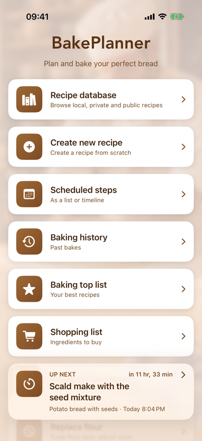
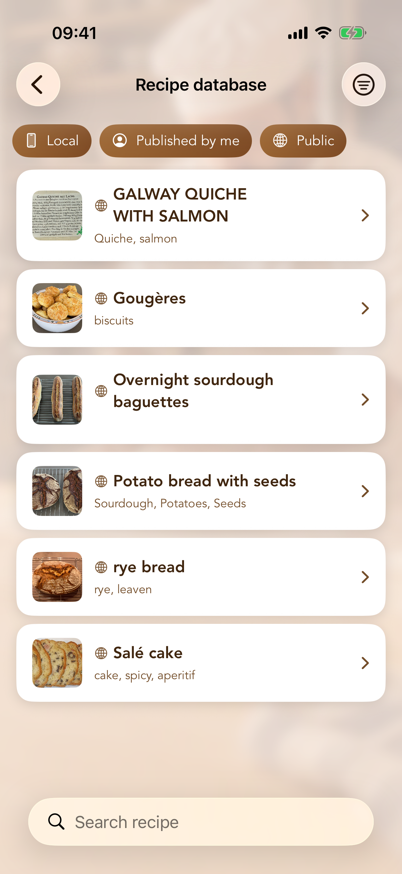
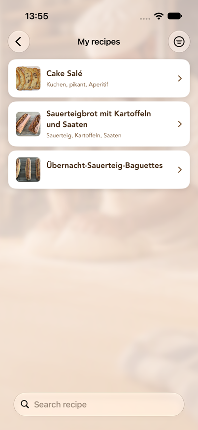
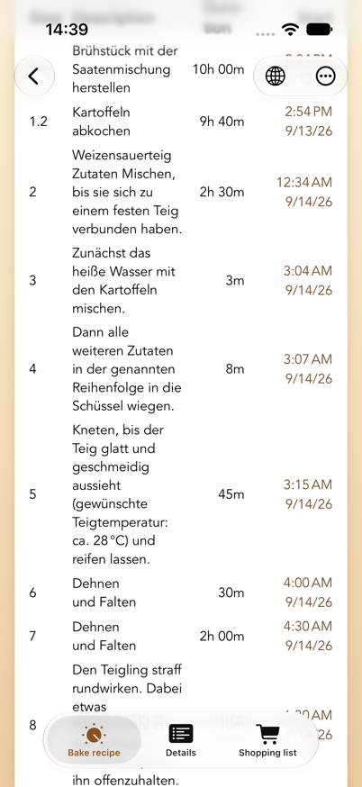
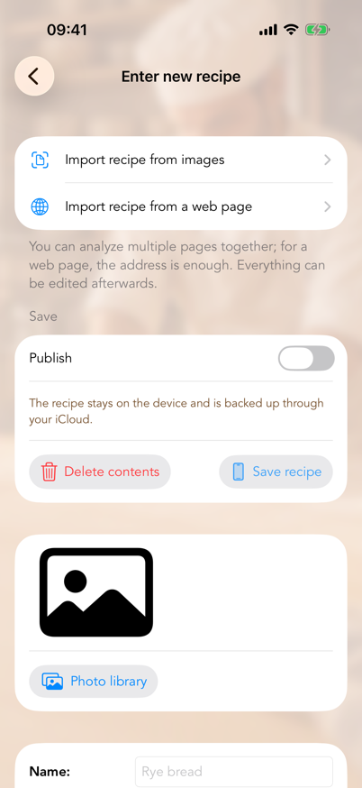
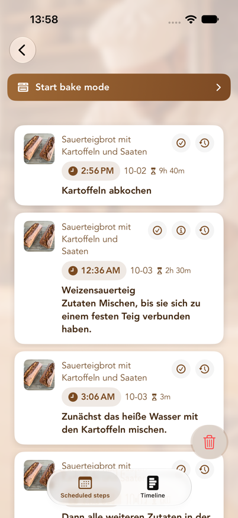
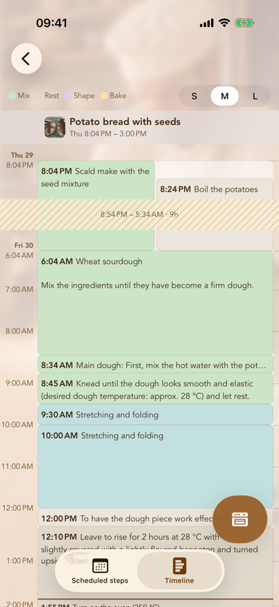

# BakePlanner – User Manual

Revised: 29 October 2026 · App version 2.1

> Translated from the German original, `Benutzerhandbuch.md`. Where the two
> differ, the German version is authoritative.

---

## Contents

1. [What BakePlanner does](#1-what-bakeplanner-does)
2. [System requirements](#2-system-requirements)
3. [Key concepts](#3-key-concepts)
4. [The main menu](#4-the-main-menu)
5. [Recipe database](#5-recipe-database)
6. [My recipes](#6-my-recipes)
7. [Baking instructions and reminders](#7-baking-instructions-and-reminders)
8. [Creating a new recipe](#8-creating-a-new-recipe)
9. [Editing a recipe](#9-editing-a-recipe)
10. [Scheduled steps (list and timeline)](#10-scheduled-steps-list-and-timeline)
11. [Reminders on the Lock Screen](#11-reminders-on-the-lock-screen)
12. [Baking history](#12-baking-history)
13. [Shopping list](#13-shopping-list)
14. [Settings](#14-settings)
15. [Units, amounts, and serving sizes](#15-units-amounts-and-serving-sizes)
16. [Privacy, moderation, and terms of use](#16-privacy-moderation-and-terms-of-use)
17. [Frequently asked questions and troubleshooting](#17-frequently-asked-questions-and-troubleshooting)
18. [Known limitations](#18-known-limitations)

---

## 1. What BakePlanner does

BakePlanner is a baking scheduler for bread, rolls, and pastry. What sets it apart from a plain recipe collection is that **it works out the timing for you**:

- A recipe isn't just a list of ingredients; it's a series of **processing steps with durations**.
- From those durations the app calculates the **start time of every single step**.
- You can plan backwards: "the bread should be ready at 6:00 p.m." — and the app tells you when to start the sourdough.
- Every step gets a **local reminder**, including the automatically inserted steps "turn on the oven" and "baking is finished".

On top of that: a shared public recipe database, your own recipes on the device, ingredient import from photos and web pages, shopping lists sorted by shelf, a baking history with photos and measurements, a starter diary for sourdoughs refreshed on a schedule, three baker's calculators (dough temperature, replace flour, starter TA), on-device translation of public recipes with a glossary of baker's terms, and Siri commands for the next step and starter feedings (see [chapter 11](#11-reminders-on-the-lock-screen)).

### Quick start: your first baking plan in five steps

1. Open **Recipe database** and pick a recipe — or create one of your own under **Create new recipe**.
2. In the recipe, open the **Bake** or **Bake recipe** tab.
3. Choose **Start from** or **Done by** and set the date and time.
4. Check the calculated start times and tap **Set reminders**.
5. Open **Scheduled steps** to review every appointment as a list or a timeline.

Reminders require BakePlanner to be allowed to send notifications. The full explanations are in [chapter 7](#7-baking-instructions-and-reminders), [chapter 10](#10-scheduled-steps-list-and-timeline), and [chapter 17](#17-frequently-asked-questions-and-troubleshooting).

---

## 2. System requirements

| Item | Value |
|------|-------|
| Devices | iPhone (including iPhone Duo, folded and unfolded) and iPad |
| Operating system | iOS/iPadOS 26.0 or later |
| Orientation | iPhone: portrait and landscape · iPad: all orientations |
| Languages | German, English, French (switchable in Settings) |
| Appearance | Light and dark mode, Dynamic Type |
| Internet | Needed for the public recipe database and iCloud sync. Your own recipes, planning, and reminders work entirely offline; changes sync later. |
| iCloud | Your own recipes, scheduled steps, shopping lists, and baking histories sync through iCloud across all devices using the same Apple Account, provided iCloud is on. The reminders themselves are local to each device. |
| Permissions | Notifications (for reminders), photo library and camera (for recipe images) |
| Sign-in | **Not** required for baking, for your own recipes, or for the public database. Signing in with Apple is voluntary: with it, the authorship of your published recipes applies on all your devices (see [chapter 14](#14-settings)). |

The app asks for notification permission on first launch. Without it, baking steps are still calculated and listed under "Scheduled steps", but **no reminders appear**.

---

## 3. Key concepts

These six terms turn up throughout the app:

**Recipe**
The top-level unit: name, description, image, rating, tags, an optional link to the source, total weight, and working time.

**Component**
A sub-preparation within a recipe — "sourdough", "preferment", "main dough", "scald", for instance. Each component has a number (its sort order) and its own ingredient list. This is the heart of the data model: BakePlanner is built for multi-stage doughs.

**Ingredient**
Always belongs to a component. Consists of a number, an amount, a unit, a name, and optionally a fraction (numerator/denominator, labelled **Z / N** in the app).

**Processing step**
A work instruction with a step number and a duration. The duration is stored in minutes; you can enter it in hours and minutes as well ("1:30", "1h 30", "1.5 h"), see [chapter 8](#8-creating-a-new-recipe). The step number is a decimal and carries a special meaning:

- **Whole numbers (1, 2, 3 …) are main steps.** They run one after another.
- **Decimals (2.1, 2.2, 2.3) are parallel steps within a main step.** They run at the same time, and only the *longest* duration in the group counts towards the total. Steps that make a component (sourdough, pre-dough, soaker …) start 5 minutes apart, in the order of their step numbers: nobody weighs out four pre-doughs in the same minute, and the reminders arrive staggered accordingly. All other parallel steps finish together with their group.

Example: if you start a sourdough (12 h) and a scald (2 h) at the same time, give them steps 1.1 and 1.2. The next main step, 2, begins after a little over 12 hours — not after 14.

**Serving size**
A scaling factor for every amount: 0.5 / 1.0 / 1.5 / 2.0. **1.0 is the recipe exactly as stored.** 2.0 doubles every amount and the displayed total weight. Instead of a factor you can enter a **dough weight** in grams. The choice applies to every tab of the open recipe: Details, Bake and Shopping list all use the same factor (see [chapter 15](#15-units-amounts-and-serving-sizes)).

**Storage**
Where a recipe lives. There are two options, and the **Publish** switch when saving decides who can see it:

| Storage | Who sees it? | Where does it live? | Editable? |
|---------|--------------|---------------------|-----------|
| **On this device only** (switch off) | only you | on the device, backed up through your iCloud | yes, any time |
| **Public for everyone** (switch on) | every user of the app | in the recipe database | yes, by you as its author |

A recipe you're **not allowed to publish** — out of a book, say — stays on the device. Through iCloud it's still on all your devices, and the backup (see [chapter 14](#14-settings)) exports it as a file.

---

## 4. The main menu

After launch the main menu appears with nine cards:

*The main menu is the starting point for recipes, planning, history, and settings.*

| Card | Purpose |
|------|---------|
| **Recipe database** | Every recipe in one list: your own on the device, the ones you published and the public ones of all users — with the filter chips **Local / Published by me / Public** |
| **Create new recipe** | Build a recipe from scratch or import one from photos or a web page |
| **Scheduled steps** | Every scheduled baking step as a list or a timeline |
| **Baking history** | Past bakes with comments and photos — as a list, gallery, top list or photo cloud |
| **Shopping list** | All the shopping lists you've created |
| **Dough temperature** | Calculator: the water temperature for a desired dough temperature |
| **Replace flour** | Calculator: swap the flour type, adjust the water |
| **Starter TA** | Calculator: use a starter of a different dough yield, adjust the water |
| **Settings** | Language, defaults, baking plan, backup, account |

**The "Up next" bar.** As soon as a baking plan is running, a bar floats over the bottom edge of the screen with the step that is coming up: the step text, the recipe name, the time, and a countdown in minutes ("in 42 min"). The menu cards scroll underneath it, so the bar stays in view. When a step's time has come, it switches to **"Due now"** with the elapsed time ("5 min ago") for an hour — until you mark the step as done in the notification or the next step falls due. Tapping the bar opens "Scheduled steps". With no step ahead it stays hidden and the menu looks as pictured above.

The back arrow at the top left returns you to the main menu from anywhere.

---

## 5. Recipe database

Since version 2.0 the recipe database is **one list for every recipe**: the public ones you or other users have shared, and your own recipes on the device (see [chapter 6](#6-my-recipes)). Sorted alphabetically, with three filter chips below the search field — **Local**, **Published by me**, **Public** — that can be switched on and off individually and keep their state.

A symbol before each name shows the source: an iPhone for recipes on the device, a person symbol for the ones you published, and a globe for the public recipes of other users. Switch **Public** off and, next to your local recipes, what remains is the list of what you published yourself.

*In the recipe database you can search for and open public recipes.*

### Searching and filtering

- **Search field** at the top: searches recipe names.
- **Switch the search scope**: below the search field you can choose between **Name** and **Tags**. With "Tags", the search runs over keywords ("rye", "wholemeal", "sourdough", for example).
- **Filter chips** below the search field: **Local** (recipes on the device), **Published by me** (your own recipes in the database) and **Public** (the recipes of other users). Each chip switches its source on or off on its own; a public recipe always belongs to exactly one of the two cloud chips.
- **Filter symbol** at the top right: minimum rating (All ratings, 1–5 stars and up). While the filter is active, the symbol is shown filled.
- **Pull down** to refresh the list from the cloud.

"No recipes loaded" means there was no internet connection at launch — pull the list down once. "No matching recipes" means a filter is active.

### Opening a public recipe

A recipe opens on the **Details** tab. Three tabs run along the bottom:

- **Bake recipe** — the baking instructions with the schedule (see [chapter 7](#7-baking-instructions-and-reminders)). The schedule is only worked out once you choose this tab.
- **Details** — an overview of ingredients, components, and steps
- **Shopping list** — put the ingredients on a shopping list

### Translating a recipe

By default, BakePlanner automatically translates public recipes into your app language — **entirely on the device** (Apple Translation) — covering the recipe name, description, tags, component and ingredient names, and step texts. You can turn this off under *Settings → Translation → Automatically translate public recipes* (see [chapter 14](#14-settings)).

- **On (default):** the recipe database already translates the names, descriptions and tags of recipes written in another language in the background, and when you open a recipe the app automatically translates the rest — components, ingredients and steps — if no translation exists yet. If one does, it appears at once. With the app set to German, a German recipe naturally stays as it is. Because the language is already settled this way, the globe symbol doesn't appear in this mode.
- **Off:** a recipe always shows first in the language it was written in. The **globe symbol** appears at the top right instead, letting you choose between Deutsch, English, and Français yourself. A checkmark in the menu shows which language is currently displayed; choose it again to go straight back to the original.

Notes:

- **Units** aren't touched by the recipe translation. The app shows them in its own language anyway (see [chapter 15](#15-units-amounts-and-serving-sizes)).
- The first translation into a language takes a moment (a brief delay for an automatic translation, or a progress indicator replacing the globe for a manual one). After that it's cached and available instantly.
- The first time, iOS may ask whether it may download the language packs for the translation. If you decline, recipes stay in their original language; with automatic translation off, it can be caught up later through the globe symbol.
- **Baker's terms are translated by a glossary.** Words such as Brühstück, Quellstück, Kochstück, Anstellgut, Stockgare or Stückgare — in compounds like Weizenanstellgut or Roggensauerteig as well — don't go through the machine translation but are put in as the target language's own term (scald, soaker, sourdough starter, bulk fermentation …). An older translation that still had such a word wrong is translated afresh when the recipe is opened.
- **The original is never overwritten.** The original is the language the recipe is written in — not the language your app happened to be set to. The app reads that off the recipe text, so a French recipe is kept as a French original even if someone entered it in a German-language app.

### Taking a copy of a recipe

The **Bake recipe** tab has a **Save as my own recipe** button. It puts a complete copy — image, components, ingredients, and steps included — into "My recipes". Only that copy can be edited. If a copy already exists, it stays as it is — your changes and its baking history included. The public recipe never overwrites it, not even when you save or plan it again.

The app confirms with **"Recipe was saved"** and a note that you can edit the copy without changing the public recipe. If saving fails, an error message appears instead — nothing disappears silently.

### Editing a recipe of your own

Recipes that came from *your* account can be changed right in the recipe database: **"…" menu** at the top right → **Edit recipe**. The form matches the one for entering a recipe: image, name, description, link, tags, components with their ingredients, and steps. Components, ingredients, tags and steps can be added and deleted. **Save** writes the changes to the database, **Cancel** discards them; until then the recipe on screen stays as it was.

Note:

- What you edit is always the **original**, in the language the recipe was written in — even if you're looking at a translation right now. Existing translations are discarded and created anew the next time a language is chosen.
- Start times, total duration and total weight are recalculated when saving.
- A new image replaces the old one in the database.
- The version under "My recipes" on the device is unaffected; it remains a recipe of its own.

For recipes by other authors the entry doesn't appear — except for administrators (see below).

### Reporting, blocking, deleting

Through the **"…" menu** at the top right:

- **Report recipe** — you choose a reason (objectionable/offensive, spam, copyright infringement, other). The report goes to the operator for review, and the recipe is hidden **from every user immediately**, not only after the review. It becomes visible again only if an administrator releases it.
- **Block author** — every recipe by that author disappears from your list. This applies **on your device only**; other users still see them.
- **Edit recipe** — appears only for recipes that came from *your* account (see above).
- **Delete my recipe** — likewise only for your own recipes. The recipe is removed from the database for good.

So the two differ in reach: **blocking is local, reporting affects everyone.** Both can be undone under *Settings → Moderation* (see [chapter 14](#14-settings)).

### Administrator function

If you're signed in as an administrator (see [chapter 14](#14-settings)), you can remove any public recipe — intended for moderating reported content. There are three ways to do it: the **Delete recipe (admin)** entry in the recipe's ⋯ menu, the button of the same name at the bottom of the **Details** tab, and in the recipe database a swipe to the left across the row. Each asks for confirmation first; in the list the question names the recipe. The recipe's image is removed from storage along with it. Through **Edit recipe** in the same menu you can also correct a public recipe — a typo, say, or a wrong quantity — without deleting it. An administrator has no access to the recipes other users keep on their devices; they aren't shared, so they aren't a moderation matter either.

**Reported recipes** stay visible in the list for administrators while they're hidden from everyone else. At the bottom of the **Details** tab it then says "This recipe has been reported and is hidden from all other users." If the report is justified, delete the recipe. If it isn't, **Unhide recipe** makes it visible to everyone again at once.

---

## 6. My recipes

My recipes are the recipes on your device: the ones you created, imported, or copied from the database. You find them under **Main menu → Recipe database** with the filter chip **Local** (see [chapter 5](#5-recipe-database)); switch the chips **Published by me** and **Public** off and the list is your own recipes alone.

Where only your own recipes come into question — the empty screens of the shopping list and the baking history — **Open my recipes** opens a list of just those. While it is empty, it offers the two ways to a first recipe right there: **Open the recipe database** and **Create new recipe**.

### Searching and filtering

- **Search field** with a **Name / Tags** switch.
- **Filter symbol** at the top right: pick a minimum rating (All ratings, 1–5 stars and up). While a filter is active, the symbol is shown filled.

The search ignores capitalisation and matches partial words: "rye" finds "Rye bread", and for tags a fragment of the keyword is enough. Search and rating filters can be combined.

### Deleting a recipe

Swipe the row left → **Delete**. A confirmation follows, naming the recipe, so that an accidental swipe can't destroy one. Deleting a recipe also deletes its components, ingredients, processing steps, and baking-history entries.

Steps already scheduled for that recipe do stay in "Scheduled steps", though — delete them separately there if you no longer need them.

### The tabs of your own recipe

| Tab | Contents |
|-----|----------|
| **Bake** | Baking instructions with the schedule and "Set reminders" |
| **Details** | Rating, description, total ingredients, components, step overview, **Share recipe** as PDF, **Export recipe** as a file; flour and starter lines can be tapped (see [chapter 15](#15-units-amounts-and-serving-sizes)) |
| **Edit** | Edit the recipe (see [chapter 9](#9-editing-a-recipe)) |
| **Shopping list** | Put this recipe's ingredients — at the chosen serving size — on a shopping list (see [chapter 13](#13-shopping-list)) |
| **+ History** | Record a bake with date, comment, photos and measurements (room and dough temperature, proofing, flour, crumb) |
| **Feeding** | Only for starter recipes: the starter diary (see [chapter 9](#9-editing-a-recipe)) |

Serving size and dough weight are the same in every tab: what you set under Details also applies under Bake and to the shopping list.

A recipe opens on the **Details** tab. The schedule in the **Bake** tab is only worked out once you choose it; only **Plan again** in Scheduled steps takes you straight there.

In the **Details** tab you can tap the recipe image to see it full size.

---

## 7. Baking instructions and reminders

This is the heart of the app. The layout is the same for your own and for public recipes.

*The baking view puts each processing step's duration next to its calculated start.*

### From top to bottom

1. **Image and name** — tap the image to enlarge it.
2. **Serving size** (0.5 / 1.0 / 1.5 / 2.0) or **dough weight**, the **weight in grams** calculated from it, — if one is stored — the **Recipe link**, and **Share recipe**: the latter produces a PDF with the picture, the components and their ingredients, the total ingredients and the processing steps at the serving size currently chosen, and offers it in the share sheet — Messages, Mail, printing or "Save to Files". The same exists for your own recipes on the "Details" tab. Below it stands **"Dough yield 172 · hydration 72 %"**, the dough yield and hydration over all components; a tap opens the breakdown (see [chapter 15](#15-units-amounts-and-serving-sizes)).
3. **Total ingredients** — every ingredient across all components, added up. This list is meant for shopping and weighing. Water is deliberately left out, as are ingredients that are themselves an intermediate product of a component ("sourdough" as an ingredient of the main dough, say) — otherwise amounts would be counted twice.
4. **Components** — sorted by number, each with its ingredients at the chosen serving size.
5. **Last time** (your own recipes only, once the recipe has been baked) — how the last bake of this recipe went: room and dough temperature, the actual bulk and final proof, flour, crumb/oven spring and the comment from the baking history, with its date. **Add details** opens the entry; if nothing has been noted yet, the card asks and offers **Note it now**. Only a bake that has already happened counts — the entry created when reminders are set lies in the future until the bake ends.
6. **Control bar** — see below.
7. **Processing steps** — a table of step, description, duration, and calculated **Start**. The last row reads "Done", with the finishing time.
8. **Previous bakes** (your own recipes only) — every baking-history entry, newest first, each with its date, the measurements in one line and the comment; an entry still ahead is marked "planned".
9. **Set reminders**.

### The control bar

| Element | Function |
|---------|----------|
| **Change duration** | A switch. When active, a "Duration" field appears for each step. |
| **Start from / Done by** | Decides how the date below is interpreted. Abbreviated on iPhone in portrait. |
| **Date and time** | The reference point for the plan, selectable from today up to one year ahead. |

**Start from** means: I'm starting at this moment — when will I be done?
**Done by** means: I want to be finished at this moment — when do I have to start? The "Start" column then counts backwards.

Change the time and watch the "Start" column adjust immediately. Nothing is saved yet.

### Adjusting durations

1. Turn on **Change duration**.
2. Enter new durations in the fields in the right-hand column — in minutes ("90") or in hours and minutes ("1:30", "1h 30", "1.5 h", "14 hours"). Empty fields and values of 0 or less are ignored, and the previous value stays.
3. Tap **Apply duration**.

The app then recalculates every start time and the total working time. For your own recipes the new durations are saved permanently; for public recipes they apply only to the current plan.

### What the app objects to in a plan

Notes appear above the step table as soon as the time you've set produces an impractical plan. They refresh with every change to date, time, or durations — before you tap "Set reminders".

| Sign | Meaning |
|------|---------|
| ⚠️ orange | **A note.** The plan works, but you should know about it. |
| ⛔️ red | **An error.** More bakes would run at the same time than you have ovens. When you set the reminders the app then asks; **Plan anyway** sets the plan regardless — when several doughs fit into the oven together at the same temperature, say. |

Three things are checked:

- **Steps outside your day.** If a step falls before **Start of day** or after **End of day** from Settings, it gets named: "'Stretch and fold' starts on 11/09/26 at 3:07 a.m., which is before the start of day (6:00 a.m.)." With long fermentations that's normal and no cause for concern — it just shows you what you'd have to get up for.
- **Overlapping baking times.** Each oven takes one bake at a time. With one oven (the default), any overlap with another planned recipe is an error: two loaves don't fit in at two different temperatures. If you've entered several **Ovens** in Settings, that many bakes may run in parallel. An overlap that still fits into a free oven is then only reported as a note ("… and therefore needs another oven"); only the bake for which no oven is left is an error.
- **Too short a baking pause.** If less time than the configured **Baking pause** falls between two bakes in the same oven, you get a note. The oven needs that time to change temperature. With several ovens the note is dropped as long as another oven is free during that time — the loaf simply goes into the cold one.

The notes don't prevent anything — you can still set the plan. They only spare you the surprise at three in the morning.

**Suggestions to keep out of the night.** If a step begins before the start of day or after the end of day, the app looks for the nearest earlier and the nearest later time at which every step falls inside your day, and shows them below the notes, for example:

> **Done by Sat, 10 Oct, 1:45 PM**
> 1 hr, 45 min later · Starts Fri, 9 Oct, 6:05 PM · done Sat, 10 Oct, 1:45 PM

**Apply** sets the date and time above accordingly; the recipe stays as it is. The search goes in quarter-hour steps up to a day earlier or later, never before now, and never so that the bake would need more ovens than you have. If there is no such time — say, because the dough takes longer than your day — the app tells you so.

### Setting reminders

Tapping **Set reminders** does several things at once:

1. A local reminder is set for **every processing step** at its calculated start time.
2. The step **"turn on the oven"** is inserted automatically — the configured **Preheat time** before the **baking step** (15 minutes by default, adjustable in Settings). The baking step is the one that describes the bake, not necessarily the last one: if "let it cool" follows, the oven is still preheated before the bake.
   - If the recipe names an **oven temperature**, it is added, for example "Turn on the oven (250 °C)". With "bake at 250 °C falling to 220 °C" it is the first one. The temperature may also stand in the step before ("load the bread, oven at 250 °C").
   - If the recipe already has **its own preheating step**, no second one is added. The recipe's own step then serves as the preheating reminder and gets the temperature appended if it doesn't name one yet.
   - If the bake starts in a **cold oven** ("place in the cold oven"), there is no preheat time.
   - If the baking step names a **falling temperature** ("load at 250 °C, after 10 minutes reduce to 220 °C"), the app additionally inserts **"Turn the oven down to 220 °C"** — at the minute named in the sentence with the lower temperature; "immediately" means at the start of the bake, and without any minute it is ten minutes in. If the step mentions steam, it reads "…, release the steam"; not with "without steam". If the recipe has a **step of its own for releasing the steam** ("Release the steam" 20 minutes after loading), the oven is turned down as the loaf goes in and the inserted step names no steam — the recipe itself says when the steam goes. A convection figure given alongside ("230 °C top/bottom heat, fan 210 °C") does not count as a drop.
3. **"Baking is finished"** is likewise scheduled for the finishing time.
4. Every step lands in **Scheduled steps**.
5. For your own recipes a **baking-history entry** is created with the end date and the placeholder comment "no comment recorded", which you can fill in later.

A confirmation then appears, for example:

> **Reminders were set**
> 12 reminders set.
> Turn on the oven at 4:45 p.m. (250 °C).
> Done at 6:10 p.m.

The texts "turn on the oven", "turn the oven down" and "baking is finished" appear in whichever language is currently active (for public recipes, in the language you're viewing the recipe in).

> **One recipe, one plan — or several.** Tap "Set reminders" while a plan for this recipe is already running and the app asks: **Replace existing plan** discards the old steps together with their reminders and puts the new plan in their place — the way to go when you want to move the bread to another day. **Add as a second plan** keeps the existing plan and sets the new one beside it, for Saturday and Sunday, say. In "Scheduled steps" each plan then gets its own filter chip with its start time, and "Reschedule" and "Delete" only ever act on the selected plan.

> **For Apple Watch: set the reminders on the iPhone.** Reminders are created on the device where you tap "Set reminders", and they stay there. Only an iPhone passes its notifications on to a paired Apple Watch — an iPad isn't paired with the watch and can't do it. So if you plan on the iPad, the baking reminders appear on the iPad alone, even if you're wearing an Apple Watch.
>
> A plan that has already been set can't be moved to another device afterwards — in that case simply set the reminders again on the iPhone. The recipe itself is on both devices through iCloud anyway.

---

## 8. Creating a new recipe

Through **Main menu → Create new recipe**. The form is laid out from top to bottom.

*In the recipe form you can import a recipe from images or from a web page, or enter everything by hand.*

### Importing a recipe from images

Right at the top: **Import recipe from images**. It reads in a printed or photographed recipe.

1. **Select images** (up to 10 pages; the order you pick them in is kept) or **Take photo** for a new shot.
2. The chosen pages appear as a list, "Selected pages"; individual ones can be removed with the bin symbol.
3. **"Analyse … image(s)"** starts the text recognition. It runs on the device, shows "Reading image x of y …", and can be cancelled at any time.
4. The app then shows a **summary**: the recognised name, the number of components, ingredients, and steps, plus the recognised components with their ingredients and the recognised schedule.
5. **Check data in the recipe form** transfers everything into the normal recipe form. **Select different images** starts over.

The app reads the images with every source type it knows and keeps the result that fits what's on the page. Straight, legible photos give the best results.

#### Choosing the name yourself

Which line is the heading isn't always visible from a page: a logo, a printed header, and a column heading all look like a title. If the recognised name is wrong, **tap the "Name" row in the summary**. The page then appears exactly as you photographed it, with a frame around every recognised line:

- **Tap** to choose a line as the recipe name.
- **Pinch out with two fingers** to magnify the page up to six times, in case the lines are close together.
- For multi-page recipes, a bar at the top switches between **pages**.
- If the name isn't on the page at all, type it into the **Recipe name** field below.

**Mind the crop.** Cut away everything that isn't part of the recipe: logos, headers and footers, page numbers, web addresses, and stray text from neighbouring articles. That saves you the corrections in the first place. **Handwritten recipes** can't be read reliably by text recognition.

Afterwards be sure to check **amounts, units, temperatures, and times** — nothing is saved until you choose "Save recipe" in the form.

#### Analysis mode: protected cloud AI or on this device only

Above the image selection you choose how the pages are evaluated:

- **Protected cloud AI** — the images are sent in encrypted form through the BackPlaner server to Google Vertex AI (Gemini) and structured there. That usually gives the most complete results, including components such as pre-dough and sourdough. Before the first use the app explains the data transfer and asks for your consent; you can withdraw it under Settings › Privacy & AI.
- **On this device only** — nothing leaves the device. Depending on availability the app uses Apple Intelligence or the on-device text recognition; recognition may be less accurate.

The app remembers the choice for both import routes.

### Importing a recipe from a web page

Below that: **Import recipe from a web page**. It reads a recipe straight from a recipe page on the internet, a baking blog for instance.

1. **Paste the address**: copy the address of the recipe page in Safari and paste it with the paste button next to the field, or type it in. "https://" may be left out; the app adds it.

   **It's quicker straight from Safari:** on the recipe page tap **Share** and choose **BakePlanner**. A small sheet shows the page; **Import** switches to BakePlanner, where the address is already filled in and the analysis starts on its own. That works from any browser and from any app that shares a web address. If BakePlanner doesn't appear in the row of apps, tap **More** and switch BakePlanner on there.
2. Choose the **Analysis mode** as for the image import. With "On this device only" the page text isn't transmitted; without Apple Intelligence the app then takes only the structured recipe data the page itself provides.
3. **Load and analyze page** loads the page on the device, reads out the recipe data and the visible text, and hands them to the chosen analysis. The page's recipe photo comes along.
4. Then the same **summary** appears as for the image import; instead of the recognised source type it shows the source (the web address). **Load a different page** starts over.
5. **Check data in the recipe form** transfers everything into the recipe form. The page's address goes into the recipe's "URL link" field automatically.

**What works well:** most recipe pages and baking blogs provide structured recipe data; then ingredients and steps are almost always right. The cloud AI also separates pre-dough, sourdough, and main dough into components of their own.

**Step numbers:** components that go into the main dough (sourdough, pre-doughs, soakers, and scalds) are each combined by the import into one parallel step 1.1, 1.2, 1.3 … covering mixing and maturing. The main dough's steps follow as 2, 3, 4 …. That way a recipe with four overnight pre-doughs takes twelve hours, not two days. The pre-doughs are started five minutes apart in the plan; the earlier ones get correspondingly more duration so that all are ready together for the main dough. Steps without a recognised duration get one minute.

**What doesn't work:** pages behind a login, a paywall, or nothing but a cookie notice deliver no readable text, and some sites block retrieval by apps. BakePlanner then reports "Unable to import" with the reason. In such cases the image import of a screenshot of the page helps.

> **Copyright:** for your own use you may import any recipe. That's why the "Publish" switch starts out off. Only publish other people's recipes with the author's permission.

### Storage: on the device or published

The **Save** section holds the **Publish** switch (see also the overview in [chapter 3](#3-key-concepts)). A sentence below it explains what the current position means. The default comes from Settings (*Publish new recipes*).

- **Switch off** — the recipe stays on the device, is backed up through your iCloud, and can be changed at any time.
- **Switch on** — the recipe becomes visible to every user. First comes the question **"Publish recipe?"**, with the note that as its author you can edit or delete it later in the recipe database. The first time round you also have to accept the terms of use (see [chapter 16](#16-privacy-moderation-and-terms-of-use)).

When importing from images or a web page, the switch always starts out off. The symbol on the "Save recipe" button changes along with its position.

### Recipe image

**Photo library** or **camera** (the camera button only on devices that have one).

> **An image is mandatory.** Without a recipe image, saving produces the message "Image required".

### Master data and tags

- **Name** — required. As long as it's empty, "Save recipe" stays disabled.
- **Description** — a multi-line text field.
- **URL link** — an optional link to the source; appears later as "Recipe link".
- **Tags** — type a keyword, tap **+**. Tags are searchable later.

### Components and ingredients

The component first, then its ingredients:

1. Enter the component's number and name (`1` / `Sourdough`, for example) and tap **+**. The number counts up automatically.
2. Below each component the ingredient entry row appears, with these columns:

| Column | Meaning |
|--------|---------|
| **No.** | Sort order within the component |
| **Amount / Weight** | The numeric value of the amount; an empty field means 0 |
| **Unit** | A menu; see [chapter 15](#15-units-amounts-and-serving-sizes) |
| **Ingredient** | The ingredient's name |
| **Z / N** | The fraction — numerator and denominator, 1 / 2 for "½" |

3. **+** adds the ingredient, the bin symbol removes it again. Rows already entered are directly editable.

Only the **name** is mandatory — an ingredient without an amount and unit is allowed ("salt to taste"). Use either amount/weight **or** the fraction fields, not both for the same figure.

### Processing steps

Columns **Step**, **Description**, **Duration**. Enter the duration in minutes ("90") or in hours and minutes: "1:30", "1h 30", "1 h 30 min", "1.5 h", "14 hours" — a number without a unit is minutes, a decimal without a unit is hours. Minutes are what gets stored; once you leave the field it reads "1 h 30 min". After you add one, the step number continues automatically: from a whole number to the next whole number, from a decimal in steps of 0.1. That makes it easy to enter parallel sub-steps as 2.1, 2.2, 2.3.

Remember the rule from [chapter 3](#3-key-concepts): decimal steps run in parallel, whole numbers one after another.

**Stretch and fold during a rest.** If a step describes several folds during a rest — "rest for 3 hours, stretch and fold after 30 and 60 minutes", "store for 8–12 hours at 9 °C and stretch and fold in the first 30 and 60 minutes", or "fold every 30 minutes, 4x" — the app creates one step per fold when you save: 3.1 "Stretch and fold the dough (after 30 minutes)", 3.2 "… (after 60 minutes)" and so on, each with its own reminder. The rest step itself keeps its full duration; the fold steps carry what remains of the rest from their point on. The same happens on import from photos and web pages and when you edit a step (see [chapter 9](#9-editing-a-recipe)). If the fold instruction stands in a step of its own after the rest, it is assigned to the rest mentioned last and expanded there.

### Saving

- **Save recipe** — saves locally or uploads to the database. During an upload, "Recipe is uploading ..." appears; then either "Recipe was saved" or a specific error message.
- **Delete contents** — clears the whole form (without asking).

---

## 9. Editing a recipe

Reachable through **My recipes → recipe → "Edit" tab**.

### Automatic saving

Changes to **name, description, URL link, tags, and rating** are saved automatically — shortly after you type and at the latest when you leave the screen. There's no confirmation message for it.

A new **recipe image** is saved the moment you choose it.

### Rating

Tap the stars at the top right: 1 to 5 stars. Tapping the first star again resets the rating to 0. The rating is what the rating filter in the lists works on.

### Refresh regularly

For recipes you bake or set up at fixed intervals — the starter above all — there is the switch **Refresh regularly** (**Plan regularly** for breads) with an interval in days (1 to 60). When it is on, the app **plans the next date automatically after the last bake**: as soon as the last bake is finished, the next refresh appears with its reminders under "Scheduled steps". The rhythm hangs on the **start of the first step**: feed your starter at 8:00 today and, at "every 1 day", you feed it at 8:00 again tomorrow — however long the recipe takes, and across a daylight-saving change. The interval always counts from the actual last bake; an earlier or later feeding moves the next date accordingly.

So that a date two weeks away doesn't clutter the lists, "Scheduled steps", the timeline, the "Up next" card, the widget, the Live Activity and Bake Mode hold automatically planned steps back **until two days before they are due**. The reminders themselves still come on time. Steps you planned by hand are not affected.

When the next refresh is due, the **Details** and **Edit** tabs show at the top as the line **"Next feeding: Tomorrow 08:00"** ("Next bake: …" for breads) — meaning the start of the first step. While a plan is still running, the line already shows the date after it; before the first bake it reads "after the first bake".

**What makes a recipe a starter** is decided by its ingredients, not by the switch: they give a feeding ratio of starter (or sourdough, levain — the names are equivalent), flour and water, and nothing is baked. A recipe of nothing but those three is always a starter, even when a step mentions the oven ("let ripen in the switched-off oven with the light on", "keep cool until the next bake"). Only an oven temperature or a preheating step — or further ingredients such as salt — make it a bread. A tag such as "Starter", "Feeding" or "Refresh" settles it by hand when in doubt; a "Sourdough" tag is not enough, breads carry it too.

Starter recipes get the extra tab **Feeding**: the **starter diary**. At the top stands the feeding ratio "starter : flour : water", calculated from the recipe's ingredients and therefore not editable by hand. Below it you record, for every feeding, the **time to peak** in minutes, optionally the **float test**, and a note on smell and consistency. The previous feedings are listed underneath, newest first — so you can see whether your starter is getting faster or slower.

### Changing components

- **Adding**: enter a number and name, **+**.
- **Editing**: tap the component's row. "Edit component" opens with the number, the name, and the full ingredient list. There you can add ingredients (**+**), delete them (bin), and edit one by tapping it in the "Edit ingredient" dialogue. **Done** applies, **Cancel** discards.
- **Deleting**: the bin next to the component. The recipe's total weight is recalculated afterwards.

### Changing processing steps

- **Adding**: enter step, description, duration, **+**. The duration as when creating, in minutes or hours ("1:30", "1.5 h"). Start times are recalculated automatically.
- **Editing**: tap the step's row → "Edit processing step". After **Done** the app recalculates every start time and the working time. If the step describes folds during a rest ("stretch and fold after 30 and 60 minutes"), the fold steps from [chapter 8](#8-creating-a-new-recipe) are created at that point — for an older recipe too, once you open the step and confirm it with **Done**.
- **Deleting**: the bin next to the row.

### Saving manually

The **Save** section holds two buttons. You'll also find them at the top right of the navigation bar, in the menu behind the save symbol.

- **Local** — saves everything including the image, recalculates the total weight, and confirms with "Recipe was saved".
- **Public** — uploads a copy of the recipe so it's visible to every user. The "Publish recipe?" question appears here too.
- **Delete** (top left) — clears the recipe's contents.

After a successful upload, **"Public" is disabled**, because the recipe now has a copy in the database — a recipe is published only once; afterwards you make changes in the recipe database (see [chapter 5](#5-recipe-database)).

If that copy is later deleted (by you or by moderation), the app notices the next time you open the recipe and releases the button again.

---

## 10. Scheduled steps (list and timeline)

**Main menu → Scheduled steps.** This is every baking step from every recipe you've set reminders for — in chronological order, across recipes. You switch between two views at the bottom; the timeline opens first. Automatically planned refreshes (see [chapter 9](#9-editing-a-recipe)) only appear two days before their date.

*In its empty state, the list view also shows where new plans are created.*

### The "Scheduled steps" view (list)

Every step is a card with the recipe image, recipe name, start time, date, duration, and instruction. Tapping one opens the detail view with the recipe, the start, the step number, the duration, and the full description.

**Looking up a component's ingredients** — through the **i symbol** on the card. It only appears on steps that mix one of the recipe's components, such as "Make preferment A" or "Make the final dough". Tapping it opens the ingredients of exactly that component with their amounts, so you can weigh out straight from the plan without opening the recipe. The amounts are at the serving size or dough weight you set the plan with – at ×2 twice the amounts, exactly as in the reminders.

The app recognises such a mixing step by the name of a recipe component occurring in the step text. Steps from the image import know which component they belong to anyway. A step like "Fold the dough" with no component name gets no i symbol.

**Rescheduling a step** — through the clock symbol on the card. The sheet shows the recipe, the step and its current time ("Currently") at the top and, once you have entered minutes, the new one ("New"):

1. Enter minutes (1440 at most, that is 24 hours).
2. Choose a direction: **Earlier** or **Later**.
3. Choose the **affected steps**: **This step only** or **All following steps** (every later step of the same plan moves by the same amount, including "Baking is finished" and steps that begin at the same minute but come after it in the order). A note under the choice spells out what it does.
4. **Apply**.

The matching reminders move along automatically. If the new time would be in the past, the app refuses with "Unable to reschedule".

**Ticking a step off as done** — through the **checkmark symbol** on the card, or by swiping the row to the **right** and tapping "Done". The step leaves the plan, its reminder is removed with it, and the "Up next" card in the main menu and the widget move on to the next step. It is the same action as "Done" in the notification, just right in the list.

**Deleting:**

- **A single step**: swipe the row left. Its reminder is removed with it.
- **All steps**: the bin button at the bottom right, then "Delete all". That removes every scheduled step **and** every pending reminder — including those for recipes you no longer want to bake.

### The "Timeline" view

The same steps as a **project plan**: every plan gets a lane of its own with the recipe image and name, every step a bar as long as the step takes. The colour says what is to be done — mixing green, resting and proofing grey, shaping purple, oven blue, baking yellow; a legend sits at the top. The bar carries the time and the instruction. Sub-steps that fall inside another step — the stretch and fold during the bulk rest, "Turn on the oven" during the final proof, the turn-down as the loaf goes in — appear as a marker with their time on their step's bar. A checkered flag marks "Baking is finished", a red line the present moment.

The time axis shows the full hours, with weekday and date where the day changes. Short steps get enough room for their time to stay legible; a long stretch without any step — the night the sourdough ripens in — collapses to a hatched band that names what it skips ("22:45 – 08:35 · 10h"). **S / M / L** at the top right sets the scale.

In portrait, time runs top-down: the axis stands on the left, the plans are columns, and you scroll as in the list. In landscape, time runs left to right with a row per plan, on an iPad just as on an iPhone. Steps that run at the same time — the soaker while the sourdough ripens — share the lane side by side. Tapping a bar or a marker opens the step's detail; a long press shows the step's full text and offers **Mark as done** and **Reschedule**, like the card in the list. With a mouse or trackpad, hovering over a bar is enough to see the whole text.

*The tab at the bottom switches between list and timeline.*

With no steps scheduled, both views read: "No scheduled steps — Set a reminder in a recipe's baking instructions."

### Bake mode

For working in the kitchen there is a **Start bake mode** button: in the list it floats as a bar over the bottom edge, with the bin for "Delete scheduled steps" beside it; in the timeline it is the round oven button at the bottom right. It opens the current step full-screen in large type: the recipe name and "Step 3 of 12" at the top, below that the time with a countdown ("in 42 min") or "5 min ago" once the step is due, then the step text. If the step mixes a component, that component's ingredients and amounts follow right beneath — the same ones as behind the i symbol.

At the bottom sit large buttons that can be hit with flour on your hands:

- **Back** and **Next** page through every step of the plan.
- **Read aloud** speaks the step and, where present, the ingredients through the speaker in the app language you have set. A second tap (**Stop**) cancels. Speech also plays while the device is muted. If you do not want it, switch off *Settings → Baking plan → Speech in bake mode*; the button then disappears.
- **Done** removes the step together with its reminder and jumps to the next one.

Bake mode opens on the step that is up right now and respects the list's recipe filter. While it is open, the screen stays on. **Close** at the top right returns to the list.

### The "Next baking step" widget

You can see the next step without opening the app: BakePlanner comes with a widget for the Home Screen and the Lock Screen. It shows the same information as the "Up next" card in the main menu — the upcoming step with its time and a running countdown ("in 1:42:10"), or, once the time has come, **"Due now"** with the elapsed time. Tapping it opens "Scheduled steps" directly.

- **Small**: step text, day and time, countdown.
- **Medium**: additionally the recipe name.
- **Lock Screen**: as a rectangular widget with step text and countdown, or as a one-line display next to the clock.

To add it: press and hold the Home Screen → **Edit** → **Add Widget** → choose **BakePlanner** → pick a size → **Add Widget**. The widget updates by itself whenever a step starts or falls due, and whenever the plan changes in the app. With no planned steps it reads "No step planned".

The widget uses the device's **system language**, not the app language chosen in Settings.

---

## 11. Reminders on the Lock Screen

Every reminder appears as a notification titled **"Baking reminder"**, with the subtitle "Press and hold for Done or Reschedule" and the step text as its content.

**Ingredients in the reminder.** If the step mixes a component, the ingredients of that component with their amounts follow below the step text — the same ones that sit behind the i symbol in "Scheduled steps":

> **Baking reminder**
> Make preferment A
>
> Ingredients for "Preferment A":
> • 200 g wheat flour 550
> • 200 g water
> • 2 g yeast

The banner shows only the first lines. Press and hold the notification, or expand it in Notification Centre, to see the whole list. The amounts match the serving size that was selected in the baking instructions when the reminders were set.

**Press and hold the notification** to get two actions:

- **Mark as done** — the step is removed from "Scheduled steps".
- **Reschedule by …** — enter the minutes directly in the notification. A follow-up question then appears: **"Should all following steps of this recipe be moved as well?"** with the options **Only this step** and **All following steps**.

Rescheduling is always counted from **now**: "30 minutes" means "30 minutes from now". With "All following steps", every later step of the same recipe moves by the same difference — so a fermentation stays coherent even when you're running late.

Notifications are shown while the app is in the foreground too.

### Live Activity

While a plan is running, BakePlanner also shows the upcoming step as a **Live Activity**: as its own tile on the Lock Screen, and at the top of the display on iPhones with a Dynamic Island. It shows the step text, the recipe name, the time, the step after it ("Then 00:36 · Weizensauerteig …") and a running countdown. When the time has come, the tile switches to **"Due now"** and counts the elapsed time up. A tap opens "Scheduled steps"; on the Dynamic Island a long press expands the view.

The Live Activity appears as soon as a step is less than eight hours away — iOS ends Live Activities after eight hours at the latest, so not earlier. It is updated when you open the app, mark a step as done or reschedule it, and it ends when no step is within reach any more. The first time, iOS asks whether BakePlanner may show Live Activities. Under *Settings → Baking plan → Live Activity on the Lock Screen* it can be switched off altogether.

**Apple Watch.** The baking reminders appear on the watch if you set them on the **iPhone** — the iPhone's notifications are passed on to the paired watch. Reminders set on the iPad stay on the iPad. More on this in [chapter 7](#7-baking-instructions-and-reminders).

### Siri

With dough on your hands you need not touch the device: BakePlanner understands a few phrases through **Siri**, with nothing to set up. Every phrase names the app, which is how Siri knows BakePlanner is meant. The phrases exist in German, English and French; Siri understands the ones in its own language.

| What you say | What happens |
|---|---|
| "Next step in BakePlanner" · "What is up next in BakePlanner" | Siri names the upcoming step with recipe and time, or "due now" when it is time. |
| "Step done in BakePlanner" | Marks the due step as done and names the next one. If the step is not due yet, Siri asks first. |
| "Move the next step in BakePlanner later" · "… up" | Moves the upcoming step a few minutes later or earlier. Siri asks "By how many minutes?"; the following steps move along. |
| "When is oven time in BakePlanner" | Names the planned start of baking with its time. |
| "Fed Rye starter in BakePlanner" · "Fed my starter in BakePlanner" | Records a feeding in the starter diary. Without a name Siri asks which starter is meant; the starter recipes count (see [chapter 9](#9-editing-a-recipe)). |
| "Fed all starters in BakePlanner" | Records a feeding for every starter. One recorded within the last hour is skipped. |
| "When did I last feed Rye starter in BakePlanner" · "Last feeding in BakePlanner" | Names the date and time of the last feeding. |

The same commands are listed in the **Shortcuts** app under BakePlanner and can be built into your own shortcuts there. Everything runs in the background; the app need not be open. Whatever Siri changes shows at once in "Scheduled steps", the widget and the Live Activity.

---

## 12. Baking history

### Baking history

**Main menu → Baking history.** Every bake in four views, switched with the symbols under the title; the choice is remembered. **List**: newest first, with date, recipe name, comment and photos. **Gallery**: tiles with the bake's first photo (or the recipe picture as a stand-in), recipe name, date, rating and comment, two across on an iPhone and more on an iPad. **Top list** and **photo cloud** sum the history up per recipe (see below). Search, tags and the rating filter apply in all four. While there is no bake yet, the empty screen explains where entries come from and leads to your recipes.

- **Tap an entry** (row or tile) → baking notes: edit the comment, fill in **Measurements and result** (see below) and add photos through **Photo library**. Photos can be tapped and browsed full size. **Save** confirms with "History was saved".
- **Delete an entry**: swipe the row left.
- **Searching and filtering**: the search field (Name/Tags) and the rating filter at the top right.

In the list and the gallery an entry's measurements appear in one line under the comment, such as "Room 22 °C · Dough 25 °C · Bulk proof 3h 30m · Final proof 1h 00m · Wheat 550 · open, good oven spring".

### Measurements and result

Free text and stars alone are not enough to do better next time. Every entry therefore has a section **Measurements and result**:

| Field | Content |
|-------|---------|
| **Room temperature**, **Dough temperature** | In °C, with comma or point ("22.5"). Empty means "not measured". |
| **Bulk proof**, **Final proof** | The actual duration in minutes; from 60 minutes on the conversion is shown underneath ("= 3h 30m"). |
| **Flour** | The flour used, as free text ("Wheat 550, spelt 630"). |
| **Crumb / oven spring** | Two or three keywords, separated by commas. Below the field are word chips for **Crumb** (open, dense, moist, dry, even, large pores, gummy) and **Oven spring** (good oven spring, little oven spring, torn, stayed flat); a tap puts the word into the field or takes it out again, and a chosen word carries a checkmark. You can add words of your own. |

The number fields have no Return key; **Done** appears next to the field being edited to close the keyboard.

The baking view shows these details as the **Last time** card when the same recipe is planned next (see [chapter 7](#7-baking-instructions-and-reminders)).

### Recording a bake after the fact

**My recipes → recipe → "+ History" tab.** Choose the baking date (up to 10 years back), write a comment, fill in measurements and result, add photos from the library, **Save**.

An entry is also created automatically when you set reminders in the baking instructions — initially with the placeholder "no comment recorded" and without measurements. After the bake the "Last time" card in the baking view reminds you to complete it.

### Top list and photo cloud

**Baking history → Top list.** Every recipe you've baked at least once, sorted by the number of bakes — your classics at the top; with equal counts, the most recently baked first. Each recipe shows its rank, picture, name, "baked 3× · last 12 Oct 2026", its rating, the newest photos from the baking histories and, large on the right, the count. A tap opens the recipe. The top list used to be a menu entry of its own; it is the same history, grouped by recipe.

**Baking history → Photo cloud.** The same recipes as a round cloud: every recipe is a circle with the photo of its last bake (or the recipe picture) and the count in its corner. The circle's area follows the count — a recipe baked four times as often gets a circle twice as wide. The most baked recipe sits in the middle, the others nestle around it in a spiral. Larger circles carry the name on a dark band inside; the whole cloud is fitted to the screen. A tap opens the recipe.

*The photo cloud: the more often baked, the bigger the circle.*

---

## 13. Shopping list

### Putting ingredients on a list

If there is no list yet, the empty screen under "Shopping list" explains the way and leads straight to the recipes with **Open my recipes**.

**Recipe → "Shopping list" tab** — for your own recipes and for public ones alike.

1. **Serving size.** At the top sits the same serving-size control as under Details and Bake, with the total weight. The ingredients go on the list **at this factor or dough weight**; at ×2, the doubled amounts. The footer names the factor.
2. **New list**: choose a date, **Create**. If a list already exists for that date, the ingredients are added to it.
3. **Existing list**: switch to "Existing list" and tap **+** next to the list you want. To delete one, swipe the row left.

The confirmation reads "Ingredients were added to the shopping list", and at a factor other than 1.0 adds "The amounts correspond to the factor …". A link to **Show shopping lists** appears afterwards.

### The list speaks your language

The ingredient names on the list are **always in the app's language**, even when the recipe is German or French. For public recipes the app uses the translation it already has; otherwise it translates the names on the device when the list is created — "Translating ingredient names …" shows briefly. The glossary of baker's terms applies (see [chapter 5](#5-recipe-database)). If the translation fails, for instance without a language pack and without a connection, the names go on the list in the recipe's language and the confirmation says so. This also lets ingredients from a German and an English recipe merge on one list.

### What makes it onto the list — and what doesn't

The app filters deliberately, in every language:

- **Left out** are **water** (including mixing water, Wasser, eau), **salt** (including sea salt, Salz, sel) and everything you make yourself: **sourdough starter, sourdough, levain, lievito madre, poolish, biga**. What merely sounds like it is bought — rose water, coconut milk, salted butter, dried sourdough or sourdough extract stay on the list.
- **Left out** are ingredients with no unit or no usable amount.
- **Eggs are counted by the piece**, in every language: "120 g eggs" become "2 pcs eggs", rounded up, at ×2 four pieces.
- **Identical ingredients are combined.** Temperature details are stripped from the name in the process: "milk 30 °C" and "milk" count as the same ingredient. Capitalisation and umlauts make no difference.
- **Units are converted** when they share the same base unit: 0.5 kg + 200 g are added together, and so are tablespoons and millilitres. Grams and millilitres stay separate.

### Viewing shopping lists

**Main menu → Shopping list.** Each list shows its date, the recipes it contains, and below them the ingredients with amount and unit — **grouped by shelf**, in the order of a walk through the shop: flour & grains, dairy & eggs, baking supplies, nuts, seeds & dried fruit, fruit & vegetables, spices & herbs, oils, fats & liquids, other. The app reads the shelf off the ingredient's name, so older lists are grouped too.

Tapping an ingredient opens **Change amount**: amount, unit and fraction then apply to this list, the recipe stays unchanged; the ingredient can be removed there as well. The bin symbol next to the row removes it directly. **Delete** removes the whole list after a confirmation.

---

## 14. Settings

**Main menu → Settings.**

*Settings bring together language, defaults, and the parameters for the baking plan. The Privacy & AI, Moderation, and Account sections follow further down.*

### General

| Setting | Description |
|---------|-------------|
| **Language** | System language, German, English, or French. Affects the interface as well as date and time formats. |
| **Publish new recipes** | The default position of the **Publish** switch when creating a recipe. Default: off — new recipes stay on the device. |

### Recipes

| Setting | Description |
|---------|-------------|
| **Default serving size** | The value recipes open with: 0.5 / 1.0 / 1.5 / 2.0. Default: 1.0. |
| **Use detail view** | On: the components and steps of every public recipe are loaded along with the list — recipes open faster, but the first load takes longer and uses more data. Off: details are loaded only when you open a recipe. Default: on. |
| **Show baker's percentages** | Adds each weighed ingredient's share of the component's flour in the component view (see [chapter 15](#15-units-amounts-and-serving-sizes)). Default: off. |
| **Sourdough starter** | Dough yield of your starter, used to split an amount of starter into flour and water when the recipe does not state its TA. 120 to 300 in steps of five. Default: TA 200. |
| **Lievito madre** | The same for lievito madre. Default: TA 150. |
| **My starter TAs** | The dough yields you keep your starters at, separated by commas ("190, 210, 220"). They are offered as quick picks when adjusting the starter TA (see [chapter 15](#15-units-amounts-and-serving-sizes)). Default: 150, 180, 200, 220. |
| **Custom units** | Shows how many you've created and leads to managing them. See [chapter 15](#15-units-amounts-and-serving-sizes). |

### Backup

| Entry | Effect |
|-------|--------|
| **Back up all my recipes** | Writes every recipe on the device, images included, into one file and offers it in the share sheet — for "Save to Files", Mail or AirDrop, say. |
| **Restore from backup** | Reads such a file, or a single exported recipe. Imported recipes arrive as **new** recipes of your own; existing ones are never overwritten. |

A single recipe is exported on the **Details** tab via **Export recipe** (next to "Share recipe"). The file can be handed to someone else, who reads it in through "Restore from backup" — a route outside the recipe database, for recipes out of books, for instance.

### Translation

| Setting | Description |
|---------|-------------|
| **Automatically translate public recipes** | Affects only the recipe database. On: recipes are translated into your app language automatically, and the globe symbol doesn't appear. Off: a recipe first shows the language it was written in, and you choose the language yourself through the globe symbol (see [chapter 5](#5-recipe-database)). Default: on. |

### Baking schedule

| Setting | Description |
|---------|-------------|
| **Preheat time** | 0–120 minutes in steps of 5. Used when setting reminders, to place the automatic "turn on the oven" step before the final step. Default: 15 minutes. |
| **Baking pause** | 0–120 minutes. The minimum gap between two bakes in the same oven. Default: 10 minutes. |
| **Ovens** | 1–6. How many bakes may run at the same time. The plan check reports an error only when more recipes bake at the same time than there are ovens; the baking pause applies per oven. Default: 1. |
| **Start of day** | 0–23. From when you're available in the morning. Default: 6. |
| **End of day** | Between start of day and 23. Default: 23. |
| **Speech in bake mode** | Shows or hides the "Read aloud" button in bake mode. Default: on. |
| **Live Activity on the Lock Screen** | Shows the upcoming step as a Live Activity on the Lock Screen and in the Dynamic Island. Off ends a running one immediately. Default: on. |

> **Note:** Only **Preheat time** actually moves steps. **Baking pause, ovens, start of day, and end of day** don't change the plan — the app checks it against them and warns you in the baking view when a step falls into your night's sleep or more bakes coincide than you have ovens (see [chapter 7](#7-baking-instructions-and-reminders)).

### Privacy & AI

This shows whether the **protected cloud AI** may be used for recipe imports (see [chapter 8](#8-creating-a-new-recipe)).

| Entry | Effect |
|-------|--------|
| **AI analysis for recipe import** | **Allowed** if you've consented to the cloud AI, otherwise **Local only**. Tapping it opens the **AI privacy** page. |
| **Withdraw consent to cloud AI** | Appears only after you've consented. Withdraws the consent and sets the analysis mode to "On this device only". |

The **AI privacy** page explains which data a cloud analysis transmits, to whom, for what purpose, and what of it remains stored (summary in [chapter 16](#16-privacy-moderation-and-terms-of-use)). You can withdraw your consent there too. It is only ever given during an import itself, after the app has explained the transfer. Withdrawal applies to all future analyses; analyses already completed are unaffected.

### Account

This is where you sign in with Apple. Signing in is **voluntary** and serves two purposes:

- **Author identity.** Without signing in, your published recipes belong to the anonymous identifier of this installation — it's lost with the app and differs on a second device. Signed in, they belong to your Apple Account: you can edit and delete them on every device you're signed in on, and after a reinstall.
- **Moderation rights.** If your identifier has been enabled for it, the label **Administrator** appears as well, and public recipes can be deleted — through the ⋯ menu, the Details tab, or a swipe in the recipe database.

**Neither your name nor your email address is requested** — the app only needs the identifier itself. If your use has been anonymous so far, it carries over when you sign in: recipes already published from this device still belong to you afterwards.

| Button | Effect |
|--------|--------|
| **Sign in with Apple** | Creates or connects your account. |
| **Sign out** | Back to anonymous use. The recipes published under the account stay in the database; you can edit them again once you're signed in again. The app confirms with **"You're signed out"**; it does **not** ask you to sign in again to confirm — that belongs to deleting the account alone. |
| **Delete account** | Removes the account for good (see below). |

**Delete account** asks first. Then this happens:

- The sign-in is undone and the account deleted; the app carries on anonymously.
- **Published recipes stay** visible to every user. They no longer belong to any account, so you can't delete them yourself any more — do that beforehand if you don't want to leave them in the database.
- **Recipes on the device stay.** They belong to the device and your iCloud, not to the account.

This can't be undone. If your last sign-in was a while ago, Apple requires you to sign in again for security — the "Sign in again" sheet appears, and the deletion then continues by itself.

For ordinary baking, for your own recipes, and for browsing the public database, **no sign-in is required**.

### Moderation

This is where you take back what you've hidden in the recipe database.

| Entry | Effect |
|-------|--------|
| **Blocked authors** | How many authors you've blocked. |
| **Unblock all authors** | Lifts every block. Those authors' recipes reappear in the list **immediately**. |
| **Recipes you reported** | How many recipes you've reported. |
| **Clear reports on this device** | Removes the hiding your device has remembered. |

**The difference matters:** blocking is purely a device setting, which is why lifting it takes effect at once. A report, on the other hand, hides the recipe from every user — and only an administrator can undo that. So clearing it here only takes effect *after* the recipe has been released; until then it stays invisible, to you as well.

Both lists apply to this device only and aren't synced through iCloud.

### Help

From here you open the **User manual** (this document), the **Help and contact** page with the e-mail address for questions and bug reports, the **Privacy policy** and the **Legal notice** in your browser. All pages appear in the language the app is set to.

---

## 15. Units, amounts, and serving sizes

### Serving size or dough weight

Every recipe screen scales the amounts in two ways:

- **Serving size** — the factor 0.5 / 1.0 / 1.5 / 2.0 as before; 1.0 is the recipe as stored.
- **Dough weight** — next to it sits a field showing the current total weight as a placeholder. Type a target weight in grams, say 2000, and the app scales every ingredient to that dough weight; the serving-size picker then shows no selection. Tapping a factor clears the field again.

Scaled amounts are rounded the way you weigh them: whole grams from 10 g upwards, one decimal below that ("2.7 g yeast"). Fractions such as "1/2 cube" stay fractions at the factors 0.5 to 2.0 ("3/4 cube") and become decimals at a free dough weight ("0.7 cube"). Serving size and dough weight apply to **every tab of the recipe** — Details, Bake and Shopping list —, to the ingredients in the reminders you set afterwards, and to the "Replace flour" and "Adjust starter TA" sheets when you open them from the recipe.

### Baker's percentages

Under *Settings → Recipes → Show baker's percentages* the component view adds each weighed ingredient's share of the component's flour, for instance "319 g water · 62 %". Anything with "Mehl", "Schrot", "Grieß", "Dunst", "flour" or "farine" in its name counts as flour, and so do old bread and breadcrumbs (flour that was baked once, as in a scald) — but not linseed meal, flakes, bran or nut and almond flours. A component without flour shows no percentages; neither do pieces or whole components used as an ingredient ("1 whole scald"). The percentages do not change with the serving size.

### Dough yield and hydration

On the **Details** tab, below the weight, stands the line **"Dough yield 172 · hydration 72 %"**: the dough yield (TA, the German Teigausbeute: flour plus water per 100 g of flour) and the hydration (water per flour) over **all components** of the recipe. A tap opens the breakdown with flour and water in grams, each component's own figure, the starter shares and the ingredients that were not counted.

The baker's convention applies:

- **Flour** is what the baker's percentages count as flour (see above).
- **Poured liquid counts in full**: water, milk, buttermilk, beer, wine, whey, juice and yeast water — even though milk is physically only about 90 % water. That way the figures match what baking books and blogs print. Milk powder and cream of tartar do not count.
- **Sourdough starter is split**: 20 g of starter at TA 200 are 10 g flour and 10 g water; at TA 150 they are 13 g flour and 7 g water. The app reads the TA from the ingredient name when it says "TA 200" or "100 % hydration"; otherwise it takes *Settings → Recipes → Sourdough starter* or *Lievito madre*. Biga (TA 150), poolish (TA 200) and pâte fermentée (TA 165) have their TA by definition. The breakdown says for every starter where its TA came from.
- **Seeds, flakes, fat, eggs, sugar and salt** count neither as flour nor as water. The heavier ones appear in the breakdown under "Not counted", so you can see what the figure leaves out.
- **Each component counts exactly once.** If the main dough lists "gesamter Sauerteig" (the whole sourdough), the sourdough enters through that row, not twice. If it lists "200 g Sauerteig" while the component makes 300 g, two thirds of it count. If the main dough never names the sourdough, the components are simply added up.

The line is absent for recipes without recognised flour. The image import compares the same calculation with the dough yield printed in the book and warns when they differ.

### Replace flour

No wheat flour 1050 in the house, but spelt flour 630? Flours are swapped **1:1 by weight**; what changes is the water, because every flour absorbs differently. Two ways:

- **In the recipe:** on the **Details** tab, flour lines can be tapped (arrow symbol behind them). The **Replace flour** sheet shows the recognised flour, lets you pick the replacement by grain and type, and works it out: the component's water change ("+20 g" or "−20 g"), dough yield and hydration before and after. If the component has no water, the app takes its poured liquid (milk, beer); if it has none, it says so. **Create copy with substitution** writes the swap into a new recipe of your own with today's date in its name ("… – Dinkelmehl 630 (14 Oct 2026)") and opens it; the original stays unchanged. In that copy the button reads **Apply change**: a second flour or a starter adjustment changes the copy itself, the addition in the name is extended ("… – Dinkelmehl 630, TA 210 (…)"), and no further copy is created.
- **As a calculator:** **Main menu → Replace flour** for a free amount — amount, flour in the recipe, replacement flour.

Handling advice comes with it: knead spelt less and consider a soaker or cooked soaker, acidify rye, bake emmer and einkorn in a tin, let wholegrain soak, work extra water in gradually. The water figures are rules of thumb relative to wheat 550 (spelt 630 −4 %, wholewheat +10 %, rye 1150 +12 % …) — flours vary with the mill and the harvest, the dough has the final say.

### Adjust the starter TA

If a recipe asks for "100 g starter TA 150" but you keep yours at TA 210, the sums no longer add up: your softer starter brings less flour and more water. The app evens that out so that **the flour from the starter stays the same**: amount of starter = recipe amount × TA on hand ÷ TA in the recipe, here 140 g instead of 100 g, and the extra 40 g of water come off the water of the same component. Dough yield and total weight of the dough stay as the recipe meant them; with a firmer starter it works the other way round.

- **In the recipe:** on the **Details** tab, lines with sourdough starter, sourdough or lievito madre can be tapped (drop symbol). The **Adjust starter TA** sheet shows the recognised TA — from the ingredient name or, when none is given there, from Settings, which the sheet points out. Below it you choose the TA on hand: your **starter TAs** from Settings as quick picks, next to them a stepper for any other value. The result names starter before → after, the water change, dough yield and hydration. **Create copy with adjustment** writes everything into a new recipe of your own with the date in its name and opens it – in a copy that is already adjusted the button reads **Apply change** and changes the copy itself; the new TA then stands in the ingredient name ("Anstellgut TA 210") so the dough yield keeps reading it correctly.
- **As a calculator:** **Main menu → Starter TA** for a free amount — amount, TA in the recipe, TA on hand.

The adjustment is not offered for lines that stand for a component of the recipe ("200 g sourdough" with a component called sourdough): its TA follows from the component itself. Poolish and biga have their TA by definition. If the component's water does not suffice, the app does not go below zero and names the missing grams. Advice comes with it: a softer starter ferments faster and milder, a firmer one slower and stronger; with a big jump in TA, convert the starter over one or two feedings first.

### Dough temperature

**Main menu → Dough temperature** works out, by the baker's formula, how warm the **mixing water** has to be for the dough to reach the desired temperature after kneading. You enter the dough's **target temperature**, the **room temperature**, the flour temperature (usually the room's) and, for recipes with a sourdough or preferment, its temperature. The **friction heat** is the warmth the dough picks up from kneading on top: compare the dough temperature you measure after kneading with the target and adjust the value — calibrated once, it holds for every recipe and is remembered. If the sum calls for water that would be too cold or too hot, the calculator says so.

### Available units

You choose the unit from a **menu** (abbreviation – full form). You can't type one in: a unit carries a conversion and not just a name, and the app has to know it. If one is missing, you create it as a **custom unit** (see below).

If a recipe you imported or copied from the database holds a unit the app doesn't know, the field shows a **warning triangle** and a red border. The conversion is then missing, and that ingredient doesn't count towards the total weight.

**On screen and in the recipe.** A recipe always stores the German abbreviation (the "Stored as" column); the app shows it in its own language, with plurals ("2 cups"). Recipes don't change when you switch the language, so the switch applies to every recipe at once, including public recipes by other authors.

**On import** from images or a web page, the app turns English and French units into its own: "tsp", "teaspoon", and "c. à c." become tsp, "tbsp" and "c. à s." become tbsp, "cup" becomes cup, "pinch" and "pincée" become pinch, and so on. Pounds and ounces (lb, oz) are converted to grams straight away, because the German pound in the table (500 g) isn't the imperial one (454 g). Units it doesn't know are kept as they are; they then carry the warning triangle.

**Weight-based (base: grams)**

| Abbrev. | Unit | Stored as | Equals |
|---|---|---|---|
| g | gram | g | 1 g |
| kg | kilogram | kg | 1000 g |
| mg | milligram | mg | 0.001 g |
| pfd | German pound (500 g) | pfd | 500 g |
| pinch | pinch | Pr | 1 g |
| knife tip | knife tip | Msp | 0.05 g |
| bunch | bunch | Bd | 10 g |
| slice | slice | Sc | 25 g |
| roll | roll | Rolle | 275 g |
| pkt | packet | Pck | 11 g |
| handful | handful | Handvoll | 25 g |
| egg | egg | ei | 60 g |
| egg (S) | egg, size S | ei(s) | 50 g |
| egg (M) | egg, size M | ei(m) | 60 g |
| egg (L) | egg, size L | ei(l) | 70 g |
| egg (XL) | egg, size XL | ei(xl) | 80 g |

**Volume-based (base: milliliters)**

| Abbrev. | Unit | Stored as | Equals |
|---|---|---|---|
| ml | milliliter | ml | 1 ml |
| cl | centiliter | cl | 10 ml |
| dl | deciliter | dl | 100 ml |
| l | liter | l | 1000 ml |
| Mass | Mass (1 l) | mass | 1000 ml |
| tsp | teaspoon | TL | 5 ml |
| tbsp | tablespoon | EL | 15 ml |
| cup | cup | Tas | 200 ml |
| splash | splash | Ss | 10 ml |
| dash | dash | Sp | 0.27 ml |
| drop | drop | Tr | 0.067 ml |

**Counted**

| Abbrev. | Unit | Stored as | Equals |
|---|---|---|---|
| pc | piece | St | counted |

### Custom units

If a unit is missing — a "mug", say, or a cube of yeast — you create it yourself: **Settings → Recipes → Custom units**.

| Field | Meaning |
|-------|---------|
| **Name** | The full form, "mug" for instance. |
| **Abbreviation** | What appears in the menu and in the ingredient lists, "mug" for instance. It has to be unused. |
| **Measured in** | **grams**, **millilitres**, or **counted**. |
| **Conversion** | How much one of them holds — around 250 millilitres for a mug. With "counted" the field is dropped. |

Why the conversion is mandatory: the total ingredients, the baker's percentages, and the shopping list all depend on it. Without it, "2 mugs of flour" would count as 2 grams.

Your custom units then sit in the menu alongside the bundled ones. To remove one, swipe the entry left or tap **Edit** at the top right. They apply to this device only and aren't synced through iCloud.

> **Careful when deleting:** recipes that use a deleted unit keep it as text — but the app no longer knows it and shows the warning triangle. Simply create it again in that case.

### Conversion to weight

For the recipe's **total weight**, the app converts volume figures into grams and takes the density of common baking ingredients into account — flour 0.66, water 1.0, oil 0.8, honey 1.3, sugar 1.0, icing sugar 0.6, butter 1.0, cocoa 0.6, starch 0.6, nuts and almonds 0.5, semolina 0.5, milk 1.0, juice 1.0, jam 1.33, for example. The factor is recognised from the ingredient's name: "Weizenmehl 550" is treated as flour.

A cup of flour is therefore counted as 200 ml × 0.66 = 132 g, a cup of water as 200 g.

### Fractions (Z / N)

For figures like "½ egg" or "¾ cube of yeast", use the **Z** (numerator) and **N** (denominator) fields. The app scales fractions with the serving size and reduces them automatically; 2/2 becomes 1, and the remainder is shown as a fraction ("1 1/2").

### Scaling

The serving size affects the total ingredients, the components' ingredient lists, and the displayed total weight. It does **not** affect durations — dough doesn't rise faster just because you make less of it.

**1.0 is always the recipe as stored.** The serving size is purely a display option: it doesn't change the recipe.

---

## 16. Privacy, moderation, and terms of use

### Where your data lives

- **Your own recipes, scheduled steps, shopping lists, and baking histories** live on the device and in your private iCloud database. They're visible only to you and your own devices, not to other users of the app.
- **Public recipes** live in the shared cloud database and are visible to every user of the app. No other recipes are kept in the cloud.
- **Translations** are produced on the device.
- **Recipe import:** with "On this device only", images and page text stay on the device. Only if you've consented to the **protected cloud AI** are the chosen images, or the recipe text and address of a web page, sent in encrypted form through a BackPlaner Firebase function (region europe-west1) to Google Vertex AI (Gemini, EU location). There they're processed only to create the recipe draft and aren't stored. All that remains stored is a counter for the hourly usage limit, kept with your pseudonymous identifier. You can withdraw your consent under *Settings → Privacy & AI*.
- The app uses an anonymous identifier so that you can delete your own public recipes and other users can block authors. A user account isn't required for baking. Signing in with Apple is voluntary — it makes your Apple Account the author of your published recipes and enables moderation rights; neither your name nor your email address is requested in the process.
- **You can delete your account yourself at any time** — Settings → Account → "Delete account". Details in [chapter 14](#14-settings).

### Terms of use for public recipes

Before you save a recipe publicly for the first time, you have to accept the terms. The gist:

- A publicly shared recipe is visible to every user of the recipe database.
- There is **zero tolerance** for objectionable, offensive, unlawful, or copyright-infringing content.
- You are solely responsible for the content you share.
- Reported content is reviewed and removed **within 24 hours**.
- Authors who breach the rules repeatedly can be excluded.

Choose **Decline** and nothing is uploaded; the recipe stays in the form and can be saved on the device.

### What you can do about unwanted content

Through the "…" menu in a public recipe: **Report recipe** (with a reason) or **Block author**. Both take effect at once — the report hides the recipe **from every user**, the block only on your device. You can undo both under *Settings → Moderation*. Details in [chapter 5](#5-recipe-database) and [chapter 14](#14-settings).

---

## 17. Frequently asked questions and troubleshooting

**No reminders arrive.**
Check in *Settings → Notifications → BakePlanner* whether notifications are allowed. Check as well whether there are any steps under "Scheduled steps" at all — only tapping "Set reminders" creates reminders. And note: reminders for times in the past aren't triggered.

**Nothing arrives on the Apple Watch.**
Reminders stay on the device where you set them. Only a paired **iPhone's** notifications are passed on to the watch — if you planned on the iPad, the baking reminders appear there and nowhere else. Set the reminders again on the iPhone in that case.

**The recipe database is empty ("No recipes loaded").**
There was no internet connection at launch. Pull the list down to load it again.

**I uploaded my recipe to the database and want to correct it.**
Open the recipe in the recipe database and choose "…" → **Edit recipe** (see [chapter 5](#5-recipe-database)). That works for every recipe that came from your account. The version on the device doesn't change; if you want to bring it in line, edit it separately under "My recipes".

**"Edit recipe" is missing on a recipe I published myself.**
The recipe belongs to a different identifier — the anonymous identifier of another device or of an earlier installation, say. If you published it while signed in, sign in with the same Apple Account: *Settings → Account → Sign in with Apple*, then pull the list down once.

**I tapped "Set reminders" twice by mistake.**
On the second tap the app asks whether the new plan should replace the existing one or be added beside it. If you chose "Add as a second plan" although you only wanted one, select the surplus plan under "Scheduled steps" via its chip and delete it with the bin button via "Delete only '…'".

**I want to schedule the same recipe for two different dates.**
Set the reminders for the first date, then set the second one and tap "Set reminders" again: the app asks whether the new plan should replace the existing one or be **added** beside it (see [chapter 7](#7-baking-instructions-and-reminders)).

**The total weight is wrong.**
Usually it's a unit the app doesn't know — the unit field then shows a **warning triangle** — or an ingredient without a unit. Check the ingredients in the "Edit" tab and choose the unit from the menu. If it isn't there, create it under *Settings → Recipes → Custom units* (see [chapter 15](#15-units-amounts-and-serving-sizes)).

**An ingredient is missing from the shopping list.**
Water, salt and everything you make yourself (sourdough starter, sourdough, poolish, biga) are left out deliberately — in every language —, as are ingredients without a unit or without an amount. See [chapter 13](#13-shopping-list).

**The amounts on the shopping list don't match the recipe.**
The list takes over the serving size or dough weight set in the recipe — the "Shopping list" tab shows the factor at the top. Change it there before you put the ingredients on the list.

**A technical term is translated wrongly.**
Baker's terms such as Brühstück or Anstellgut are translated by a glossary in the app (see [chapter 5](#5-recipe-database)). If you still come across a wrong translation, open the recipe once more: an older translation without the glossary's word is created anew. If the mistake remains, report the word — it then goes into the glossary.

**An ingredient is missing from "Total ingredients".**
Water isn't listed there, and neither are ingredients that are themselves the product of a component ("sourdough" as an ingredient of the main dough, say), so that amounts aren't counted twice. They appear in full in the component list below.

**A step starts at an implausible time.**
Check the step numbers: decimal steps (2.1, 2.2) run in parallel, whole numbers one after another. An accidental "3" instead of "2.2" lengthens the total considerably.

**The image import barely recognises anything.**
Photograph straight, well lit, one page per image, and without strong shadows. Recognition is optimised for a two-column layout with a planning example. With an unsuitable source, entering it by hand is quicker.

**Translation fails.**
Translation uses Apple's on-device translation. The first time, iOS has to provide the language pack — that may need an internet connection. Try again later or switch back to the original language.

---

## 18. Known limitations

- **Recipes in the database can be edited only by their author** (or an administrator). Once uploaded, the version on the device and the one in the database are two separate recipes; changes to one aren't carried over to the other.
- **A recipe is published only once.** Afterwards you change the published version in the recipe database, not under "My recipes".
- **Without signing in, authorship is tied to the device.** A recipe published on the iPhone can't be edited on the iPad until both devices are signed in with the same Apple Account.
- **Deleting your account leaves published recipes in the database.** They no longer belong to any account and can only be removed by an administrator.
- **Baking pause, start of day, and end of day** don't move any steps. The app checks the plan against them and warns you. If a step falls into the night, it suggests a different time for the whole plan (see [chapter 7](#7-baking-instructions-and-reminders)); it doesn't lengthen or shorten individual steps.
- **Plans set before this update** carry no plan identifier yet and count together as one plan per recipe. The next "Set reminders" with "Replace existing plan" cleans that up.
- **If you change a recipe after planning it** (steps, durations), the plan already set stays as it is — scheduled steps are a snapshot. "Scheduled steps" then shows a notice at the top, "… has changed since it was planned", with a **Plan again** button that opens the recipe. Only steps added to the recipe afterwards go undetected.
- **The ingredients in a reminder** are fixed when the reminders are set. If you change ingredients or the serving size afterwards, the reminder keeps showing the old amounts; the i symbol in "Scheduled steps", by contrast, always reads the recipe's current state, but scales it by the plan's serving size. Reminders set before this update contain no ingredients yet — planning once more is enough.
- Scheduled steps are matched to recipes by **recipe name**. Two of your own recipes with identical or very similar names can get mixed up over the image and over rescheduling — give them distinct names.
- **Reminders only reach the Apple Watch from an iPhone.** They're created on the device where you tap "Set reminders", and an iPad isn't paired with the watch. An existing plan can't be moved to another device — set it again there.
- **The image import** reads cookbook pages, recipe cards, web printouts, and two-column baking-blog pages with a planning example. How much of it arrives depends on the device's text recognition, though: the same file can yield fewer lines on an iPhone than on a Mac, and with web recipes that use pale grey numbered circles, whole paragraphs are sometimes missing. So always check the steps in the recipe form before you save.
- **The web page import** only reads what a page delivers to an app without signing in. Pages behind a paywall, a login, or a mandatory cookie consent, and sites that block retrieval by apps, can't be read. Without the cloud AI and without Apple Intelligence only the page's structured recipe data is taken; pre-dough and main dough then often end up in one shared component.
- **Custom units appear in every language as you created them.** Only the bundled ones are translated.
- **A shopping list keeps the language it was created in.** If you switch the app language afterwards, existing lists stay in the old one; new lists are created in the new one.
- **Blocked authors** are hidden on the device in question only; on a second device they still appear. A **reported** recipe, by contrast, is invisible to everyone until an administrator releases it — to you as well, and even if you clear the report under *Settings → Moderation*.
- **Custom units only apply on the device where you created them.** They aren't synced through iCloud. A recipe using such a unit shows the warning triangle on another device until you create it there too.
