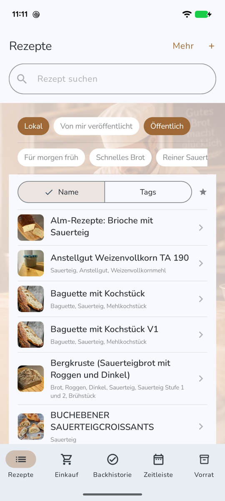
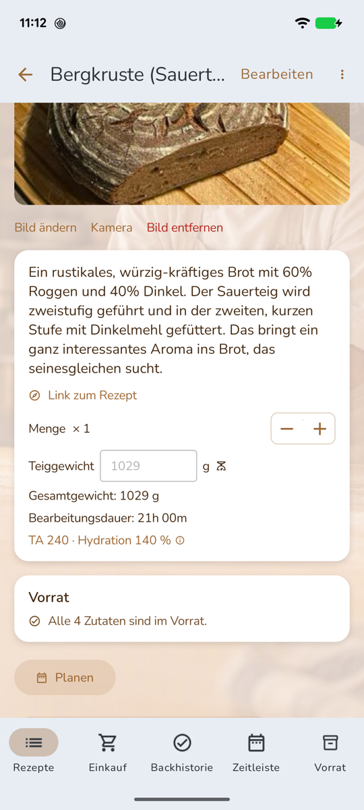
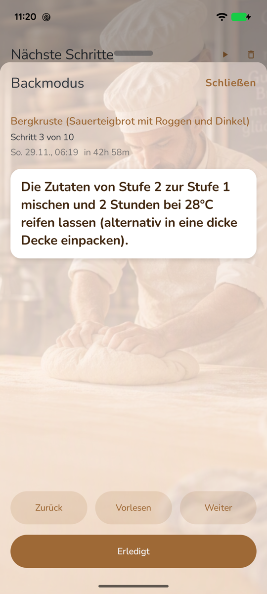
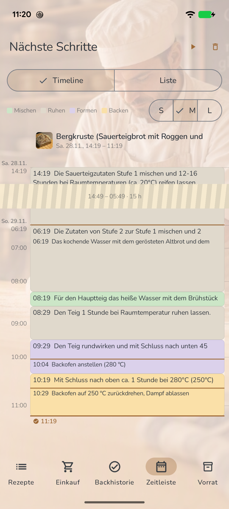
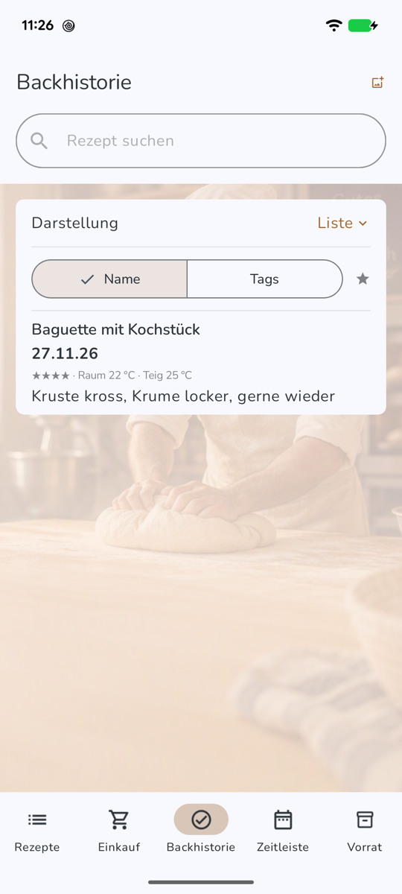
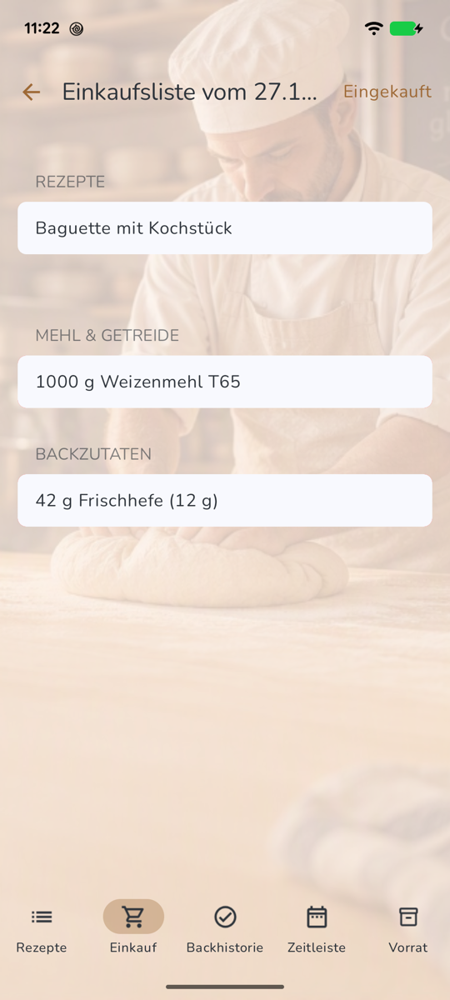
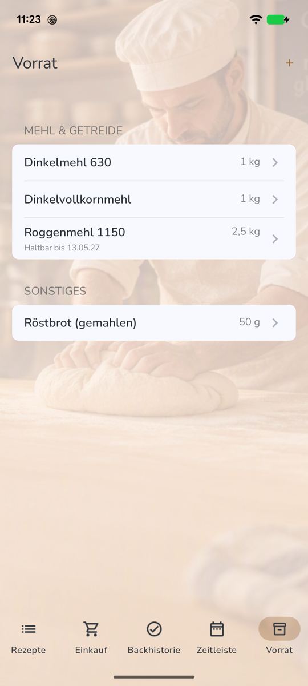

# BakePlanner für Android – Benutzerhandbuch

Stand: 27.11.2026 · Android-Fassung 2.4

---

## Inhalt

1. [Was BakePlanner macht](#1-was-bakeplanner-macht)
2. [Voraussetzungen](#2-voraussetzungen)
3. [Grundbegriffe](#3-grundbegriffe)
4. [Die Tabs](#4-die-tabs)
5. [Rezept-Datenbank](#5-rezept-datenbank)
6. [Eigene Rezepte](#6-eigene-rezepte)
7. [Planen, Backmodus und Erinnerungen](#7-planen-backmodus-und-erinnerungen)
8. [Neues Rezept anlegen und bearbeiten](#8-neues-rezept-anlegen-und-bearbeiten)
9. [Zeitleiste und Backtag planen](#9-zeitleiste-und-backtag-planen)
10. [Backhistorie](#10-backhistorie)
11. [Einkaufslisten](#11-einkaufslisten)
12. [Vorrat](#12-vorrat)
13. [Rechner](#13-rechner)
14. [Einstellungen](#14-einstellungen)
15. [Einheiten und Portionen](#15-einheiten-und-portionen)
16. [Daten, Sicherung und Gerätewechsel](#16-daten-sicherung-und-gerätewechsel)
17. [Datenschutz](#17-datenschutz)
18. [Häufige Fragen](#18-häufige-fragen)
19. [Was es nur auf dem iPhone gibt](#19-was-es-nur-auf-dem-iphone-gibt)

---

## 1. Was BakePlanner macht

BakePlanner ist eine Backplanungs-App für Brot, Brötchen und Gebäck. Sie unterscheidet sich von einer reinen Rezept-Sammlung dadurch, dass sie **die Zeitplanung übernimmt**:

- Ein Rezept besteht nicht nur aus Zutaten, sondern aus **Verarbeitungsschritten mit Dauern**.
- Aus diesen Dauern berechnet die App die **Startzeit jedes einzelnen Schritts**.
- Du kannst rückwärts planen: „Das Brot soll um 18:00 Uhr fertig sein“ – die App sagt Dir, wann Du den Sauerteig ansetzen musst.
- Für jeden Schritt kommt eine **Erinnerung** als Android-Benachrichtigung, inklusive der automatisch eingefügten Schritte „Backofen anstellen“ und „Backvorgang ist beendet“.

Dazu kommen: eine gemeinsame öffentliche Rezept-Datenbank, eigene Rezepte auf dem Gerät, Import aus Fotos, von Internetseiten und aus Text, Einkaufslisten nach Regalen sortiert, ein Vorrat, eine Backhistorie mit Fotos, Messwerten und Statistik, ein Anstellgut-Tagebuch mit Reifezeit-Schätzung, Rezept-Varianten mit Vergleich, ein Backmodus mit Vorlesen und vier Bäckerrechner.

**Auf Android ist alles frei.** Es gibt kein Pro und nichts zu kaufen.

### Schnellstart: In fünf Schritten zum ersten Backplan

1. Wähle im Tab **Rezepte** ein Rezept – oder lege über **+** oben rechts ein eigenes an.
2. Tippe auf der Rezeptseite auf **Planen**.
3. Wähle **Starten ab** oder **Fertig bis** und stelle Datum und Startzeit ein.
4. Prüfe die berechneten Zeiten und tippe oben rechts auf **Planen**.
5. Öffne den Tab **Zeitleiste**, um alle Termine als Timeline oder Liste zu sehen.

Beim ersten Planen fragt Android, ob BakePlanner Benachrichtigungen senden darf. Ohne diese Erlaubnis wird der Plan trotzdem gespeichert, es kommen aber keine Erinnerungen (siehe [Kapitel 7](#7-planen-backmodus-und-erinnerungen)).

---

## 2. Voraussetzungen

| Punkt | Wert |
|-------|------|
| Android | 9.0 oder neuer; eine eigene App-Sprache unabhängig von der Systemsprache ab Android 13 |
| Bezug | Google Play (zurzeit als geschlossener Test) |
| Größe | Rund 55–60 MB Download, rund 190 MB installiert – die App bringt ihre eigene Laufzeit mit |
| Sprachen | Deutsch, Englisch, Französisch |
| Darstellung | Hell- und Dunkelmodus nach der Systemeinstellung, Schriftgröße nach der Android-Einstellung „Schriftgröße“ |
| Berechtigungen | Mitteilungen (Erinnerungen), Kamera (Rezeptbilder, Backfotos, Import aus Fotos), Internet (Rezept-Datenbank, Cloud-KI, Import von Internetseiten) |
| Internet | Nur für die Rezept-Datenbank, die Cloud-KI und den Import von Internetseiten. Eigene Rezepte, Planung und Erinnerungen funktionieren offline. |
| Anmeldung | Nicht nötig. Freiwillig ist die Anmeldung mit Apple – sie braucht nur, wer Rezepte veröffentlichen will (siehe [Kapitel 14](#14-einstellungen)). |

> **Wichtig:** Alle eigenen Daten liegen nur auf diesem Gerät. Es gibt keinen Abgleich und keine automatische Sicherung in Google Drive. Lege deshalb regelmäßig eine Sicherung an (siehe [Kapitel 16](#16-daten-sicherung-und-gerätewechsel)).

---

## 3. Grundbegriffe

Diese Begriffe tauchen überall in der App auf:

**Rezept**
Die oberste Einheit: Name, Beschreibung, Bild, Bewertung, Tags, optional ein Link zur Quelle, Gesamtgewicht und Bearbeitungsdauer.

**Komponente**
Ein Teilansatz innerhalb eines Rezepts – zum Beispiel „Sauerteig“, „Vorteig“, „Hauptteig“, „Brühstück“. Jede Komponente hat ihre eigene Zutatenliste. BakePlanner ist für mehrstufige Teigführungen gebaut.

**Zutat**
Gehört immer zu einer Komponente: Menge, Einheit und Name. Die Menge darf auch ein Bruch sein („1/2“, „1 1/2“).

**Verarbeitungsschritt**
Eine Arbeitsanweisung mit Schrittnummer und Dauer. Die Dauer gibst Du in Minuten („90“) oder in Stunden und Minuten an („1:30“, „1h 30“, „1,5 h“). Die Schrittnummer hat eine besondere Bedeutung:

- **Ganze Zahlen (1, 2, 3 …) sind Hauptschritte.** Sie laufen zeitlich nacheinander.
- **Nachkommastellen (2.1, 2.2, 2.3) sind Parallelschritte innerhalb eines Hauptschritts.** Sie laufen gleichzeitig; für die Gesamtdauer zählt nur die *längste* Dauer der Gruppe. Schritte, die eine Komponente herstellen (Sauerteig, Vorteig, Quellstück …), starten dabei im Abstand von 5 Minuten nacheinander, damit Du nicht alles zur selben Minute abwiegen musst.

Beispiel: Setzt Du Sauerteig (12 h) und Brühstück (2 h) gleichzeitig an, gib ihnen die Schritte 1.1 und 1.2. Der Hauptschritt 2 beginnt dann nach gut 12 Stunden, nicht nach 14.

**Menge (Portionsgröße)**
Ein Faktor für alle Mengen; **× 1 ist das Rezept, wie es gespeichert ist**, × 2 verdoppelt alles. Statt eines Faktors kannst Du ein **Teiggewicht** in Gramm eingeben. Die Wahl gilt für das geöffnete Rezept: Rezeptseite, Planung und Einkaufsliste rechnen damit (siehe [Kapitel 15](#15-einheiten-und-portionen)).

**Ablage**
Wo ein Rezept liegt:

| Ablage | Wer sieht es? | Wo liegt es? | Änderbar? |
|--------|---------------|--------------|-----------|
| **Lokal** | nur Du | auf diesem Gerät | ja, jederzeit |
| **Öffentlich** | alle Nutzer der App, auf Android wie auf dem iPhone | in der Rezept-Datenbank | ja, durch Dich als Autor |

Neue Rezepte sind immer zuerst lokal. In die Datenbank stellst Du ein Rezept über **Veröffentlichen** auf seiner Seite (siehe [Kapitel 6](#6-eigene-rezepte)). Ein Rezept, das Du nicht veröffentlichen darfst – etwa aus einem Buch –, bleibt einfach lokal.

---

## 4. Die Tabs

Nach dem Start öffnet sich die App im Tab **Rezepte**. Am unteren Rand liegen die fünf Tabs:

*Der Tab „Rezepte“ ist der Ausgangspunkt: alle Rezepte, oben rechts „Mehr“ und „+“ für ein neues Rezept.*

| Tab | Zweck |
|-----|-------|
| **Rezepte** | Alle Rezepte in einer Liste: Deine eigenen, die von Dir veröffentlichten und die öffentlichen aller Nutzer (siehe [Kapitel 5](#5-rezept-datenbank) und [Kapitel 6](#6-eigene-rezepte)) |
| **Einkauf** | Alle Einkaufslisten (siehe [Kapitel 11](#11-einkaufslisten)) |
| **Backhistorie** | Vergangene Backvorgänge als Liste, Galerie, Hit-Liste, Fotowolke oder Statistik (siehe [Kapitel 10](#10-backhistorie)) |
| **Zeitleiste** | Alle geplanten Schritte als Timeline oder Liste, dazu der Backmodus (siehe [Kapitel 9](#9-zeitleiste-und-backtag-planen)) |
| **Vorrat** | Was Du zu Hause hast: Mehle, Saaten, Hefe mit Menge und Haltbarkeit (siehe [Kapitel 12](#12-vorrat)) |

Oben rechts im Tab **Rezepte** stehen zwei Menüs:

| Menü | Einträge |
|------|----------|
| **Mehr** | **Einstellungen**, **Rezepte importieren** (eine Sicherungsdatei oder ein einzeln gesichertes Rezept einlesen), **Rezepte exportieren** (eigene Rezepte als Datei), **Backtag planen** und **Rechner** |
| **+** (Neues Rezept) | **Von Hand**, **Nach Bäckerprozent**, **Von einer Internetseite**, **Aus Fotos**, **Aus Text** (siehe [Kapitel 8](#8-neues-rezept-anlegen-und-bearbeiten)) |

Mit dem Zurück-Pfeil oben links oder der Zurück-Geste von Android kommst Du aus jedem geöffneten Bildschirm zurück. Blätter wie das Planungsblatt oder das Bearbeiten schließt **Abbrechen** beziehungsweise **Schließen** oben links.

---

## 5. Rezept-Datenbank

Die öffentliche Rezept-Datenbank teilen sich alle Nutzer von BakePlanner, auf Android wie auf dem iPhone. Ihre Rezepte stehen im Tab **Rezepte** zusammen mit Deinen eigenen, alphabetisch sortiert. Drei Filter-Chips über der Liste schalten die Quellen einzeln ein und aus:

- **Lokal** – Deine Rezepte auf diesem Gerät,
- **Von mir veröffentlicht** – Deine eigenen Rezepte in der Datenbank,
- **Öffentlich** – die Rezepte der anderen Nutzer.

**Nach unten ziehen** lädt die öffentlichen Rezepte neu. Steht über der Liste „Die öffentlichen Rezepte konnten nicht geladen werden“, fehlte die Internetverbindung – zieh die Liste noch einmal nach unten.

**Sprache.** Eine automatische Übersetzung gibt es auf Android nicht. Hat jemand für ein Rezept schon eine Übersetzung in Deiner App-Sprache hinterlegt, zeigt die App sie, sonst die Sprache, in der das Rezept geschrieben ist.

### Ein öffentliches Rezept öffnen

Ein öffentliches Rezept öffnet sich als durchgehende Seite: Bild, Name und Beschreibung, Menge und Teiggewicht, Gesamtgewicht, die TA-Zeile, darunter Gesamtzutaten, Komponenten und Verarbeitungsschritte. Dazu drei Schaltflächen:

- **Planen** – öffnet das Planungsblatt (siehe [Kapitel 7](#7-planen-backmodus-und-erinnerungen)).
- **Rezept zur Einkaufsliste hinzufügen** – siehe [Kapitel 11](#11-einkaufslisten).
- **Als eigenes Rezept speichern** – legt eine vollständige Kopie samt Bild auf Deinem Gerät an. Erst diese Kopie kannst Du bearbeiten. Eine schon vorhandene Kopie bleibt, wie sie ist.

### Weitere Aktionen

Oben rechts unter **Weitere Aktionen**:

- **Rezept teilen** – erzeugt ein PDF des Rezepts in der gewählten Menge und öffnet das Teilen-Menü von Android.
- **Rezept melden** – mit einem Grund (anstößig, Spam, Urheberrecht, Sonstiges). Das Rezept wird **sofort für alle Nutzer** ausgeblendet, bis ein Administrator es geprüft hat.
- **Autor blockieren** – alle Rezepte dieses Autors verschwinden **nur auf Deinem Gerät** aus der Liste.
- **Rezept bearbeiten** und **Mein Rezept löschen** – nur bei Rezepten, die von Deinem Konto stammen. Bearbeitet wird das Rezept in der Datenbank; Deine lokale Fassung bleibt davon unberührt.

Blockieren und Melden nimmst Du unter *Einstellungen → Moderation* zurück (siehe [Kapitel 14](#14-einstellungen)). Wer als **Administrator** angemeldet ist, findet zusätzlich **Rezept löschen (Admin)** und bei gemeldeten Rezepten **Rezept wieder freigeben**.

---

## 6. Eigene Rezepte

Eigene Rezepte sind die Rezepte auf Deinem Gerät: selbst angelegte, importierte und aus der Datenbank übernommene. Schaltest Du die Chips **Von mir veröffentlicht** und **Öffentlich** aus, bleibt die reine Liste Deiner eigenen Rezepte.

### Suchen und filtern

- **Suchfeld** oben, darunter die Umschaltung **Name / Tags**. Die Suche ignoriert Groß- und Kleinschreibung und findet Wortteile: „roggen“ findet „Roggenbrot“.
- **Stern-Menü (★)** daneben: **Alle Bewertungen** oder „… Sterne und mehr“, **Varianten anzeigen / ausblenden** und **Filter …**.
- **Sammlungen** als Chips über der Liste: **Für morgen früh**, **Schnelles Brot**, **Reiner Sauerteig**, **Lange nicht gebacken** und **Lieblinge**; sobald etwas im Vorrat steht, auch **Aus dem Vorrat** und **Vorrat aufbrauchen**. Ein zweiter Tipp hebt eine Sammlung wieder auf.

### Facetten

Das Blatt **Filter …** enthält die Facetten. Die App liest sie aus den Zutaten und Schritten jedes Rezepts – Du musst nichts eintragen:

| Facette | Auswahl |
|---------|---------|
| **Dauer** | Unter 4 Stunden, 4 bis 12 Stunden, Über Nacht, Mehrtägig |
| **Tagesablauf** | Abends ansetzen, morgens backen; Morgens ansetzen, abends backen; Fertig in 2 Stunden |
| **Triebmittel** | Reiner Sauerteig, Lievito Madre, Hefe, Sauerteig und Hefe |
| **Mehl** | Überwiegend Weizen, Roggen, Dinkel oder Vollkorn |
| **Teigausbeute** | Fest (unter TA 165), Mittel (TA 165 bis 180), Weich (ab TA 180) |
| **Ausstattung** | Backstein, Kastenform, Gärkörbchen, Topf |
| **Backhistorie** | Nie gebacken, Lange nicht gebacken, Lieblinge |
| **Wenig Arbeit** | Höchstens 30 Minuten Handarbeit |

Mit Vorrat kommen die Schalter **Aus dem Vorrat** (nur Rezepte, deren Zutaten vollständig da sind) und **Vorrat aufbrauchen** (Rezepte, die verbrauchen, was bald abläuft; unter jedem steht, was es aufbraucht). **Filter zurücksetzen** hebt alles auf einmal auf.

**Eigene Sammlungen.** Eine Kombination, die Du öfter brauchst, sicherst Du im Blatt **Filter …** mit **Sammlung sichern** unter einem Namen. Sie erscheint als Chip hinter den vorgegebenen. Unter **Gesicherte Sammlungen** benennst Du sie um (antippen) oder löschst sie (wischen); langes Drücken auf den Chip bietet ebenfalls **Umbenennen** und **Löschen**.

**Fertig bis.** Im Blatt **Filter …** wählst Du mit **Fertig bis** Datum und Uhrzeit, zu der das Brot fertig sein soll. Die Liste zeigt dann nur Rezepte, die bis dahin noch zu schaffen sind, und schreibt den nötigen Start unter jedes: „Start heute 17:45“, „Start morgen 06:10“, gegebenenfalls mit „Schritte in der Nacht“. Das Ziel steht als erster Chip über der Liste; ein Tipp darauf ändert es.

### Rezept löschen

Wische ein eigenes Rezept in der Liste nach links und bestätige die Rückfrage. Mit dem Rezept verschwinden seine Backhistorie und sein Anstellgut-Tagebuch. Öffentliche Rezepte lassen sich hier nicht löschen.

### Die Seite eines eigenen Rezepts

*Die Rezeptseite: oben Bild und Mengen, darunter Planen, die Einkaufsliste und alle Zutaten und Schritte.*

Von oben nach unten:

1. **Bild** mit **Bild ändern**, **Kamera** und **Bild entfernen**, darunter die Beschreibung und – falls hinterlegt – der **Link zum Rezept**.
2. **Menge** (Faktor) und **Teiggewicht**, das **Gesamtgewicht**, die **Bearbeitungsdauer** und die Zeile **„TA 172 · Hydration 72 %“**; ein Tipp darauf öffnet die Aufschlüsselung (siehe [Kapitel 15](#15-einheiten-und-portionen)). Bei regelmäßig geplanten Rezepten folgt „Nächster Backtermin“ beziehungsweise „Nächste Fütterung“.
3. **Vorrat** – sobald etwas im Vorrat steht: „Alle 5 Zutaten sind im Vorrat“ oder was fehlt (siehe [Kapitel 12](#12-vorrat)).
4. **Planen** und **Rezept zur Einkaufsliste hinzufügen**.
5. **Gesamtzutaten**, **Komponenten** und **Verarbeitungsschritte**. Mehl- und Anstellgut-Zeilen sind antippbar (siehe [Kapitel 13](#13-rechner)).
6. **Letztes Mal**, **Backvorgang eintragen** und **Bisherige Backvorgänge** – bei einem Anstellgut stattdessen das **Anstellgut-Tagebuch**.
7. **Varianten** – die Rezepte, die aus diesem entstanden sind.

Oben rechts stehen **Bearbeiten** (siehe [Kapitel 8](#8-neues-rezept-anlegen-und-bearbeiten)) und **Weitere Aktionen**:

| Eintrag | Zweck |
|---------|-------|
| **Rezept sichern** | Schreibt das Rezept samt Bild in eine Datei, ohne Backhistorie – zum Weitergeben an andere, die es über **Mehr → Rezepte importieren** einlesen |
| **Rezept teilen** | Erzeugt ein PDF mit Bild, Komponenten, Gesamtzutaten und Schritten in der gewählten Menge und öffnet das Teilen-Menü |
| **Veröffentlichen** | Stellt das Rezept in die Rezept-Datenbank (siehe unten) |
| **Variante anlegen** | Legt eine Variante an (siehe unten) |

**Veröffentlichen** setzt zweierlei voraus: die **Anmeldung mit Apple** unter *Einstellungen → Konto* (sonst erscheint „Anmeldung nötig“) und ein **Rezeptbild** (sonst „Bild erforderlich“). Beim ersten Mal akzeptierst Du die Nutzungsbedingungen (siehe [Kapitel 17](#17-datenschutz)), dann folgt die Rückfrage **Rezept veröffentlichen?** mit **Öffentlich speichern**. Danach steht auf der Seite „Veröffentlicht“, und der Eintrag entfällt: Ein Rezept wird nur einmal veröffentlicht, Änderungen machst Du danach an der öffentlichen Fassung (siehe [Kapitel 5](#5-rezept-datenbank)).

### Rezept-Varianten

Varianten sind eigene Rezepte, die mit ihrem Ursprungsrezept verbunden bleiben – so siehst Du später, was anders war und wie es geworden ist.

- **Variante anlegen** öffnet das Blatt **Neue Variante**: Unter „Was ist anders? (optional)“ notierst Du die Änderung, **Anlegen** kopiert das Rezept als „Landbrot V1“, „Landbrot V2“ … und öffnet die Kopie. Auch **Mehl ersetzen** und **Anstellgut-TA anpassen** legen Varianten an (siehe [Kapitel 13](#13-rechner)).
- Auf der Variante steht **Variante von „…“**; **Vergleichen** zeigt die Unterschiede: Zutaten, TA, Hydration, Teiggewicht und Schritte.
- Auf dem Ursprungsrezept listet die Karte **Varianten** jede Variante mit ihrer Notiz und dem Ergebnis aus ihrer Backhistorie.
- Im Stern-Menü der Liste blendet **Varianten ausblenden** sie aus der Liste aus.

### Anstellgut-Tagebuch

Ein Rezept, das nur aus Anstellgut, Mehl und Wasser besteht und nichts backt, ist für die App ein **Anstellgut**. Es wird gefüttert, nicht gebacken, und hat deshalb statt der Backhistorie das **Anstellgut-Tagebuch**:

- **Fütterungsverhältnis** „Anstellgut : Mehl : Wasser“, aus dem Rezept berechnet.
- **Reifezeit-Schätzung**: Hast Du Fütterungen mit Reifezeit und Raumtemperatur notiert, sagt die App, wann das Anstellgut bei der **Raumtemperatur heute** reif ist („Bei 22 °C reif nach etwa 6h 30m, aus 4 Fütterungen“).
- **Neue Fütterung erfassen** mit Datum, **Reifezeit bis zum Höhepunkt**, Raumtemperatur, **Schwimmtest** und Notiz.
- **Bisherige Fütterungen**, neueste zuerst. Eine geplante Fütterung ergänzt Du nach dem Füttern über **Ergebnis eintragen**.

Planst Du ein Anstellgut, legt BakePlanner die Fütterung im Tagebuch an statt einen Eintrag in der Backhistorie. Steht das Mehl im Vorrat, wird es bei der Fütterung abgebucht.

---

## 7. Planen, Backmodus und Erinnerungen

Das ist der Kern der App. **Planen** auf der Rezeptseite öffnet das Planungsblatt; es rechnet mit der Menge, die auf der Rezeptseite eingestellt ist.

*Im Planungsblatt wählst Du den Zeitpunkt; die Uhrzeiten der Schritte rechnen sofort mit.*

### Den Zeitpunkt wählen

| Element | Funktion |
|---------|----------|
| **Starten ab / Fertig bis** | **Starten ab**: Ich fange zu diesem Zeitpunkt an – wann bin ich fertig? **Fertig bis**: Ich will zu diesem Zeitpunkt fertig sein – wann muss ich anfangen? |
| **Datum** und **Startzeit** | Der Bezugszeitpunkt der Planung |
| **Ofen** und **Umluft** | Nur mit zwei oder mehr Ofenprofilen (siehe [Kapitel 14](#14-einstellungen)): der Ofen für dieses Brot, vorbelegt mit dem aus den Einstellungen, und ob er mit Umluft backt |
| **Dauer ändern** | Schalter. Aktiv erscheint pro Schritt ein Feld für die Dauer; **Dauer übernehmen** speichert die neuen Dauern im Rezept |

Ändere den Zeitpunkt und beobachte, wie sich die Uhrzeiten unter **Verarbeitungsschritte** anpassen. Gespeichert wird erst mit **Planen** oben rechts.

### Gare heute und Reifezeit heute

**Gare heute.** Bei einem Brot erkennt das Planungsblatt die Gärschritte – Reife eines Vorteigs, Stockgare und Stückgare – und zeigt zu jeder Phase die geplante Dauer und die Dauer bei der **Raumtemperatur heute**, vorbelegt mit der beim letzten Backen notierten. Gärung läuft je 10 °C etwa zweieinhalbmal so schnell; die Dauern des Rezepts gelten als für 22 °C geschrieben. Jede Phase hat ihre eigene **Temperatur**, etwa wenn die Stückgare an einem warmen Ort stattfindet. Haben Deine Backvorgänge Stock- oder Stückgare samt Raumtemperatur festgehalten, rechnet die App mit diesen Messungen. **Diese Garzeiten übernehmen** gilt nur für diesen Plan, **Dauern des Rezepts verwenden** nimmt das zurück, und **Dauern aus den Backvorgängen ins Rezept übernehmen** schreibt die gemessenen Werte dauerhaft ins Rezept.

**Reifezeit heute.** Planst Du ein Anstellgut mit Fütterungen im Tagebuch, zeigt das Blatt die geschätzte Reifezeit bei der heutigen Raumtemperatur; **Reifezeit als Dauer übernehmen** setzt sie als Dauer des Reifeschritts.

### Was die App am Plan bemängelt

Über den Schritten erscheinen Hinweise, sobald der Zeitpunkt zu einem unpraktischen Plan führt:

- **Schritte außerhalb Deines Tages** – vor dem **Tagesbeginn** oder nach dem **Tagesende** aus den Einstellungen. Darunter schlägt die App vor: „So beginnt kein Schritt in der Nacht:“ mit einem früheren und einem späteren Zeitpunkt; **Übernehmen** stellt ihn ein.
- **Überschneidende Backzeiten** – jeder Ofen nimmt einen Backvorgang auf einmal. Mehr Backvorgänge gleichzeitig, als Du Öfen hast, sind ein Fehler; „So werden die Backöfen nacheinander frei:“ schlägt passende Zeitpunkte vor.
- **Zu kurze Backpause** zwischen zwei Backvorgängen im selben Ofen.
- **Schritte mit Zeitfenster** (siehe [Kapitel 8](#8-neues-rezept-anlegen-und-bearbeiten)) darf die App dehnen oder kürzen: „So passt es mit den Zeitfenstern der Schritte:“ zeigt die kleinste Änderung, mit der alles in Deinen Tag und in die Öfen passt.

Die Hinweise verhindern nichts. Bei überschneidenden Backzeiten fragt die App beim Planen nach; **Trotzdem planen** setzt den Plan dennoch.

### Planen

Ein Tippen auf **Planen** oben rechts:

1. legt alle Schritte in die **Zeitleiste** und setzt für jeden eine **Erinnerung**,
2. fügt **„Backofen anstellen“** um die Vorheizzeit vor dem Backschritt ein – mit der Ofentemperatur aus dem Rezept, bei einem Backstein mit der Vorheizzeit mit Backstein, mit Ofenprofilen mit der Reglereinstellung („am Regler 240 °C“),
3. fügt bei fallender Temperatur **„Backofen auf … zurückdrehen“** und gegebenenfalls **„Dampf ablassen“** ein,
4. plant **„Backvorgang ist beendet“** zum Endzeitpunkt,
5. legt bei eigenen Rezepten einen **Backhistorien-Eintrag** zum Enddatum an, den Du nach dem Backen ergänzt.

Die Bestätigung **Erinnerungen wurden gesetzt** nennt, wann der Ofen an muss und wann das Brot fertig ist. Fehlt die Erlaubnis für Benachrichtigungen, heißt sie **Plan gespeichert**: Der Plan steht in der Zeitleiste, aber ohne Erinnerungen – die Erlaubnis gibst Du in den Android-Einstellungen unter *Apps → BakePlanner → Benachrichtigungen*.

> **Ein Rezept, ein Plan – oder mehrere.** Gibt es für das Rezept schon einen Plan, fragt die App: **Bestehenden Plan ersetzen** verwirft die alten Schritte samt Erinnerungen – so verschiebst Du ein Brot auf einen anderen Tag. **Zusätzlich planen** behält den bestehenden Plan und legt den neuen daneben, etwa für Samstag und Sonntag.

### Erinnerungen

Jede Erinnerung kommt als Android-Benachrichtigung mit dem Titel **„Backhinweis“** und dem Schritttext. Mischt der Schritt eine Komponente an, stehen ihre Zutaten mit Mengen darunter. Unter der Benachrichtigung liegen zwei Aktionen:

- **Erledigt** – der Schritt verschwindet aus dem Plan.
- **Verschieben um …** – Du gibst die Minuten ein; danach fragt die App „Sollen alle nachfolgenden Schritte dieses Rezepts ebenfalls verschoben werden?“ mit **Nur diesen Schritt** und **Alle nachfolgenden**. Gerechnet wird ab jetzt.

> **Zustellzeit:** Android liefert die Erinnerungen über seinen Aufgabenplaner aus, nicht als Wecker. Liegt das Telefon lange unbenutzt im Energiesparmodus, kann eine Erinnerung einige Minuten später kommen als geplant. Für Schritte, die auf die Minute kommen müssen, lass den **Backmodus** geöffnet oder stelle zusätzlich einen Wecker in der Uhr-App.

### Backmodus

Für die Arbeit in der Küche startest Du im Tab **Zeitleiste** den **Backmodus** – oben rechts für alle Pläne oder in der Liste unter einem Plan nur für diesen. Er zeigt den aktuellen Schritt bildschirmfüllend in großer Schrift: Rezeptname, „Schritt 3 von 12“, die Uhrzeit mit Countdown, den Schritttext und darunter die Zutaten der Komponente. Mit Ofenprofilen steht dazu die Zeile „Am Regler …“.

*Der Backmodus: große Schrift und große Tasten, auch mit Mehl an den Händen.*

- **Zurück** und **Weiter** blättern durch die Schritte.
- **Vorlesen** liest den Schritt und die Zutaten über die Android-Sprachausgabe vor; **Stopp** bricht ab. Fehlt eine Stimme in Deiner Sprache, installierst Du sie in den Android-Einstellungen unter „Sprachausgabe“ (Google Sprachausgabe).
- **Erledigt** nimmt den Schritt samt Erinnerung aus dem Plan und springt zum nächsten.

Solange der Backmodus offen ist, bleibt der Bildschirm an. **Schließen** führt zurück.

---

## 8. Neues Rezept anlegen und bearbeiten

Über **+** oben rechts im Tab **Rezepte** wählst Du, wie das Rezept entsteht. Alle Wege enden im selben Rezept-Formular, in dem Du prüfst und speicherst.

### Von Hand

Öffnet das leere Rezept-Formular (siehe unten).

### Aus Fotos

Liest ein gedrucktes oder abfotografiertes Rezept ein – auf Android **nur über die geschützte Cloud-KI**; eine Texterkennung auf dem Gerät gibt es in der Android-App nicht.

1. **Bilder auswählen** aus den Dateien des Geräts oder **Aufnehmen** mit der Kamera, Seite für Seite, bis zu zehn. Die Reihenfolge wird übernommen; unter **Ausgewählte Seiten** entfernst Du einzelne.
2. Unter **Analyseart** steht **Geschützte Cloud-KI**. Vor der ersten Nutzung erklärt die App die Datenübertragung; **Zustimmen und mit Cloud-KI analysieren** erteilt die Einwilligung. Wählst Du **Nur auf diesem Gerät**, erklärt die App, dass Fotos so nicht gelesen werden können.
3. **Importieren** schickt die Seiten zur Analyse und öffnet das Ergebnis im Rezept-Formular.

Gerade, gut ausgeleuchtete Fotos ohne Logos und Kopfzeilen liefern die besten Ergebnisse. Handschrift wird nicht zuverlässig gelesen. Prüfe danach **Mengen, Einheiten, Temperaturen und Zeiten**.

### Von einer Internetseite

1. Trage die **Internetadresse** ein. Kürzer geht es aus Chrome oder jeder anderen App: **Teilen → BakePlanner** öffnet den Import mit der Adresse.
2. Wähle die **Analyseart**: **Geschützte Cloud-KI** trennt auch Vorteig, Sauerteig und Hauptteig in eigene Komponenten. **Nur auf diesem Gerät** übernimmt nur die strukturierten Rezeptdaten, die die Seite selbst mitliefert.
3. **Importieren** lädt die Seite und öffnet das Rezept im Formular, mit dem Rezeptfoto der Seite und ihrer Adresse als Link.

Seiten mit Anmeldung, Bezahlschranke oder reinem Cookie-Hinweis lassen sich nicht lesen. Dann hilft der Import aus Text.

> **Urheberrecht:** Für den eigenen Gebrauch darfst Du jedes Rezept importieren. Veröffentliche fremde Rezepte nur mit Erlaubnis der Urheber.

### Aus Text

Für Rezepte aus einer Nachricht, einer Notiz oder von einer Seite, die der Web-Import nicht lesen kann. Markiere das Rezept von der Überschrift bis zum letzten Schritt, kopiere es und füge es unter **Rezepttext** ein – oder teile markierten Text aus einer anderen App an BakePlanner. Unter **Internetadresse (optional)** gibst Du die Quelle an. Mit **Nur auf diesem Gerät** liest die App Zutaten und Schritte nach festen Regeln: Überschriften wie „Zutaten“ und „Zubereitung“, je Zeile eine Zutat mit Menge, je Absatz ein Schritt, Komponenten an eigenen Überschriften wie „Sauerteig“. Mit der Cloud-KI spielt die Form eine kleinere Rolle. **Importieren** öffnet das Ergebnis im Formular.

### Nach Bäckerprozent

Für alle, die Rezepte als Formel denken: Du gibst jede Zutat als Anteil vom Mehl ein, die App rechnet die Gramm.

1. **Rezeptname** eintragen.
2. **Vorgabe**: **Mehl gesamt** (etwa 500 g) oder **Teiggewicht** (etwa 850 g) und die Menge.
3. **Komponenten und Zutaten** in Prozent; alle Prozente beziehen sich auf das gesamte Mehl des Rezepts, die Mehle müssen zusammen 100 Prozent ergeben. Weitere Komponenten legst Du mit **Neue Komponente** und **Hinzufügen** an. Neben jeder Zeile stehen die errechneten Gramm.
4. **Weiter** öffnet das Rezept-Formular mit den Gramm. Dort ergänzt Du Ruhezeiten, Formen und Backen.

Solange etwas nicht stimmt, bleibt **Weiter** gesperrt, und ein Hinweis nennt den Grund („Die Mehle ergeben 95 Prozent statt 100.“).

### Das Rezept-Formular

Das Formular – beim Anlegen „Neues Rezept“, beim Ändern „Bearbeiten“ – hat diese Abschnitte:

- **Name** – Pflichtfeld.
- **Rezeptbild** – **Bild hinzufügen** aus den Dateien oder **Kamera**. Fotos werden schon beim Auswählen auf Bildschirmgröße verkleinert. Zum Veröffentlichen ist ein Bild nötig.
- **Beschreibung**.
- **Bewertung** – fünf Sterne; ein zweiter Tipp auf denselben Stern nimmt die Bewertung zurück. Darunter **Tags, durch Komma getrennt**.
- **Regelmäßig planen** (bei einem Anstellgut **Regelmäßig auffrischen**) mit „alle … Tage“: Nach dem letzten Backen plant die App den nächsten Termin von selbst, zur selben Uhrzeit wie der Beginn des ersten Schritts. Solche Termine erscheinen erst zwei Tage vorher in der Zeitleiste; die Erinnerungen kommen trotzdem pünktlich.
- **Komponente** – je Komponente ein Name und ihre Zutaten mit **Menge**, **Einheit** und **Zutat**. Die Menge darf ein Bruch sein („1/2“, „1 1/2“), die Einheit ein Kürzel aus [Kapitel 15](#15-einheiten-und-portionen). **Zutat hinzufügen**, **Komponente entfernen**, darunter **Komponente hinzufügen**. Eine Zutatenzeile löschst Du durch Wischen.
- **Verarbeitungsschritte** – je Schritt **Nr.**, Text und Dauer in **Minuten** (auch „1:30“ oder „1,5 h“). **Schritt hinzufügen** zählt auf die nächste ganze Zahl weiter, **Unterschritt hinzufügen** legt einen Parallelschritt wie 3.1 an. Löschen durch Wischen.

Rot markierte Felder sind ungültig, etwa eine Dauer, die die App nicht lesen kann; solange bleibt **Speichern** gesperrt.

**Zeitfenster.** Ein Schritt, den der Planer dehnen darf – eine Kühlschrankgare von 12 bis 18 Stunden –, hat die Felder **Mindestens** und **Höchstens**. Leer gelassen ist die Dauer fest. Steht das Fenster schon im Wortlaut („12–18 Stunden im Kühlschrank“), erkennt die App es auch ohne Felder.

**Ofen.** Ein Schritt, der backt, vorheizt oder eine Ofentemperatur nennt, hat die Felder **Ofen** (°C) und **Fallend auf** sowie **Schwaden** (Nicht angegeben, Mit Schwaden, Ohne Schwaden). Die Felder gelten vor dem Wortlaut; leer gelassen liest die App den Ofen aus dem Text („bei 250 °C fallend auf 220 °C mit Schwaden backen“).

**Speichern** oben rechts sichert das Rezept, **Abbrechen** verwirft die Änderungen.

### Ein Rezept bearbeiten

**Bearbeiten** oben rechts auf der Seite eines eigenen Rezepts öffnet dasselbe Formular. Das Rezeptbild änderst Du auch direkt auf der Rezeptseite. Ein schon gesetzter Plan bleibt, wie er ist: Die Zeitleiste zeigt dann „… wurde seit der Planung geändert“ mit **Neu planen**.

---

## 9. Zeitleiste und Backtag planen

Im Tab **Zeitleiste** (Titel „Nächste Schritte“) stehen alle geplanten Schritte aus allen Rezepten. Oben wechselst Du zwischen **Timeline** und **Liste**. Oben rechts liegen **Backmodus starten** und **Alle löschen**.

*Die Timeline zeigt jeden Plan als eigene Spur, jeden Schritt als Balken.*

### Timeline

Jeder Plan bekommt eine eigene Spur mit Rezeptbild und Name, jeder Schritt einen Balken, so lang, wie er dauert. Die Farbe sagt, was zu tun ist – Mischen, Ruhen, Formen, Backen; eine Legende steht oben, daneben der **Zoom** in drei Stufen (S, M, L). Teilschritte wie das Falten während der Teigruhe oder „Backofen anstellen“ während der Stückgare erscheinen als Marke auf dem Balken ihres Schritts, eine Fahne markiert „Backvorgang ist beendet“, eine rote Linie den jetzigen Zeitpunkt. Lange Pausen ohne Schritt – die Nacht, in der der Sauerteig reift – werden zu einem schraffierten Band zusammengeschoben.

Ein Tipp auf einen Balken öffnet die Details des Schritts mit Beginn, Dauer, Beschreibung und – bei einem Mischschritt – den Zutaten. Langes Drücken bietet **Erledigt** und **Verschieben**.

### Liste

Ganz oben steht der Schritt, der **Als Nächstes** ansteht, oder **Jetzt fällig** mit der verstrichenen Zeit. Darunter folgen die Pläne, je Plan seine Schritte mit Uhrzeit, Tag, Dauer und Anweisung. Jede Zeile hat drei Symbole:

- **Häkchen** – Schritt als erledigt markieren; er verschwindet samt Erinnerung aus dem Plan.
- **i** – Zutaten der Komponente anzeigen, in der Menge, mit der Du geplant hast. Nur bei Schritten, die eine Komponente anmischen.
- **Kalender** – Schritt zeitlich verschieben (siehe unten).

Unter jedem Plan stehen **Backmodus starten** (nur für diesen Plan) und **Geplante Schritte löschen** (nur dieser Plan, nach Rückfrage). **Alle löschen** oben rechts entfernt alle Pläne samt ihren Erinnerungen.

### Einen Schritt verschieben

Das Blatt **Schritt verschieben** zeigt **Bisher** und, sobald Du Minuten eingegeben hast, **Neu**:

1. **Minuten** eingeben.
2. **Richtung**: **Früher** oder **Später**.
3. **Betroffene Schritte**: **Nur dieser Schritt** oder **Alle nachfolgenden** – dann wandern alle späteren Schritte desselben Plans mit.
4. **Übernehmen**.

Die Erinnerungen wandern mit. Liegt der neue Zeitpunkt in der Vergangenheit, meldet die App „Verschieben nicht möglich“.

Sind keine Schritte geplant, steht dort „Keine geplanten Schritte – Öffne ein Rezept und tippe auf „Planen“.“

### Backtag planen

**Rezepte → Mehr → Backtag planen** plant mehrere Brote auf einmal:

1. Unter **Rezepte** wählst Du die Brote; Anstellgut-Rezepte stehen nicht zur Wahl.
2. **Fertig bis** – die Uhrzeit, zu der das letzte fertig sein soll – und die **Backöfen** (vorbelegt aus den Einstellungen; mit Ofenprofilen die Auswahl „Ofen“ je Brot).
3. **Backtag berechnen** legt die Startzeiten: Das Brot mit dem längsten Backen ist zur Wunschzeit fertig, jedes weitere bekommt die späteste Viertelstunde davor, zu der es noch in einen Ofen passt. Die **Backpause** wird eingehalten, und nie werden zwei Teige zugleich geknetet, gefaltet oder geformt. Schon geplante Backvorgänge zählen mit.
4. Je Brot stehen Start, Fertig und die Ofenzeit, dazu Hinweise als Text: „Schritte in der Nacht“, „Handarbeit fällt mit einem anderen Brot zusammen“, „Kein Ofen frei – überschneidet sich mit einem anderen Backen“, „Müsste schon laufen – Wunschzeit später wählen“ oder „Hat schon einen Plan – wird ersetzt“. Reicht der Vorrat nicht für alle Brote, sagt die App, was fehlt.
5. **Alle planen** legt für jedes Brot Schritte, Erinnerungen und den Eintrag in der Backhistorie an.

---

## 10. Backhistorie

Im Tab **Backhistorie** stehen alle Backvorgänge. Über **Darstellung** wählst Du:

- **Liste** – neueste zuerst, mit Datum, Rezeptname, Kommentar, Messwerten und Fotos,
- **Galerie** – Kacheln mit dem ersten Foto,
- **Hit-Liste** – die Rezepte nach Anzahl der Backvorgänge, oben Deine Klassiker,
- **Fotowolke** – jedes Rezept als Kreis mit dem Foto des letzten Backens, je öfter gebacken, desto größer,
- **Statistik** – siehe unten.

*Die Backhistorie hält fest, was Du gebacken hast und wie es geworden ist.*

Suchfeld (Name/Tags) und Bewertungsfilter gelten in allen Darstellungen. Einen Eintrag löschst Du durch Wischen nach links.

### Einen Backvorgang eintragen

Ein Eintrag entsteht automatisch, wenn Du ein eigenes Rezept planst – zunächst ohne Kommentar. Nach dem Backen erinnert die Karte **Letztes Mal** auf der Rezeptseite daran, ihn zu ergänzen (**Ergänzen** oder **Jetzt eintragen**). Ein Backen ohne Plan trägst Du auf der Rezeptseite über **Backvorgang eintragen** nach.

Der Eintrag („Backanmerkungen- / hinweise“) hat:

- **Rezept** – das Rezept, zu dem er gehört; hier verschiebst Du einen Eintrag zu einem anderen Rezept.
- **Backdatum** und **Kommentar**.
- **Messwerte und Ergebnis**: **Bewertung** (1–5 Sterne), **Raumtemperatur** und **Teigtemperatur** in °C, **Stockgare** und **Stückgare** in Minuten, **Mehl** als Freitext und **Krume / Ofentrieb** als Stichworte – darunter Wort-Chips wie „offen“, „saftig“ oder „guter Ofentrieb“ zum Antippen.
- **Fotos** – **Bild hinzufügen** aus den Dateien oder **Kamera**.

**Speichern** sichert den Eintrag. Die Messwerte zeigt die Rezeptseite als **Letztes Mal**; Stock- und Stückgare samt Raumtemperatur fließen in die Karte **Gare heute** beim nächsten Planen ein.

### Statistik

**Darstellung → Statistik** rechnet zusammen, was die gerade gezeigten, schon vergangenen Backvorgänge ergeben: oben **Brote gesamt**, **Dieses Jahr**, **Pro Monat** und die Durchschnittsbewertung, darunter **Brote je Monat**, **Meistgebacken**, **Bewertungen**, **Stückgare und Raumtemperatur** (ein Punkt je Backen) und **Krume und Ofentrieb**. Die Diagramme sind einfache Balken und Punkte ohne Achsenbeschriftung. Je mehr Messwerte Du einträgst, desto mehr zeigt die Statistik.

### Backhistorie aus Fotos

Das Foto-Symbol oben im Tab **Backhistorie** holt alte Brotfotos in die Historie:

1. **Fotos auswählen**.
2. Aus jedem Foto liest die App das **Datum** und, wenn vorhanden, den **Titel oder die Beschreibung**. Das Rezept schlägt sie **nach diesem Titel** vor („Nach dem Titel vorgeschlagen“) – nicht nach der Ähnlichkeit mit dem Rezeptbild. Schreibe den Rezeptnamen deshalb ins Foto, etwa in Google Fotos unter *Info → Beschreibung*. Datum und Titel liest Android aus JPEG-Dateien.
3. Prüfe jede Zeile: Datum wählen, wenn „Kein Datum im Foto“ steht, Rezept wählen oder ändern. Zeilen mit „Schon in der Backhistorie an diesem Tag“ werden übersprungen.
4. **Anlegen** schreibt die Einträge mit dem Foto.

---

## 11. Einkaufslisten

### Zutaten auf eine Liste setzen

**Rezeptseite → Rezept zur Einkaufsliste hinzufügen** – bei eigenen wie öffentlichen Rezepten. Die Zutaten kommen in der Menge auf die Liste, die auf der Rezeptseite eingestellt ist.

1. **Ziel**: **Neue Liste** mit Datum oder **Bestehende Liste**. Existiert für das Datum schon eine Liste, werden die Zutaten dort ergänzt.
2. **Vorrat abziehen** (voreingestellt an): Was im Vorrat ist, kommt nicht auf die Liste, Teilmengen werden gekürzt. Ist alles da, sagt die App das statt eine leere Liste anzulegen.
3. **Erstellen**. Die App bestätigt mit „Zutaten wurden auf die Einkaufsliste gesetzt“.

### Was auf die Liste kommt – und was nicht

- **Nicht aufgenommen** werden Wasser, Salz und alles, was man selbst ansetzt: Anstellgut, Sauerteig, Levain, Lievito Madre, Poolish, Biga – in jeder Sprache. Was nur so klingt (Rosenwasser, Sauerteigpulver), bleibt auf der Liste.
- **Nicht aufgenommen** werden Zutaten ohne Einheit oder ohne Menge.
- **Eier** zählt die Liste in Stück: „120 g Eier“ werden „2 St Eier“.
- **Gleiche Zutaten werden zusammengefasst**: „Milch 30 °C“ und „Milch“, „Frischhefe“ und „Hefe“, „Weizenmehl Type 550“ und „Weizenmehl 550“. Einheiten mit derselben Basis werden zusammengerechnet (0,5 kg + 200 g).
- Die Zutatennamen stehen so auf der Liste, wie sie im Rezept heißen; übersetzt werden sie auf Android nicht.

### Einkaufslisten ansehen

*Die Einkaufsliste ist nach Regalen sortiert und nennt die Packung, die Du kaufst.*

Im Tab **Einkauf** steht je Liste „Einkaufsliste vom …“, darunter die enthaltenen Rezepte und die Zutaten **nach Regalen gruppiert**: Mehl & Getreide, Milchprodukte & Eier, Backzutaten, Nüsse, Saaten & Trockenfrüchte, Obst & Gemüse, Gewürze & Kräuter, Öle, Fette & Flüssiges, Sonstiges.

**Gebindegrößen.** Vor der Zutat steht die übliche Packung, die den Bedarf deckt, der Bedarf in Klammern: „1 kg Weizenmehl 550 (200 g)“, „42 g Frischhefe (6 g)“, „6 Stück Eier (2 St)“.

- Ein Tipp auf eine Zutat öffnet **Menge ändern**: Menge und Einheit gelten nur für diese Liste, das Rezept bleibt unverändert. Dort stehen auch **In den Vorrat übernehmen** und **Zutat entfernen**.
- **Eingekauft** oben an der Liste übernimmt die ganze Liste in den Vorrat (siehe [Kapitel 12](#12-vorrat)).
- Eine Liste löschst Du durch Wischen nach links (**Einkaufsliste löschen**).

---

## 12. Vorrat

Der Tab **Vorrat** führt, was Du zu Hause hast – nach denselben Regalen wie die Einkaufsliste.

*Der Vorrat: die Posten nach Regalen, mit Menge und Haltbarkeit.*

- **Posten hinzufügen** (+ oben rechts): **Name** – mit **Vorschlägen aus Deinen Rezepten**, damit Vorrat und Rezepte dasselbe meinen –, **Menge** in g, kg oder Stück, **Mindesthaltbarkeit** und **Notiz**; **Sichern**.
- Ein Tipp auf einen Posten ändert ihn, Wischen nach links entfernt ihn.
- **Bald aufbrauchen**: Posten, die in den nächsten 14 Tagen ablaufen oder schon abgelaufen sind, stehen oben und sind farbig markiert.
- Mengen ab 1000 g zeigt der Vorrat in Kilogramm.

### Aus der Einkaufsliste in den Vorrat

**Eingekauft** an der Liste oder **In den Vorrat übernehmen** bei einer Zeile öffnen das Blatt **Eingekauft**: Je Zeile stehen „Benötigt: …“ und die **Gekaufte Menge**, vorbelegt mit der Packung von der Liste – trage ein, was Du wirklich gekauft hast. **Buchen** bucht jede Zeile auf den Posten gleichen Namens oder legt ihn an und nimmt sie von der Liste. Zeilen mit leerer Menge bleiben stehen; bleibt nichts übrig, ist die Liste erledigt.

### Vorrat und Rezepte

- **Rezeptseite:** Die Karte **Vorrat** sagt, ob alle Zutaten da sind, oder nennt, was fehlt („Es fehlen 200 g Roggenmehl 1150“), in der gewählten Menge. Wasser, Salz und Anstellgut zählen nicht. Zutaten treffen sich über den Namen; „Frischhefe“ und „Hefe“, „Type 550“ und „550“ gelten als dasselbe.
- **Einkaufsliste:** **Vorrat abziehen** (siehe [Kapitel 11](#11-einkaufslisten)).
- **Rezeptliste:** die Sammlungen **Aus dem Vorrat** und **Vorrat aufbrauchen** (siehe [Kapitel 6](#6-eigene-rezepte)).
- **Reservierungen:** Sobald Du ein Brot planst, reserviert die App, was es verbraucht. Rezeptkarte, Einkaufsliste und Backtag rechnen mit dem Verfügbaren. Wird der Plan gelöscht oder ersetzt, ist die Menge wieder frei. Erreicht der Plan sein Ende, wird die Reservierung zur Abbuchung, und der Bestand sinkt.
- **Fütterungen** eines Anstellguts buchen das Mehl ebenso ab.
- **Letzte Abbuchungen** listet die Abbuchungen beendeter Pläne; **Rückgängig** bucht zurück, wenn ein Brot doch nicht gebacken wurde.

Die vollständige Sicherung nimmt den Vorrat mit (siehe [Kapitel 16](#16-daten-sicherung-und-gerätewechsel)).

---

## 13. Rechner

**Rezepte → Mehr → Rechner** öffnet eine Seite mit vier Bäckerrechnern. Zwei davon erreichst Du auch direkt aus einem Rezept.

### Teigtemperatur

Rechnet aus, wie warm das **Schüttwasser** sein muss, damit der Teig nach dem Kneten die gewünschte Temperatur hat. Du gibst die **Zieltemperatur** des Teigs ein, die Raumtemperatur, die Mehltemperatur (meist gleich der Raumtemperatur) und bei Bedarf die Temperatur von Sauerteig oder Vorteig. Die **Reibungswärme** ist die Wärme, die der Teig beim Kneten aufnimmt; kalibriere sie einmal mit einer Messung nach dem Kneten, dann gilt sie für jedes Rezept.

### Mehl ersetzen

Mehle werden **1:1 nach Gewicht** getauscht; was sich ändert, ist das Wasser, weil jedes Mehl anders bindet. Auf der Rezeptseite sind Mehlzeilen antippbar („Tippe auf ein Mehl, um es zu ersetzen.“): Das Blatt **Mehl ersetzen** zeigt die erkannte Sorte, lässt das Ersatzmehl wählen und rechnet die Wasseränderung, Teigausbeute und Hydration vor. **Kopie mit Ersatz anlegen** schreibt den Tausch in eine neue Variante; in einer solchen Kopie heißt die Schaltfläche **Änderung übernehmen**. Dazu kommen Hinweise zur Führung, etwa Dinkel kürzer kneten oder Roggen versäuern.

### Anstellgut-TA

Verlangt ein Rezept „100 g Anstellgut TA 150“, Du führst Deines aber bei TA 210, gleicht die App aus, sodass das Mehl aus dem Anstellgut gleich bleibt: mehr Anstellgut, weniger Wasser in derselben Komponente. Auf der Rezeptseite sind Anstellgut-Zeilen antippbar: **Anstellgut-TA anpassen** zeigt die erkannte TA (aus dem Zutatennamen oder den Einstellungen), Deine **Anstellgut-TAs** als Schnellwahl und das Ergebnis. **Kopie mit Anpassung anlegen** legt eine Variante an.

### Teigeinlage

Rechnet aus, wie viel Teig in eine Form passt: **Kastenform** und **Runde Form** über die Innenmaße und den **Füllfaktor** der **Teigart** (Weizen hell, Toast; Mischbrot; Roggen, Vollkorn, Saaten), **Gärkörbchen rund** und **Gärkörbchen oval** über die Nennwerte am oberen Rand. Auf der Rezeptseite öffnet das Waagen-Symbol neben **Teiggewicht** denselben Rechner mit der Teigart aus dem Rezept; **Als Teiggewicht übernehmen** trägt das Ergebnis ein.

---

## 14. Einstellungen

**Rezepte → Mehr → Einstellungen.** Die Einstellungen gelten nur auf diesem Gerät.

### Allgemein

**Sprache** öffnet Androids Einstellung „App-Sprache“ (ab Android 13). Dort wählst Du Deutsch, Englisch oder Französisch unabhängig von der Gerätesprache; ohne Auswahl folgt die App der Systemsprache. In der App selbst gibt es keine Sprachauswahl.

### Rezepte

| Einstellung | Beschreibung |
|-------------|--------------|
| **Standard-Portionsgröße** | 0,5 / 1,0 / 1,5 / 2,0 – damit öffnen sich Rezepte. Standard: 1,0 |
| **Anstellgut** | TA Deines Anstellguts, mit der die App eine Anstellgut-Menge ohne TA-Angabe in Mehl und Wasser aufteilt. Standard: TA 200 |
| **Lievito Madre** | Dasselbe für Lievito Madre. Standard: TA 150 |
| **Bäckerprozente anzeigen** | Zeigt hinter jeder gewogenen Zutat ihren Anteil am Mehl der Komponente. Standard: aus |
| **Meine Anstellgut-TAs** | Durch Komma getrennt; die Schnellwahl beim Anpassen der Anstellgut-TA |
| **Eigene Einheiten** | Führt zur Verwaltung, siehe [Kapitel 15](#15-einheiten-und-portionen) |

### Sicherung

**Vollständige Sicherung erstellen** und **Sicherung wiedereinspielen** – siehe [Kapitel 16](#16-daten-sicherung-und-gerätewechsel).

### Backöfen

Deine Öfen als Profile: **Name**, **Vorheizzeit**, **Vorheizzeit mit Backstein**, die **Abweichung** (ob der Ofen heißer oder kälter läuft, als der Regler zeigt) und der **Umluft-Abschlag**. **Geplant wird mit** ist der Ofen, den Planungsblatt und Backtag vorschlagen; **Ofen hinzufügen** legt einen weiteren an, **Ofen löschen** entfernt ihn. Mit Ofenprofilen nennen die Ofenschritte die Reglereinstellung („Backofen anstellen (250 °C, am Regler 240 °C)“), und die Zahl der Öfen ist die Zahl der Profile. Das Rezept merkt sich den Ofen nicht; vorbelegt ist immer der aus den Einstellungen.

### Backplanung

| Einstellung | Beschreibung |
|-------------|--------------|
| **Vorheizzeit** | 0–120 Minuten vor dem Backschritt für „Backofen anstellen“. Standard: 15 Minuten (nur ohne Ofenprofile) |
| **Vorheizzeit mit Backstein** | 0–180 Minuten, wenn ein Schritt einen Backstein oder Backstahl nennt. Standard: 45 Minuten (nur ohne Ofenprofile) |
| **Backpause** | Mindestabstand zwischen zwei Backvorgängen im selben Ofen. Standard: 10 Minuten |
| **Backöfen** | Wie viele Backvorgänge gleichzeitig laufen dürfen. Standard: 1 (nur ohne Ofenprofile) |
| **Tagesbeginn** und **Tagesende** | Wann Du ansprechbar bist. Standard: 6 und 23 Uhr |

> Nur die Vorheizzeiten verschieben Schritte. Backpause, Backöfen, Tagesbeginn und Tagesende ändern den Plan nicht – die App prüft ihn dagegen und warnt im Planungsblatt.

### Konto

Die Anmeldung ist **freiwillig**. **Mit Apple anmelden** öffnet die Apple-Anmeldung im Browser und kehrt danach in die App zurück; Name oder E-Mail-Adresse werden nicht abgefragt. Mit ihr gehören Deine veröffentlichten Rezepte Deinem Apple-Konto, auf Android wie auf dem iPhone: Ein auf dem iPhone veröffentlichtes Rezept bearbeitest Du so auch vom Android-Gerät aus. Auf Android ist die Anmeldung außerdem Voraussetzung für **Veröffentlichen**.

- **Abmelden** – zurück zur anonymen Nutzung; Rezepte auf dem Gerät bleiben unberührt.
- **Konto löschen** – nach Rückfrage. Veröffentlichte Rezepte bleiben für alle sichtbar, gehören aber keinem Konto mehr; lösche sie vorher, wenn Du sie nicht in der Datenbank lassen willst. Rezepte auf dem Gerät bleiben erhalten. Das lässt sich nicht widerrufen.

### Datenschutz & KI

**KI-Analyse beim Rezeptimport** zeigt **Zugelassen** oder **Nur lokal**; ein Tipp öffnet die Seite **Datenschutz bei KI** (siehe [Kapitel 17](#17-datenschutz)). **Einwilligung zur Cloud-KI widerrufen** nimmt die Einwilligung zurück.

### Moderation

**Blockierte Autoren** mit **Blockierungen aufheben** – die Rezepte erscheinen sofort wieder – und **Von Dir gemeldete Rezepte** mit **Meldungen auf diesem Gerät zurücknehmen**. Ein gemeldetes Rezept bleibt für alle ausgeblendet, bis ein Administrator es geprüft hat; das Zurücknehmen wirkt erst danach.

### Hilfe

Öffnet im Browser das **Benutzerhandbuch**, **Hilfe und Kontakt**, die **Datenschutzerklärung** und das **Impressum**.

---

## 15. Einheiten und Portionen

### Menge oder Teiggewicht

Auf der Rezeptseite skalierst Du ein Rezept auf zwei Arten:

- **Menge** – ein Faktor in halben Schritten (× 0,5, × 1, × 1,5 …); × 1 ist das gespeicherte Rezept.
- **Teiggewicht** – ein Zielgewicht in Gramm, etwa 2000; die App rechnet alle Zutaten darauf um. Das Waagen-Symbol daneben berechnet es aus Deiner Form (siehe [Kapitel 13](#13-rechner)).

Gerundet wird, wie man abwiegt: ab 10 g auf ganze Gramm, darunter auf eine Nachkommastelle („2,7 g Hefe“). Die Wahl gilt für Rezeptseite, Planung, Einkaufsliste und die Zutaten in den Erinnerungen. Sie wirkt **nicht** auf Dauern – Teige gehen nicht schneller auf, nur weil man weniger davon macht – und verändert das Rezept nicht.

### Teigausbeute und Hydration

Die Zeile **„TA 172 · Hydration 72 %“** auf der Rezeptseite zeigt die Teigausbeute (Mehl plus Wasser je 100 g Mehl) und die Hydration über alle Komponenten. Ein Tipp öffnet die Aufschlüsselung mit Mehl und Wasser in Gramm, den Komponenten, den Anstellgut-Anteilen, dem **vorfermentierten Mehl**, den Zutaten, die **nicht gezählt** wurden, und **Hinweisen**, wenn Salz oder Hefe weit von den üblichen Bäckerprozenten abweichen.

- **Mehl** ist, was „Mehl“, „Schrot“, „Grieß“, „Dunst“ im Namen trägt, außerdem Altbrot – nicht Leinsamenschrot, Flocken, Kleie oder Nussmehle.
- **Schüttflüssigkeit zählt voll**: Wasser, Milch, Buttermilch, Bier, Molke, Saft.
- **Anstellgut wird aufgeteilt**: 20 g mit TA 200 sind 10 g Mehl und 10 g Wasser. Die TA kommt aus dem Zutatennamen („Anstellgut TA 150“) oder aus den Einstellungen; Biga, Poolish und Pâte fermentée haben ihre TA per Definition.
- **Komponenten zählen genau einmal.**

### Bäckerprozente

Mit *Einstellungen → Rezepte → Bäckerprozente anzeigen* steht hinter jeder gewogenen Zutat ihr Anteil am Mehl der Komponente, etwa „319 g Wasser · 62 %“.

### Verfügbare Einheiten

Im Rezept-Formular trägst Du die Einheit als **Kürzel** ein. Verwende die Kürzel aus den Tabellen – eine Einheit, die die App nicht kennt, hat keine Umrechnung und geht nicht ins Gesamtgewicht ein. Fehlt Dir eine, legst Du sie als eigene Einheit an. Auf Englisch und Französisch zeigt die App dieselben Einheiten mit eigenen Kürzeln an („tsp“, „c. à c.“ für TL); gespeichert wird immer das Kürzel aus der Tabelle.

**Gewichtsbasiert (Basis Gramm)**

| Kurz | Einheit | entspricht |
|---|---|---|
| g | Gramm | 1 g |
| kg | Kilogramm | 1000 g |
| mg | Milligramm | 0,001 g |
| pfd | Pfund | 500 g |
| Pr | Prise | 1 g |
| Msp | Messerspitze | 0,05 g |
| Bd | Bund | 10 g |
| Sc | Scheibe | 25 g |
| Rolle | Rolle | 275 g |
| Pck | Päckchen | 11 g |
| Handvoll | Handvoll | 25 g |
| ei | Ei | 60 g |
| ei(s) | Ei, Größe S | 50 g |
| ei(m) | Ei, Größe M | 60 g |
| ei(l) | Ei, Größe L | 70 g |
| ei(xl) | Ei, Größe XL | 80 g |

**Volumenbasiert (Basis Milliliter)**

| Kurz | Einheit | entspricht |
|---|---|---|
| ml | Milliliter | 1 ml |
| cl | Zentiliter | 10 ml |
| dl | Deziliter | 100 ml |
| l | Liter | 1000 ml |
| mass | Mass | 1000 ml |
| TL | Teelöffel | 5 ml |
| EL | Esslöffel | 15 ml |
| Tas | Tasse | 200 ml |
| Ss | Schuss | 10 ml |
| Sp | Spritzer | 0,27 ml |
| Tr | Tropfen | 0,067 ml |

**Gezählt**

| Kurz | Einheit | entspricht |
|---|---|---|
| St | Stück | gezählt |

Für das Gesamtgewicht rechnet die App Volumen über die Dichte gängiger Zutaten in Gramm um – Mehl 0,66, Wasser und Milch 1,0, Öl 0,8, Honig 1,3. Eine Tasse Mehl zählt also 200 ml × 0,66 = 132 g.

### Eigene Einheiten

*Einstellungen → Rezepte → Eigene Einheiten → Einheit hinzufügen*: **Name** (etwa „Becher“), **Kürzel** (muss noch frei sein), **Gemessen in** (Gramm, Milliliter oder Stück) und die **Umrechnung** – wie viel eine Einheit enthält. Die Umrechnung ist Pflicht, denn davon leben Gesamtzutaten, Bäckerprozente und Einkaufsliste. Eigene Einheiten gelten nur auf diesem Gerät und kommen mit der Sicherung nicht mit.

---

## 16. Daten, Sicherung und Gerätewechsel

### Alles liegt auf dem Gerät

Eigene Rezepte, geplante Schritte, Einkaufslisten, Backhistorie, Anstellgut-Tagebuch und Vorrat werden **nur auf diesem Android-Gerät** gespeichert. Es gibt **keinen Abgleich** mit anderen Geräten – weder mit einem zweiten Android-Gerät noch mit einem iPhone. Androids automatische Sicherung in Google Drive ist für BakePlanner abgeschaltet, weil sie auf 25 MB begrenzt ist und mit Fotos stillschweigend scheitern würde. **Wer die App deinstalliert oder das Gerät verliert, verliert ohne eigene Sicherung alle Daten.**

### Sichern

- **Einstellungen → Sicherung → Vollständige Sicherung erstellen** schreibt alle eigenen Rezepte samt Bildern, die Backhistorie mit Fotos, das Anstellgut-Tagebuch und den Vorrat in eine Datei. Lege sie in Google Drive ab, schick sie Dir per Mail oder kopiere sie auf den Rechner.
- **Rezepte → Mehr → Rezepte exportieren** sichert eine Auswahl: Rezepte anhaken oder **Alle auswählen**, auf Wunsch **Mit Backhistorie, Anstellgut-Tagebuch und Vorrat**, dann **Exportieren**. Einige Rezepte ohne den Schalter sind eine Weitergabe an andere.
- **Rezept sichern** unter **Weitere Aktionen** auf einer Rezeptseite schreibt ein einzelnes Rezept ohne Backhistorie.

Rezeptbilder und Backfotos verkleinert Android schon beim Auswählen auf Bildschirmgröße; so bleibt auch eine Sicherung mit vielen Fotos handlich.

### Wiedereinspielen

**Einstellungen → Sicherung → Sicherung wiedereinspielen** oder **Rezepte → Mehr → Rezepte importieren** liest eine Datei ein. Rezepte und Vorratsposten, die noch fehlen, kommen dazu; **Vorhandenes wird nie überschrieben**. Fehlende Backvorgänge und Fütterungen werden ergänzt. Die Meldung nennt, wie viel dazugekommen ist. Einstellungen und geplante Schritte gehören nicht zur Datei.

### Gerätewechsel zwischen iPhone und Android

Die Sicherungsdatei ist auf beiden Plattformen dieselbe und funktioniert **in beide Richtungen**: Auf dem iPhone erzeugst Du sie unter *Einstellungen → Sicherung → Vollständige Sicherung erstellen* und liest sie auf Android ein – und umgekehrt. Was nicht mitkommt:

- gesetzte Pläne und Erinnerungen – plane auf dem neuen Gerät neu,
- eigene Einheiten – lege sie neu an,
- Einstellungen.

Der Vorrat kommt mit; Posten, die der Vorrat des neuen Geräts dem Namen nach noch nicht hat, werden ergänzt. Öffentliche Rezepte musst Du nicht übertragen: Die Rezept-Datenbank ist auf beiden Plattformen dieselbe.

---

## 17. Datenschutz

### Wo Deine Daten liegen

- **Eigene Rezepte, Pläne, Einkaufslisten, Backhistorie, Anstellgut-Tagebuch und Vorrat** liegen nur auf Deinem Gerät. Niemand sonst sieht sie.
- **Öffentliche Rezepte** liegen in der gemeinsamen Rezept-Datenbank und sind für alle Nutzer sichtbar.
- **Rezeptimport:** Mit „Nur auf diesem Gerät“ bleiben Seitentext und eingefügter Text auf dem Gerät. Nur wenn Du der **geschützten Cloud-KI** zugestimmt hast, gehen die gewählten Bilder beziehungsweise der Rezepttext und die Adresse der Seite verschlüsselt über eine Firebase-Funktion von BackPlaner (Region europe-west1) an Google Vertex AI (Gemini, Standort EU). Dort werden sie nur für den Rezeptentwurf verarbeitet und nicht gespeichert. Gespeichert bleibt allein ein Zähler für die Nutzungsbegrenzung mit Deiner pseudonymen Kennung. Die Internetseite selbst lädt Dein Gerät direkt. Details stehen unter *Einstellungen → Datenschutz & KI → Datenschutz bei KI*; dort widerrufst Du die Einwilligung auch.
- Die App verwendet eine **anonyme Kennung**, damit Du eigene öffentliche Rezepte löschen kannst und andere Autoren blockieren können. Die Anmeldung mit Apple ist freiwillig; Name und E-Mail-Adresse werden nicht abgefragt. Dein Konto löschst Du jederzeit unter *Einstellungen → Konto → Konto löschen*.

### Nutzungsbedingungen für öffentliche Rezepte

Bevor Du zum ersten Mal ein Rezept veröffentlichst, akzeptierst Du die Bedingungen:

- Ein veröffentlichtes Rezept ist für alle Nutzer der Rezept-Datenbank sichtbar.
- Es gilt **Null-Toleranz** gegenüber anstößigen, beleidigenden, rechtswidrigen oder urheberrechtsverletzenden Inhalten.
- Du bist allein verantwortlich für die von Dir geteilten Inhalte.
- Gemeldete Inhalte werden geprüft und **innerhalb von 24 Stunden** entfernt; Autoren, die wiederholt verstoßen, können ausgeschlossen werden.

Mit **Ablehnen** wird nichts hochgeladen; das Rezept bleibt lokal. Gegen unerwünschte Inhalte helfen **Rezept melden** und **Autor blockieren** (siehe [Kapitel 5](#5-rezept-datenbank)).

---

## 18. Häufige Fragen

**Es kommen keine Erinnerungen.**
Prüfe in den Android-Einstellungen unter *Apps → BakePlanner → Benachrichtigungen*, ob Benachrichtigungen erlaubt sind. Prüfe außerdem, ob in der Zeitleiste überhaupt Schritte stehen; für Zeitpunkte in der Vergangenheit kommen keine Erinnerungen.

**Eine Erinnerung kam ein paar Minuten zu spät.**
Android stellt Erinnerungen über seinen Aufgabenplaner zu, und ein lange unbenutztes Telefon im Energiesparmodus verzögert sie. Lass für kritische Schritte den Backmodus offen oder stelle zusätzlich einen Wecker in der Uhr-App.

**Vorlesen bleibt stumm oder spricht die falsche Sprache.**
Installiere in den Android-Einstellungen unter „Sprachausgabe“ (Google Sprachausgabe) eine Stimme für Deine Sprache und prüfe die Medienlautstärke.

**Die Sprache lässt sich nicht umstellen.**
Die App-Sprache wählst Du ab Android 13 unter *Einstellungen → Allgemein → Sprache*. Auf älteren Android-Versionen folgt die App der Systemsprache.

**Der Import aus Fotos startet nicht.**
Fotos liest die Android-App nur über die geschützte Cloud-KI. Wähle unter **Analyseart** die Cloud-KI und stimme der Übertragung zu – oder kopiere den Text und nimm **Aus Text**.

**Die öffentlichen Rezepte fehlen.**
Beim Laden bestand keine Internetverbindung. Zieh die Liste nach unten. Prüfe auch, ob die Chips **Von mir veröffentlicht** und **Öffentlich** eingeschaltet sind.

**„Veröffentlichen“ meldet „Anmeldung nötig“.**
Melde Dich unter *Einstellungen → Konto* mit Apple an. Ohne Rezeptbild erscheint „Bild erforderlich“.

**„Rezept bearbeiten“ fehlt bei einem Rezept, das ich selbst veröffentlicht habe.**
Das Rezept gehört einer anderen Kennung. Hast Du es angemeldet veröffentlicht, melde Dich mit demselben Apple-Konto an und zieh die Liste einmal nach unten.

**Ich habe mein altes Telefon nicht mehr – sind die Rezepte weg?**
Eigene Rezepte gibt es nur auf dem Gerät und in Deinen Sicherungsdateien. Hast Du eine Sicherung, spiele sie unter *Einstellungen → Sicherung → Sicherung wiedereinspielen* ein. Deine veröffentlichten Rezepte stehen weiter in der Rezept-Datenbank; mit **Als eigenes Rezept speichern** holst Du sie zurück.

**Ein Schritt beginnt zu einem unplausiblen Zeitpunkt.**
Prüfe die Schrittnummern: Nachkommaschritte (2.1, 2.2) laufen parallel, ganze Zahlen nacheinander. Ein versehentliches „3“ statt „2.2“ verlängert die Gesamtdauer erheblich.

**Das Gesamtgewicht passt nicht.**
Meist steht bei einer Zutat eine Einheit, die die App nicht kennt. Verwende die Kürzel aus [Kapitel 15](#15-einheiten-und-portionen) oder lege eine eigene Einheit an.

**Eine Zutat fehlt auf der Einkaufsliste.**
Wasser, Salz und alles, was man selbst ansetzt, werden absichtlich weggelassen, ebenso Zutaten ohne Menge oder Einheit. Mit **Vorrat abziehen** fehlt außerdem, was schon im Vorrat ist.

**Ich habe das Rezept geändert, der Plan zeigt noch den alten Stand.**
Geplante Schritte sind eine Momentaufnahme. Tippe in der Zeitleiste auf **Neu planen** und wähle **Bestehenden Plan ersetzen**.

---

## 19. Was es nur auf dem iPhone gibt

Die iPhone-Fassung von BakePlanner kann außerdem:

| Funktion | Auf Android |
|----------|-------------|
| Abgleich über iCloud zwischen allen Geräten | Kein Abgleich; Sicherungsdatei (siehe [Kapitel 16](#16-daten-sicherung-und-gerätewechsel)) |
| Automatische Übersetzung öffentlicher Rezepte und Menü „Rezept übersetzen“ | Hinterlegte Übersetzung oder Originalsprache |
| Übersetzung der Zutaten auf Einkaufslisten | Nicht vorgesehen |
| Texterkennung auf dem Gerät beim Import aus Fotos | Nur Cloud-KI |
| Wecker für Ofenschritte, die durch Stumm und Fokus klingeln | Erinnerungen als Benachrichtigung |
| Live-Aktivität, Widgets, Kontrollzentrum, Siri, Spotlight, Apple Watch | Nicht vorgesehen |
| Freihändiger Backmodus mit Sprachbefehlen | Vorlesen ist vorhanden |
| Backtag-Zettel als PDF, Schritte in den Kalender, Einkaufsliste an Erinnerungen | Fehlen |
| Kalender beim Planen prüfen | Fehlt |
| Anstellgut-Diagramm mit Reifekurve | Die Reifezeit-Schätzung ist vorhanden |
| Backjahr-Buch als PDF | Fehlt |
| Rezeptvorschlag nach Bildähnlichkeit bei der Backhistorie aus Fotos | Vorschlag nur nach Titel oder Beschreibung |
| Vorrat: Erinnerung vor Ablauf, Rückfrage „Vorrat abbuchen?“ nach einem Backen ohne Plan | Fehlen |
| Einstellungen „Neue Rezepte veröffentlichen“, „Detailansicht verwenden“, eigene Sprachauswahl in der App | Fehlen; Sprache über Android |
| Das Rezept merkt sich den zuletzt gewählten Ofen | Vorbelegt ist der Ofen aus den Einstellungen |
