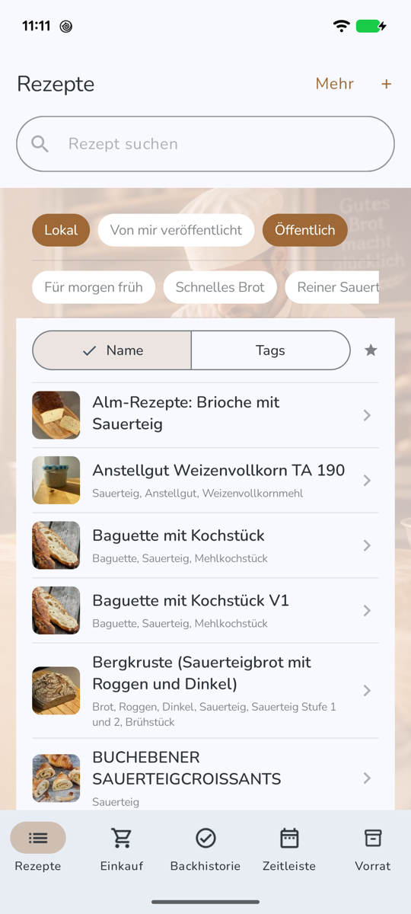
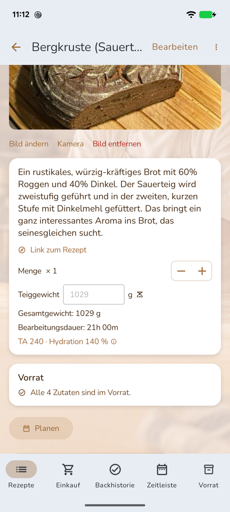
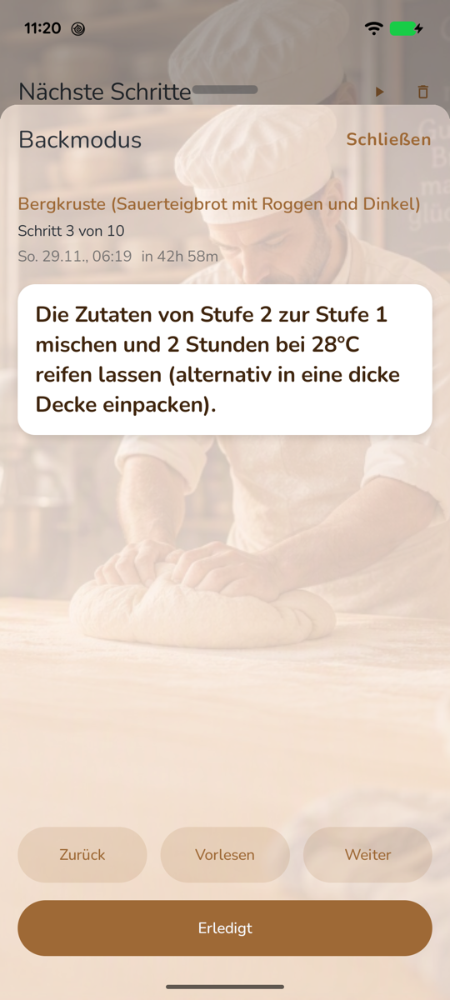
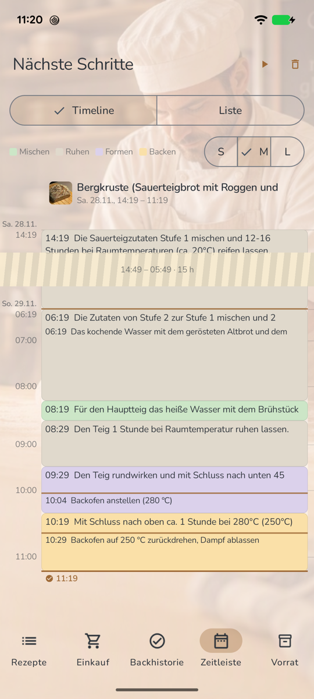
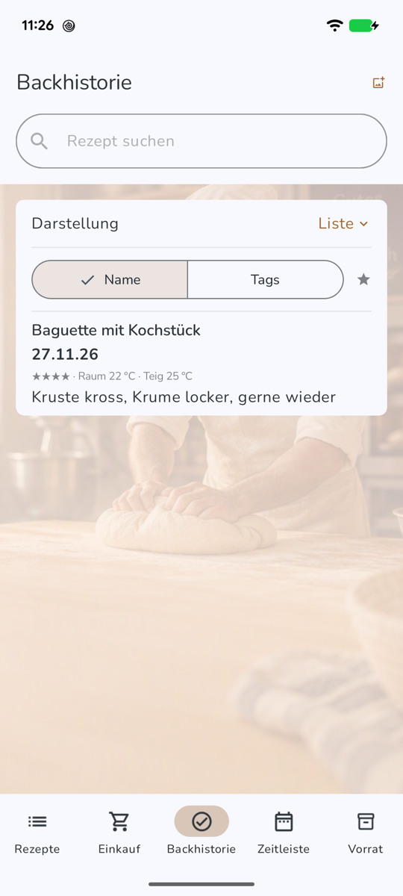
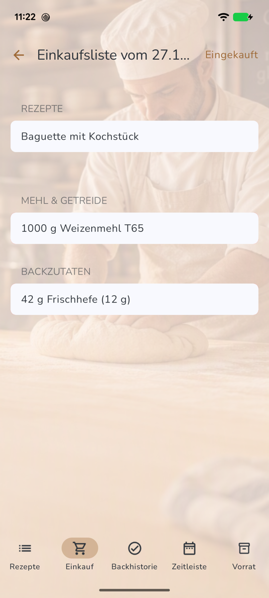
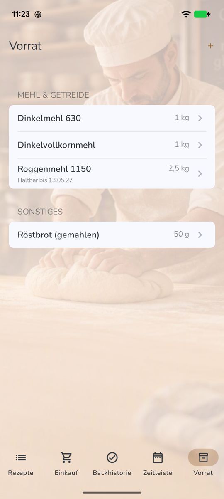

# BakePlanner pour Android – Manuel de l’utilisateur

Mise à jour : 27/11/2026 · version Android 2.4

---

## Sommaire

1. [Ce que fait BakePlanner](#1-ce-que-fait-bakeplanner)
2. [Prérequis](#2-prérequis)
3. [Notions de base](#3-notions-de-base)
4. [Les onglets](#4-les-onglets)
5. [Base de recettes](#5-base-de-recettes)
6. [Mes recettes](#6-mes-recettes)
7. [Planifier, mode cuisson et rappels](#7-planifier-mode-cuisson-et-rappels)
8. [Créer et modifier une recette](#8-créer-et-modifier-une-recette)
9. [Timeline et journée de cuisson](#9-timeline-et-journée-de-cuisson)
10. [Historique de cuisson](#10-historique-de-cuisson)
11. [Listes de courses](#11-listes-de-courses)
12. [Réserve](#12-réserve)
13. [Calculatrices](#13-calculatrices)
14. [Réglages](#14-réglages)
15. [Unités et quantités](#15-unités-et-quantités)
16. [Données, sauvegarde et changement d’appareil](#16-données-sauvegarde-et-changement-dappareil)
17. [Confidentialité](#17-confidentialité)
18. [BakePlanner Pro](#18-bakeplanner-pro)
19. [Questions fréquentes](#19-questions-fréquentes)
20. [Ce que seul l’iPhone propose](#20-ce-que-seul-liphone-propose)

---

## 1. Ce que fait BakePlanner

BakePlanner est une app de planification pour le pain, les petits pains et la pâtisserie. Ce qui la distingue d’un simple recueil de recettes, c’est qu’elle **prend en charge le calcul des horaires** :

- Une recette ne se compose pas seulement d’ingrédients, mais d’**étapes de préparation avec des durées**.
- À partir de ces durées, l’app calcule l’**heure de début de chaque étape**.
- Vous pouvez planifier à rebours : « le pain doit être prêt à 18 h » — et l’app vous dit quand lancer le levain.
- Chaque étape reçoit un **rappel** sous forme de notification Android, y compris les étapes insérées automatiquement « Allumer le four » et « La cuisson est terminée ».

S’y ajoutent : une base de recettes publique commune, vos propres recettes sur l’appareil, l’import depuis des photos, des pages web et du texte, des listes de courses triées par rayon, une réserve, un historique de cuisson avec photos, mesures et statistiques, un journal du levain avec estimation de la maturation, des variantes de recette avec comparaison, un mode cuisson qui lit à voix haute et quatre calculatrices de boulanger.

**Gratuit, et BakePlanner Pro.** L’essentiel de l’app est gratuit : recettes, planification avec rappels, mode cuisson avec lecture à voix haute, historique de cuisson, base de recettes, calculatrices et sauvegarde. Certaines fonctions avancées — listes de courses, réserve, journée de cuisson ou profils de four, par exemple — font partie de **BakePlanner Pro**, un achat unique via Google Play, sans abonnement (voir [chapitre 18](#18-bakeplanner-pro)).

### Démarrage rapide : votre premier plan de cuisson en cinq étapes

1. Choisissez une recette dans l’onglet **Recettes** — ou créez la vôtre avec **+** en haut à droite.
2. Sur la page de la recette, touchez **Planifier**.
3. Choisissez **Commencer à** ou **Terminé pour** et réglez la date et l’heure de début.
4. Vérifiez les heures calculées et touchez **Planifier** en haut à droite.
5. Ouvrez l’onglet **Timeline** pour voir toutes les étapes sous forme de timeline ou de liste.

À la première planification, Android demande si BakePlanner peut envoyer des notifications. Sans cette autorisation, le plan est tout de même enregistré, mais aucun rappel n’arrive (voir [chapitre 7](#7-planifier-mode-cuisson-et-rappels)).

---

## 2. Prérequis

| Point | Valeur |
|-------|--------|
| Android | 9.0 ou plus récent ; une langue de l’app distincte de celle du système à partir d’Android 13 |
| Distribution | Google Play (actuellement en test fermé) |
| Coût | Gratuit ; BakePlanner Pro en achat intégré unique via Google Play (voir [chapitre 18](#18-bakeplanner-pro)) |
| Taille | Environ 55–60 Mo à télécharger, environ 190 Mo une fois installée — l’app embarque son propre environnement d’exécution |
| Langues | Allemand, anglais, français |
| Affichage | Mode clair et sombre selon le réglage du système, taille de police selon le réglage Android « Taille de la police » |
| Autorisations | Notifications (rappels), appareil photo (images de recette, photos de cuisson, import depuis des photos), Internet (base de recettes, IA cloud, import depuis des pages web) |
| Internet | Seulement pour la base de recettes, l’IA cloud et l’import depuis des pages web. Vos recettes, la planification et les rappels fonctionnent hors ligne. |
| Connexion | Pas nécessaire. La connexion avec Apple est facultative — elle ne sert qu’à publier des recettes (voir [chapitre 14](#14-réglages)). |

> **Important :** toutes vos données restent uniquement sur cet appareil. Il n’y a ni synchronisation ni sauvegarde automatique dans Google Drive. Faites donc régulièrement une sauvegarde (voir [chapitre 16](#16-données-sauvegarde-et-changement-dappareil)).

---

## 3. Notions de base

Ces notions reviennent partout dans l’app :

**Recette**
L’unité de plus haut niveau : nom, description, image, note, tags, un lien facultatif vers la source, poids total et durée de préparation.

**Composant**
Une partie de la recette préparée à part — par exemple « Levain », « Préferment », « Pâte principale », « Échaudage ». Chaque composant a sa propre liste d’ingrédients. BakePlanner est conçu pour les pâtes en plusieurs étapes.

**Ingrédient**
Appartient toujours à un composant : quantité, unité et nom. La quantité peut aussi être une fraction (« 1/2 », « 1 1/2 »).

**Étape de préparation**
Une instruction avec un numéro d’étape et une durée. Vous saisissez la durée en minutes (« 90 ») ou en heures et minutes (« 1:30 », « 1h 30 », « 1,5 h »). Le numéro d’étape a une signification particulière :

- **Les nombres entiers (1, 2, 3 …) sont des étapes principales.** Elles se suivent dans le temps.
- **Les décimales (2.1, 2.2, 2.3) sont des étapes parallèles au sein d’une étape principale.** Elles se déroulent en même temps ; seule la durée *la plus longue* du groupe compte pour le total. Les étapes qui préparent un composant (levain, préferment, trempage …) démarrent à 5 minutes d’intervalle, pour que vous n’ayez pas tout à peser dans la même minute.

Exemple : si vous lancez un levain (12 h) et un échaudage (2 h) en même temps, donnez-leur les étapes 1.1 et 1.2. L’étape principale 2 commence alors après un peu plus de 12 heures, et non après 14.

**Quantité (taille de portion)**
Un facteur pour toutes les quantités ; **× 1 correspond à la recette telle qu’elle est enregistrée**, × 2 double tout. Au lieu d’un facteur, vous pouvez saisir un **poids de pâte** en grammes. Le choix vaut pour la recette ouverte : page de la recette, planification et liste de courses l’utilisent (voir [chapitre 15](#15-unités-et-quantités)).

**Emplacement**
L’endroit où se trouve une recette :

| Emplacement | Qui la voit ? | Où est-elle ? | Modifiable ? |
|-------------|---------------|---------------|--------------|
| **Local** | vous seul | sur cet appareil | oui, à tout moment |
| **Public** | tous les utilisateurs de l’app, sur Android comme sur l’iPhone | dans la base de recettes | oui, par vous en tant qu’auteur |

Les nouvelles recettes sont toujours d’abord locales. Vous mettez une recette dans la base avec **Publier** sur sa page (voir [chapitre 6](#6-mes-recettes)). Une recette que vous n’avez pas le droit de publier — tirée d’un livre, par exemple — reste simplement locale.

---

## 4. Les onglets

Au démarrage, l’app s’ouvre sur l’onglet **Recettes**. Les cinq onglets se trouvent en bas :

*L’onglet Recettes est le point de départ : toutes les recettes, avec « Plus » et « + » pour une nouvelle recette en haut à droite.*

| Onglet | Rôle |
|--------|------|
| **Recettes** | Toutes les recettes dans une liste : les vôtres, celles que vous avez publiées et les recettes publiques de tous les utilisateurs (voir [chapitre 5](#5-base-de-recettes) et [chapitre 6](#6-mes-recettes)) |
| **Courses** | Toutes les listes de courses (voir [chapitre 11](#11-listes-de-courses)) |
| **Historique de cuisson** | Les cuissons passées en liste, galerie, palmarès, nuage de photos ou statistiques (voir [chapitre 10](#10-historique-de-cuisson)) |
| **Timeline** | Toutes les étapes planifiées en timeline ou en liste, ainsi que le mode cuisson (voir [chapitre 9](#9-timeline-et-journée-de-cuisson)) |
| **Réserve** | Ce que vous avez à la maison : farines, graines, levure avec quantité et date limite (voir [chapitre 12](#12-réserve)) |

**Courses** et **Réserve** font partie de BakePlanner Pro. Sans Pro, les deux onglets montrent ce que fait la fonction, avec **En savoir plus** (voir [chapitre 18](#18-bakeplanner-pro)).

En haut à droite de l’onglet **Recettes**, deux menus :

| Menu | Entrées |
|------|---------|
| **Plus** | **Réglages**, **Importer des recettes** (lire un fichier de sauvegarde ou une recette sauvegardée seule), **Exporter des recettes** (vos recettes dans un fichier), **Planifier une journée de cuisson** et **Calculatrices** |
| **+** (Nouvelle recette) | **À la main**, **Pourcentages boulanger**, **Depuis une page web**, **À partir de photos**, **À partir d’un texte** (voir [chapitre 8](#8-créer-et-modifier-une-recette)) |

Les entrées portant le suffixe **« · PRO »** — ici **Planifier une journée de cuisson · PRO** et **Pourcentages boulanger · PRO** — font partie de BakePlanner Pro ; tant que Pro n’est pas débloqué, elles ouvrent la page Pro (voir [chapitre 18](#18-bakeplanner-pro)).

La flèche retour en haut à gauche ou le geste retour d’Android vous ramène depuis n’importe quel écran. Les feuilles comme la feuille de planification ou l’éditeur se ferment avec **Annuler** ou **Fermer** en haut à gauche.

---

## 5. Base de recettes

La base de recettes publique est partagée par tous les utilisateurs de BakePlanner, sur Android comme sur l’iPhone. Ses recettes apparaissent dans l’onglet **Recettes** avec les vôtres, par ordre alphabétique. Trois puces de filtre au-dessus de la liste activent ou désactivent chaque source :

- **Local** — vos recettes sur cet appareil,
- **Publiées par moi** — vos propres recettes dans la base,
- **Public** — les recettes des autres utilisateurs.

**Tirer vers le bas** recharge les recettes publiques. Si la liste indique « Les recettes publiques n’ont pas pu être chargées », la connexion Internet manquait — tirez la liste vers le bas encore une fois.

**Langue.** Il n’y a pas de traduction automatique sur Android. Si quelqu’un a déjà enregistré une traduction d’une recette dans la langue de votre app, l’app l’affiche ; sinon, elle montre la langue dans laquelle la recette a été écrite.

### Ouvrir une recette publique

Une recette publique s’ouvre sur une page continue : image, nom et description, quantité et poids de pâte, poids total, la ligne TA, puis le total des ingrédients, les composants et les étapes de préparation. Trois boutons :

- **Planifier** — ouvre la feuille de planification (voir [chapitre 7](#7-planifier-mode-cuisson-et-rappels)).
- **Ajouter la recette à la liste de courses** — voir [chapitre 11](#11-listes-de-courses). Fait partie de BakePlanner Pro.
- **Enregistrer comme ma recette** — crée une copie complète, image comprise, sur votre appareil. Seule cette copie peut être modifiée. Une copie déjà existante reste telle quelle.

### Plus d’actions

En haut à droite, sous **Plus d’actions** :

- **Partager la recette** — crée un PDF de la recette dans la quantité choisie et ouvre le menu de partage d’Android. Fait partie de BakePlanner Pro (voir [chapitre 18](#18-bakeplanner-pro)).
- **Signaler la recette** — avec un motif (choquant, spam, droit d’auteur, autre). La recette est masquée **aussitôt pour tous les utilisateurs** jusqu’à ce qu’un administrateur l’ait examinée.
- **Bloquer l'auteur** — toutes les recettes de cet auteur disparaissent de la liste **sur votre appareil uniquement**.
- **Modifier la recette** et **Supprimer ma recette** — seulement pour les recettes issues de votre compte. Vous modifiez la recette dans la base ; votre version locale n’est pas touchée.

Vous annulez blocages et signalements sous *Réglages → Modération* (voir [chapitre 14](#14-réglages)). Si vous êtes connecté en tant qu’**administrateur**, vous voyez en plus **Supprimer la recette (admin)** et, pour les recettes signalées, **Réafficher la recette**.

---

## 6. Mes recettes

Vos recettes sont celles de votre appareil : créées par vous, importées ou reprises de la base. Désactivez les puces **Publiées par moi** et **Public**, et il ne reste que vos propres recettes.

### Rechercher et filtrer

- **Champ de recherche** en haut, en dessous le choix **Nom / Tags**. La recherche ignore les majuscules et trouve les parties de mots : « seigle » trouve « Pain de seigle ».
- **Menu étoile (★)** à côté : **Toutes les notes** ou « … étoiles et plus », **Afficher les variantes / Masquer les variantes** et **Filtre …**.
- **Collections** sous forme de puces au-dessus de la liste : **Pour demain matin**, **Pain rapide**, **Levain pur**, **Pas cuit depuis longtemps** et **Favoris** ; dès que la réserve contient quelque chose, aussi **Avec la réserve** et **Écouler la réserve**. Un second appui annule une collection.

### Facettes

La feuille **Filtre …** contient les facettes. L’app les lit dans les ingrédients et les étapes de chaque recette — vous n’avez rien à saisir :

| Facette | Choix |
|---------|-------|
| **Durée** | Moins de 4 heures, 4 à 12 heures, Sur la nuit, Plusieurs jours |
| **Déroulement de la journée** | Préparer le soir, cuire le matin ; Préparer le matin, cuire le soir ; Prêt en 2 heures |
| **Agent levant** | Levain pur, Lievito madre, Levure, Levain et levure |
| **Farine** | Surtout du blé, du seigle, de l’épeautre ou du complet |
| **Rendement de la pâte (TA)** | Ferme (moins de TA 165), Moyen (TA 165 à 180), Souple (TA 180 et plus) |
| **Équipement** | Pierre de cuisson, Moule à cake, Banneton, Cocotte |
| **Historique de cuisson** | Jamais cuit, Pas cuit depuis longtemps, Favoris |
| **Peu de travail** | Au plus 30 minutes de travail manuel |

Avec une réserve s’ajoutent les interrupteurs **Avec la réserve** (seulement les recettes dont tous les ingrédients sont là) et **Écouler la réserve** (les recettes qui utilisent ce qui expire bientôt ; sous chacune figure ce qu’elle consomme). **Réinitialiser les filtres** efface tout d’un coup.

**Vos propres collections.** Une combinaison dont vous avez souvent besoin s’enregistre dans la feuille **Filtre …** avec **Enregistrer la collection**, sous un nom. Elle apparaît comme puce après les collections prédéfinies. Sous **Collections enregistrées**, vous la renommez (appui) ou la supprimez (balayage) ; un appui long sur la puce propose aussi **Renommer** et **Supprimer**.

**Terminé pour.** Dans la feuille **Filtre …**, **Terminé pour** fixe la date et l’heure auxquelles le pain doit être prêt. La liste ne montre alors que les recettes encore réalisables et inscrit sous chacune le départ nécessaire : « Début aujourd’hui 17:45 », « Début demain 06:10 », avec « Étapes la nuit » le cas échéant. L’objectif figure comme première puce au-dessus de la liste ; touchez-la pour le changer.

> **Fait partie de BakePlanner Pro :** vos propres collections et **Terminé pour** (voir [chapitre 18](#18-bakeplanner-pro)). Sans Pro, la feuille **Filtre …** affiche **Collections et prêt pour · PRO** à la place de **Terminé pour** et **Enregistrer la collection** ; les collections enregistrées et la puce « Terminé pour » disparaissent de la liste. Les collections enregistrées sont conservées et reviennent avec l’achat. La recherche, les facettes et les collections prédéfinies sont gratuites.

### Supprimer une recette

Balayez une de vos recettes vers la gauche dans la liste et confirmez. Son historique de cuisson et son journal du levain disparaissent avec elle. Les recettes publiques ne se suppriment pas ici.

### La page d’une de vos recettes

*La page de recette : image et quantités en haut, puis Planifier, la liste de courses et tous les ingrédients et étapes.*

De haut en bas :

1. **Image** avec **Changer l’image**, **Appareil photo** et **Supprimer l’image**, en dessous la description et — s’il existe — le **Lien vers la recette**.
2. **Quantité** (facteur) et **Poids de pâte**, le **poids total**, la **durée de préparation** et la ligne **« TA 172 · hydratation 72 % »** ; touchez-la pour le détail (voir [chapitre 15](#15-unités-et-quantités)). Les recettes planifiées régulièrement ajoutent « Prochaine cuisson » ou « Prochain nourrissage ».
3. **Réserve** — avec BakePlanner Pro, dès que la réserve contient quelque chose : « Les 5 ingrédients sont dans la réserve » ou ce qui manque (voir [chapitre 12](#12-réserve)).
4. **Planifier** et **Ajouter la recette à la liste de courses** (Pro).
5. **Total des ingrédients**, **Composants** et **Étapes de préparation**. Les lignes de farine et de levain se touchent (voir [chapitre 13](#13-calculatrices)).
6. **La dernière fois**, **Noter une cuisson** et **Cuissons précédentes** — pour un levain, le **Journal du levain** à la place.
7. **Variantes** — les recettes nées de celle-ci.

En haut à droite se trouvent **Modifier** (voir [chapitre 8](#8-créer-et-modifier-une-recette)) et **Plus d’actions** :

| Entrée | Rôle |
|--------|------|
| **Sauvegarder la recette** | Écrit la recette et son image dans un fichier, sans historique — pour la transmettre à d’autres, qui la lisent avec **Plus → Importer des recettes** |
| **Partager la recette** | Crée un PDF avec image, composants, total des ingrédients et étapes dans la quantité choisie et ouvre le menu de partage |
| **Publier** | Met la recette dans la base de recettes (voir ci-dessous) |
| **Créer une variante** | Crée une variante (voir ci-dessous) |

**Sauvegarder la recette** et **Partager la recette** font partie de BakePlanner Pro (voir [chapitre 18](#18-bakeplanner-pro)) ; sans Pro, elles portent le suffixe « · PRO » et ouvrent la page Pro. Toutes les recettes à la fois se sauvegardent gratuitement avec **Plus → Exporter des recettes**.

**Publier** suppose deux choses : la **connexion avec Apple** sous *Réglages → Compte* (sinon « Connexion requise » apparaît) et une **image de la recette** (sinon « Image requise »). La première fois, vous acceptez les conditions d’utilisation (voir [chapitre 17](#17-confidentialité)) ; suit la question **Publier la recette ?** avec **Enregistrer publiquement**. Ensuite, la page indique « Publié » et l’entrée disparaît : une recette n’est publiée qu’une fois, les modifications ultérieures se font sur la version publique (voir [chapitre 5](#5-base-de-recettes)).

### Variantes de recette

Les variantes sont vos propres recettes qui restent liées à leur recette d’origine — vous voyez ainsi plus tard ce qui changeait et comment le résultat a tourné.

- **Créer une variante** ouvre la feuille **Nouvelle variante** : sous « Ce qui change ? (facultatif) », vous notez la modification, et **Créer** copie la recette sous « Pain de campagne V1 », « Pain de campagne V2 » … puis ouvre la copie. **Remplacer la farine** et **Ajuster la TA du levain chef** créent aussi des variantes (voir [chapitre 13](#13-calculatrices)).
- Une variante affiche **Variante de « … »** ; **Comparer** liste les différences : ingrédients, TA, hydratation, poids de pâte et étapes.
- Sur la recette d’origine, la carte **Variantes** liste chaque variante avec sa note et le résultat de son historique de cuisson.
- Dans le menu étoile de la liste, **Masquer les variantes** les retire de la liste.

### Journal du levain

Une recette composée uniquement de levain, de farine et d’eau et qui ne cuit rien est un **levain** pour l’app. On le nourrit, on ne le cuit pas : au lieu de l’historique de cuisson, il a le **Journal du levain** :

- **Ratio de nourrissage** « levain : farine : eau », calculé d’après la recette.
- **Estimation de la maturation** : si vous avez noté temps de maturation et température ambiante lors des nourrissages, l’app indique quand le levain sera mûr à la **Température ambiante aujourd’hui** (« À 22 °C, mûr après environ 6h 30m, d’après 4 nourrissages »).
- **Saisir un nouveau nourrissage** avec date, **Temps jusqu’au pic de pousse**, température ambiante, **Test de flottaison** et note.
- **Nourrissages précédents**, le plus récent en premier. Un nourrissage planifié se complète après coup avec **Noter le résultat**.

Quand vous planifiez un levain, BakePlanner ajoute le nourrissage au journal au lieu d’une entrée dans l’historique de cuisson. Si la farine est dans la réserve, elle est déduite au moment du nourrissage.

---

## 7. Planifier, mode cuisson et rappels

C’est le cœur de l’app. **Planifier** sur la page de la recette ouvre la feuille de planification ; elle calcule avec la quantité réglée sur la page de la recette.

*Dans la feuille de planification, vous choisissez le moment ; les heures des étapes suivent aussitôt.*

### Choisir le moment

| Élément | Fonction |
|---------|----------|
| **Commencer à / Terminé pour** | **Commencer à** : je commence à ce moment — quand aurai-je fini ? **Terminé pour** : je veux avoir fini à ce moment — quand dois-je commencer ? |
| **Date** et **Heure de début** | Le moment de référence du plan |
| **Four** et **Chaleur tournante** | Seulement avec BakePlanner Pro et deux profils de four ou plus (voir [chapitre 14](#14-réglages)) : le four pour ce pain, prérempli avec celui des réglages, et s’il cuit en chaleur tournante |
| **Modifier les durées** | Interrupteur. Activé, chaque étape reçoit un champ de durée ; **Appliquer la durée** enregistre les nouvelles durées dans la recette |

Changez le moment et observez comment les heures sous **Étapes de préparation** s’adaptent. Rien n’est enregistré avant que vous touchiez **Planifier** en haut à droite.

### Pousse aujourd’hui et maturation aujourd’hui

**Pousse aujourd’hui.** Pour un pain, la feuille de planification reconnaît les étapes de fermentation — maturation d’un préferment, pointage et apprêt — et montre pour chaque phase la durée prévue et la durée à la **Température ambiante aujourd’hui**, préremplie avec celle notée lors de la dernière cuisson. La fermentation va environ deux fois et demie plus vite par tranche de 10 °C ; les durées de la recette sont considérées comme écrites pour 22 °C. Chaque phase a sa propre **température**, par exemple quand l’apprêt se fait dans un endroit chaud. Si vos cuissons ont noté pointage ou apprêt avec la température ambiante, l’app calcule avec ces mesures. **Utiliser ces temps de pousse** vaut pour ce plan seulement, **Utiliser les durées de la recette** annule, et **Reporter les durées des cuissons dans la recette** inscrit durablement les valeurs mesurées dans la recette.

**Maturation aujourd’hui.** Quand vous planifiez un levain avec des nourrissages dans le journal, la feuille montre le temps de maturation estimé à la température du jour ; **Reprendre la maturation comme durée** l’applique à l’étape de maturation.

### Ce que l’app signale dans le plan

Des remarques apparaissent au-dessus des étapes dès que le moment choisi mène à un plan peu pratique :

- **Étapes hors de votre journée** — avant le **Début de journée** ou après la **Fin de journée** des réglages. En dessous, l’app propose « Pour qu’aucune étape ne commence la nuit : » avec un moment plus tôt et un plus tard ; **Appliquer** le règle.
- **Temps de cuisson qui se chevauchent** — chaque four accueille une cuisson à la fois. Plus de cuissons simultanées que de fours est une erreur ; « Pour que les fours se libèrent l’un après l’autre : » propose des moments adaptés.
- **Pause de cuisson trop courte** entre deux cuissons dans le même four.
- **Étapes avec plage de durée** (voir [chapitre 8](#8-créer-et-modifier-une-recette)) : l’app peut les allonger ou les raccourcir. « Voici comment cela tient dans les plages de durée des étapes : » montre la plus petite modification qui fait tout tenir dans votre journée et vos fours.

Les remarques n’empêchent rien. En cas de chevauchement des temps de cuisson, l’app demande au moment de planifier ; **Planifier malgré tout** pose le plan quand même.

### Planifier

Toucher **Planifier** en haut à droite :

1. place toutes les étapes dans la **Timeline** et pose un **rappel** pour chacune,
2. ajoute **« Allumer le four »** le temps de préchauffage avant l’étape de cuisson — avec la température du four tirée de la recette, avec le temps de préchauffage avec pierre pour une pierre de cuisson, et avec le réglage du thermostat si vous utilisez des profils de four (« thermostat sur 240 °C »),
3. ajoute **« Baisser le four à … »** pour une température décroissante et **« Évacuer la buée »** le cas échéant,
4. planifie **« La cuisson est terminée »** à l’heure de fin,
5. crée pour vos propres recettes une **entrée d’historique de cuisson** à la date de fin, que vous complétez après la cuisson.

La confirmation **Les rappels ont été définis** indique quand allumer le four et quand le pain sera prêt. Sans l’autorisation des notifications, elle s’intitule **Plan enregistré** : le plan figure dans la timeline, mais sans rappels — accordez l’autorisation dans les réglages Android sous *Applications → BakePlanner → Notifications*.

> **Une recette, un plan — ou plusieurs.** Si la recette a déjà un plan, l’app demande : **Remplacer le plan existant** abandonne les anciennes étapes et leurs rappels — c’est ainsi que vous déplacez un pain à un autre jour. **Planifier en plus** garde le plan existant et ajoute le nouveau à côté, pour samedi et dimanche par exemple.

### Rappels

Chaque rappel arrive comme notification Android intitulée **« Rappel de cuisson »** avec le texte de l’étape. Si l’étape prépare un composant, ses ingrédients avec leurs quantités figurent en dessous. La notification propose deux actions :

- **Marquer comme terminé** — l’étape quitte le plan.
- **Décaler de…** — vous saisissez les minutes ; l’app demande ensuite « Voulez-vous également décaler toutes les étapes suivantes de cette recette ? » avec **Uniquement cette étape** et **Toutes les suivantes**. Le temps compte à partir de maintenant.

> **Heure de remise :** Android remet les rappels par son planificateur de tâches, pas sous forme d’alarmes. Si le téléphone reste longtemps inutilisé en économie d’énergie, un rappel peut arriver quelques minutes plus tard que prévu. Pour les étapes à la minute près, laissez le **mode cuisson** ouvert ou réglez en plus une alarme dans l’app Horloge.

### Mode cuisson

Pour le travail en cuisine, lancez le **mode cuisson** dans l’onglet **Timeline** — en haut à droite pour tous les plans, ou dans la liste sous un plan pour ce plan seulement. Il affiche l’étape en cours en plein écran et en grands caractères : nom de la recette, « Étape 3 sur 12 », l’heure avec un compte à rebours, le texte de l’étape et en dessous les ingrédients du composant. Avec des profils de four s’ajoute la ligne « Thermostat sur … ».

*Le mode cuisson : grands caractères et grands boutons, faciles à toucher même avec de la farine sur les mains.*

- **Retour** et **Suivant** font défiler les étapes.
- **Lire à voix haute** lit l’étape et ses ingrédients par la synthèse vocale d’Android ; **Stop** interrompt. S’il manque une voix dans votre langue, installez-la dans les réglages Android sous « Synthèse vocale » (Services de reconnaissance vocale Google).
- **Marquer comme terminé** retire l’étape et son rappel du plan et passe à la suivante.

L’écran reste allumé tant que le mode cuisson est ouvert. **Fermer** ramène en arrière.

---

## 8. Créer et modifier une recette

Avec **+** en haut à droite de l’onglet **Recettes**, vous choisissez comment la recette voit le jour. Chaque voie aboutit au même éditeur de recette, où vous vérifiez et enregistrez.

### À la main

Ouvre l’éditeur de recette vide (voir ci-dessous).

### À partir de photos

Lit une recette imprimée ou photographiée — sur Android **uniquement par l’IA cloud protégée** ; l’app Android n’a pas de reconnaissance de texte sur l’appareil.

1. **Sélectionner des images** dans les fichiers de l’appareil ou **Prendre une photo**, page par page, jusqu’à dix. L’ordre est conservé ; sous **Pages sélectionnées**, vous retirez des pages.
2. Sous **Mode d’analyse** figure **IA cloud protégée**. Avant la première utilisation, l’app explique le transfert de données ; **Accepter et analyser avec l’IA cloud** donne votre consentement. Si vous choisissez **Sur cet appareil uniquement**, l’app explique que les photos ne peuvent pas être lues ainsi.
3. **Importer** envoie les pages à l’analyse et ouvre le résultat dans l’éditeur de recette.

Des photos droites et bien éclairées, sans logos ni en-têtes, donnent les meilleurs résultats. L’écriture manuscrite n’est pas lue de façon fiable. Vérifiez ensuite **quantités, unités, températures et durées**.

### Depuis une page web

1. Saisissez l’**Adresse web**. C’est plus rapide depuis Chrome ou n’importe quelle autre app : **Partager → BakePlanner** ouvre l’import avec l’adresse remplie.
2. Choisissez le **Mode d’analyse** : l’**IA cloud protégée** sépare aussi préferment, levain et pâte principale en composants distincts. **Sur cet appareil uniquement** ne reprend que les données de recette structurées que la page fournit elle-même.
3. **Importer** charge la page et ouvre la recette dans l’éditeur, avec la photo de la page et son adresse comme lien.

Les pages derrière une connexion, un mur payant ou un bandeau de cookies ne peuvent pas être lues. L’import depuis un texte aide alors.

> **Droit d’auteur :** vous pouvez importer n’importe quelle recette pour votre usage personnel. Ne publiez les recettes d’autrui qu’avec l’accord de leurs auteurs.

### À partir d’un texte

Pour les recettes venant d’un message, d’une note ou d’une page que l’import web ne sait pas lire. Sélectionnez la recette du titre jusqu’à la dernière étape, copiez-la et collez-la sous **Texte de la recette** — ou partagez un texte sélectionné depuis une autre app vers BakePlanner. Sous **Adresse Internet (facultative)**, vous pouvez indiquer la source. Avec **Sur cet appareil uniquement**, l’app lit ingrédients et étapes selon des règles fixes : des titres comme « Ingrédients » et « Préparation », un ingrédient avec sa quantité par ligne, une étape par paragraphe, les composants sous leurs propres titres comme « Levain ». Avec l’IA cloud, la mise en forme compte moins. **Importer** ouvre le résultat dans l’éditeur.

### Pourcentages boulanger

Pour ceux qui pensent les recettes comme une formule : vous saisissez chaque ingrédient en part de la farine, l’app calcule les grammes.

> Fait partie de BakePlanner Pro (voir [chapitre 18](#18-bakeplanner-pro)). Sans Pro, l’entrée du menu **+** s’appelle « Pourcentages boulanger · PRO » et ouvre la page Pro.

1. Saisissez le **Nom de la recette**.
2. **Donnée** : **Farine totale** (par exemple 500 g) ou **Poids de pâte** (par exemple 850 g) et la quantité.
3. **Composants et ingrédients** en pourcentage ; tous les pourcentages se rapportent à la farine totale de la recette, et les farines doivent faire 100 pour cent ensemble. D’autres composants s’ajoutent avec **Nouveau composant** et **Ajouter**. Les grammes calculés figurent à côté de chaque ligne.
4. **Suivant** ouvre l’éditeur de recette avec les grammes. Vous y ajoutez temps de repos, façonnage et cuisson.

Tant que quelque chose ne va pas, **Suivant** reste désactivé et une remarque en donne la raison (« Les farines font 95 pour cent au lieu de 100. »).

### L’éditeur de recette

L’éditeur — « Nouvelle recette » à la création, « Modifier » lors d’un changement — comporte ces sections :

- **Nom** — obligatoire.
- **Image de la recette** — **Ajouter une image** depuis les fichiers ou **Appareil photo**. Les photos sont réduites à la taille de l’écran dès leur sélection. Publier demande une image.
- **Description**.
- **Note** — cinq étoiles ; toucher à nouveau la même étoile annule la note. En dessous, **Tags, séparés par des virgules**.
- **Planifier régulièrement** (pour un levain **Rafraîchir régulièrement**) avec « tous les … jours » : après la dernière cuisson, l’app planifie d’elle-même la date suivante, à la même heure que le début de la première étape. Ces dates n’apparaissent dans la timeline que deux jours avant ; les rappels arrivent tout de même à l’heure. Les plans de cuisson récurrents font partie de BakePlanner Pro (voir [chapitre 18](#18-bakeplanner-pro)) : sans Pro, l’interrupteur est désactivé, en dessous figure « Les plans de cuisson récurrents font partie de BakePlanner Pro. », et les recettes à rythme ne sont pas planifiées d’elles-mêmes.
- **Composant** — par composant un nom et ses ingrédients avec **Quantité**, **Unité** et **Ingrédient**. La quantité peut être une fraction (« 1/2 », « 1 1/2 »), l’unité une abréviation du [chapitre 15](#15-unités-et-quantités). **Ajouter un ingrédient**, **Supprimer le composant**, en dessous **Ajouter un composant**. Balayez une ligne d’ingrédient pour la supprimer.
- **Étapes de préparation** — par étape le **N°**, le texte et la durée en **Minutes** (aussi « 1:30 » ou « 1,5 h »). **Ajouter une étape** passe au nombre entier suivant, **Ajouter une sous-étape** crée une étape parallèle comme 3.1. Balayez pour supprimer.

Les champs en rouge ne sont pas valides, par exemple une durée que l’app ne sait pas lire ; tant qu’ils le restent, **Enregistrer** est désactivé.

**Plage de durée.** Une étape que le planificateur peut allonger — un apprêt au réfrigérateur de 12 à 18 heures — a les champs **Au moins** et **Au plus**. Laissés vides, la durée est fixe. Si la plage figure déjà dans le texte (« 12–18 heures au réfrigérateur »), l’app la reconnaît sans les champs.

**Four.** Une étape qui cuit, préchauffe ou indique une température de four a les champs **Four** (°C) et **Descendant à** ainsi que le choix **Buée** (Non indiqué, Avec buée, Sans buée). Les champs priment sur le texte ; laissés vides, l’app lit le four dans le texte (« cuire à 250 °C descendant à 220 °C avec buée »).

**Enregistrer** en haut à droite enregistre la recette, **Annuler** abandonne les modifications.

### Modifier une recette

**Modifier** en haut à droite d’une de vos recettes ouvre le même éditeur. Vous pouvez aussi changer l’image directement sur la page de la recette. Un plan déjà posé reste tel quel : la timeline affiche alors « … a été modifiée depuis la planification » avec **Replanifier**.

---

## 9. Timeline et journée de cuisson

L’onglet **Timeline** (intitulé « Prochaines étapes ») réunit toutes les étapes planifiées de toutes les recettes. En haut, vous basculez entre **Timeline** et **Liste**. En haut à droite se trouvent **Démarrer le mode cuisson** et **Tout supprimer**.

*La timeline montre chaque plan comme une piste et chaque étape comme une barre.*

### Timeline

Chaque plan a sa piste avec l’image et le nom de la recette, chaque étape une barre aussi longue qu’elle dure. La couleur indique ce qu’il y a à faire — pétrir, repos, façonnage, cuire ; une légende figure en haut, à côté le **zoom** en trois niveaux (S, M, L). Les sous-étapes comme les rabats pendant le pointage ou « Allumer le four » pendant l’apprêt apparaissent comme repère sur la barre de leur étape, un drapeau marque « La cuisson est terminée », une ligne rouge le moment présent. Les longues pauses sans étape — la nuit pendant laquelle le levain mûrit — sont resserrées en une bande hachurée.

Toucher une barre ouvre le détail de l’étape avec début, durée, description et — pour une étape de pétrissage — les ingrédients. Un appui long propose **Marquer comme terminé** et **Décaler**.

### Liste

Tout en haut figure l’étape **À suivre**, ou **À faire maintenant** avec le temps écoulé. Viennent ensuite les plans, chacun avec ses étapes : heure, jour, durée et instruction. Chaque ligne porte trois symboles :

- **Coche** — marquer l’étape comme terminée ; elle quitte le plan avec son rappel.
- **i** — afficher les ingrédients du composant, dans la quantité avec laquelle vous avez planifié. Seulement pour les étapes qui préparent un composant.
- **Calendrier** — décaler l’étape (voir ci-dessous).

Sous chaque plan se trouvent **Démarrer le mode cuisson** (pour ce plan seulement) et **Supprimer les étapes planifiées** (ce plan seulement, après confirmation). **Tout supprimer** en haut à droite retire tous les plans avec leurs rappels.

### Décaler une étape

La feuille **Décaler l’étape** montre **Actuellement** et, dès que vous avez saisi des minutes, **Nouveau** :

1. Saisissez les **Minutes**.
2. **Direction** : **Plus tôt** ou **Plus tard**.
3. **Étapes concernées** : **Uniquement cette étape** ou **Toutes les suivantes** — toutes les étapes ultérieures du même plan se déplacent alors aussi.
4. **Appliquer**.

Les rappels suivent. Si le nouveau moment est dans le passé, l’app signale « Décalage impossible ».

Sans étape planifiée, l’onglet indique « Aucune étape planifiée — Ouvrez une recette et touchez « Planifier ». »

### Planifier une journée de cuisson

> Fait partie de BakePlanner Pro (voir [chapitre 18](#18-bakeplanner-pro)). Sans Pro, l’entrée s’appelle « Planifier une journée de cuisson · PRO » et ouvre la page Pro.

**Recettes → Plus → Planifier une journée de cuisson** planifie plusieurs pains à la fois :

1. Sous **Recettes**, vous choisissez les pains ; les recettes de levain ne sont pas proposées.
2. **Terminé pour** — l’heure à laquelle le dernier doit être prêt — et les **Fours** (préremplis d’après les réglages ; avec des profils de four, un choix « Four » par pain).
3. **Calculer la journée de cuisson** fixe les heures de début : le pain à la plus longue cuisson est prêt à l’heure voulue, chaque autre reçoit le dernier quart d’heure avant auquel il tient encore dans un four. La **pause de cuisson** est respectée, et jamais deux pâtes ne sont pétries, rabattues ou façonnées en même temps. Les cuissons déjà planifiées comptent aussi.
4. Chaque pain affiche son début, sa fin et son créneau de four, avec des remarques en texte : « Étapes la nuit », « Le travail manuel coïncide avec un autre pain », « Aucun four libre – chevauche une autre cuisson », « Devrait déjà être en cours – choisissez une heure plus tard » ou « A déjà un plan – il sera remplacé ». Si la réserve ne suffit pas pour tous les pains, l’app dit ce qui manque.
5. **Tout planifier** crée étapes, rappels et entrée d’historique de cuisson pour chaque pain.

---

## 10. Historique de cuisson

L’onglet **Historique de cuisson** réunit toutes vos cuissons. Sous **Affichage**, vous choisissez :

- **Liste** — la plus récente en premier, avec date, nom de la recette, commentaire, mesures et photos,
- **Galerie** — des vignettes avec la première photo,
- **Palmarès** — les recettes par nombre de cuissons, vos classiques en tête,
- **Nuage de photos** — chaque recette comme un cercle avec la photo de sa dernière cuisson, d’autant plus grand qu’elle a été souvent cuite,
- **Statistiques** — voir ci-dessous.

*L’historique de cuisson garde trace de ce que vous avez cuit et du résultat.*

Le champ de recherche (nom/tags) et le filtre de note valent pour tous les affichages. Balayez une entrée vers la gauche pour la supprimer.

### Noter une cuisson

Une entrée se crée automatiquement quand vous planifiez une de vos recettes — d’abord sans commentaire. Après la cuisson, la carte **La dernière fois** sur la page de la recette vous rappelle de la compléter (**Compléter** ou **Noter maintenant**). Une cuisson sans plan s’ajoute sur la page de la recette avec **Noter une cuisson**.

L’entrée (« Notes de cuisson ») comporte :

- **Recette** — la recette à laquelle elle appartient ; c’est ici que vous déplacez une entrée vers une autre recette.
- **Date de cuisson** et **Commentaire**.
- **Mesures et résultat** : **Note** (1 à 5 étoiles), **Température ambiante** et **Température de la pâte** en °C, **Pointage** et **Apprêt** en minutes, **Farine** en texte libre et **Mie / développement** en mots-clés — en dessous, des puces de mots comme « ouverte », « moelleuse » ou « bon développement » à toucher.
- **Photos** — **Ajouter une image** depuis les fichiers ou **Appareil photo**.

**Enregistrer** sauvegarde l’entrée. La page de la recette montre les mesures sous **La dernière fois** ; pointage et apprêt avec la température ambiante alimentent la carte **Pousse aujourd’hui** à la prochaine planification.

### Statistiques

**Affichage → Statistiques** additionne ce que donnent les cuissons affichées, déjà passées : en haut **Pains au total**, **Cette année**, **Par mois** et la note moyenne, en dessous **Pains par mois**, **Les plus cuits**, **Notes**, **Apprêt et température ambiante** (un point par cuisson) et **Mie et développement au four**. Les graphiques sont de simples barres et points sans légende d’axe. Plus vous notez de mesures, plus les statistiques en montrent.

> Les statistiques font partie de BakePlanner Pro (voir [chapitre 18](#18-bakeplanner-pro)). Sans Pro, **Statistiques** montre ce qu’elles font, avec **En savoir plus**.

### Historique de cuisson à partir de photos

Le symbole photo en haut de l’onglet **Historique de cuisson** fait entrer d’anciennes photos de pain dans l’historique :

1. **Choisir des photos**.
2. De chaque photo, l’app lit la **date** et, s’il existe, le **titre ou la description**. Elle propose la recette **d’après ce titre** (« Proposée d’après le titre ») — pas d’après la ressemblance avec l’image de la recette. Inscrivez donc le nom de la recette dans la photo, par exemple dans Google Photos sous *Infos → Description*. Android lit date et titre dans les fichiers JPEG.
3. Vérifiez chaque ligne : choisissez une date là où figure « Pas de date dans la photo – en choisir une », choisissez ou changez la recette. Les lignes marquées « Déjà dans l’historique ce jour-là » sont ignorées.
4. **Créer** écrit les entrées avec leurs photos.

> Fait partie de BakePlanner Pro (voir [chapitre 18](#18-bakeplanner-pro)). Sans Pro, le symbole photo ouvre la page Pro.

---

## 11. Listes de courses

> Fait partie de BakePlanner Pro (voir [chapitre 18](#18-bakeplanner-pro)). Sans Pro, l’onglet **Courses** montre ce que fait la fonction, avec **En savoir plus** ; **Ajouter la recette à la liste de courses** porte le suffixe « · PRO ».

### Mettre des ingrédients sur une liste

**Page de la recette → Ajouter la recette à la liste de courses** — pour vos recettes comme pour les recettes publiques. Les ingrédients vont sur la liste dans la quantité réglée sur la page de la recette.

1. **Destination** : **Nouvelle liste** avec une date, ou **Liste existante**. S’il existe déjà une liste pour cette date, les ingrédients y sont ajoutés.
2. **Déduire la réserve** (activé par défaut) : ce qui est dans la réserve ne va pas sur la liste, les quantités partielles sont réduites. Si tout est là, l’app le dit au lieu de créer une liste vide.
3. **Créer**. L’app confirme par « Les ingrédients ont été ajoutés à la liste de courses ».

### Ce qui va sur la liste — et ce qui n’y va pas

- **Ne sont pas repris** l’eau, le sel et tout ce que l’on prépare soi-même : levain chef, levain, levain liquide, lievito madre, poolish, biga — dans toutes les langues. Ce qui n’en a que le nom (eau de rose, levain en poudre) reste sur la liste.
- **Ne sont pas repris** les ingrédients sans unité ou sans quantité.
- **Les œufs** sont comptés à la pièce : « 120 g d’œufs » deviennent « 2 pce œufs ».
- **Les ingrédients identiques sont regroupés** : « lait 30 °C » et « lait », « levure fraîche » et « levure », « farine de blé type 550 » et « farine de blé 550 ». Les unités de même base sont additionnées (0,5 kg + 200 g).
- Les noms d’ingrédients figurent sur la liste tels qu’ils sont nommés dans la recette ; Android ne les traduit pas.

### Consulter les listes de courses

*La liste de courses est triée par rayon et indique l’emballage que vous achetez vraiment.*

Dans l’onglet **Courses**, chaque liste affiche « Liste de courses du … », les recettes qu’elle contient et les ingrédients **regroupés par rayon** : farines et céréales, produits laitiers et œufs, ingrédients de pâtisserie, noix, graines et fruits secs, fruits et légumes, épices et herbes, huiles, matières grasses et liquides, divers.

**Tailles d’emballage.** Devant l’ingrédient figure l’emballage habituel qui couvre le besoin, le besoin lui-même entre parenthèses : « 1 kg farine de blé 550 (200 g) », « 42 g levure fraîche (6 g) », « 6 pièces œufs (2 pce) ».

- Toucher un ingrédient ouvre **Modifier la quantité** : quantité et unité ne valent que pour cette liste, la recette reste inchangée. **Mettre dans la réserve** et **Retirer l’ingrédient** s’y trouvent aussi.
- **Acheté** en haut de la liste met toute la liste dans la réserve (voir [chapitre 12](#12-réserve)).
- Balayez une liste vers la gauche pour la supprimer (**Supprimer la liste de courses**).

---

## 12. Réserve

L’onglet **Réserve** recense ce que vous avez à la maison — selon les mêmes rayons que la liste de courses.

> Fait partie de BakePlanner Pro (voir [chapitre 18](#18-bakeplanner-pro)). Sans Pro, l’onglet **Réserve** montre ce que fait la fonction, avec **En savoir plus**. La carte **Réserve** de la page de recette et **Déduire la réserve** manquent alors, et les plans ne réservent rien dans la réserve. Les articles saisis sont conservés.

*La réserve : les articles par rayon, avec quantité et date limite.*

- **Ajouter un article** (+ en haut à droite) : **Nom** — avec des **Suggestions tirées de vos recettes**, pour que réserve et recettes désignent la même chose —, **Quantité** en g, kg ou pièces, **Date limite** et **Note** ; **Enregistrer**.
- Touchez un article pour le modifier, balayez-le vers la gauche pour le retirer.
- **À consommer bientôt** : les articles qui expirent dans les 14 prochains jours ou ont déjà expiré figurent en haut, marqués en couleur.
- À partir de 1000 g, la réserve affiche les quantités en kilogrammes.

### De la liste de courses à la réserve

**Acheté** sur la liste ou **Mettre dans la réserve** sur une ligne ouvre la feuille **Acheté** : chaque ligne montre « Nécessaire : … » et la **Quantité achetée**, préremplie avec l’emballage de la liste — saisissez ce que vous avez vraiment acheté. **Enregistrer** ajoute chaque ligne à l’article du même nom ou le crée, et la retire de la liste. Les lignes sans quantité restent ; s’il ne reste rien, la liste est terminée.

### Réserve et recettes

- **Page de la recette :** la carte **Réserve** dit si tous les ingrédients sont là ou nomme ce qui manque (« Il manque 200 g de farine de seigle 1150 »), dans la quantité choisie. L’eau, le sel et le levain ne comptent pas. Les ingrédients se rapprochent par leur nom ; « levure fraîche » et « levure », « type 550 » et « 550 » comptent comme identiques.
- **Liste de courses :** **Déduire la réserve** (voir [chapitre 11](#11-listes-de-courses)).
- **Liste des recettes :** les collections **Avec la réserve** et **Écouler la réserve** (voir [chapitre 6](#6-mes-recettes)).
- **Réservations :** dès que vous planifiez un pain, l’app réserve ce qu’il consommera. Carte de recette, liste de courses et journée de cuisson calculent avec le disponible. Si le plan est supprimé ou remplacé, la quantité redevient libre. Quand le plan arrive à sa fin, la réservation devient une déduction et le stock baisse.
- **Les nourrissages** d’un levain déduisent leur farine de la même façon.
- **Dernières déductions** liste les déductions des plans terminés ; **Annuler** remet une quantité en stock si un pain n’a finalement pas été cuit.

La sauvegarde complète emporte la réserve (voir [chapitre 16](#16-données-sauvegarde-et-changement-dappareil)).

---

## 13. Calculatrices

**Recettes → Plus → Calculatrices** ouvre une page avec quatre calculatrices de boulanger. Deux d’entre elles s’atteignent aussi directement depuis une recette.

### Température de la pâte

Calcule la température que doit avoir l’**eau** pour que la pâte atteigne la température voulue après le pétrissage. Vous saisissez la **Température cible** de la pâte, la température ambiante, celle de la farine (en général la même que la pièce) et, si besoin, celle du levain ou du préferment. La **Chaleur de pétrissage** est la chaleur que la pâte prend en pétrissant ; calibrez-la une fois en mesurant après le pétrissage, et elle vaut pour toutes les recettes.

### Remplacer la farine

Les farines s’échangent **1:1 au poids** ; ce qui change, c’est l’eau, car chaque farine absorbe différemment. Sur la page de la recette, les lignes de farine se touchent (« Appuyez sur une farine pour la remplacer. ») : la feuille **Remplacer la farine** montre la farine reconnue, vous laisse choisir la farine de remplacement et calcule la variation d’eau, le rendement de la pâte et l’hydratation. **Créer une copie avec la substitution** inscrit l’échange dans une nouvelle variante ; dans une telle copie, le bouton s’intitule **Appliquer la modification**. Des conseils de conduite s’y ajoutent, comme pétrir l’épeautre moins longtemps ou acidifier le seigle.

### TA du levain chef

Si une recette demande « 100 g de levain chef TA 150 » mais que vous conduisez le vôtre à TA 210, l’app compense pour que la farine apportée par le levain reste la même : plus de levain, moins d’eau dans le même composant. Sur la page de la recette, les lignes de levain se touchent : **Ajuster la TA du levain chef** montre la TA reconnue (d’après le nom de l’ingrédient ou les réglages), vos **TA de levain chef** en choix rapide et le résultat. **Créer une copie avec l’ajustement** crée une variante.

### Poids de pâte

Calcule la quantité de pâte qui tient dans un moule ou un banneton : **Moule à cake** et **Moule rond** d’après les mesures intérieures et le **Facteur de remplissage** du **Type de pâte** (blé clair, pain de mie ; pain mixte ; seigle, complet, graines), **Banneton rond** et **Banneton ovale** d’après les tailles nominales au bord supérieur. Sur la page de la recette, le symbole balance à côté de **Poids de pâte** ouvre la même calculatrice avec le type de pâte tiré de la recette ; **Reprendre comme poids de pâte** reporte le résultat.

---

## 14. Réglages

**Recettes → Plus → Réglages.** Les réglages ne valent que pour cet appareil.

### BakePlanner Pro

Tout en haut figure **BakePlanner Pro**, à côté **En savoir plus** ou, après l’achat, **Débloqué**. Un appui ouvre la page Pro avec l’achat et **Restaurer les achats** (voir [chapitre 18](#18-bakeplanner-pro)).

### Général

**Langue** ouvre le réglage Android « Langue de l’application » (à partir d’Android 13). Vous y choisissez l’allemand, l’anglais ou le français indépendamment de la langue de l’appareil ; sans choix, l’app suit la langue du système. Il n’y a pas de sélecteur de langue dans l’app elle-même.

### Recettes

| Réglage | Description |
|---------|-------------|
| **Taille de portion par défaut** | 0,5 / 1,0 / 1,5 / 2,0 — les recettes s’ouvrent à cette taille. Par défaut : 1,0 |
| **Levain chef** | La TA de votre levain, pour répartir en farine et eau une quantité de levain sans TA indiquée. Par défaut : TA 200 |
| **Lievito madre** | Idem pour le lievito madre. Par défaut : TA 150 |
| **Afficher les pourcentages boulanger** | Affiche pour chaque ingrédient pesé sa part de la farine du composant. Par défaut : désactivé |
| **Mes TA de levain chef** | Séparées par des virgules ; le choix rapide pour ajuster la TA du levain chef |
| **Unités personnalisées** | Mène à leur gestion, voir [chapitre 15](#15-unités-et-quantités) |

### Sauvegarde

**Créer une sauvegarde complète** et **Restaurer une sauvegarde** — voir [chapitre 16](#16-données-sauvegarde-et-changement-dappareil).

### Fours

Vos fours sous forme de profils : **Nom**, **Temps de préchauffage**, **Temps de préchauffage avec pierre**, l’**Écart** (si le four chauffe plus ou moins que ce qu’indique le thermostat) et la **Réduction chaleur tournante**. **Planification avec** est le four que proposent la feuille de planification et la journée de cuisson ; **Ajouter un four** en crée un autre, **Supprimer le four** le retire. Avec des profils de four, les étapes du four indiquent le réglage du thermostat (« Allumer le four (250 °C, thermostat sur 240 °C) »), et le nombre de fours est le nombre de profils. La recette ne mémorise pas le four ; celui des réglages est toujours prérempli.

> Les profils de four font partie de BakePlanner Pro (voir [chapitre 18](#18-bakeplanner-pro)). Sans Pro, **Fours** n’affiche qu’une remarque, et l’app planifie comme s’il n’y avait pas de profils de four : avec les temps de préchauffage et le nombre de **Fours** de **Planification de cuisson**, sans choix du four dans la feuille de planification. Les profils enregistrés sont conservés et s’appliquent de nouveau après l’achat.

### Planification de cuisson

| Réglage | Description |
|---------|-------------|
| **Temps de préchauffage** | 0 à 120 minutes avant l’étape de cuisson pour « Allumer le four ». Par défaut : 15 minutes (seulement sans profils de four) |
| **Temps de préchauffage avec pierre** | 0 à 180 minutes quand une étape mentionne une pierre ou un acier de cuisson. Par défaut : 45 minutes (seulement sans profils de four) |
| **Pause de cuisson** | Écart minimal entre deux cuissons dans le même four. Par défaut : 10 minutes |
| **Fours** | Combien de cuissons peuvent se dérouler en même temps. Par défaut : 1 (seulement sans profils de four) |
| **Début de journée** et **Fin de journée** | Quand vous êtes disponible. Par défaut : 6 h et 23 h |

> Seuls les temps de préchauffage déplacent des étapes. Pause de cuisson, fours, début et fin de journée ne modifient pas le plan — l’app le vérifie par rapport à eux et avertit dans la feuille de planification.

### Compte

La connexion est **facultative**. **Se connecter avec Apple** ouvre la connexion Apple dans le navigateur puis revient dans l’app ; ni nom ni adresse e-mail ne sont demandés. Avec elle, vos recettes publiées appartiennent à votre compte Apple, sur Android comme sur l’iPhone : une recette publiée depuis l’iPhone peut ainsi être modifiée aussi depuis l’appareil Android. Sur Android, la connexion est en outre nécessaire pour **Publier**.

- **Se déconnecter** — retour à l’utilisation anonyme ; les recettes sur l’appareil ne sont pas touchées.
- **Supprimer le compte** — après confirmation. Les recettes publiées restent visibles pour tous mais n’appartiennent plus à aucun compte ; supprimez-les avant si vous ne voulez pas les laisser dans la base. Les recettes sur l’appareil sont conservées. C’est irréversible.

### Confidentialité et IA

**Analyse IA à l’importation de recettes** affiche **Autorisée** ou **Local uniquement** ; touchez pour ouvrir la page **Confidentialité de l’IA** (voir [chapitre 17](#17-confidentialité)). **Retirer le consentement à l’IA cloud** annule le consentement.

### Modération

**Auteurs bloqués** avec **Débloquer tous les auteurs** — leurs recettes réapparaissent aussitôt — et **Recettes que vous avez signalées** avec **Effacer les signalements sur cet appareil**. Une recette signalée reste masquée pour tous jusqu’à ce qu’un administrateur l’ait examinée ; effacer votre signalement ne prend effet qu’ensuite.

### Aide

Ouvre dans le navigateur le **Manuel de l’utilisateur**, **Aide et contact**, la **Politique de confidentialité** et les **Mentions légales**.

---

## 15. Unités et quantités

### Quantité ou poids de pâte

Sur la page de la recette, vous mettez une recette à l’échelle de deux façons :

- **Quantité** — un facteur par demi-pas (× 0,5, × 1, × 1,5 …) ; × 1 est la recette enregistrée.
- **Poids de pâte** — un poids cible en grammes, par exemple 2000 ; l’app convertit tous les ingrédients. Le symbole balance à côté le calcule d’après votre moule (voir [chapitre 13](#13-calculatrices)).

L’arrondi suit la pesée : à partir de 10 g au gramme entier, en dessous à une décimale (« 2,7 g de levure »). Le choix vaut pour la page de la recette, la planification, la liste de courses et les ingrédients des rappels. Il ne touche **pas** aux durées — la pâte ne lève pas plus vite parce qu’on en fait moins — et ne modifie pas la recette.

### Rendement de la pâte et hydratation

La ligne **« TA 172 · hydratation 72 % »** sur la page de la recette indique le rendement de la pâte (farine plus eau pour 100 g de farine) et l’hydratation sur l’ensemble des composants. Touchez-la pour le détail avec farine et eau en grammes, les composants, les parts de levain, la **farine préfermentée**, les ingrédients **non comptés** et des **remarques** quand le sel ou la levure s’écartent nettement des pourcentages boulanger habituels.

- **Farine** : ce qui porte « farine », « semoule », « mouture » dans son nom, ainsi que le vieux pain — pas la graine de lin moulue, les flocons, le son ou les farines de noix.
- **Les liquides comptent entièrement** : eau, lait, babeurre, bière, petit-lait, jus.
- **Le levain est réparti** : 20 g à TA 200 font 10 g de farine et 10 g d’eau. La TA vient du nom de l’ingrédient (« levain chef TA 150 ») ou des réglages ; biga, poolish et pâte fermentée ont leur TA par définition.
- **Chaque composant compte exactement une fois.**

### Pourcentages boulanger

Avec *Réglages → Recettes → Afficher les pourcentages boulanger*, chaque ingrédient pesé affiche sa part de la farine du composant, par exemple « 319 g d’eau · 62 % ».

### Unités disponibles

Dans l’éditeur de recette, vous saisissez l’unité sous forme d’**abréviation**. Utilisez les abréviations de la colonne « Enregistrée comme » — une unité que l’app ne connaît pas n’a pas de conversion et n’entre pas dans le poids total. S’il vous en manque une, créez-la comme unité personnalisée. En anglais et en français, l’app affiche les mêmes unités avec leurs propres abréviations (« c. à c. » pour TL) ; ce qui est enregistré est toujours l’abréviation du tableau.

**Au poids (base : grammes)**

| Abrév. | Unité | Enregistrée comme | Équivaut à |
|---|---|---|---|
| g | gramme | g | 1 g |
| kg | kilogramme | kg | 1000 g |
| mg | milligramme | mg | 0,001 g |
| livre | livre (500 g) | pfd | 500 g |
| pincée | pincée | Pr | 1 g |
| pointe | pointe de couteau | Msp | 0,05 g |
| botte | botte | Bd | 10 g |
| tranche | tranche | Sc | 25 g |
| rouleau | rouleau | Rolle | 275 g |
| sachet | sachet | Pck | 11 g |
| poignée | poignée | Handvoll | 25 g |
| œuf | œuf | ei | 60 g |
| œuf (S) | œuf, calibre S | ei(s) | 50 g |
| œuf (M) | œuf, calibre M | ei(m) | 60 g |
| œuf (L) | œuf, calibre L | ei(l) | 70 g |
| œuf (XL) | œuf, calibre XL | ei(xl) | 80 g |

**Au volume (base : millilitres)**

| Abrév. | Unité | Enregistrée comme | Équivaut à |
|---|---|---|---|
| ml | millilitre | ml | 1 ml |
| cl | centilitre | cl | 10 ml |
| dl | décilitre | dl | 100 ml |
| l | litre | l | 1000 ml |
| Mass | Mass (1 l) | mass | 1000 ml |
| c. à c. | cuillère à café | TL | 5 ml |
| c. à s. | cuillère à soupe | EL | 15 ml |
| tasse | tasse | Tas | 200 ml |
| giclée | giclée | Ss | 10 ml |
| trait | trait | Sp | 0,27 ml |
| goutte | goutte | Tr | 0,067 ml |

**Comptées**

| Abrév. | Unité | Enregistrée comme | Équivaut à |
|---|---|---|---|
| pce | pièce | St | compté |

Pour le poids total, l’app convertit les volumes en grammes d’après la densité des ingrédients courants — farine 0,66, eau et lait 1,0, huile 0,8, miel 1,3. Une tasse de farine compte donc 200 ml × 0,66 = 132 g.

### Unités personnalisées

*Réglages → Recettes → Unités personnalisées → Ajouter une unité* : **Nom** (par exemple « pot »), **Abréviation** (encore libre), **Mesurée en** (grammes, millilitres ou pièces) et la **Conversion** — ce que contient une unité. La conversion est obligatoire, car le total des ingrédients, les pourcentages boulanger et la liste de courses en dépendent. Les unités personnalisées ne valent que sur cet appareil et ne suivent pas la sauvegarde.

---

## 16. Données, sauvegarde et changement d’appareil

### Tout reste sur l’appareil

Vos recettes, étapes planifiées, listes de courses, historique de cuisson, journal du levain et réserve sont enregistrés **uniquement sur cet appareil Android**. Il n’y a **aucune synchronisation** avec d’autres appareils — ni avec un second appareil Android, ni avec un iPhone. La sauvegarde automatique d’Android dans Google Drive est désactivée pour BakePlanner, car elle est limitée à 25 Mo et échouerait en silence avec les photos. **Si vous désinstallez l’app ou perdez l’appareil sans sauvegarde personnelle, toutes les données sont perdues.**

### Sauvegarder

- **Réglages → Sauvegarde → Créer une sauvegarde complète** écrit toutes vos recettes avec leurs images, l’historique de cuisson avec ses photos, le journal du levain et la réserve dans un fichier. Placez-le dans Google Drive, envoyez-le-vous par e-mail ou copiez-le sur votre ordinateur.
- **Recettes → Plus → Exporter des recettes** sauvegarde une sélection : cochez des recettes ou **Tout sélectionner**, au besoin **Avec l’historique de cuisson, le journal du levain et la réserve**, puis **Exporter**. Quelques recettes sans l’interrupteur servent à les transmettre à d’autres.
- **Sauvegarder la recette** sous **Plus d’actions** sur une page de recette écrit une seule recette, sans historique. Cela fait partie de BakePlanner Pro ; la sauvegarde complète et **Exporter des recettes** sont gratuites.

Sur Android, les images de recette et les photos de cuisson sont réduites à la taille de l’écran dès leur sélection ; même une sauvegarde riche en photos reste ainsi maniable.

### Restaurer

**Réglages → Sauvegarde → Restaurer une sauvegarde** ou **Recettes → Plus → Importer des recettes** lit un fichier. Les recettes et articles de réserve qui manquent sont ajoutés ; **rien de ce qui existe n’est jamais écrasé**. Les cuissons et nourrissages manquants sont complétés. Le message indique ce qui a été ajouté. Les réglages et les étapes planifiées ne font pas partie du fichier.

### Passer de l’iPhone à Android et inversement

Le fichier de sauvegarde est le même sur les deux plateformes et fonctionne **dans les deux sens** : sur l’iPhone, vous le créez sous *Réglages → Sauvegarde → Créer une sauvegarde complète* et le lisez sur Android — et inversement. Ce qui ne suit pas :

- les plans et rappels en cours — replanifiez sur le nouvel appareil,
- les unités personnalisées — recréez-les,
- les réglages.

La réserve suit ; les articles que la réserve du nouvel appareil n’a pas encore par leur nom sont ajoutés. Les recettes publiques n’ont pas besoin d’être transférées : la base de recettes est la même sur les deux plateformes.

---

## 17. Confidentialité

### Où se trouvent vos données

- **Vos recettes, plans, listes de courses, historique de cuisson, journal du levain et réserve** se trouvent uniquement sur votre appareil. Personne d’autre ne les voit.
- **Les recettes publiques** se trouvent dans la base de recettes commune et sont visibles par tous les utilisateurs.
- **Import de recettes :** avec « Sur cet appareil uniquement », le texte de la page et le texte collé restent sur l’appareil. Ce n’est que si vous avez accepté l’**IA cloud protégée** que les images choisies ou le texte de la recette et l’adresse de la page sont envoyés chiffrés via une fonction Firebase de BackPlaner (région europe-west1) à Google Vertex AI (Gemini, site UE). Ils y sont traités uniquement pour le brouillon de recette et ne sont pas conservés. Seul reste enregistré un compteur pour la limite d’utilisation, avec votre identifiant pseudonyme. Votre appareil charge lui-même la page web. Les détails se trouvent sous *Réglages → Confidentialité et IA → Confidentialité de l’IA*, où vous pouvez aussi retirer votre consentement.
- L’app utilise un **identifiant anonyme** pour que vous puissiez supprimer vos propres recettes publiques et que d’autres puissent bloquer des auteurs. La connexion avec Apple est facultative ; ni nom ni adresse e-mail ne sont demandés. Vous pouvez supprimer votre compte à tout moment sous *Réglages → Compte → Supprimer le compte*.

### Conditions d’utilisation des recettes publiques

Avant de publier une recette pour la première fois, vous acceptez les conditions :

- Une recette publiée est visible par tous les utilisateurs de la base de recettes.
- **Tolérance zéro** envers les contenus choquants, injurieux, illicites ou portant atteinte au droit d’auteur.
- Vous êtes seul responsable des contenus que vous partagez.
- Les contenus signalés sont examinés et retirés **sous 24 heures** ; les auteurs qui enfreignent les règles à plusieurs reprises peuvent être exclus.

Avec **Refuser**, rien n’est téléversé ; la recette reste locale. Contre les contenus indésirables, **Signaler la recette** et **Bloquer l'auteur** vous aident (voir [chapitre 5](#5-base-de-recettes)).

---

## 18. BakePlanner Pro

BakePlanner Pro est un **achat unique** via Google Play — sans abonnement. La page Pro affiche le prix tel que Google Play l’indique pour votre pays. Une fois achetées, les fonctions restent débloquées pour toujours.

### Ce qui est inclus

| Fonction | Ce qu’elle fait | Où dans l’app |
|----------|-----------------|---------------|
| **Partager des recettes en PDF** | Imprimer ou envoyer une recette en PDF dans la quantité affichée | Page de la recette → **Plus d’actions** → **Partager la recette**, aussi pour les recettes publiques (voir [chapitre 6](#6-mes-recettes)) |
| **Transmettre des recettes** | Une seule recette dans un fichier qui se réimporte | Page de la recette → **Plus d’actions** → **Sauvegarder la recette** |
| **Plans de cuisson récurrents** | Une recette se planifie d’elle-même selon son rythme, par exemple le nourrissage du levain | Éditeur de recette → **Planifier régulièrement** ou **Rafraîchir régulièrement** (voir [chapitre 8](#8-créer-et-modifier-une-recette)) |
| **Listes de courses** | Mettre les ingrédients d’une recette sur une liste triée par rayon, et les cocher | Onglet **Courses** ; page de la recette → **Ajouter la recette à la liste de courses** (voir [chapitre 11](#11-listes-de-courses)) |
| **Réserve** | Farines, graines et levure avec quantité et date limite ; les achats y entrent, les plans y réservent | Onglet **Réserve** ; carte **Réserve** de la page de recette ; **Déduire la réserve** (voir [chapitre 12](#12-réserve)) |
| **Planifier une journée de cuisson** | Plusieurs pains pour une heure voulue, en tenant compte des fours et de la pause de cuisson | **Recettes → Plus → Planifier une journée de cuisson** (voir [chapitre 9](#9-timeline-et-journée-de-cuisson)) |
| **Collections et prêt pour** | Enregistrer vos combinaisons de filtres comme puce ; ne voir que les recettes encore réalisables pour une heure donnée | Feuille **Filtre …** → **Enregistrer la collection** et **Terminé pour** (voir [chapitre 6](#6-mes-recettes)) |
| **Statistiques de cuisson** | L’historique de cuisson en chiffres et graphiques : combien de fois, quoi le plus, quelle note | Onglet **Historique de cuisson** → **Affichage** → **Statistiques** (voir [chapitre 10](#10-historique-de-cuisson)) |
| **Recette en pourcentages du boulanger** | Une nouvelle recette à partir de parts de la farine ; l’app calcule les grammes | **+** → **Pourcentages boulanger** (voir [chapitre 8](#8-créer-et-modifier-une-recette)) |
| **Profils de four** | Chaque four avec ses temps de préchauffage, son écart et sa réduction en chaleur tournante ; le plan et les étapes du four tiennent compte du four choisi | **Réglages → Fours** ; choix du four dans la feuille de planification et pour la journée de cuisson (voir [chapitre 14](#14-réglages)) |
| **Historique de cuisson à partir de photos** | D’anciennes photos de pain deviennent des entrées de l’historique | Onglet **Historique de cuisson** → symbole photo (voir [chapitre 10](#10-historique-de-cuisson)) |

### Ce qui reste gratuit

Tout le reste : vos recettes et leur import depuis des photos, des pages web et du texte, les variantes de recette et le journal du levain, la planification avec rappels, pousse aujourd’hui comprise, la timeline, le mode cuisson avec lecture à voix haute, l’historique de cuisson, la base de recettes publique avec la publication, les quatre calculatrices, la recherche, les facettes et les collections prédéfinies, ainsi que la sauvegarde : **Réglages → Sauvegarde**, **Plus → Exporter des recettes** et **Plus → Importer des recettes** — aussi pour une recette sauvegardée seule que quelqu’un vous envoie.

### Reconnaître les fonctions Pro

- Les entrées de menu et les boutons portent le suffixe **« · PRO »** : **Planifier une journée de cuisson**, **Pourcentages boulanger**, **Sauvegarder la recette**, **Partager la recette** et **Ajouter la recette à la liste de courses**.
- Les onglets **Courses** et **Réserve** et l’affichage **Statistiques** montrent, au lieu de leur contenu, ce que fait la fonction, avec **En savoir plus**.
- Dans la feuille **Filtre …**, **Collections et prêt pour · PRO** remplace **Terminé pour** et **Enregistrer la collection**.
- D’autres éléments sont désactivés ou masqués sans Pro : l’interrupteur **Planifier régulièrement**, les profils de four sous **Réglages → Fours**, la carte **Réserve** et **Déduire la réserve**. Les chapitres consacrés à chaque fonction le décrivent plus en détail.

Toucher une fonction verrouillée ouvre la page Pro. Ce que vous avez déjà créé — listes de courses, articles de la réserve, collections enregistrées, profils de four — reste enregistré sans Pro et réapparaît dès que Pro est débloqué.

### Acheter Pro

1. Ouvrez **Réglages → BakePlanner Pro** ou touchez une fonction verrouillée.
2. La page Pro liste toutes les fonctions sous **Inclus**, celle que vous avez touchée en premier.
3. **Débloquer Pro** affiche à droite le prix de Google Play. Un appui ouvre la boîte d’achat de Google Play.
4. Après l’achat, la page se ferme ; les réglages affichent **Débloqué**.

Si « Prix indisponible » apparaît à la place du prix, l’app ne joint pas Google Play pour le moment — vérifiez la connexion Internet et que Google Play est configuré sur l’appareil. « L’achat n’est pas possible pour le moment. Veuillez réessayer plus tard. » signifie la même chose.

### Paiement en attente

Si vous choisissez dans Google Play un mode de paiement confirmé plus tard, la page Pro indique « Le paiement n’est pas encore finalisé. Pro sera débloqué dès que Google Play le confirmera. » Vous n’avez rien d’autre à faire : dès que Google Play confirme le paiement, l’app débloque Pro.

### Restaurer les achats

L’achat appartient à votre compte Google et vaut sur tous les appareils Android où Google Play est connecté avec ce compte — même après une réinstallation. L’app lit l’achat au lancement et chaque fois qu’elle revient au premier plan ; sans Internet, elle se souvient que Pro a été acheté. Si l’achat manque malgré tout, touchez **Restaurer les achats** sur la page Pro.

### Utiliser un code

Un code promotionnel pour BakePlanner Pro s’utilise dans le Play Store : photo de profil → **Paiements et abonnements** → utiliser un code. Le code arrive comme un achat ; ouvrez ensuite BakePlanner, et Pro est débloqué. S’il n’apparaît pas tout de suite, **Restaurer les achats** aide.

### iPhone et Android

Pro sur l’iPhone et Pro sur Android sont des **achats distincts** : l’App Store et Google Play ne connaissent pas les achats de l’autre. Un achat sur l’iPhone ne vaut pas sur Android, et inversement. Le fichier de sauvegarde transporte recettes et données, mais aucun achat.

---

## 19. Questions fréquentes

**Aucun rappel n’arrive.**
Vérifiez dans les réglages Android, sous *Applications → BakePlanner → Notifications*, que les notifications sont autorisées. Vérifiez aussi qu’il y a bien des étapes dans la timeline ; les moments passés ne reçoivent pas de rappel.

**Un rappel est arrivé avec quelques minutes de retard.**
Android remet les rappels par son planificateur de tâches, et un téléphone longtemps inutilisé en économie d’énergie les retarde. Pour les étapes critiques, laissez le mode cuisson ouvert ou réglez en plus une alarme dans l’app Horloge.

**La lecture à voix haute reste muette ou parle la mauvaise langue.**
Installez une voix pour votre langue dans les réglages Android sous « Synthèse vocale » (Services de reconnaissance vocale Google) et vérifiez le volume multimédia.

**Je ne peux pas changer la langue.**
À partir d’Android 13, vous choisissez la langue de l’app sous *Réglages → Général → Langue*. Sur les versions plus anciennes, l’app suit la langue du système.

**L’import depuis des photos ne démarre pas.**
L’app Android ne lit les photos que par l’IA cloud protégée. Choisissez l’IA cloud sous **Mode d’analyse** et acceptez le transfert — ou copiez le texte et utilisez **À partir d’un texte**.

**Les recettes publiques manquent.**
Il n’y avait pas de connexion Internet au chargement. Tirez la liste vers le bas. Vérifiez aussi que les puces **Publiées par moi** et **Public** sont activées.

**« Publier » affiche « Connexion requise ».**
Connectez-vous avec Apple sous *Réglages → Compte*. Sans image de recette, « Image requise » apparaît.

**« Modifier la recette » manque pour une recette que j’ai publiée moi-même.**
La recette appartient à un autre identifiant. Si vous l’avez publiée en étant connecté, connectez-vous avec le même compte Apple et tirez une fois la liste vers le bas.

**Je n’ai plus mon ancien téléphone — mes recettes sont-elles perdues ?**
Vos recettes n’existent que sur l’appareil et dans vos fichiers de sauvegarde. Si vous avez une sauvegarde, restaurez-la sous *Réglages → Sauvegarde → Restaurer une sauvegarde*. Vos recettes publiées sont toujours dans la base de recettes ; **Enregistrer comme ma recette** les récupère.

**Une étape commence à une heure étrange.**
Vérifiez les numéros d’étape : les étapes décimales (2.1, 2.2) se déroulent en parallèle, les nombres entiers l’un après l’autre. Un « 3 » saisi par erreur au lieu de « 2.2 » allonge nettement la durée totale.

**Le poids total est faux.**
Le plus souvent, un ingrédient porte une unité que l’app ne connaît pas. Utilisez les abréviations du [chapitre 15](#15-unités-et-quantités) ou créez une unité personnalisée.

**Un ingrédient manque sur la liste de courses.**
L’eau, le sel et tout ce que l’on prépare soi-même sont omis volontairement, de même que les ingrédients sans quantité ou sans unité. Avec **Déduire la réserve**, ce qui est déjà dans la réserve manque aussi.

**J’ai modifié la recette, mais le plan montre encore l’ancienne version.**
Les étapes planifiées sont un instantané. Touchez **Replanifier** dans la timeline et choisissez **Remplacer le plan existant**.

**J’ai acheté BakePlanner Pro sur l’iPhone — pourquoi est-il verrouillé sur Android ?**
Les achats de l’App Store et de Google Play sont distincts ; un achat ne vaut que sur sa plateforme. Pour Android, vous achetez Pro sous *Réglages → BakePlanner Pro* (voir [chapitre 18](#18-bakeplanner-pro)).

**J’ai acheté Pro, mais les fonctions restent verrouillées.**
Vérifiez que Google Play est connecté sur cet appareil avec le compte Google utilisé pour l’achat, puis touchez **Restaurer les achats** sur la page Pro. S’il est indiqué que le paiement n’est pas encore finalisé, l’app attend la confirmation de Google Play.

**Comment utiliser un code pour BakePlanner Pro ?**
Dans le Play Store, sous photo de profil → **Paiements et abonnements** → utiliser un code. Ouvrez ensuite BakePlanner ; au besoin, touchez **Restaurer les achats**.

---

## 20. Ce que seul l’iPhone propose

La version iPhone de BakePlanner sait en outre :

| Fonction | Sur Android |
|----------|-------------|
| BakePlanner Pro, sur l’iPhone aussi avec widgets et activité en direct, livre de l’année de cuisson, mode cuisson mains libres, diagramme du levain et vérification de l’agenda | BakePlanner Pro existe aussi sur Android, comme achat distinct via Google Play (voir [chapitre 18](#18-bakeplanner-pro)) ; un achat ne vaut que sur sa plateforme |
| Synchronisation par iCloud entre tous les appareils | Pas de synchronisation ; fichier de sauvegarde (voir [chapitre 16](#16-données-sauvegarde-et-changement-dappareil)) |
| Traduction automatique des recettes publiques et menu « Traduire la recette » | Traduction enregistrée ou langue d’origine |
| Traduction des ingrédients des listes de courses | Non prévu |
| Reconnaissance de texte sur l’appareil pour l’import depuis des photos | IA cloud uniquement |
| Alarmes pour les étapes de four, qui sonnent malgré le mode silencieux et la concentration | Rappels sous forme de notifications |
| Activité en direct, widgets, centre de contrôle, Siri, Spotlight, Apple Watch | Non prévu |
| Mode cuisson mains libres avec commandes vocales | La lecture à voix haute est disponible |
| Feuille de la journée de cuisson en PDF, étapes dans le calendrier, liste de courses vers Rappels | Manquent |
| Vérifier l’agenda en planifiant | Manque |
| Diagramme du levain avec courbe de maturation | L’estimation de maturation est disponible |
| Livre de l’année de cuisson en PDF | Manque |
| Proposition de recette par ressemblance d’image pour l’historique à partir de photos | Proposition d’après le titre ou la description seulement |
| Réserve : rappel avant la date limite, question « Déduire de la réserve ? » après une cuisson sans plan | Manquent |
| Réglages « Publier les nouvelles recettes », « Utiliser la vue détaillée », sélecteur de langue dans l’app | Manquent ; langue par Android |
| La recette mémorise le dernier four choisi | Le four des réglages est prérempli |
