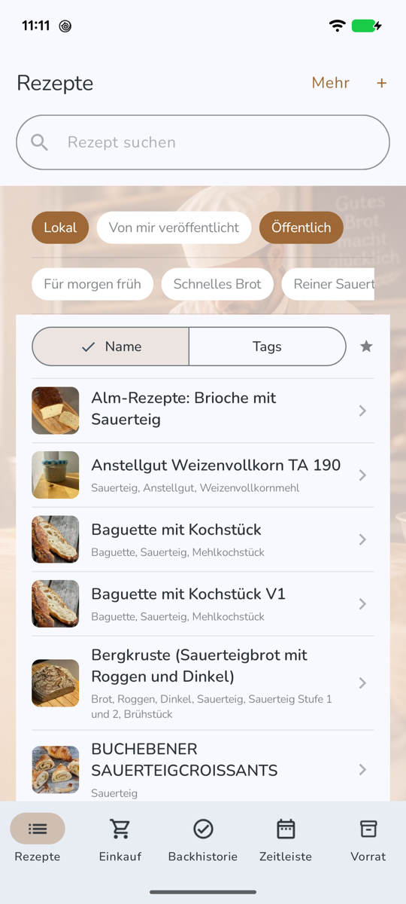
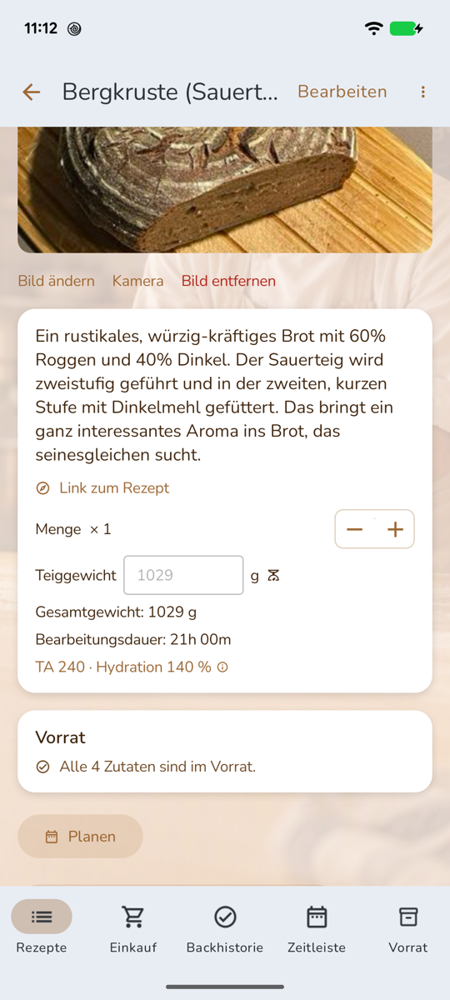
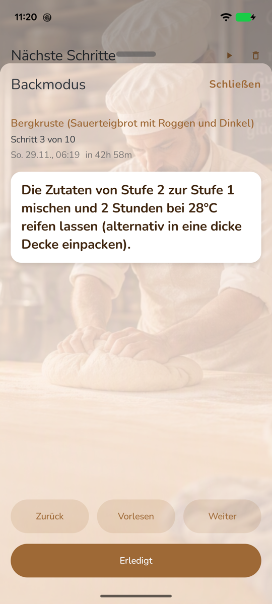
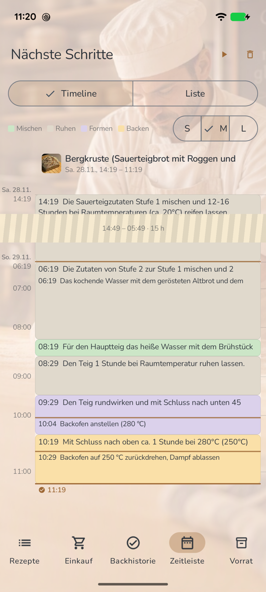
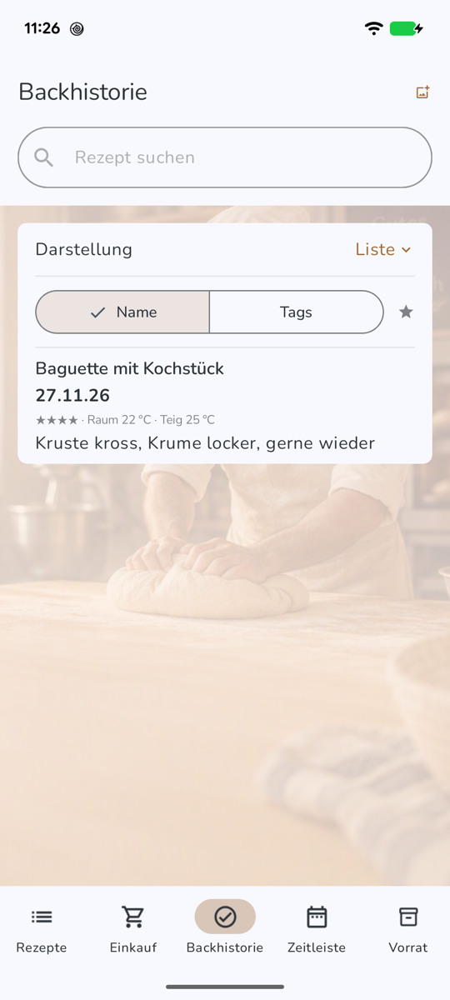
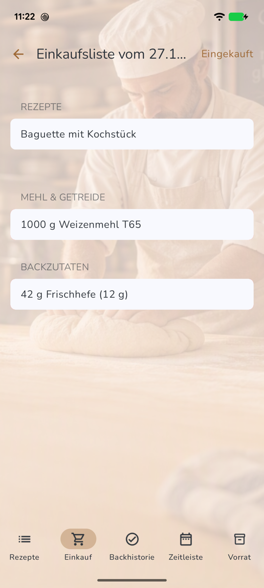
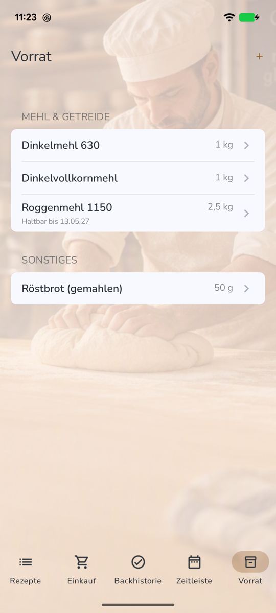

# BakePlanner for Android – User Manual

As of 27 Nov 2026 · Android version 2.4

---

## Contents

1. [What BakePlanner does](#1-what-bakeplanner-does)
2. [Requirements](#2-requirements)
3. [Basic terms](#3-basic-terms)
4. [The tabs](#4-the-tabs)
5. [Recipe database](#5-recipe-database)
6. [My recipes](#6-my-recipes)
7. [Planning, bake mode and reminders](#7-planning-bake-mode-and-reminders)
8. [Creating and editing a recipe](#8-creating-and-editing-a-recipe)
9. [Timeline and baking day](#9-timeline-and-baking-day)
10. [Baking history](#10-baking-history)
11. [Shopping lists](#11-shopping-lists)
12. [Pantry](#12-pantry)
13. [Calculators](#13-calculators)
14. [Settings](#14-settings)
15. [Units and amounts](#15-units-and-amounts)
16. [Data, backup and changing devices](#16-data-backup-and-changing-devices)
17. [Privacy](#17-privacy)
18. [Frequently asked questions](#18-frequently-asked-questions)
19. [What only the iPhone has](#19-what-only-the-iphone-has)

---

## 1. What BakePlanner does

BakePlanner is a baking planner for bread, rolls and pastries. What sets it apart from a plain recipe collection is that it **does the scheduling for you**:

- A recipe consists not only of ingredients but of **processing steps with durations**.
- From those durations the app works out the **start time of every single step**.
- You can plan backwards: "The bread should be ready at 6 pm" – the app tells you when to mix the sourdough.
- Every step gets a **reminder** as an Android notification, including the automatically added steps "Turn on the oven" and "Baking is finished".

On top of that: a shared public recipe database, your own recipes on the device, import from photos, web pages and text, shopping lists sorted by aisle, a pantry, a baking history with photos, measurements and statistics, a starter diary with a ripening estimate, recipe variants with a comparison, a bake mode that reads aloud, and four baker's calculators.

**Everything is free on Android.** There is no Pro and nothing to buy.

### Quick start: your first baking plan in five steps

1. Pick a recipe in the **Recipes** tab – or create your own with **+** at the top right.
2. On the recipe page, tap **Plan**.
3. Choose **Start from** or **Done by** and set the date and start time.
4. Check the calculated times and tap **Plan** at the top right.
5. Open the **Timeline** tab to see all steps as a timeline or a list.

The first time you plan, Android asks whether BakePlanner may send notifications. Without that permission the plan is still saved, but no reminders arrive (see [chapter 7](#7-planning-bake-mode-and-reminders)).

---

## 2. Requirements

| Item | Value |
|------|-------|
| Android | 9.0 or later; an app language separate from the system language from Android 13 |
| Source | Google Play (currently as a closed test) |
| Size | About 55–60 MB download, about 190 MB installed – the app brings its own runtime |
| Languages | German, English, French |
| Appearance | Light and dark mode following the system setting, font size following Android's "Font size" setting |
| Permissions | Notifications (reminders), camera (recipe pictures, baking photos, import from photos), internet (recipe database, cloud AI, import from web pages) |
| Internet | Only for the recipe database, the cloud AI and the import from web pages. Your own recipes, planning and reminders work offline. |
| Sign-in | Not needed. Signing in with Apple is optional – you need it only to publish recipes (see [chapter 14](#14-settings)). |

> **Important:** all your own data lives on this device only. There is no sync and no automatic backup to Google Drive. Make a backup regularly (see [chapter 16](#16-data-backup-and-changing-devices)).

---

## 3. Basic terms

These terms come up throughout the app:

**Recipe**
The top-level unit: name, description, picture, rating, tags, an optional link to the source, total weight and preparation time.

**Component**
A part of a recipe that is mixed separately – for example "Sourdough", "Preferment", "Main dough", "Scald". Every component has its own ingredient list. BakePlanner is built for multi-stage doughs.

**Ingredient**
Always belongs to a component: amount, unit and name. The amount may also be a fraction ("1/2", "1 1/2").

**Processing step**
An instruction with a step number and a duration. You enter the duration in minutes ("90") or in hours and minutes ("1:30", "1h 30", "1.5 h"). The step number has a special meaning:

- **Whole numbers (1, 2, 3 …) are main steps.** They run one after another.
- **Decimals (2.1, 2.2, 2.3) are parallel steps within a main step.** They run at the same time; only the *longest* duration in the group counts towards the total. Steps that make a component (sourdough, preferment, soaker …) start 5 minutes apart, so you don't have to weigh everything in the same minute.

Example: if you mix a sourdough (12 h) and a scald (2 h) at the same time, give them steps 1.1 and 1.2. Main step 2 then starts after a little over 12 hours, not after 14.

**Amount (serving size)**
A factor for all quantities; **× 1 is the recipe as stored**, × 2 doubles everything. Instead of a factor you can enter a **dough weight** in grams. The choice applies to the recipe you have open: recipe page, planning and shopping list all use it (see [chapter 15](#15-units-and-amounts)).

**Storage**
Where a recipe lives:

| Storage | Who sees it? | Where is it? | Editable? |
|---------|--------------|--------------|-----------|
| **Local** | only you | on this device | yes, any time |
| **Public** | all users of the app, on Android and on the iPhone | in the recipe database | yes, by you as the author |

New recipes always start local. You put a recipe into the database with **Publish** on its page (see [chapter 6](#6-my-recipes)). A recipe you may not publish – from a book, say – simply stays local.

---

## 4. The tabs

After launch the app opens in the **Recipes** tab. The five tabs sit at the bottom:

*The Recipes tab is where everything starts: all recipes, "More" and "+" for a new recipe at the top right.*

| Tab | Purpose |
|-----|---------|
| **Recipes** | All recipes in one list: your own, the ones you published and the public ones of all users (see [chapter 5](#5-recipe-database) and [chapter 6](#6-my-recipes)) |
| **Shopping** | All shopping lists (see [chapter 11](#11-shopping-lists)) |
| **Baking history** | Past bakes as a list, gallery, top list, photo cloud or statistics (see [chapter 10](#10-baking-history)) |
| **Timeline** | All scheduled steps as a timeline or a list, plus bake mode (see [chapter 9](#9-timeline-and-baking-day)) |
| **Pantry** | What you have at home: flours, seeds, yeast with amount and best-before date (see [chapter 12](#12-pantry)) |

At the top right of the **Recipes** tab there are two menus:

| Menu | Entries |
|------|---------|
| **More** | **Settings**, **Import recipes** (read a backup file or a single saved recipe), **Export recipes** (your own recipes as a file), **Plan a baking day** and **Calculators** |
| **+** (New recipe) | **By hand**, **Baker's percentages**, **From a web page**, **From photos**, **From text** (see [chapter 8](#8-creating-and-editing-a-recipe)) |

The back arrow at the top left or Android's back gesture takes you back from any screen. Sheets such as the planning sheet or the editor close with **Cancel** or **Close** at the top left.

---

## 5. Recipe database

The public recipe database is shared by all BakePlanner users, on Android and on the iPhone. Its recipes appear in the **Recipes** tab together with your own, sorted alphabetically. Three filter chips above the list switch the sources on and off one by one:

- **Local** – your recipes on this device,
- **Published by me** – your own recipes in the database,
- **Public** – the recipes of the other users.

**Pull down** to reload the public recipes. If the list says "The public recipes could not be loaded", there was no internet connection – pull the list down once more.

**Language.** There is no automatic translation on Android. If someone has already stored a translation of a recipe in your app language, the app shows it; otherwise it shows the language the recipe was written in.

### Opening a public recipe

A public recipe opens as one continuous page: picture, name and description, amount and dough weight, total weight, the TA line, then total ingredients, components and processing steps. There are three buttons:

- **Plan** – opens the planning sheet (see [chapter 7](#7-planning-bake-mode-and-reminders)).
- **Add recipe to shopping list** – see [chapter 11](#11-shopping-lists).
- **Save as my own recipe** – creates a full copy, picture included, on your device. Only that copy can be edited. An existing copy stays as it is.

### More actions

At the top right under **More actions**:

- **Share recipe** – creates a PDF of the recipe at the chosen amount and opens Android's share menu.
- **Report recipe** – with a reason (offensive, spam, copyright, other). The recipe is hidden **for all users at once** until an administrator has reviewed it.
- **Block author** – all recipes by this author disappear from the list **on your device only**.
- **Edit recipe** and **Delete my recipe** – only for recipes that come from your account. You edit the recipe in the database; your local version is not affected.

You undo blocks and reports under *Settings → Moderation* (see [chapter 14](#14-settings)). If you are signed in as an **administrator**, you also see **Delete recipe (admin)** and, for reported recipes, **Unhide recipe**.

---

## 6. My recipes

Your own recipes are the ones on your device: created by you, imported or copied from the database. Switch off the chips **Published by me** and **Public** and only your own recipes remain.

### Searching and filtering

- **Search field** at the top, below it the **Name / Tags** switch. The search ignores case and finds parts of words: "rye" finds "Rye bread".
- **Star menu (★)** next to it: **All ratings** or "… stars and up", **Show variants / Hide variants** and **Filter …**.
- **Collections** as chips above the list: **For tomorrow morning**, **Quick bread**, **Pure sourdough**, **Not baked for a while** and **Favourites**; once there is anything in the pantry, also **From the pantry** and **Use up the pantry**. A second tap clears a collection.

### Facets

The **Filter …** sheet holds the facets. The app reads them from each recipe's ingredients and steps – you don't have to enter anything:

| Facet | Choices |
|-------|---------|
| **Duration** | Under 4 hours, 4 to 12 hours, Overnight, Several days |
| **Day flow** | Set up in the evening, bake in the morning; Set up in the morning, bake in the evening; Done in 2 hours |
| **Leavening** | Pure sourdough, Lievito madre, Yeast, Sourdough and yeast |
| **Flour** | Mostly wheat, rye, spelt or wholemeal |
| **Dough yield** | Firm (under TA 165), Medium (TA 165 to 180), Soft (TA 180 and up) |
| **Equipment** | Baking stone, Loaf tin, Proofing basket, Pot |
| **Baking history** | Never baked, Not baked for a while, Favourites |
| **Little work** | At most 30 minutes of hands-on work |

With a pantry you also get the switches **From the pantry** (only recipes whose ingredients are all there) and **Use up the pantry** (recipes that use what expires soon; each shows what it uses up). **Reset filters** clears everything at once.

**Your own collections.** A combination you need often is saved in the **Filter …** sheet with **Save collection** under a name. It appears as a chip after the preset ones. Under **Saved collections** you rename it (tap) or delete it (swipe); a long press on the chip also offers **Rename** and **Delete**.

**Done by.** In the **Filter …** sheet, **Done by** sets the date and time the bread should be ready. The list then shows only the recipes that can still make it and writes the required start under each one: "Start today 17:45", "Start tomorrow 06:10", with "Steps at night" where it applies. The target sits as the first chip above the list; tap it to change it.

### Deleting a recipe

Swipe one of your own recipes to the left in the list and confirm. Its baking history and starter diary go with it. Public recipes can't be deleted here.

### The page of one of your own recipes

*The recipe page: picture and amounts at the top, then Plan, the shopping list and all ingredients and steps.*

From top to bottom:

1. **Picture** with **Change picture**, **Camera** and **Remove picture**, below it the description and – if stored – the **Recipe link**.
2. **Amount** (factor) and **Dough weight**, the **total weight**, the **preparation time** and the line **"TA 172 · hydration 72 %"**; tap it for the breakdown (see [chapter 15](#15-units-and-amounts)). Recipes planned regularly add "Next bake" or "Next feeding".
3. **Pantry** – once there is anything in the pantry: "All 5 ingredients are in the pantry" or what is missing (see [chapter 12](#12-pantry)).
4. **Plan** and **Add recipe to shopping list**.
5. **Total ingredients**, **Components** and **Processing steps**. Flour and starter lines can be tapped (see [chapter 13](#13-calculators)).
6. **Last time**, **Record a bake** and **Previous bakes** – for a starter, the **Starter Diary** instead.
7. **Variants** – the recipes made from this one.

At the top right you find **Edit** (see [chapter 8](#8-creating-and-editing-a-recipe)) and **More actions**:

| Entry | Purpose |
|-------|---------|
| **Back up recipe** | Writes the recipe with its picture to a file, without baking history – to pass on to others, who read it with **More → Import recipes** |
| **Share recipe** | Creates a PDF with picture, components, total ingredients and steps at the chosen amount and opens the share menu |
| **Publish** | Puts the recipe into the recipe database (see below) |
| **Create variant** | Creates a variant (see below) |

**Publish** needs two things: **Sign in with Apple** under *Settings → Account* (otherwise "Sign-in required" appears) and a **recipe picture** (otherwise "Image required"). The first time, you accept the terms of use (see [chapter 17](#17-privacy)); then the question **Publish recipe?** follows with **Save publicly**. Afterwards the page says "Published" and the entry disappears: a recipe is published only once, and later changes go to the public version (see [chapter 5](#5-recipe-database)).

### Recipe variants

Variants are your own recipes that stay linked to their original – so you can see later what was different and how it turned out.

- **Create variant** opens the **New variant** sheet: under "What is different? (optional)" you note the change, and **Create** copies the recipe as "Country bread V1", "Country bread V2" … and opens the copy. **Replace flour** and **Adjust starter TA** create variants too (see [chapter 13](#13-calculators)).
- A variant shows **Variant of "…"**; **Compare** lists the differences: ingredients, TA, hydration, dough weight and steps.
- On the original, the **Variants** card lists every variant with its note and the result from its baking history.
- In the list's star menu, **Hide variants** removes them from the list.

### Starter Diary

A recipe made only of starter, flour and water that bakes nothing is a **starter** to the app. It is fed, not baked, so instead of the baking history it has the **Starter Diary**:

- **Feeding ratio** "starter : flour : water", worked out from the recipe.
- **Ripening estimate**: if you noted ripening time and room temperature for your feedings, the app tells you when the starter will be ripe at **Room temperature today** ("At 22 °C ripe after about 6h 30m, from 4 feedings").
- **Enter new feeding** with date, **Time to peak rise**, room temperature, **Float test** and a note.
- **Previous feedings**, newest first. A planned feeding is completed after feeding with **Record result**.

When you plan a starter, BakePlanner adds the feeding to the diary instead of an entry in the baking history. If the flour is in the pantry, it is deducted at the feeding.

---

## 7. Planning, bake mode and reminders

This is the heart of the app. **Plan** on the recipe page opens the planning sheet; it uses the amount set on the recipe page.

*In the planning sheet you pick the time; the steps' times follow at once.*

### Choosing the time

| Element | Function |
|---------|----------|
| **Start from / Done by** | **Start from**: I begin at this time – when will I be done? **Done by**: I want to be done at this time – when do I have to start? |
| **Date** and **Start time** | The reference time of the plan |
| **Oven** and **Convection** | Only with two or more oven profiles (see [chapter 14](#14-settings)): the oven for this bread, preset with the one from the settings, and whether it bakes with convection |
| **Change durations** | Switch. When on, every step gets a duration field; **Apply duration** saves the new durations in the recipe |

Change the time and watch the times under **Processing steps** adjust. Nothing is saved until you tap **Plan** at the top right.

### Proofing today and ripening today

**Proofing today.** For a bread, the planning sheet recognises the fermentation steps – ripening of a preferment, bulk proof and final proof – and shows for each phase the planned duration and the duration at **Room temperature today**, preset with the one noted at the last bake. Fermentation runs about two and a half times as fast per 10 °C; the recipe's durations are taken as written for 22 °C. Each phase has its own **temperature**, for instance when the final proof happens in a warm spot. If your bakes recorded bulk or final proof with room temperature, the app uses those measurements. **Use these proofing times** applies to this plan only, **Use the recipe's durations** takes it back, and **Write the durations from the bakes into the recipe** stores the measured values in the recipe for good.

**Ripening today.** When you plan a starter with feedings in the diary, the sheet shows the estimated ripening time at today's room temperature; **Use the ripening time as the duration** sets it as the duration of the ripening step.

### What the app points out about the plan

Notes appear above the steps as soon as the chosen time leads to an awkward plan:

- **Steps outside your day** – before the **Start of day** or after the **End of day** from the settings. Below, the app suggests "So that no step begins at night:" with an earlier and a later time; **Apply** sets it.
- **Overlapping baking times** – each oven takes one bake at a time. More bakes at once than you have ovens is an error; "So that the ovens come free one after another:" suggests suitable times.
- **Too short a baking pause** between two bakes in the same oven.
- **Steps with a time window** (see [chapter 8](#8-creating-and-editing-a-recipe)) may be stretched or shortened: "This is how it fits within the steps' time windows:" shows the smallest change that fits everything into your day and your ovens.

The notes don't prevent anything. With overlapping baking times the app asks when you plan; **Plan anyway** sets the plan regardless.

### Planning

Tapping **Plan** at the top right:

1. puts all steps into the **Timeline** and sets a **reminder** for each one,
2. adds **"Turn on the oven"** the preheat time before the baking step – with the oven temperature from the recipe, with the stone preheat time for a baking stone, and with the dial setting when you use oven profiles ("dial at 240 °C"),
3. adds **"Turn the oven down to …"** for a falling temperature and **"Release the steam"** where it applies,
4. schedules **"Baking is finished"** at the end time,
5. creates a **baking history entry** at the end date for your own recipes, which you complete after baking.

The confirmation **Reminders were set** tells you when the oven has to go on and when the bread is ready. Without the notification permission it reads **Plan saved**: the plan is in the timeline, but without reminders – grant the permission in Android's settings under *Apps → BakePlanner → Notifications*.

> **One recipe, one plan – or several.** If the recipe already has a plan, the app asks: **Replace existing plan** discards the old steps and their reminders – that's how you move a bread to another day. **Add as a second plan** keeps the existing plan and adds the new one next to it, for Saturday and Sunday, say.

### Reminders

Each reminder arrives as an Android notification titled **"Baking reminder"** with the step text. If the step mixes a component, its ingredients with amounts are listed below. The notification has two actions:

- **Mark as done** – the step leaves the plan.
- **Reschedule by…** – you enter the minutes; the app then asks "Do you also want to reschedule all following steps of this recipe?" with **Only this step** and **All following steps**. The time counts from now.

> **Delivery time:** Android delivers reminders through its task scheduler, not as alarms. If the phone lies unused in battery saver for a long time, a reminder may come a few minutes later than planned. For steps that must happen on the minute, keep **bake mode** open or also set an alarm in the Clock app.

### Bake mode

For the work in the kitchen, start **bake mode** in the **Timeline** tab – at the top right for all plans, or in the list under a plan for that plan only. It shows the current step full-screen in large type: recipe name, "Step 3 of 12", the time with a countdown, the step text and below it the component's ingredients. With oven profiles there is also the line "Dial at …".

*Bake mode: large type and large buttons, easy to hit even with flour on your hands.*

- **Back** and **Next** page through the steps.
- **Read aloud** reads the step and its ingredients through Android's text-to-speech; **Stop** cancels. If a voice for your language is missing, install it in Android's settings under "Text-to-speech output" (Speech Services by Google).
- **Mark as done** removes the step and its reminder from the plan and moves on to the next one.

The screen stays on while bake mode is open. **Close** takes you back.

---

## 8. Creating and editing a recipe

With **+** at the top right of the **Recipes** tab you choose how the recipe comes about. Every route ends in the same recipe editor, where you check and save.

### By hand

Opens the empty recipe editor (see below).

### From photos

Reads a printed or photographed recipe – on Android **only through the protected cloud AI**; the Android app has no on-device text recognition.

1. **Select images** from the device's files or **Take photo** with the camera, page by page, up to ten. The order is kept; under **Selected pages** you remove single pages.
2. Under **Analysis mode** you find **Protected cloud AI**. Before the first use the app explains the data transfer; **Agree and analyze with cloud AI** gives your consent. If you choose **On this device only**, the app explains that photos can't be read that way.
3. **Import** sends the pages for analysis and opens the result in the recipe editor.

Straight, well-lit photos without logos and headers give the best results. Handwriting isn't read reliably. Afterwards check **amounts, units, temperatures and times**.

### From a web page

1. Enter the **Web address**. It's quicker from Chrome or any other app: **Share → BakePlanner** opens the import with the address filled in.
2. Choose the **Analysis mode**: **Protected cloud AI** also splits preferment, sourdough and main dough into separate components. **On this device only** takes just the structured recipe data the page itself provides.
3. **Import** loads the page and opens the recipe in the editor, with the page's recipe photo and its address as the link.

Pages behind a login, a paywall or a cookie wall can't be read. The import from text helps then.

> **Copyright:** you may import any recipe for your own use. Only publish other people's recipes with their permission.

### From text

For recipes from a message, a note or a page the web import can't read. Select the recipe from the heading to the last step, copy it and paste it under **Recipe text** – or share selected text from another app with BakePlanner. Under **Web address (optional)** you can name the source. With **On this device only** the app reads ingredients and steps by fixed rules: headings such as "Ingredients" and "Method", one ingredient with its amount per line, one step per paragraph, components under their own headings such as "Sourdough". With the cloud AI the layout matters less. **Import** opens the result in the editor.

### Baker's percentages

For those who think of recipes as a formula: you enter each ingredient as a share of the flour, and the app works out the grams.

1. Enter the **Recipe name**.
2. **Target**: **Total flour** (say 500 g) or **Dough weight** (say 850 g) and the amount.
3. **Components and ingredients** in percent; all percentages refer to the recipe's total flour, and the flours must add up to 100 percent. More components are added with **New component** and **Add**. The calculated grams appear next to every line.
4. **Next** opens the recipe editor with the grams. There you add resting times, shaping and baking.

As long as something doesn't add up, **Next** stays disabled and a note tells you why ("The flours add up to 95 percent instead of 100.").

### The recipe editor

The editor – "New recipe" when creating, "Edit" when changing – has these sections:

- **Name** – required.
- **Recipe image** – **Add picture** from the files or **Camera**. Photos are scaled down to screen size as soon as they are picked. Publishing needs a picture.
- **Description**.
- **Rating** – five stars; tapping the same star again takes the rating back. Below it **Tags, separated by commas**.
- **Plan regularly** (for a starter **Refresh regularly**) with "every … days": after the last bake the app schedules the next date by itself, at the same time as the start of the first step. Such dates appear in the timeline only two days ahead; the reminders still come on time.
- **Component** – a name per component and its ingredients with **Amount**, **Unit** and **Ingredient**. The amount may be a fraction ("1/2", "1 1/2"), the unit an abbreviation from [chapter 15](#15-units-and-amounts). **Add ingredient**, **Remove component**, below them **Add component**. Swipe an ingredient line to delete it.
- **Processing steps** – per step the **No.**, the text and the duration in **Minutes** (also "1:30" or "1.5 h"). **Add step** counts on to the next whole number, **Add sub-step** creates a parallel step such as 3.1. Swipe to delete.

Fields shown in red are invalid, for example a duration the app can't read; until they are fixed, **Save** stays disabled.

**Time window.** A step the planner may stretch – a fridge proof of 12 to 18 hours – has the fields **At least** and **At most**. Left empty, the duration is fixed. If the window is already in the wording ("12–18 hours in the fridge"), the app recognises it without the fields.

**Oven.** A step that bakes, preheats or names an oven temperature has the fields **Oven** (°C) and **Falling to** and the choice **Steam** (Not stated, With steam, Without steam). The fields take precedence over the wording; left empty, the app reads the oven from the text ("bake at 250 °C falling to 220 °C with steam").

**Save** at the top right stores the recipe, **Cancel** discards the changes.

### Editing a recipe

**Edit** at the top right of one of your own recipes opens the same editor. You can also change the recipe picture right on the recipe page. A plan already set stays as it is: the timeline then shows "… has changed since it was planned" with **Plan again**.

---

## 9. Timeline and baking day

The **Timeline** tab (titled "Next steps") holds all scheduled steps from all recipes. At the top you switch between **Timeline** and **List**. At the top right sit **Start bake mode** and **Delete all**.

*The timeline shows every plan as its own lane and every step as a bar.*

### Timeline

Each plan gets its own lane with recipe picture and name, each step a bar as long as it lasts. The colour tells you what to do – mix, rest, shape, bake; a legend sits at the top, next to it the **zoom** in three steps (S, M, L). Sub-steps such as folds during the bulk rest or "Turn on the oven" during the final proof appear as a marker on the bar of their step, a flag marks "Baking is finished", a red line the current time. Long gaps without a step – the night while the sourdough ripens – are collapsed into a hatched band.

Tapping a bar opens the step's details with start, duration, description and – for a mixing step – the ingredients. A long press offers **Mark as done** and **Reschedule**.

### List

At the very top is the step that is **Up next**, or **Due now** with the time elapsed. Below follow the plans, each with its steps: time, day, duration and instruction. Every row has three symbols:

- **Checkmark** – mark the step as done; it leaves the plan together with its reminder.
- **i** – show the component's ingredients, at the amount you planned with. Only for steps that mix a component.
- **Calendar** – reschedule the step (see below).

Under each plan you find **Start bake mode** (for this plan only) and **Delete scheduled steps** (this plan only, after a confirmation). **Delete all** at the top right removes all plans with their reminders.

### Rescheduling a step

The **Reschedule step** sheet shows **Currently** and, once you have entered minutes, **New**:

1. Enter the **Minutes**.
2. **Direction**: **Earlier** or **Later**.
3. **Affected steps**: **This step only** or **All following steps** – then every later step of the same plan moves too.
4. **Apply**.

The reminders move along. If the new time lies in the past, the app reports "Unable to reschedule".

With no steps scheduled, the tab says "No scheduled steps – Open a recipe and tap "Plan"."

### Plan a baking day

**Recipes → More → Plan a baking day** plans several breads at once:

1. Under **Recipes** you choose the breads; starter recipes aren't offered.
2. **Done by** – the time the last one should be ready – and the **Ovens** (preset from the settings; with oven profiles an "Oven" choice per bread).
3. **Work out the baking day** sets the start times: the bread with the longest bake is ready at the target time, every other one gets the latest quarter hour before that at which it still fits into an oven. The **baking pause** is kept, and two doughs are never kneaded, folded or shaped at the same time. Bakes already scheduled count too.
4. Each bread shows its start, its finish and its oven time, plus notes as text: "Steps at night", "Hands-on work coincides with another bread", "No oven free – overlaps another bake", "Would have to be under way – choose a later time" or "Already has a plan – it will be replaced". If the pantry doesn't cover all breads, the app says what is missing.
5. **Plan all** creates steps, reminders and the baking history entry for every bread.

---

## 10. Baking history

The **Baking history** tab holds all your bakes. Under **View** you choose:

- **List** – newest first, with date, recipe name, comment, measurements and photos,
- **Gallery** – tiles with the first photo,
- **Top list** – the recipes by number of bakes, your classics at the top,
- **Photo cloud** – each recipe as a circle with the photo of its last bake, the more often baked, the bigger,
- **Statistics** – see below.

*The baking history keeps track of what you baked and how it turned out.*

The search field (name/tags) and the rating filter apply to every view. Swipe an entry to the left to delete it.

### Recording a bake

An entry is created automatically when you plan one of your own recipes – at first without a comment. After baking, the **Last time** card on the recipe page reminds you to complete it (**Add details** or **Note it now**). A bake without a plan is added on the recipe page with **Record a bake**.

The entry ("Baking notes") has:

- **Recipe** – the recipe it belongs to; this is where you move an entry to another recipe.
- **Bake date** and **Comment**.
- **Measurements and result**: **Rating** (1–5 stars), **Room temperature** and **Dough temperature** in °C, **Bulk proof** and **Final proof** in minutes, **Flour** as free text and **Crumb / oven spring** as keywords – below it word chips such as "open", "moist" or "good oven spring" to tap.
- **Photos** – **Add picture** from the files or **Camera**.

**Save** stores the entry. The recipe page shows the measurements as **Last time**; bulk and final proof with room temperature feed into the **Proofing today** card the next time you plan.

### Statistics

**View → Statistics** adds up what the bakes currently shown – those already in the past – amount to: at the top **Loaves in total**, **This year**, **Per month** and the average rating, below that **Loaves per month**, **Baked most**, **Ratings**, **Final proof and room temperature** (one dot per bake) and **Crumb and oven spring**. The charts are plain bars and dots without axis labels. The more measurements you record, the more the statistics show.

### Baking history from photos

The photo symbol at the top of the **Baking history** tab brings old bread photos into the history:

1. **Choose photos**.
2. From each photo the app reads the **date** and, if there is one, the **title or description**. It proposes the recipe **by that title** ("Proposed by the title") – not by likeness to the recipe picture. So put the recipe name into the photo, for instance in Google Photos under *Info → Description*. Android reads date and title from JPEG files.
3. Check every row: pick a date where it says "No date in the photo – choose one", pick or change the recipe. Rows marked "Already in the baking history on that day" are skipped.
4. **Create** writes the entries with their photos.

---

## 11. Shopping lists

### Putting ingredients on a list

**Recipe page → Add recipe to shopping list** – for your own and for public recipes. The ingredients go on the list at the amount set on the recipe page.

1. **Destination**: **New list** with a date, or **Existing list**. If a list for that date exists, the ingredients are added to it.
2. **Deduct pantry** (on by default): what is in the pantry doesn't go on the list, partial amounts are reduced. If everything is there, the app says so instead of creating an empty list.
3. **Create**. The app confirms with "Ingredients were added to the shopping list".

### What goes on the list – and what doesn't

- **Left out** are water, salt and everything you make yourself: starter, sourdough, levain, lievito madre, poolish, biga – in every language. Things that only sound like it (rose water, sourdough powder) stay on the list.
- **Left out** are ingredients without a unit or without an amount.
- **Eggs** are counted in pieces: "120 g eggs" become "2 pc eggs".
- **Identical ingredients are merged**: "milk 30 °C" and "milk", "fresh yeast" and "yeast", "wheat flour type 550" and "wheat flour 550". Units with the same base are added up (0.5 kg + 200 g).
- Ingredient names appear on the list as they are named in the recipe; Android doesn't translate them.

### Viewing shopping lists

*The shopping list is sorted by aisle and names the package you actually buy.*

In the **Shopping** tab each list shows "Shopping list of …", the recipes it contains and the ingredients **grouped by aisle**: flour & grains, dairy & eggs, baking ingredients, nuts, seeds & dried fruit, fruit & vegetables, spices & herbs, oils, fats & liquids, other.

**Package sizes.** In front of the ingredient stands the usual package that covers the need, the need itself in brackets: "1 kg wheat flour 550 (200 g)", "42 g fresh yeast (6 g)", "6 pieces eggs (2 pc)".

- Tapping an ingredient opens **Change amount**: amount and unit apply to this list only, the recipe stays unchanged. **Move into the pantry** and **Remove ingredient** are there too.
- **Bought** at the top of the list moves the whole list into the pantry (see [chapter 12](#12-pantry)).
- Swipe a list to the left to delete it (**Delete shopping list**).

---

## 12. Pantry

The **Pantry** tab keeps track of what you have at home – by the same aisles as the shopping list.

*The pantry: items by aisle, with amount and best-before date.*

- **Add item** (+ at the top right): **Name** – with **Suggestions from your recipes**, so pantry and recipes mean the same thing –, **Amount** in g, kg or pieces, **Best-before date** and **Note**; **Save**.
- Tap an item to change it, swipe it to the left to remove it.
- **Use up soon**: items that expire within the next 14 days or already have are listed at the top and marked in colour.
- From 1000 g the pantry shows amounts in kilograms.

### From the shopping list into the pantry

**Bought** on the list or **Move into the pantry** on a line opens the **Bought** sheet: each line shows "Needed: …" and the **Amount bought**, preset with the package from the list – enter what you really bought. **Book** adds each line to the item of the same name or creates it, and takes the line off the list. Lines with an empty amount stay; if nothing is left, the list is done.

### Pantry and recipes

- **Recipe page:** the **Pantry** card says whether all ingredients are there or names what is missing ("200 g rye flour 1150 missing"), at the chosen amount. Water, salt and starter don't count. Ingredients are matched by name; "fresh yeast" and "yeast", "type 550" and "550" count as the same.
- **Shopping list:** **Deduct pantry** (see [chapter 11](#11-shopping-lists)).
- **Recipe list:** the collections **From the pantry** and **Use up the pantry** (see [chapter 6](#6-my-recipes)).
- **Reservations:** as soon as you plan a bread, the app reserves what it will use. Recipe card, shopping list and baking day work with what is available. If the plan is deleted or replaced, the amount is free again. When the plan reaches its end, the reservation turns into a deduction and the stock goes down.
- **Feedings** of a starter deduct their flour the same way.
- **Recent deductions** lists the deductions of finished plans; **Undo** books an amount back if a bread wasn't baked after all.

The full backup includes the pantry (see [chapter 16](#16-data-backup-and-changing-devices)).

---

## 13. Calculators

**Recipes → More → Calculators** opens a page with four baker's calculators. You can reach two of them directly from a recipe as well.

### Dough temperature

Works out how warm the **water** has to be so that the dough reaches the desired temperature after kneading. You enter the dough's **target temperature**, the room temperature, the flour temperature (usually the same as the room) and, where needed, the temperature of the sourdough or preferment. The **Friction factor** is the heat the dough picks up while kneading; calibrate it once by measuring after kneading, and it holds for every recipe.

### Replace flour

Flours are swapped **1:1 by weight**; what changes is the water, because every flour absorbs differently. On the recipe page, flour lines can be tapped ("Tap a flour to replace it."): the **Replace flour** sheet shows the recognised flour, lets you choose the replacement and works out the change in water, dough yield and hydration. **Create copy with substitution** writes the swap into a new variant; in such a copy the button reads **Apply change**. You also get handling tips, such as kneading spelt for less time or acidifying rye.

### Starter TA

If a recipe asks for "100 g starter TA 150" but you keep yours at TA 210, the app compensates so that the flour from the starter stays the same: more starter, less water in the same component. On the recipe page, starter lines can be tapped: **Adjust starter TA** shows the recognised TA (from the ingredient name or the settings), your **starter TAs** as quick picks and the result. **Create copy with adjustment** creates a variant.

### Dough weight

Works out how much dough fits into a tin or basket: **Loaf tin** and **Round tin** from the inside measurements and the **Fill factor** of the **Dough type** (light wheat, toast; mixed bread; rye, wholemeal, seeds), **Round proofing basket** and **Oval proofing basket** from the nominal sizes at the top rim. On the recipe page, the scale symbol next to **Dough weight** opens the same calculator with the dough type taken from the recipe; **Use as dough weight** fills in the result.

---

## 14. Settings

**Recipes → More → Settings.** The settings apply to this device only.

### General

**Language** opens Android's "App language" setting (Android 13 and later). There you choose German, English or French independently of the device language; without a choice the app follows the system language. There is no language picker inside the app.

### Recipes

| Setting | Description |
|---------|-------------|
| **Default serving size** | 0.5 / 1.0 / 1.5 / 2.0 – recipes open at this size. Default: 1.0 |
| **Sourdough starter** | The TA of your starter, used to split a starter amount without a TA into flour and water. Default: TA 200 |
| **Lievito madre** | The same for lievito madre. Default: TA 150 |
| **Show baker's percentages** | Shows each weighed ingredient's share of the component's flour. Default: off |
| **My starter TAs** | Separated by commas; the quick picks when adjusting the starter TA |
| **Custom units** | Leads to their management, see [chapter 15](#15-units-and-amounts) |

### Backup

**Create full backup** and **Restore backup** – see [chapter 16](#16-data-backup-and-changing-devices).

### Ovens

Your ovens as profiles: **Name**, **Preheat time**, **Preheat time with baking stone**, the **Deviation** (whether the oven runs hotter or cooler than the dial shows) and the **Convection reduction**. **Planning with** is the oven the planning sheet and the baking day suggest; **Add oven** creates another one, **Delete oven** removes it. With oven profiles the oven steps name the dial setting ("Turn on the oven (250 °C, dial at 240 °C)"), and the number of ovens is the number of profiles. The recipe doesn't remember the oven; the one from the settings is always preset.

### Baking schedule

| Setting | Description |
|---------|-------------|
| **Preheat time** | 0–120 minutes before the baking step for "Turn on the oven". Default: 15 minutes (only without oven profiles) |
| **Preheat time with baking stone** | 0–180 minutes when a step names a baking stone or steel. Default: 45 minutes (only without oven profiles) |
| **Baking pause** | Minimum gap between two bakes in the same oven. Default: 10 minutes |
| **Ovens** | How many bakes may run at the same time. Default: 1 (only without oven profiles) |
| **Start of day** and **End of day** | When you are available. Default: 6 am and 11 pm |

> Only the preheat times move steps. Baking pause, ovens, start and end of day don't change the plan – the app checks it against them and warns in the planning sheet.

### Account

Signing in is **optional**. **Sign in with Apple** opens Apple's sign-in in the browser and returns to the app afterwards; neither name nor e-mail address is requested. With it, your published recipes belong to your Apple account, on Android as on the iPhone: a recipe published on the iPhone can then be edited from the Android device too. On Android, signing in is also required for **Publish**.

- **Sign out** – back to anonymous use; recipes on the device are not affected.
- **Delete account** – after a confirmation. Published recipes stay visible to everyone but no longer belong to any account; delete them first if you don't want to leave them in the database. Recipes on the device are kept. This can't be undone.

### Privacy & AI

**AI analysis for recipe import** shows **Allowed** or **Local only**; tap it to open the **AI privacy** page (see [chapter 17](#17-privacy)). **Withdraw consent to cloud AI** takes the consent back.

### Moderation

**Blocked authors** with **Unblock all authors** – their recipes reappear at once – and **Recipes you reported** with **Clear reports on this device**. A reported recipe stays hidden for everyone until an administrator has reviewed it; clearing your report only takes effect after that.

### Help

Opens the **User manual**, **Help and contact**, the **Privacy Policy** and the **Legal Notice** in the browser.

---

## 15. Units and amounts

### Amount or dough weight

On the recipe page you scale a recipe in two ways:

- **Amount** – a factor in half steps (× 0.5, × 1, × 1.5 …); × 1 is the stored recipe.
- **Dough weight** – a target weight in grams, say 2000; the app converts every ingredient to it. The scale symbol next to it works it out from your tin (see [chapter 13](#13-calculators)).

Rounding follows how you weigh: from 10 g to whole grams, below that to one decimal ("2.7 g yeast"). The choice applies to the recipe page, the planning, the shopping list and the ingredients in the reminders. It does **not** affect durations – dough doesn't rise faster just because you make less of it – and it doesn't change the recipe.

### Dough yield and hydration

The line **"TA 172 · hydration 72 %"** on the recipe page shows the dough yield (flour plus water per 100 g of flour) and the hydration across all components. Tap it for the breakdown with flour and water in grams, the components, the starter shares, the **pre-fermented flour**, the ingredients **not counted** and **notes** when salt or yeast are far from the usual baker's percentages.

- **Flour** is whatever carries "flour", "meal", "semolina" in its name, plus old bread – not linseed meal, flakes, bran or nut flours.
- **Liquids count in full**: water, milk, buttermilk, beer, whey, juice.
- **Starter is split**: 20 g at TA 200 are 10 g flour and 10 g water. The TA comes from the ingredient name ("starter TA 150") or from the settings; biga, poolish and pâte fermentée have their TA by definition.
- **Components count exactly once.**

### Baker's percentages

With *Settings → Recipes → Show baker's percentages*, each weighed ingredient shows its share of the component's flour, for example "319 g water · 62 %".

### Available units

In the recipe editor you type the unit as an **abbreviation**. Use the abbreviations in the "Stored as" column – a unit the app doesn't know has no conversion and doesn't count towards the total weight. If one is missing, create it as a custom unit. In English and French the app displays the same units with their own abbreviations ("tsp" for TL); what is stored is always the abbreviation from the table.

**Weight-based (base: grams)**

| Abbrev. | Unit | Stored as | Equals |
|---|---|---|---|
| g | gram | g | 1 g |
| kg | kilogram | kg | 1000 g |
| mg | milligram | mg | 0.001 g |
| pfd | German pound (500 g) | pfd | 500 g |
| pinch | pinch | Pr | 1 g |
| knife tip | knife tip | Msp | 0.05 g |
| bunch | bunch | Bd | 10 g |
| slice | slice | Sc | 25 g |
| roll | roll | Rolle | 275 g |
| pkt | packet | Pck | 11 g |
| handful | handful | Handvoll | 25 g |
| egg | egg | ei | 60 g |
| egg (S) | egg, size S | ei(s) | 50 g |
| egg (M) | egg, size M | ei(m) | 60 g |
| egg (L) | egg, size L | ei(l) | 70 g |
| egg (XL) | egg, size XL | ei(xl) | 80 g |

**Volume-based (base: milliliters)**

| Abbrev. | Unit | Stored as | Equals |
|---|---|---|---|
| ml | milliliter | ml | 1 ml |
| cl | centiliter | cl | 10 ml |
| dl | deciliter | dl | 100 ml |
| l | liter | l | 1000 ml |
| Mass | Mass (1 l) | mass | 1000 ml |
| tsp | teaspoon | TL | 5 ml |
| tbsp | tablespoon | EL | 15 ml |
| cup | cup | Tas | 200 ml |
| splash | splash | Ss | 10 ml |
| dash | dash | Sp | 0.27 ml |
| drop | drop | Tr | 0.067 ml |

**Counted**

| Abbrev. | Unit | Stored as | Equals |
|---|---|---|---|
| pc | piece | St | counted |

For the total weight the app converts volumes to grams using the density of common ingredients – flour 0.66, water and milk 1.0, oil 0.8, honey 1.3. A cup of flour therefore counts as 200 ml × 0.66 = 132 g.

### Custom units

*Settings → Recipes → Custom units → Add unit*: **Name** (say "tub"), **Abbreviation** (must still be free), **Measured in** (grams, milliliters or pieces) and the **Conversion** – how much one unit holds. The conversion is required, because the total ingredients, baker's percentages and shopping list depend on it. Custom units apply to this device only and don't travel with the backup.

---

## 16. Data, backup and changing devices

### Everything lives on the device

Your own recipes, scheduled steps, shopping lists, baking history, starter diary and pantry are stored **only on this Android device**. There is **no sync** with other devices – neither with a second Android device nor with an iPhone. Android's automatic backup to Google Drive is switched off for BakePlanner, because it is limited to 25 MB and would fail silently with photos. **If you uninstall the app or lose the device without a backup of your own, all data is gone.**

### Backing up

- **Settings → Backup → Create full backup** writes all your recipes with their pictures, the baking history with photos, the starter diary and the pantry to one file. Put it in Google Drive, e-mail it to yourself or copy it to your computer.
- **Recipes → More → Export recipes** saves a selection: tick recipes or **Select all**, optionally **With baking history, starter diary and pantry**, then **Export**. A few recipes without the switch make a hand-over to others.
- **Back up recipe** under **More actions** on a recipe page writes a single recipe without baking history.

Recipe pictures and baking photos are scaled down to screen size on Android as soon as they are picked, so even a backup with many photos stays manageable.

### Restoring

**Settings → Backup → Restore backup** or **Recipes → More → Import recipes** reads a file. Recipes and pantry items that are missing are added; **nothing that exists is ever overwritten**. Missing bakes and feedings are added too. The message tells you how much was added. Settings and scheduled steps are not part of the file.

### Moving between iPhone and Android

The backup file is the same on both platforms and works **in both directions**: on the iPhone you create it under *Settings → Backup → Create full backup* and read it on Android – and the other way round. What doesn't come along:

- plans and reminders already set – plan again on the new device,
- custom units – create them again,
- settings.

The pantry comes along; items the new device's pantry doesn't have by name are added. Public recipes don't need moving: the recipe database is the same on both platforms.

---

## 17. Privacy

### Where your data lives

- **Your own recipes, plans, shopping lists, baking history, starter diary and pantry** are on your device only. Nobody else sees them.
- **Public recipes** are in the shared recipe database and visible to all users.
- **Recipe import:** with "On this device only", page text and pasted text stay on the device. Only if you have agreed to the **protected cloud AI** are the chosen images or the recipe text and the page address sent encrypted through a BackPlaner Firebase function (region europe-west1) to Google Vertex AI (Gemini, EU location). They are processed there only for the recipe draft and not stored. All that remains stored is a counter for the usage limit with your pseudonymous identifier. Your device loads the web page itself. Details are under *Settings → Privacy & AI → AI privacy*, where you can also withdraw your consent.
- The app uses an **anonymous identifier** so that you can delete your own public recipes and others can block authors. Signing in with Apple is optional; neither name nor e-mail address is requested. You can delete your account at any time under *Settings → Account → Delete account*.

### Terms of use for public recipes

Before you publish a recipe for the first time, you accept the terms:

- A published recipe is visible to all users of the recipe database.
- There is **zero tolerance** for offensive, abusive, unlawful or copyright-infringing content.
- You alone are responsible for the content you share.
- Reported content is reviewed and removed **within 24 hours**; authors who repeatedly break the rules can be excluded.

With **Decline** nothing is uploaded; the recipe stays local. Against unwanted content, **Report recipe** and **Block author** help (see [chapter 5](#5-recipe-database)).

---

## 18. Frequently asked questions

**No reminders arrive.**
Check in Android's settings under *Apps → BakePlanner → Notifications* that notifications are allowed. Also check that there are steps in the timeline at all; times in the past get no reminder.

**A reminder came a few minutes late.**
Android delivers reminders through its task scheduler, and a phone left unused in battery saver delays them. For critical steps, keep bake mode open or also set an alarm in the Clock app.

**Read aloud stays silent or speaks the wrong language.**
Install a voice for your language in Android's settings under "Text-to-speech output" (Speech Services by Google) and check the media volume.

**I can't change the language.**
From Android 13 you choose the app language under *Settings → General → Language*. On older Android versions the app follows the system language.

**The import from photos doesn't start.**
The Android app reads photos only through the protected cloud AI. Choose the cloud AI under **Analysis mode** and agree to the transfer – or copy the text and use **From text**.

**The public recipes are missing.**
There was no internet connection when they loaded. Pull the list down. Also check that the chips **Published by me** and **Public** are switched on.

**"Publish" says "Sign-in required".**
Sign in with Apple under *Settings → Account*. Without a recipe picture, "Image required" appears.

**"Edit recipe" is missing for a recipe I published myself.**
The recipe belongs to a different identifier. If you published it while signed in, sign in with the same Apple account and pull the list down once.

**My old phone is gone – are my recipes lost?**
Your own recipes exist only on the device and in your backup files. If you have a backup, restore it under *Settings → Backup → Restore backup*. Your published recipes are still in the recipe database; **Save as my own recipe** brings them back.

**A step starts at an odd time.**
Check the step numbers: decimal steps (2.1, 2.2) run in parallel, whole numbers one after another. An accidental "3" instead of "2.2" lengthens the total time considerably.

**The total weight is wrong.**
Usually an ingredient has a unit the app doesn't know. Use the abbreviations from [chapter 15](#15-units-and-amounts) or create a custom unit.

**An ingredient is missing from the shopping list.**
Water, salt and everything you make yourself are left out on purpose, as are ingredients without an amount or unit. With **Deduct pantry**, whatever is already in the pantry is missing too.

**I changed the recipe, but the plan still shows the old version.**
Scheduled steps are a snapshot. Tap **Plan again** in the timeline and choose **Replace existing plan**.

---

## 19. What only the iPhone has

The iPhone version of BakePlanner can also do the following:

| Feature | On Android |
|---------|------------|
| Sync through iCloud between all devices | No sync; backup file (see [chapter 16](#16-data-backup-and-changing-devices)) |
| Automatic translation of public recipes and the "Translate recipe" menu | Stored translation or original language |
| Translation of the ingredients on shopping lists | Not planned |
| On-device text recognition for the import from photos | Cloud AI only |
| Alarms for oven steps that ring through silent mode and Focus | Reminders as notifications |
| Live Activity, widgets, Control Center, Siri, Spotlight, Apple Watch | Not planned |
| Hands-free bake mode with voice commands | Read aloud is available |
| Baking day sheet as PDF, steps into the calendar, shopping list to Reminders | Missing |
| Check calendar when planning | Missing |
| Starter diagram with ripening curve | The ripening estimate is available |
| Baking yearbook as PDF | Missing |
| Recipe proposal by picture likeness for the baking history from photos | Proposal by title or description only |
| Pantry: reminder before expiry, the question "Deduct from pantry?" after a bake without a plan | Missing |
| Settings "Publish new recipes", "Use detail view", a language picker inside the app | Missing; language through Android |
| The recipe remembers the oven chosen last | The oven from the settings is preset |
