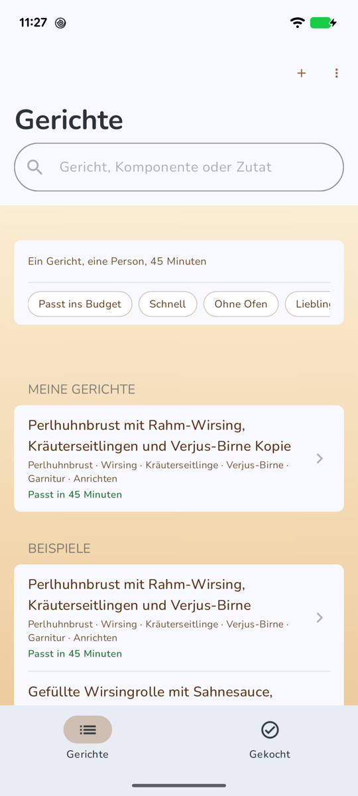
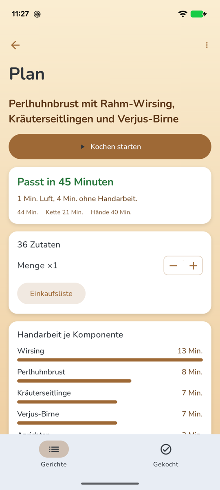
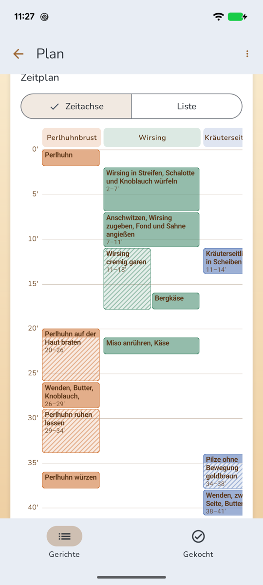
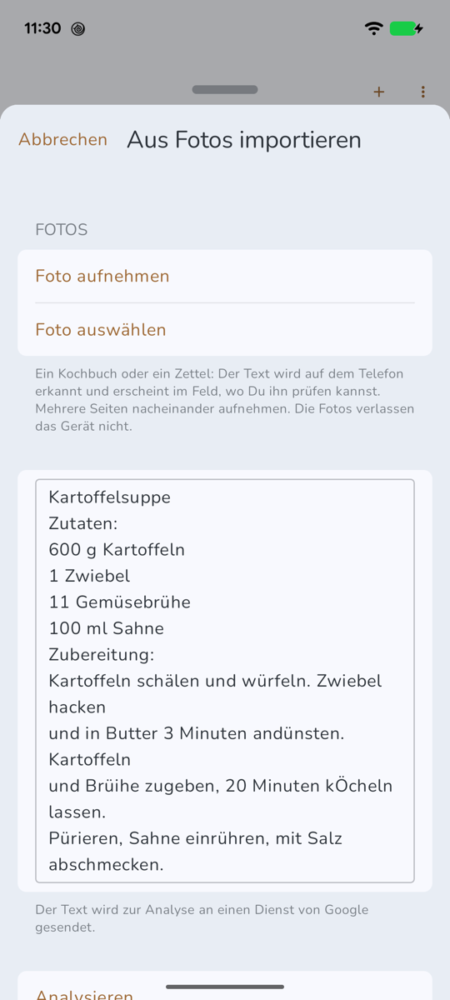
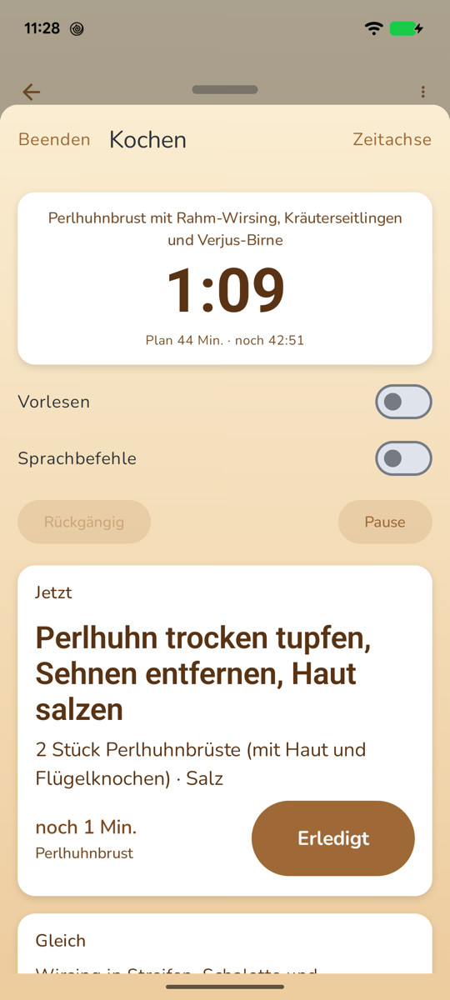
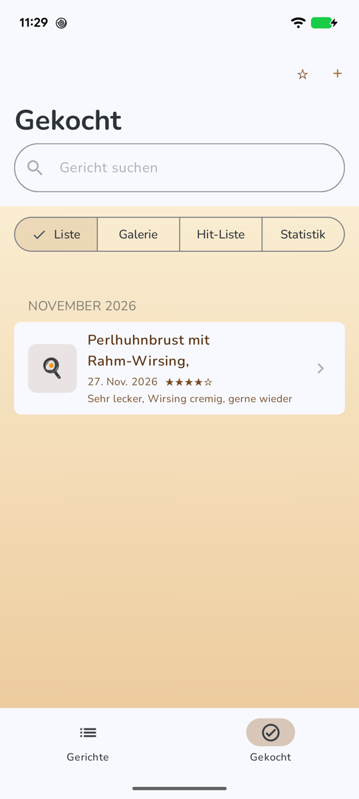
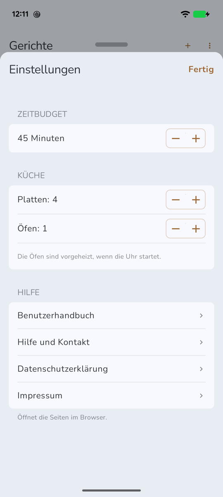

# CookPlanner für Android – Benutzerhandbuch

Stand: 27.11.2026 · Android-Fassung 1.0

---

## Inhalt

1. [Was CookPlanner macht](#1-was-cookplanner-macht)
2. [Voraussetzungen](#2-voraussetzungen)
3. [Grundbegriffe](#3-grundbegriffe)
4. [Die Gerichte-Liste](#4-die-gerichte-liste)
5. [Der Plan](#5-der-plan)
6. [Gericht anlegen und bearbeiten](#6-gericht-anlegen-und-bearbeiten)
7. [Importieren](#7-importieren)
8. [Menü zusammenstellen](#8-menü-zusammenstellen)
9. [Kochmodus](#9-kochmodus)
10. [Mitteilungen](#10-mitteilungen)
11. [Gekocht](#11-gekocht)
12. [Ablaufplan als PDF](#12-ablaufplan-als-pdf)
13. [Einstellungen](#13-einstellungen)
14. [Sicherung und Gerätewechsel](#14-sicherung-und-gerätewechsel)
15. [Datenschutz](#15-datenschutz)
16. [Häufige Fragen](#16-häufige-fragen)
17. [Was es nur auf dem iPhone gibt](#17-was-es-nur-auf-dem-iphone-gibt)

---

## 1. Was CookPlanner macht

Ein Gericht aus Fleisch, Beilage, Sauce und Garnitur, eine Person am Herd und eine feste Zeit: CookPlanner legt die Arbeitsschritte so, dass **alles zugleich fertig wird**, und sagt Dir vorher, ob die Zeit reicht. Die App heißt im Untertitel „Kochen gegen die Uhr“.

- Jeder Schritt hat **Handarbeit** (Du bist gebunden) und eine Zeit, in der er **von allein läuft** (köcheln, backen, ruhen).
- CookPlanner rechnet mit **Deiner Küche**: wie viele Herdplatten, wie viele Öfen und wie viel Zeit Du hast.
- Das **Urteil** sagt klar, ob das Gericht ins Zeitbudget passt – und wenn nicht, warum und was helfen würde.
- Im **Kochmodus** führt Dich die App mit einer Uhr Schritt für Schritt durch die Küche und plant nach jedem Haken neu.

Dazu kommen: Import aus Text, Fotos und Webseiten, Zutaten mit Portionen und Einkaufsliste, Menüs aus mehreren Gängen, ein Protokoll jedes Kochens mit Sternen, Notiz und Foto, gemessene Zeiten für den nächsten Plan, Vorlesen und Sprachbefehle, der Ablaufplan als PDF und ein Kochjahr-Buch.

Auf Android gibt es CookPlanner Pro noch nicht: **Alle Funktionen in diesem Handbuch sind frei**, es gibt nichts zu kaufen.

### Schnellstart: In fünf Schritten zum ersten Kochen gegen die Uhr

1. Stelle unter **⋮ → Einstellungen** Dein Zeitbudget und Deine Küche ein (Platten, Öfen).
2. Tippe in der Gerichte-Liste auf ein **Beispiel** oder lege mit **+ → Neues Gericht** ein eigenes an.
3. Lies auf dem Plan das Urteil („Passt in 35 Minuten“ oder „Fehlen 9 Minuten“) und schau Dir den Zeitplan an.
4. Tippe auf **Kochen starten**, wähle die Uhr (Challenge, Training oder Entspannt) und tippe auf **Start**.
5. Hake jeden Schritt mit **Erledigt** ab; Töpfe und Ofenschritte meldest Du mit **Steht**. Am Ende **Beenden und Protokoll sichern**.

*Die Gerichte-Liste: oben Budget und Chips, darunter Meine Gerichte und die Beispiele mit ihrem Urteil.*

---

## 2. Voraussetzungen

| Punkt | Wert |
|-------|------|
| Geräte | Android-Telefone und -Tablets |
| Betriebssystem | Android 9.0 oder neuer |
| Sprachen | Deutsch, Englisch, Französisch – die App folgt der Sprache des Geräts; bei anderen Sprachen erscheint sie auf Englisch |
| Darstellung | Hell- und Dunkelmodus |
| Internet | Nur für den Import aus Text, Fotos und Webseiten (die Analyse läuft in der Cloud). Planen, Kochen, Protokolle und Sicherung gehen offline |
| Anmeldung | Keine. Für die Analyse meldet sich die App im Hintergrund anonym an |
| Daten | Gerichte, Protokolle, Fotos und Einstellungen liegen nur auf diesem Gerät; einen Abgleich zwischen Geräten gibt es auf Android nicht (siehe [Kapitel 14](#14-sicherung-und-gerätewechsel)) |

Die App fragt die folgenden Berechtigungen erst, wenn sie gebraucht werden:

| Berechtigung | Wofür | Ohne sie |
|---|---|---|
| Mitteilungen | Banner „jetzt dran“ und „die Zeit ist um“ im Kochmodus | Der Kochmodus läuft, meldet sich aber bei dunklem Bildschirm nicht |
| Kamera | Kochbuchseite fotografieren, Foto zum Protokoll | Fotos lassen sich weiter aus Dateien wählen |
| Mikrofon | Sprachbefehle im Kochmodus | Sprachbefehle bleiben aus |
| Internet | Rezeptanalyse, Webseite laden | Kein Import, alles andere geht |

---

## 3. Grundbegriffe

**Gericht**
Was am Ende auf dem Teller liegt, zum Beispiel „Perlhuhnbrust mit Rahm-Wirsing, Kräuterseitlingen und Verjus-Birne“. Ein Gericht hat einen Namen, optional eine Personenzahl, Zutaten und Schritte.

**Komponente**
Ein Teil des Gerichts, der für sich gekocht wird – Fleisch, Wirsing, Pilze, Sauce. Im Plan bekommt jede Komponente ihre eigene Spalte, und die Handarbeit wird je Komponente gezählt.

**Schritt**
Eine Arbeit mit Dauer: „Wirsing in Streifen schneiden“, „Perlhuhn anbraten“. Ein Schritt gehört zu einer Komponente, kann eine Herdplatte oder einen Ofen belegen und auf andere Schritte warten.

**Hände und „läuft allein“**
Jeder Schritt hat zwei Zeiten: **Hände** – die Minuten, in denen Du gebunden bist – und **danach allein** – die Minuten, in denen der Topf köchelt oder der Ofen backt, ohne Dich. In der Zeit allein kannst Du anderes tun; genau das nutzt der Plan.

**Zeitbudget**
Die Minuten, in denen alles fertig sein soll (Voreinstellung 35). Das Urteil misst jedes Gericht daran.

**Platten und Öfen**
Wie viele Herdplatten und Öfen Deine Küche hat. Ein Schritt am Herd belegt eine Platte, ein Ofenschritt einen Ofen, jeweils für Hände und Zeit allein. Die Öfen gelten als vorgeheizt, wenn die Uhr startet.

**Muss bald weitergehen**
Manche Ergebnisse vertragen kein Warten: Fleisch nach dem Anbraten wird gleich gewendet, geruhtes Fleisch soll nicht kalt werden. Mit „Muss bald weitergehen“ gibst Du an, wie lange ein Schritt höchstens liegen darf, bevor der nächste kommt.

**Kette**
Die längste Folge von Schritten, die aufeinander warten. Kürzer als die Kette kann kein Plan werden, egal wie geschickt parallel gearbeitet wird.

**Warten auf**
Ein Schritt beginnt erst, wenn die Schritte fertig sind, auf die er wartet. Ohne Angabe kann er sofort beginnen. Das Anrichten wartet typischerweise auf den letzten Schritt jeder Komponente.

---

## 4. Die Gerichte-Liste

Die App hat unten zwei Tabs: **Gerichte** und **Gekocht** ([Kapitel 11](#11-gekocht)). Die Gerichte-Liste zeigt oben „Ein Gericht, eine Person, 35 Minuten“ mit Deinem Budget, darunter die Chips und dann zwei Abschnitte:

- **Meine Gerichte** – was Du angelegt, importiert oder als Menü gesichert hast.
- **Beispiele** – drei fertige Gerichte zum Ausprobieren. Sie lassen sich nicht ändern, aber als Vorlage übernehmen ([Kapitel 6](#6-gericht-anlegen-und-bearbeiten)).

Jede Zeile zeigt den Namen, die Komponenten und das **Urteil** in Grün („Passt in 35 Minuten“) oder Rot („Fehlen 9 Minuten“). Lässt sich gar kein Plan rechnen – etwa weil das Gericht einen Ofen braucht und die Küche auf 0 Öfen steht –, steht dort der Grund.

### Suche

Das Suchfeld steht über der Liste. Gesucht wird in Gericht, Komponente und Zutat: „Wirsing“ findet auch ein Gericht, in dem Wirsing nur als Zutat vorkommt.

### Chips

Die sechs festen Chips filtern mit einem Tipp, ein zweiter Tipp hebt den Filter wieder auf:

| Chip | Zeigt |
|---|---|
| Passt ins Budget | Gerichte, die mit Deiner Küche ins Zeitbudget passen |
| Schnell | Gerichte, deren Plan höchstens 30 Minuten dauert |
| Ohne Ofen | Gerichte, die nur den Herd brauchen |
| Lieblinge | Gerichte mit im Schnitt mindestens vier Sternen |
| Noch nie gekocht | Gerichte ohne Protokoll |
| Lange nicht gekocht | Gerichte, die seit 60 Tagen oder noch nie gekocht wurden |

### Filter und eigene Sammlungen

Unter **⋮ → Filter** stellst Du mehrere Bedingungen zusammen:

- **Dauer:** Alle, Bis 30 Minuten, 31 bis 45 Minuten, 46 bis 60 Minuten, Über eine Stunde.
- **Geräte:** Alle, Mit Ofen, Nur Herd, Ohne Hitze.
- **Herkunft:** Alle, Eigene, Importiert, Beispiele.
- **Verlauf:** Alle, Noch nie gekocht, Lange nicht gekocht, Lieblinge.
- Schalter **Passt ins Budget** und **Wenig Handarbeit** (die Hände sind höchstens 60 Prozent des Plans gebunden).

**Filter zurücksetzen** hebt alles auf. Gib unten einen **Namen** ein und tippe auf **Sammlung sichern**: Die gewählten Filter erscheinen als eigener Chip hinter den sechs festen. Unter **Eigene Sammlungen** löschst Du eine Sammlung wieder.

### Das Menü „+“ und das Menü „⋮“

| Menü | Einträge |
|---|---|
| + | Neues Gericht, Aus Text importieren, Aus Fotos importieren, Aus Webseite importieren, Menü zusammenstellen |
| ⋮ | Gerichte und Protokolle sichern, Gerichte importieren, Filter, Einstellungen |

---

## 5. Der Plan

Ein Tipp auf ein Gericht öffnet seinen **Plan**. Oben steht der Name, darunter der Knopf **Kochen starten** ([Kapitel 9](#9-kochmodus)) und dann eine Reihe von Karten.

*Der Plan: oben das Urteil mit Begründung und Zahlen, darunter die Zutaten mit Portionen und Einkaufsliste.*

### Das Urteil

Groß in Grün oder Rot: **Passt in N Minuten** oder **Fehlen N Minuten**. Darunter steht, warum:

| Begründung | Bedeutung |
|---|---|
| „N Min. Luft, N Min. ohne Handarbeit.“ | Es passt; so viel Reserve bleibt, so lange hast Du die Hände frei |
| „Die längste Kette dauert N Minuten …“ | Die Kette ist länger als das Budget; parallel arbeiten hilft nicht, nur kürzere Schritte |
| „Die Handarbeit allein dauert N Minuten …“ | Eine Person reicht nicht; Schritte streichen oder vereinfachen |
| „Kette … und Hände … passen einzeln, kollidieren aber …“ | Hände oder Geräte reichen nicht für alles zugleich – mehr Platten oder Öfen oder mehr Zeit |

Die kleine Zeile darunter nennt die Dauer des Plans, die **Kette** und die **Hände** in Minuten.

### Zutaten und Portionen

Die Karte **Zutaten** zeigt, wie viele Zutaten das Gericht hat. Nennt das Rezept eine Personenzahl, stellst Du mit **Für N Personen** um (1 bis 24); sonst gibt es **Menge ×0,5 bis ×4**. Nur die Mengen ändern sich, **die Zeiten bleiben gleich**. Die Wahl gilt je Gericht für Plan, Kochmodus und Einkaufsliste und bleibt gespeichert.

### Einkaufsliste

**Einkaufsliste** öffnet die Zutaten nach Regalen (Obst & Gemüse, Milchprodukte & Eier, Gewürze & Kräuter …), gleiche Zutaten zusammengefasst. Hake ab, was Du schon im Haus hast; **Alles im Haus** und **Nichts im Haus** setzen alle Haken auf einmal. **Fehlendes teilen** schickt den Rest als Text über Androids Teilen-Menü, etwa an eine Notiz- oder Einkaufs-App. Die Haken bleiben je Gericht gespeichert.

### So passt es

Passt ein Gericht nicht und liegt es nicht an den Händen, prüft CookPlanner, ob kürzere Garzeiten helfen: Schritte mit einer **Zeitspanne** ([Kapitel 6](#6-gericht-anlegen-und-bearbeiten)) werden am kurzen Ende geplant. Die Karte **So passt es** nennt jeden betroffenen Schritt („Wirsing schmoren: 12 statt 15 Minuten“) und sagt, ob es damit ins Budget passt oder wie viele Minuten auch dann noch fehlen. Das Gericht selbst bleibt unverändert.

### Gekocht

Hast Du das Gericht schon im Kochmodus gekocht, zeigt die Karte **Gekocht** die letzten fünf Male mit Datum und gebrauchter Zeit (oder „Entspannt“). Mit **Gemessene Zeiten übernehmen** siehst Du je Schritt die bisherige und die gemessene Zeit – der Median der abgehakten Zeiten aus den letzten bis zu fünf Durchgängen. Bei Töpfen und Ofenschritten bleibt die Handarbeit, nur die Zeit allein passt sich an. **Übernehmen** schreibt die Zeiten ins Gericht; bei einem Beispiel heißt der Knopf **Als eigenes Gericht** und legt eine Kopie unter Meine Gerichte an.

### Handarbeit je Komponente

Balken je Komponente, die längste oben: So siehst Du, welcher Teil des Gerichts Dich am meisten bindet.

### Zeitplan: Zeitachse oder Liste

Die Karte **Zeitplan** zeigt den Plan wahlweise als **Zeitachse** oder **Liste** (die Wahl bleibt gespeichert).

- **Zeitachse:** je Komponente eine Spalte, die Zeit läuft von oben nach unten. Volle Balken sind Handarbeit, gestreifte Balken laufen allein. Überlappen sich Schritte einer Komponente, stehen sie nebeneinander. Tippe auf einen Balken: Unter dem Diagramm erscheinen der Schritt, „Minute 12 bis 27“, Hände und Zeit allein und gegebenenfalls die Ofentemperatur.
- **Liste:** jeder Schritt mit seiner Minute, Herd oder Ofen und den Minuten Handarbeit, in der Reihenfolge des Plans.

*Die Zeitachse: eine Spalte je Komponente, Handarbeit voll, „läuft allein“ gestreift.*

### Warm halten

Wird eine Komponente früh fertig und wartet zehn Minuten oder länger auf das Anrichten, nennt die Karte **Warm halten** sie mit der Wartezeit („Sauce wartet 12 Minuten“).

### Das Menü „⋮“ auf dem Plan

| Gericht | Einträge |
|---|---|
| Eigenes Gericht | Ablaufplan als PDF, Bearbeiten, Teilen, Gericht löschen |
| Beispiel | Ablaufplan als PDF, Als Vorlage übernehmen |

---

## 6. Gericht anlegen und bearbeiten

**+ → Neues Gericht** öffnet den Editor leer, **⋮ → Bearbeiten** auf dem Plan mit dem eigenen Gericht. Bei einem Beispiel legt **⋮ → Als Vorlage übernehmen** eine Kopie an, die Du im Editor anpasst und als eigenes Gericht sicherst.

Der Editor hat vier Abschnitte:

- **Gericht:** Name und Personenzahl (**Portionen nicht angegeben**, wenn Du keine Zahl wählst).
- **Zutaten:** eine Zeile je Zutat, **Zutat hinzufügen** öffnet eine eigene Seite.
- **Schritte:** eine Zeile je Schritt mit Händen, Zeit allein und Gerät, **Schritt hinzufügen** öffnet eine eigene Seite.
- **Plan:** das Urteil, während Du tippst – so siehst Du sofort, was eine Änderung bewirkt.

**Sichern** geht, sobald das Gericht einen Namen und mindestens einen Schritt hat. **Abbrechen** verwirft die Änderungen.

### Zutat

| Feld | Bedeutung |
|---|---|
| Zutat | Der Name, z. B. „Wirsing“ |
| Menge und Einheit | Wie im Rezept; **Einheit wählen** oder **Ohne Einheit**. Ohne Menge für „Salz“ oder „Pfeffer“ |
| Hinweis | z. B. „klein“ oder „kräftig gereift“ |
| Komponente | Zu welchem Teil des Gerichts die Zutat gehört |

**Zutat löschen** entfernt sie. Die Zutaten bilden die Einkaufsliste; welche Du in einem Schritt in die Hand nimmst, wählst Du beim Schritt.

### Schritt

| Feld | Bedeutung |
|---|---|
| Was zu tun ist | Der Text des Schritts, z. B. „Perlhuhn auf der Haut anbraten“ |
| Komponente | Eintippen oder mit **Komponente wählen** eine vorhandene nehmen |
| Hände | Minuten, in denen Du gebunden bist (0 bis 120) |
| Danach allein | Minuten, in denen der Schritt ohne Dich läuft: kochen, backen, ruhen (0 bis 600) |
| Zeitspanne | Nur mit Zeit allein: **Mindestens** und **Höchstens** Minuten, die die Garzeit dauern darf. „So passt es“ nutzt das kurze Ende |
| Gerät | **Keins**, **Platte** oder **Ofen**; beim Ofen die Temperatur (50 bis 300 °C) |
| Muss bald weitergehen | Wie lange das Ergebnis höchstens liegen darf: 0 Minuten für Wenden nach dem Anbraten, 3 für geruhtes Fleisch, 10 für eine warm gestellte Sauce |
| Zutaten dieses Schritts | Haken bei den Zutaten, die hier verarbeitet werden; im Kochmodus stehen sie unter dem Schritt |
| Wartet auf | Haken bei den früheren Schritten, die vorher fertig sein müssen |

Ein neuer Schritt wartet zunächst auf den vorherigen Schritt seiner Komponente, bis Du die Auswahl änderst. **Auf alle Komponenten warten** setzt die Haken beim letzten Schritt jeder Komponente – richtig für das Anrichten. **Schritt löschen** entfernt einen bestehenden Schritt.

> Warten Schritte im Kreis aufeinander, sagt der Plan „Die Schritte warten im Kreis aufeinander“. Prüfe dann bei den Schritten die Angaben unter **Wartet auf**.

---

## 7. Importieren

Statt ein Gericht abzutippen, lässt Du es aus einem Rezept zerlegen. Alle drei Wege liegen unter **+**:

- **Aus Text importieren:** Rezepttext ins Feld einfügen (mindestens ein paar Zeilen) und **Analysieren** tippen.
- **Aus Fotos importieren:** **Foto aufnehmen** (Kamera) oder **Foto auswählen** (Dateien). Der Text wird **auf dem Telefon** erkannt und im Feld angehängt, wo Du ihn prüfen und korrigieren kannst. Mehrere Seiten nimmst Du nacheinander auf. Dann **Analysieren**.
- **Aus Webseite importieren:** die Adresse der Rezeptseite eingeben und **Analysieren** tippen. Die Seite wird auf dem Gerät geladen, nur der Rezepttext geht zur Analyse.

*Aus Fotos importieren: Der auf dem Telefon erkannte Text steht im Feld und lässt sich vor der Analyse prüfen.*

Die Analyse läuft bei einem Dienst von Google (Firebase). Sie zerlegt das Rezept in Schritte, schätzt Handarbeit und Zeit allein, erkennt Herd und Ofen und übernimmt die Zutaten samt Mengen. Das Ergebnis zeigt den Namen und „N Schritte, M Zutaten“, dazu gegebenenfalls **Bitte prüfen** mit Hinweisen auf Unsicheres.

- **Im Editor prüfen** öffnet das Gericht im Editor ([Kapitel 6](#6-gericht-anlegen-und-bearbeiten)). Erst mit **Sichern** landet es unter Meine Gerichte.
- **Noch einmal** verwirft das Ergebnis und lässt Dich den Text ändern.

Auf Android gibt es keine Monatsgrenze für Analysen. Pro Stunde ist die Zahl begrenzt; ist sie erreicht, versuche es später noch einmal. Dauert eine Analyse zu lange, hilft es, ein langes Rezept in zwei Teilen zu importieren.

---

## 8. Menü zusammenstellen

**+ → Menü zusammenstellen** macht aus mehreren Gerichten einen gemeinsamen Plan, etwa Vorspeise, Hauptgang und Dessert.

1. Wähle für jeden Gang ein **Gericht**. **Gang hinzufügen** ergänzt weitere Gänge, **Entfernen** streicht einen.
2. Gib zwischen den Gängen an, wie viele **Minuten bis zum nächsten Gang** vergehen, oder **Zusammen mit dem nächsten Gang**. Die Vorspeise kommt so viele Minuten vor dem Hauptgang auf den Tisch, und der Hauptgang wird gekocht, während die Gäste essen.
3. Gib dem Menü einen **Namen**. Unten steht schon, wie viele Schritte und Zutaten es hat und wie lange der Plan dauert.
4. **Sichern** legt das Menü als eigenes Gericht unter Meine Gerichte an, mit Schritten wie „Vorspeise servieren“.

Das Menü kochst Du wie jedes Gericht; seine Zutaten ergeben eine gemeinsame Einkaufsliste.

---

## 9. Kochmodus

**Kochen starten** auf dem Plan öffnet den Kochmodus. Vor dem Start wählst Du die **Uhr**:

| Uhr | Was sie tut |
|---|---|
| Challenge | Die Uhr zählt das Zeitbudget rückwärts, wie in der Sendung. Ist die Zeit um, zählt sie weiter, wie viel drüber |
| Training | Die Uhr läuft ab 0:00 – so lernst Du, wie lange das Gericht wirklich dauert |
| Entspannt | Keine Uhr, kein Überfällig: Die Schritte kommen der Reihe nach, nur Topf und Ofen behalten ihre Zeit |

Mit **Start** läuft die Uhr. Die App merkt sich Deine letzte Wahl.

*Der Kochmodus: oben die Uhr, darunter, was jetzt in die Hände kommt.*

### Was der Bildschirm zeigt

- **Uhr:** je nach Modus Restzeit oder gelaufene Zeit, dazu „Plan fertig in Minute N“; nach einer Neuplanung, ob Du früher oder später als geplant fertig wirst.
- **Jetzt:** der Schritt in Deinen Händen mit seinen Zutaten und der Restzeit („noch 3 Min.“, rot „überfällig“). Sind die Hände frei, steht dort „Hände frei, in N Min. weiter“; am Ende „Fertig, anrichten!“.
- **Gleich:** die nächsten drei Schritte, mit „in N Min.“.
- **Läuft von allein:** was gerade köchelt oder backt, mit der Restzeit. Nimmst Du einen Topf früher vom Herd, hakst Du ihn hier ab.
- **Erledigt:** „N von M Schritten“.

### Abhaken: Erledigt und Steht

- **Erledigt** hakt einen Schritt ohne Zeit allein ab.
- **Steht** gilt für Topf- und Ofenschritte: Die Hände sind fertig, der Topf steht auf dem Herd oder die Ofentür ist zu. Ab jetzt läuft die Zeit allein; ist sie um, ist der Schritt fertig.

Nach jedem Haken und jede Minute plant CookPlanner den Rest **neu**: Warst Du schneller, rückt alles vor; warst Du langsamer, verschiebt sich der Rest. **Rückgängig** nimmt den letzten Haken zurück.

### Pause, Zeitachse, Beenden

- **Pause** hält die Uhr an („Pause, die Uhr steht“), **Weiter** lässt sie weiterlaufen.
- **Zeitachse** oben zeigt den laufenden Plan als Diagramm mit einer roten Linie für **jetzt**; erledigte Schritte sind blass.
- **Beenden** oben fragt nach: **Beenden und Protokoll sichern** legt das Kochen unter Gekocht ab, **Beenden ohne Protokoll** verwirft es, **Weiterkochen** kehrt zurück. Ist noch kein Schritt erledigt, gibt es nichts festzuhalten.

Die Zurück-Taste von Android schließt den Kochmodus nicht – damit kein Lauf unbemerkt im Hintergrund weiterläuft. Verlassen geht nur über **Beenden**.

### Vorlesen

Mit dem Schalter **Vorlesen** spricht die App jeden neuen Schritt mit seinen Zutaten, der Ofentemperatur und den Minuten, meldet fertige Töpfe („Wirsing: die Zeit ist um.“) und am Ende „Fertig, anrichten!“. Gesprochen wird mit der Sprachausgabe von Android; die Einstellung bleibt gespeichert.

### Sprachbefehle

Mit dem Schalter **Sprachbefehle** hört der Kochmodus zu (beim ersten Mal fragt Android nach dem Mikrofon). Während die App selbst spricht, hört sie nicht zu.

| Befehl | Wirkung |
|---|---|
| „Erledigt“ (auch „Fertig“, „Abhaken“) | Hakt den Schritt in den Händen ab |
| „Steht“ (auch „Kocht“, „Im Ofen“, „Ist drin“) | Topf oder Ofen läuft, die Zeit allein beginnt |
| „Zurück“ / „Rückgängig“ | Nimmt den letzten Haken zurück |
| „Vorlesen“ / „Nochmal“ | Liest den aktuellen Schritt noch einmal |
| „Was kommt“ / „Nächster Schritt“ | Liest den nächsten Schritt |
| „Zutaten“ | Liest die Zutaten des aktuellen Schritts |
| „Wie lange“ | Restzeit des Schritts und des Plans |
| „Pause“ | Hält die Uhr an |
| „Weitermachen“ / „Fortsetzen“ | Lässt die Uhr weiterlaufen |
| „Stopp“ / „Ruhe“ | Beendet das Sprechen |

Die Befehle gelten in der Sprache der App; auf Englisch heißt es z. B. „Done“, „It’s on“, „What’s next“. Hat das Gerät keine Spracherkennung, sagt die App es.

### Bildschirm und Neustart

Solange der Kochmodus offen ist, bleibt der Bildschirm an. Wird die App beendet (vom System, durch ein Update oder weggewischt), öffnet der nächste Start den Lauf wieder – bis zu sechs Stunden nach dem Start. **Kochen starten** beim selben Gericht nimmt einen laufenden Lauf ebenfalls wieder auf, statt neu zu beginnen.

---

## 10. Mitteilungen

Während Du kochst, plant CookPlanner Mitteilungen für die nächsten Schritte – auch wenn das Telefon gesperrt in der Ecke liegt:

- **„Komponente · jetzt dran“** mit dem Schritt als Titel, wenn ein Schritt in die Hände kommt.
- **„Komponente · die Zeit ist um“**, wenn ein Topf oder der Ofen fertig ist.

Die App fragt beim ersten **Start** im Kochmodus nach der Erlaubnis. Fehlt sie, zeigt der Kochmodus: „Mitteilungen sind aus – bei dunklem Bildschirm meldet sich CookPlanner nicht.“ Einschalten kannst Du sie in den Android-Einstellungen unter **Apps → CookPlanner → Mitteilungen**.

Gut zu wissen:

- Geplant werden immer die nächsten 20 Mitteilungen; während die App offen ist, folgen sie jeder Neuplanung.
- Liegt die App im Hintergrund, bleiben die Mitteilungen auf ihren Zeiten.
- **Beenden**, **Pause** und ein neuer Lauf ziehen alle ausstehenden Mitteilungen zurück.
- Energiesparmodi mancher Hersteller verzögern Mitteilungen. Kommen sie zu spät, nimm CookPlanner in den Akku-Einstellungen von der Optimierung aus.

---

## 11. Gekocht

Der Tab **Gekocht** sammelt jedes Kochen, das Du mit Protokoll beendet oder von Hand eingetragen hast.

*Gekocht: die Protokolle nach Monat, oben die Darstellung, Suche und Sterne.*

### Darstellungen

| Darstellung | Zeigt |
|---|---|
| Liste | Die Protokolle nach Monat, neueste zuerst, mit Vorschaubild |
| Galerie | Die Fotos aller Protokolle |
| Hit-Liste | Die Gerichte nach Sternen, was am besten ankam |
| Statistik | Wie oft gekocht, verschiedene Gerichte, Sterne im Schnitt, gegen den Plan, die letzten zwölf Monate als Balken, am häufigsten gekocht |

Das Suchfeld (**Gericht suchen**) filtert nach dem Namen; über den Stern-Knopf ☆ oben wählst Du eine **Mindestbewertung** (Alle oder ab 1 bis 5 Sternen).

### Ein Protokoll

Ein Tipp auf einen Eintrag öffnet ihn:

- **Wie war’s?** – Sterne, eine Notiz („beim nächsten Mal weniger Salz“) und ein Foto: **Foto aufnehmen**, **Foto auswählen** oder **Foto entfernen**.
- **Gebraucht**, **Geplant** und **Unterschied** in Minuten.
- **Schritte** – je Schritt, wann er erledigt war, wie lange er gebraucht hat und was geplant war. Wurde vorzeitig beendet, steht dort, wie viele Schritte erledigt waren.
- **Eintrag löschen** entfernt das Protokoll.

### Gekocht eintragen

Hast Du ohne Stoppuhr gekocht, trägst Du es mit **+ → Gekocht eintragen** nach: Gericht wählen, Datum (**Gekocht am**), **Sichern**. Der Eintrag bekommt Sterne, Notiz und Foto wie jeder andere, aber keine Zeiten.

### Kochjahr-Buch

**+ → Kochjahr-Buch** macht aus einem Jahr ein PDF: ein Titelblatt mit Foto, das Jahr in Zahlen (Kochtage, Gerichte, Stunden am Herd, Bewertung, im Plan geblieben, längste Session), die Monate mit ihren Fotos, die Lieblingsgerichte mit Bestzeit, was die Uhr lehrte, und Platz für Vorsätze. Wähle **Jahr** und den **Name auf dem Titelblatt**, dann **Kochjahr-Buch teilen**. Ohne Protokolle gibt es noch kein Buch.

---

## 12. Ablaufplan als PDF

**⋮ → Ablaufplan als PDF** auf dem Plan erzeugt ein A4-Blatt zum Drucken, Aufhängen oder Verschicken:

- Kopf mit Name, Dauer und Personenzahl.
- Die **Zeitachse** – je Komponente eine Zeile, Balken mit der Nummer des Schritts.
- Der **Ablauf** – jeder Schritt mit Minute, Händen, Zeit allein, Herd oder Ofen und seinen Zutaten.
- Die **Zutaten** des Gerichts.

Mit **Mit Uhrzeit** und einem **Start** stehen echte Uhrzeiten auf dem Blatt („Start 18:30 · fertig 19:05“), sonst Minuten ab 0. **Ablaufplan teilen** öffnet Androids Teilen-Menü – zum Drucken, Speichern oder Senden.

---

## 13. Einstellungen

**⋮ → Einstellungen** in der Gerichte-Liste:

*Die Einstellungen: Zeitbudget, Küche und Hilfe.*

| Einstellung | Bereich | Voreinstellung |
|---|---|---|
| Zeitbudget | 10 bis 180 Minuten in Schritten von 5 | 35 Minuten |
| Platten | 1 bis 8 | 4 |
| Öfen | 0 bis 3 | 1 |

Jede Änderung gilt sofort für alle Urteile und Pläne. Die Öfen gelten als vorgeheizt, wenn die Uhr startet. Weitere Einstellungen merkt sich die App selbst, wo Du sie triffst: die Darstellung des Zeitplans, die Uhr des Kochmodus, Vorlesen, Portionen und Einkaufshaken je Gericht, die Darstellung und Mindestbewertung unter Gekocht, die eigenen Sammlungen.

### Hilfe

Der Abschnitt **Hilfe** öffnet im Browser dieses **Benutzerhandbuch**, die Seite **Hilfe und Kontakt** mit häufigen Fragen und der E-Mail-Adresse, die **Datenschutzerklärung** und das **Impressum** – jeweils in der Sprache der App.

---

## 14. Sicherung und Gerätewechsel

Auf Android liegen alle Daten nur auf diesem Gerät. Eine Sicherung schützt vor Verlust und bringt Deine Gerichte auf ein anderes Gerät – auch auf ein iPhone mit CookPlanner, das Format ist dasselbe.

### Sichern

**⋮ → Gerichte und Protokolle sichern** in der Gerichte-Liste schreibt eine Datei `….cookplanner` (benannt nach dem Datum) mit allen eigenen Gerichten, allen Protokollen und ihren Fotos. Android fragt mit **Speichern unter**, wohin – etwa in den Download-Ordner oder Google Drive. Eine eigene Bestätigung der App gibt es nicht; Androids Dialog bestätigt selbst.

### Ein Gericht teilen

**⋮ → Teilen** auf dem Plan eines eigenen Gerichts speichert nur dieses Gericht als `.cookplanner`-Datei, ebenfalls über **Speichern unter**. Die Datei kannst Du dann verschicken.

### Importieren

**⋮ → Gerichte importieren** öffnet die Dateiauswahl. CookPlanner übernimmt neue Gerichte und Protokolle mit Fotos; was schon da ist, bleibt unverändert. Danach meldet die App, wie viele Gerichte und Protokolle übernommen wurden und wie viele schon da waren. Eine Datei aus einer neueren Version von CookPlanner lehnt die App ab – dann zuerst die App aktualisieren.

> Deinstallierst Du die App, sind Gerichte und Protokolle weg. Sichere vorher – und am besten regelmäßig.

---

## 15. Datenschutz

- **Gerichte, Protokolle, Fotos und Einstellungen** liegen nur auf Deinem Gerät. Der Entwickler hat keinen Zugriff darauf.
- **Rezeptanalyse:** Nur beim Import geht der Rezepttext an einen Dienst von Google (Firebase Cloud Functions mit KI-Analyse). Er wird für die Analyse verwendet, nicht für Werbung.
- **Fotos** für den Import verlassen das Gerät nicht: Der Text wird auf dem Telefon erkannt, nur der Text geht zur Analyse – und erst, wenn Du **Analysieren** tippst.
- **Webseiten** lädt die App auf dem Gerät; zur Analyse geht nur der Rezepttext.
- **Anmeldung:** Für die Analyse meldet sich die App anonym bei Firebase an. Es gibt kein Konto, keinen Namen, keine E-Mail-Adresse. Eine Prüfung über Google Play stellt sicher, dass die Anfrage von der echten App kommt.
- **Sprachbefehle** nutzen die Spracherkennung von Android, wenn möglich auf dem Gerät; CookPlanner speichert nichts davon. **Vorlesen** nutzt die Sprachausgabe von Android.
- Keine Werbung, kein Tracking.

---

## 16. Häufige Fragen

**Warum steht beim Gericht „Fehlen N Minuten“?**
Lies die Begründung auf dem Plan. Ist die Kette zu lang, helfen nur kürzere Schritte oder ein größeres Budget; ist die Handarbeit zu viel, Schritte vereinfachen; kollidieren Hände oder Geräte, helfen mehr Platten oder Öfen in den Einstellungen. Schau auch auf die Karte **So passt es**.

**Das Gericht hat gar keinen Plan, nur einen roten Satz.**
Meist braucht es einen Ofen oder eine Platte, und die Küche steht in den Einstellungen auf 0. Oder Schritte warten im Kreis aufeinander – dann die Angaben unter **Wartet auf** prüfen.

**Kann ich ein Beispiel ändern?**
Nicht direkt. **⋮ → Als Vorlage übernehmen** legt eine Kopie an, die Dir gehört.

**Ändern sich die Zeiten, wenn ich für mehr Personen koche?**
Nein, nur die Mengen. Wenn Du merkst, dass es länger dauert, koche im Modus Training und übernimm danach die gemessenen Zeiten.

**Die Mitteilungen kommen nicht oder zu spät.**
Prüfe die Erlaubnis unter **Apps → CookPlanner → Mitteilungen** und nimm die App von der Akku-Optimierung aus. Im Kochmodus zeigt ein Hinweis, wenn Mitteilungen aus sind.

**Ich habe den Kochmodus aus Versehen verlassen.**
Öffne die App wieder oder tippe beim selben Gericht auf **Kochen starten**: Der Lauf geht weiter, bis zu sechs Stunden nach dem Start.

**Die Sprachbefehle reagieren nicht.**
Prüfe die Mikrofon-Erlaubnis und sprich die Befehle kurz und deutlich. Während die App vorliest, hört sie nicht zu. Ohne Spracherkennung auf dem Gerät gibt es keine Sprachbefehle.

**Der Import meldet einen Fehler.**
Prüfe die Internetverbindung. Bei „Das stündliche Analyse-Limit ist erreicht“ später noch einmal versuchen; bei einer Zeitüberschreitung ein langes Rezept in zwei Teilen importieren. Auf den Fotos nichts erkannt? Bei mehr Licht und gerade von oben fotografieren.

**Wie bringe ich meine Gerichte auf ein neues Telefon oder ein iPhone?**
Mit **Gerichte und Protokolle sichern** auf dem alten Gerät und **Gerichte importieren** auf dem neuen ([Kapitel 14](#14-sicherung-und-gerätewechsel)).

---

## 17. Was es nur auf dem iPhone gibt

CookPlanner für Android kann fast alles, was die iPhone-App kann. Einige Dinge hängen an Apple-Diensten und fehlen auf Android:

| Auf dem iPhone | Auf Android |
|---|---|
| iCloud-Abgleich zwischen iPhone und iPad | Kein Abgleich; Gerätewechsel über die Sicherungsdatei |
| Live-Aktivität auf dem Sperrbildschirm und in der Dynamic Island | Mitteilungen je Schritt |
| Wecker über AlarmKit für fertige Töpfe | Mitteilungen „die Zeit ist um“ |
| Siri und Kurzbefehle („Wie lange noch“, „Schritt erledigt“) | Sprachbefehle im Kochmodus |
| Gerichte in der Spotlight-Suche | Suche in der App |
| Rezept aus dem Browser über „Teilen“ importieren | **+ → Aus Webseite importieren** mit der Adresse |
| Tastaturkürzel auf dem iPad | – |
| CookPlanner Pro als Einmalkauf (Menü, Vorlesen und Sprachbefehle, Kochjahr-Buch, Statistik, eigene Sammlungen, Plan als PDF, gemessene Zeiten, mehr Rezeptanalysen) | Alles frei, nichts zu kaufen |
