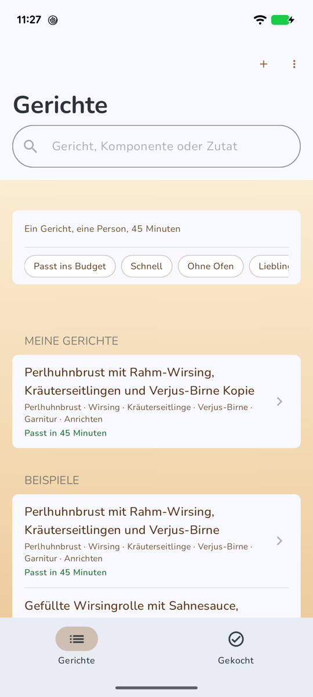
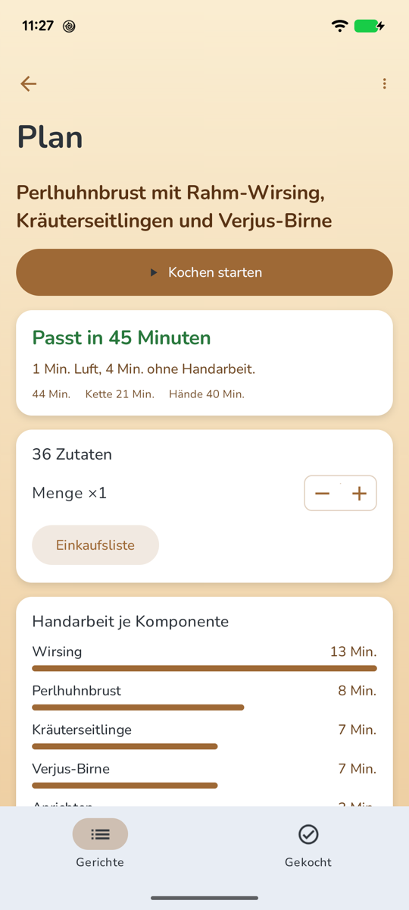
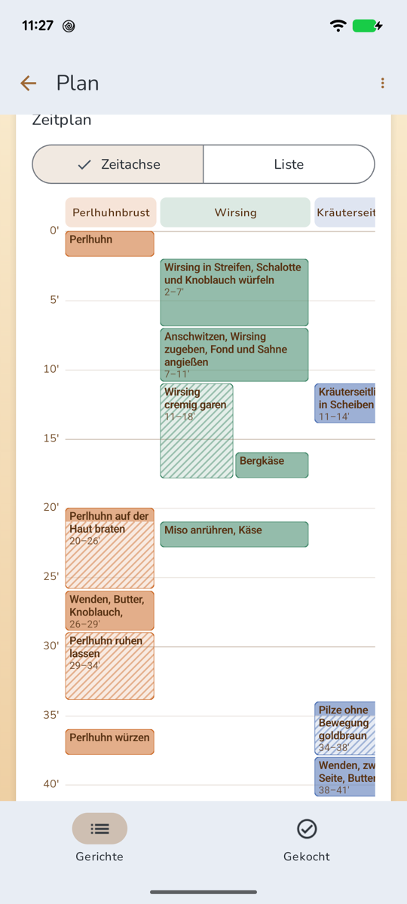
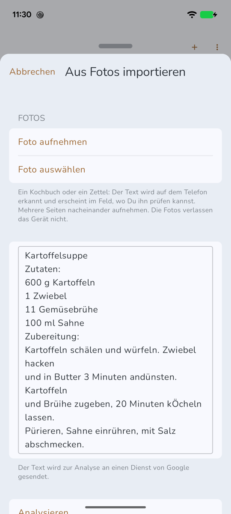
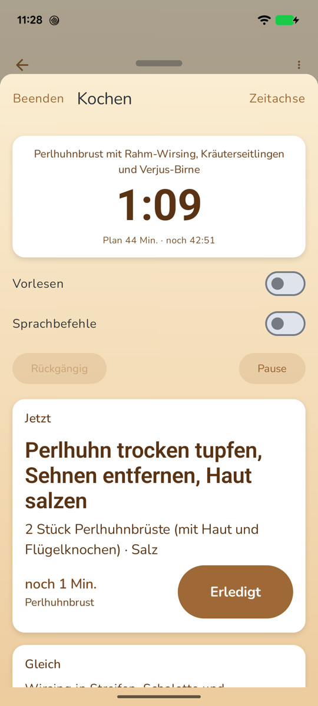
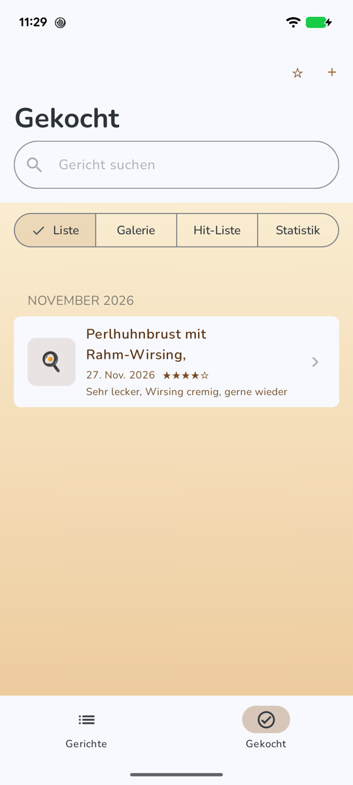
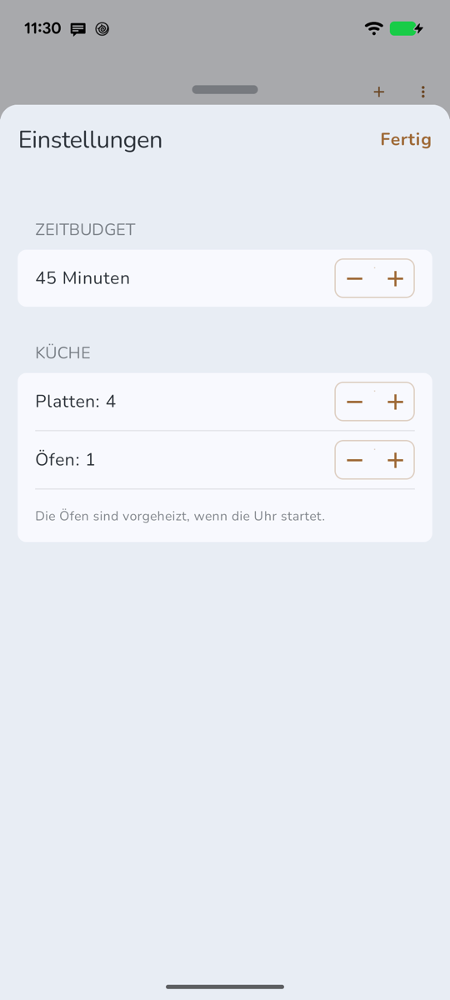

# CookPlanner pour Android – Manuel de l’utilisateur

Mise à jour : 27/11/2026 · version Android 1.0

---

## Sommaire

1. [Ce que fait CookPlanner](#1-ce-que-fait-cookplanner)
2. [Configuration requise](#2-configuration-requise)
3. [Notions de base](#3-notions-de-base)
4. [La liste des plats](#4-la-liste-des-plats)
5. [Le plan](#5-le-plan)
6. [Créer et modifier un plat](#6-créer-et-modifier-un-plat)
7. [Importer](#7-importer)
8. [Composer un menu](#8-composer-un-menu)
9. [Mode cuisine](#9-mode-cuisine)
10. [Notifications](#10-notifications)
11. [Cuisiné](#11-cuisiné)
12. [Plan de cuisson en PDF](#12-plan-de-cuisson-en-pdf)
13. [Réglages](#13-réglages)
14. [Sauvegarde et changement d’appareil](#14-sauvegarde-et-changement-dappareil)
15. [Confidentialité](#15-confidentialité)
16. [Questions fréquentes](#16-questions-fréquentes)
17. [Ce qui existe seulement sur l’iPhone](#17-ce-qui-existe-seulement-sur-liphone)

---

## 1. Ce que fait CookPlanner

Un plat avec viande, garniture, sauce et décoration, une seule personne aux fourneaux et un temps fixé : CookPlanner ordonne les étapes pour que **tout soit prêt en même temps**, et vous dit à l’avance si le temps suffit. Son sous-titre : « Cuisiner contre la montre ».

- Chaque étape a du **travail manuel** (vous êtes occupé) et un temps pendant lequel elle **se fait toute seule** (mijoter, cuire au four, reposer).
- CookPlanner tient compte de **votre cuisine** : combien de feux, combien de fours et combien de temps vous avez.
- Le **verdict** dit clairement si le plat tient dans le temps imparti – et sinon, pourquoi et ce qui aiderait.
- En **mode cuisine**, l’application vous guide pas à pas avec une horloge et replanifie après chaque coche.

En plus : import depuis un texte, des photos et des pages web, ingrédients avec portions et liste de courses, menus de plusieurs services, un relevé de chaque cuisson avec étoiles, note et photo, temps mesurés pour le prochain plan, lecture à voix haute et commandes vocales, le plan de cuisson en PDF et un livre de l’année en cuisine.

CookPlanner Pro n’existe pas encore sur Android : **toutes les fonctions de ce manuel sont gratuites**, il n’y a rien à acheter.

### Démarrage rapide : votre première cuisine contre la montre en cinq étapes

1. Sous **⋮ → Réglages**, réglez votre temps imparti et votre cuisine (feux, fours).
2. Dans la liste des plats, touchez l’un des **Exemples** ou créez le vôtre avec **+ → Nouveau plat**.
3. Lisez le verdict sur le plan (« Tient en 35 minutes » ou « Il manque 9 minutes ») et regardez le déroulé.
4. Touchez **Commencer à cuisiner**, choisissez l’horloge (Défi, Entraînement ou Détendu) et touchez **Départ**.
5. Cochez chaque étape avec **Fait** ; signalez casseroles et étapes au four avec **C’est parti**. À la fin, **Arrêter et garder le relevé**.

*La liste des plats : en haut le temps imparti et les puces, ensuite Mes plats et les exemples avec leur verdict.*

---

## 2. Configuration requise

| Élément | Valeur |
|---------|--------|
| Appareils | Téléphones et tablettes Android |
| Système | Android 9.0 ou plus récent |
| Langues | Allemand, anglais, français – l’application suit la langue de l’appareil ; pour les autres langues, elle s’affiche en anglais |
| Affichage | Mode clair et mode sombre |
| Internet | Seulement pour l’import depuis un texte, des photos ou des pages web (l’analyse se fait dans le cloud). Planifier, cuisiner, les relevés et la sauvegarde fonctionnent hors ligne |
| Connexion | Aucune. Pour l’analyse, l’application se connecte de façon anonyme en arrière-plan |
| Données | Plats, relevés, photos et réglages restent uniquement sur cet appareil ; il n’y a pas de synchronisation entre appareils sur Android (voir le [chapitre 14](#14-sauvegarde-et-changement-dappareil)) |

L’application ne demande ces autorisations qu’au moment où elle en a besoin :

| Autorisation | Pour quoi | Sans elle |
|---|---|---|
| Notifications | Bannières « à faire maintenant » et « le temps est écoulé » en mode cuisine | Le mode cuisine fonctionne, mais reste muet écran éteint |
| Appareil photo | Photographier une page de livre de cuisine, une photo pour un relevé | Les photos peuvent toujours être choisies dans les fichiers |
| Micro | Commandes vocales en mode cuisine | Pas de commandes vocales |
| Internet | Analyse de recette, chargement d’une page web | Pas d’import ; tout le reste fonctionne |

---

## 3. Notions de base

**Plat**
Ce qui finit dans l’assiette, par exemple « Suprême de pintade, chou frisé à la crème, pleurotes du panicaut et poire au verjus ». Un plat a un nom, éventuellement un nombre de personnes, des ingrédients et des étapes.

**Composant**
Une partie du plat préparée à part – viande, chou, champignons, sauce. Dans le plan, chaque composant a sa propre colonne, et le travail manuel est compté par composant.

**Étape**
Un travail avec une durée : « Émincer le chou », « Saisir la pintade ». Une étape appartient à un composant, peut occuper un feu ou un four et attendre d’autres étapes.

**Mains et « se fait seul »**
Chaque étape a deux temps : **Mains** – les minutes pendant lesquelles vous êtes occupé – et **ensuite seul** – les minutes pendant lesquelles la casserole mijote ou le four cuit sans vous. Pendant ce temps, vous pouvez faire autre chose ; c’est exactement ce dont le plan profite.

**Temps imparti**
Les minutes dans lesquelles tout doit être prêt (35 par défaut). Le verdict mesure chaque plat à cette aune.

**Feux et fours**
Combien de feux et de fours compte votre cuisine. Une étape sur la plaque occupe un feu, une étape au four un four, chacune pour son travail manuel et son temps seul. Les fours sont considérés comme préchauffés quand le chrono démarre.

**Doit continuer bientôt**
Certains résultats ne supportent pas l’attente : une viande saisie se retourne aussitôt, une viande reposée ne doit pas refroidir. Avec « Doit continuer bientôt », vous indiquez combien de temps une étape peut attendre au plus avant la suivante.

**Chaîne**
La plus longue suite d’étapes qui s’attendent les unes les autres. Aucun plan ne peut être plus court que la chaîne, aussi habilement que vous travailliez en parallèle.

**Attend**
Une étape ne commence que lorsque les étapes qu’elle attend sont terminées. Sans indication, elle peut commencer tout de suite. Le dressage attend en général la dernière étape de chaque composant.

---

## 4. La liste des plats

L’application a deux onglets en bas : **Plats** et **Cuisiné** ([chapitre 11](#11-cuisiné)). La liste des plats affiche en haut « Un plat, une personne, 35 minutes » avec votre temps imparti, puis les puces et deux sections :

- **Mes plats** – ce que vous avez créé, importé ou enregistré comme menu.
- **Exemples** – trois plats prêts à essayer. On ne peut pas les modifier, mais on peut les utiliser comme modèle ([chapitre 6](#6-créer-et-modifier-un-plat)).

Chaque ligne montre le nom, les composants et le **verdict** en vert (« Tient en 35 minutes ») ou en rouge (« Il manque 9 minutes »). Si aucun plan ne peut être calculé – par exemple parce que le plat demande un four et que la cuisine est réglée sur 0 four –, la raison s’affiche à la place.

### Recherche

Le champ de recherche se trouve au-dessus de la liste. Il cherche dans le plat, le composant et l’ingrédient : « chou » trouve aussi un plat où le chou n’est qu’un ingrédient.

### Puces

Les six puces fixes filtrent d’une touche ; une seconde touche lève le filtre :

| Puce | Affiche |
|---|---|
| Tient dans le temps | Les plats qui tiennent dans le temps imparti avec votre cuisine |
| Rapide | Les plats dont le plan dure 30 minutes au plus |
| Sans four | Les plats qui n’ont besoin que des plaques |
| Favoris | Les plats notés en moyenne d’au moins quatre étoiles |
| Jamais cuisiné | Les plats sans relevé |
| Pas cuisiné depuis longtemps | Les plats pas cuisinés depuis 60 jours, ou jamais |

### Filtre et collections personnelles

Sous **⋮ → Filtre**, vous combinez plusieurs conditions :

- **Durée :** Tous, Jusqu’à 30 minutes, 31 à 45 minutes, 46 à 60 minutes, Plus d’une heure.
- **Équipement :** Tous, Avec four, Plaques seulement, Sans cuisson.
- **Origine :** Tous, Personnels, Importés, Exemples.
- **Historique :** Tous, Jamais cuisiné, Pas cuisiné depuis longtemps, Favoris.
- Interrupteurs **Tient dans le temps** et **Peu de travail manuel** (les mains occupées au plus 60 pour cent du plan).

**Réinitialiser les filtres** efface tout. Saisissez un **Nom** en bas et touchez **Enregistrer la collection** : les filtres choisis apparaissent comme une puce à part après les six fixes. Sous **Vos propres collections**, vous supprimez une collection.

### Les menus « + » et « ⋮ »

| Menu | Entrées |
|---|---|
| + | Nouveau plat, Importer depuis un texte, Importer depuis des photos, Importer depuis une page web, Composer un menu |
| ⋮ | Sauvegarder plats et relevés, Importer des plats, Filtre, Réglages |

---

## 5. Le plan

Toucher un plat ouvre son **Plan**. En haut figure le nom, dessous le bouton **Commencer à cuisiner** ([chapitre 9](#9-mode-cuisine)), puis une série de cartes.

*Le plan : en haut le verdict avec sa raison et ses chiffres, dessous les ingrédients avec portions et liste de courses.*

### Le verdict

En grand, en vert ou en rouge : **Tient en N minutes** ou **Il manque N minutes**. Dessous, la raison :

| Raison | Signification |
|---|---|
| « N min de marge, N min sans travail manuel. » | Ça tient ; il reste cette réserve, et vos mains sont libres pendant ce temps |
| « La chaîne la plus longue dure N minutes … » | La chaîne dépasse le temps imparti ; travailler en parallèle n’aide pas, seules des étapes plus courtes aident |
| « Le travail manuel seul dure N minutes … » | Une personne ne suffit pas ; supprimer ou simplifier des étapes |
| « Chaîne … et mains … tiennent séparément, mais entrent en collision … » | Mains ou équipement ne suffisent pas pour tout à la fois – plus de feux ou de fours, ou plus de temps |

La petite ligne dessous indique la durée du plan, la **chaîne** et les **mains** en minutes.

### Ingrédients et portions

La carte **Ingrédients** indique combien d’ingrédients compte le plat. Si la recette donne un nombre de personnes, changez-le avec **Pour N personnes** (1 à 24) ; sinon, il y a **Quantité ×0,5 à ×4**. Seules les quantités changent, **les temps restent les mêmes**. Le choix vaut par plat pour le plan, le mode cuisine et la liste de courses, et il est conservé.

### Liste de courses

**Liste de courses** ouvre les ingrédients par rayon (Fruits & légumes, Produits laitiers & œufs, Épices & herbes …), les ingrédients identiques regroupés. Cochez ce que vous avez déjà ; **Tout est là** et **Rien à la maison** posent toutes les coches d’un coup. **Partager ce qui manque** envoie le reste sous forme de texte par le menu de partage d’Android, par exemple vers une application de notes ou de courses. Les coches sont conservées par plat.

### Pour que ça tienne

Si un plat ne tient pas et que ce ne sont pas les mains qui coincent, CookPlanner vérifie si des temps de cuisson plus courts aident : les étapes avec une **fourchette** ([chapitre 6](#6-créer-et-modifier-un-plat)) sont planifiées au bas de la fourchette. La carte **Pour que ça tienne** nomme chaque étape concernée (« Braiser le chou : 12 au lieu de 15 minutes ») et dit si cela suffit ou combien de minutes manquent encore. Le plat lui-même reste inchangé.

### Cuisiné

Si vous avez déjà cuisiné le plat en mode cuisine, la carte **Cuisiné** montre les cinq dernières fois avec la date et le temps passé (ou « Détendu »). Avec **Reprendre les durées mesurées**, vous voyez pour chaque étape le temps actuel et le temps mesuré – la médiane des temps cochés sur les cinq derniers passages au plus. Pour les casseroles et les étapes au four, le travail manuel reste ; seul le temps seul s’adapte. **Appliquer** inscrit les temps dans le plat ; pour un exemple, le bouton s’appelle **Comme plat personnel** et crée une copie sous Mes plats.

### Travail manuel par composant

Une barre par composant, la plus longue en haut : vous voyez quelle partie du plat vous occupe le plus.

### Déroulé : chronologie ou liste

La carte **Déroulé** montre le plan soit en **Chronologie**, soit en **Liste** (le choix est conservé).

- **Chronologie :** une colonne par composant, le temps s’écoule de haut en bas. Les barres pleines sont du travail manuel, les barres hachurées se font seules. Les étapes d’un composant qui se chevauchent sont côte à côte. Touchez une barre : sous le diagramme apparaissent l’étape, « Minute 12 à 27 », le travail manuel, le temps seul et, le cas échéant, la température du four.
- **Liste :** chaque étape avec sa minute, plaque ou four et les minutes de travail manuel, dans l’ordre du plan.

*La chronologie : une colonne par composant, travail manuel plein, « se fait seul » hachuré.*

### Tenir au chaud

Si un composant est prêt tôt et attend dix minutes ou plus le dressage, la carte **Tenir au chaud** le nomme avec son temps d’attente (« Sauce attend 12 minutes »).

### Le menu « ⋮ » du plan

| Plat | Entrées |
|---|---|
| Plat personnel | Plan de cuisson en PDF, Modifier, Partager, Supprimer le plat |
| Exemple | Plan de cuisson en PDF, Utiliser comme modèle |

---

## 6. Créer et modifier un plat

**+ → Nouveau plat** ouvre l’éditeur vide, **⋮ → Modifier** sur le plan l’ouvre avec votre plat. Pour un exemple, **⋮ → Utiliser comme modèle** crée une copie que vous adaptez dans l’éditeur et enregistrez comme plat personnel.

L’éditeur a quatre sections :

- **Plat :** nom et nombre de personnes (**Portions non indiquées** si vous n’en choisissez pas).
- **Ingrédients :** une ligne par ingrédient ; **Ajouter un ingrédient** ouvre une page à part.
- **Étapes :** une ligne par étape avec mains, temps seul et poste ; **Ajouter une étape** ouvre une page à part.
- **Plan :** le verdict pendant que vous tapez – vous voyez tout de suite l’effet d’une modification.

**Enregistrer** est possible dès que le plat a un nom et au moins une étape. **Annuler** abandonne les modifications.

### Ingrédient

| Champ | Signification |
|---|---|
| Ingrédient | Le nom, p. ex. « Chou frisé » |
| Quantité et unité | Comme dans la recette ; **Choisir l’unité** ou **Sans unité**. Sans quantité pour « sel » ou « poivre » |
| Remarque | p. ex. « petit » ou « bien affiné » |
| Composant | La partie du plat à laquelle l’ingrédient appartient |

**Supprimer l’ingrédient** le retire. Les ingrédients forment la liste de courses ; ceux que vous utilisez dans une étape se choisissent à l’étape.

### Étape

| Champ | Signification |
|---|---|
| Ce qu’il faut faire | Le texte de l’étape, p. ex. « Saisir la pintade côté peau » |
| Composant | À saisir, ou à prendre parmi les existants avec **Choisir le composant** |
| Mains | Minutes pendant lesquelles vous êtes occupé (0 à 120) |
| Ensuite seul | Minutes pendant lesquelles l’étape se fait sans vous : mijoter, cuire, reposer (0 à 600) |
| Fourchette | Seulement avec un temps seul : **Au moins** et **Au plus** de minutes de cuisson. « Pour que ça tienne » utilise le bas de la fourchette |
| Poste | **Aucun**, **Feu** ou **Four** ; pour le four, la température (50 à 300 °C) |
| Doit continuer bientôt | Combien de temps le résultat peut attendre au plus : 0 minute pour retourner après avoir saisi, 3 pour une viande reposée, 10 pour une sauce tenue au chaud |
| Ingrédients de cette étape | Cochez les ingrédients utilisés ici ; en mode cuisine, ils apparaissent sous l’étape |
| Attend | Cochez les étapes précédentes qui doivent être terminées avant |

Une nouvelle étape attend d’abord l’étape précédente de son composant, jusqu’à ce que vous changiez le choix. **Attendre tous les composants** coche la dernière étape de chaque composant – ce qu’il faut pour le dressage. **Supprimer l’étape** retire une étape existante.

> Si des étapes s’attendent en cercle, le plan le signale. Vérifiez alors les coches sous **Attend**.

---

## 7. Importer

Au lieu de saisir un plat, faites décomposer une recette. Les trois voies se trouvent sous **+** :

- **Importer depuis un texte :** collez le texte de la recette dans le champ (au moins quelques lignes) et touchez **Analyser**.
- **Importer depuis des photos :** **Prendre une photo** (appareil photo) ou **Choisir une photo** (fichiers). Le texte est reconnu **sur le téléphone** et ajouté au champ, où vous pouvez le vérifier et le corriger. Prenez plusieurs pages l’une après l’autre. Puis **Analyser**.
- **Importer depuis une page web :** saisissez l’adresse de la page de recette et touchez **Analyser**. La page est chargée sur l’appareil ; seul le texte de la recette part à l’analyse.

*Importer depuis des photos : le texte reconnu sur le téléphone est dans le champ et peut être vérifié avant l’analyse.*

L’analyse est effectuée par un service de Google (Firebase). Elle décompose la recette en étapes, estime le travail manuel et le temps seul, reconnaît plaque et four et reprend les ingrédients avec leurs quantités. Le résultat affiche le nom et « N étapes, M ingrédients », et le cas échéant **À vérifier** avec des remarques sur ce qui est incertain.

- **Vérifier dans l’éditeur** ouvre le plat dans l’éditeur ([chapitre 6](#6-créer-et-modifier-un-plat)). Ce n’est qu’avec **Enregistrer** qu’il rejoint Mes plats.
- **Recommencer** abandonne le résultat et vous laisse modifier le texte.

Sur Android, il n’y a pas de limite mensuelle d’analyses. Le nombre par heure est limité ; une fois la limite atteinte, réessayez plus tard. Si une analyse dure trop longtemps, importez une longue recette en deux parties.

---

## 8. Composer un menu

**+ → Composer un menu** réunit plusieurs plats en un seul plan, par exemple entrée, plat principal et dessert.

1. Choisissez un **plat** pour chaque service. **Ajouter un service** en ajoute d’autres, **Supprimer** en retire un.
2. Entre les services, indiquez combien de **minutes avant le service suivant** s’écoulent, ou **Avec le service suivant**. L’entrée est servie autant de minutes avant le plat principal, et le plat principal se cuisine pendant que les invités mangent.
3. Donnez un **Nom du menu**. En bas, vous voyez déjà combien d’étapes et d’ingrédients il compte et combien de temps dure le plan.
4. **Enregistrer** range le menu comme plat personnel sous Mes plats, avec des étapes comme « Servir Entrée ».

Le menu se cuisine comme n’importe quel plat ; ses ingrédients forment une seule liste de courses.

---

## 9. Mode cuisine

**Commencer à cuisiner** sur le plan ouvre le mode cuisine. Avant le départ, vous choisissez l’**Horloge** :

| Horloge | Ce qu’elle fait |
|---|---|
| Défi | L’horloge décompte le temps imparti, comme à l’émission. Une fois le temps écoulé, elle compte le dépassement |
| Entraînement | L’horloge part de 0:00 – vous apprenez combien de temps le plat prend vraiment |
| Détendu | Pas d’horloge, pas de retard : les étapes viennent dans l’ordre, seuls casserole et four gardent leur temps |

**Départ** lance l’horloge. L’application retient votre dernier choix.

*Le mode cuisine : l’horloge en haut, dessous ce qui vous revient maintenant.*

### Ce que montre l’écran

- **Horloge :** temps restant ou écoulé selon le mode, avec « plan terminé à la minute N » ; après une replanification, si vous serez prêt plus tôt ou plus tard que prévu.
- **Maintenant :** l’étape entre vos mains avec ses ingrédients et le temps restant (« encore 3 min », « en retard » en rouge). Mains libres, on lit « Mains libres, suite dans N min » ; à la fin « Terminé, dressez ! ».
- **Ensuite :** les trois étapes suivantes, avec « dans N min ».
- **Se fait tout seul :** ce qui mijote ou cuit, avec le temps restant. Si vous retirez une casserole plus tôt, cochez-la ici.
- **Fait :** « N étapes sur M ».

### Cocher : Fait et C’est parti

- **Fait** coche une étape sans temps seul.
- **C’est parti** vaut pour les étapes en casserole et au four : le travail manuel est terminé, la casserole est sur le feu ou la porte du four fermée. Le temps seul commence ; une fois écoulé, l’étape est terminée.

Après chaque coche et chaque minute, CookPlanner **replanifie** la suite : si vous avez été plus rapide, tout avance ; plus lent, la suite se décale. **Annuler** retire la dernière coche.

### Pause, chronologie, terminer

- **Pause** arrête l’horloge (« Pause, le chrono est arrêté »), **Reprendre** la relance.
- **Chronologie** en haut montre le plan en cours sous forme de diagramme avec une ligne rouge pour **maintenant** ; les étapes terminées sont pâles.
- **Terminer** en haut demande confirmation : **Arrêter et garder le relevé** range la cuisson sous Cuisiné, **Arrêter sans relevé** l’abandonne, **Continuer** revient en arrière. Si aucune étape n’est encore faite, il n’y a rien à consigner.

La touche Retour d’Android ne ferme pas le mode cuisine – pour qu’aucune cuisson ne continue en arrière-plan sans qu’on la voie. On ne le quitte que par **Terminer**.

### Lire à voix haute

Avec l’interrupteur **Lire à voix haute**, l’application énonce chaque nouvelle étape avec ses ingrédients, la température du four et les minutes, annonce les casseroles prêtes (« Chou : le temps est écoulé. ») et, à la fin, « Terminé, dressez ! ». Elle utilise la synthèse vocale d’Android ; le réglage est conservé.

### Commandes vocales

Avec l’interrupteur **Commandes vocales**, le mode cuisine écoute (la première fois, Android demande l’accès au micro). Tant que l’application parle elle-même, elle n’écoute pas.

| Commande | Effet |
|---|---|
| « C’est fait » (aussi « Terminé », « Fini ») | Coche l’étape entre vos mains |
| « C’est parti » (aussi « Sur le feu », « Au four ») | Casserole ou four en route, le temps seul commence |
| « Annuler » / « Retour » | Retire la dernière coche |
| « Lire » / « Répète » | Relit l’étape en cours |
| « Et après » / « Étape suivante » | Lit l’étape suivante |
| « Ingrédients » | Lit les ingrédients de l’étape en cours |
| « Combien de temps » / « Temps restant » | Temps restant de l’étape et du plan |
| « Pause » | Arrête l’horloge |
| « On continue » / « Reprendre » | Relance l’horloge |
| « Stop » / « Silence » | Arrête la lecture |

Les commandes valent dans la langue de l’application ; en allemand, par exemple, « Erledigt », « Steht », « Was kommt ». Si l’appareil n’a pas de reconnaissance vocale, l’application le dit.

### Écran et redémarrage

Tant que le mode cuisine est ouvert, l’écran reste allumé. Si l’application est fermée (par le système, une mise à jour ou d’un glissement), le prochain lancement rouvre la cuisson – jusqu’à six heures après le départ. **Commencer à cuisiner** sur le même plat reprend aussi une cuisson en cours au lieu d’en lancer une nouvelle.

---

## 10. Notifications

Pendant que vous cuisinez, CookPlanner programme des notifications pour les étapes suivantes – même quand le téléphone est verrouillé dans un coin :

- **« Composant · à faire maintenant »** avec l’étape comme titre, quand une étape vous revient.
- **« Composant · le temps est écoulé »** quand une casserole ou le four a terminé.

L’application demande l’autorisation la première fois que vous touchez **Départ** en mode cuisine. Sans elle, le mode cuisine l’indique : CookPlanner reste muet écran éteint. Vous pouvez les activer dans les réglages d’Android sous **Applications → CookPlanner → Notifications**.

Bon à savoir :

- Les 20 prochaines notifications sont toujours programmées ; tant que l’application est ouverte, elles suivent chaque replanification.
- Quand l’application est en arrière-plan, les notifications gardent leurs heures.
- **Terminer**, **Pause** et une nouvelle cuisson retirent toutes les notifications en attente.
- Les économiseurs de batterie de certains fabricants retardent les notifications. Si elles arrivent en retard, exemptez CookPlanner de l’optimisation de la batterie.

---

## 11. Cuisiné

L’onglet **Cuisiné** rassemble chaque cuisson terminée avec relevé ou saisie à la main.

*Cuisiné : les relevés par mois, en haut l’affichage, la recherche et les étoiles.*

### Affichages

| Affichage | Montre |
|---|---|
| Liste | Les relevés par mois, les plus récents d’abord, avec une vignette |
| Galerie | Les photos de tous les relevés |
| Palmarès | Les plats par étoiles, ce qui a le mieux plu |
| Statistiques | Combien de fois cuisiné, plats différents, étoiles en moyenne, par rapport au plan, les douze derniers mois en barres, les plus cuisinés |

Le champ de recherche (**Rechercher un plat**) filtre par nom ; avec le bouton étoile ☆ en haut, vous choisissez une **Note minimale** (Tous, ou à partir de 1 à 5 étoiles).

### Un relevé

Touchez une entrée pour l’ouvrir :

- **C’était comment ?** – étoiles, une note (« moins de sel la prochaine fois ») et une photo : **Prendre une photo**, **Choisir une photo** ou **Retirer la photo**.
- **Durée réelle**, **Prévu** et **Écart** en minutes.
- **Étapes** – pour chaque étape, quand elle a été terminée, combien de temps elle a pris et ce qui était prévu. Si la cuisson a été arrêtée avant la fin, on voit combien d’étapes étaient faites.
- **Supprimer l’entrée** efface le relevé.

### Ajouter un plat cuisiné

Si vous avez cuisiné sans chronomètre, ajoutez-le avec **+ → Ajouter un plat cuisiné** : choisissez le plat, la date (**Cuisiné le**), **Enregistrer**. L’entrée reçoit étoiles, note et photo comme les autres, mais pas de temps.

### Livre de l’année en cuisine

**+ → Livre de l’année en cuisine** fait d’une année un PDF : une couverture avec photo, l’année en chiffres (jours de cuisine, plats, heures aux fourneaux, note, dans le plan, plus longue session), les mois avec leurs photos, les plats préférés avec meilleur temps, ce que l’horloge a appris et de la place pour des résolutions. Choisissez l’**Année** et le **Nom sur la couverture**, puis **Partager le livre de l’année**. Sans relevés, il n’y a pas encore de livre.

---

## 12. Plan de cuisson en PDF

**⋮ → Plan de cuisson en PDF** sur le plan produit une feuille A4 à imprimer, afficher ou envoyer :

- Un en-tête avec nom, durée et nombre de personnes.
- La **chronologie** – une ligne par composant, des barres avec le numéro de l’étape.
- Le **déroulé** – chaque étape avec minute, mains, temps seul, plaque ou four et ses ingrédients.
- Les **ingrédients** du plat.

Avec **Avec les heures** et un **Départ**, de vraies heures figurent sur la feuille (« Début 18:30 · prêt 19:05 »), sinon des minutes depuis 0. **Partager le déroulé** ouvre le menu de partage d’Android – pour imprimer, enregistrer ou envoyer.

---

## 13. Réglages

**⋮ → Réglages** dans la liste des plats :

*Les réglages : temps imparti et cuisine.*

| Réglage | Plage | Par défaut |
|---|---|---|
| Temps imparti | 10 à 180 minutes par pas de 5 | 35 minutes |
| Feux | 1 à 8 | 4 |
| Fours | 0 à 3 | 1 |

Chaque modification vaut aussitôt pour tous les verdicts et plans. Les fours sont considérés comme préchauffés quand le chrono démarre. L’application retient d’autres choix là où vous les faites : l’affichage du déroulé, l’horloge du mode cuisine, la lecture à voix haute, les portions et les coches de courses par plat, l’affichage et la note minimale sous Cuisiné, vos propres collections.

---

## 14. Sauvegarde et changement d’appareil

Sur Android, toutes les données se trouvent uniquement sur cet appareil. Une sauvegarde protège contre la perte et transporte vos plats vers un autre appareil – y compris un iPhone avec CookPlanner, le format est le même.

### Sauvegarder

**⋮ → Sauvegarder plats et relevés** dans la liste des plats écrit un fichier `….cookplanner` (nommé d’après la date) avec tous vos plats, tous les relevés et leurs photos. Android demande où l’enregistrer avec **Enregistrer sous** – par exemple dans Téléchargements ou Google Drive. L’application n’affiche pas de confirmation propre ; la boîte de dialogue d’Android confirme elle-même.

### Partager un plat

**⋮ → Partager** sur le plan d’un plat personnel enregistre seulement ce plat comme fichier `.cookplanner`, également via **Enregistrer sous**. Vous pouvez ensuite envoyer le fichier.

### Importer

**⋮ → Importer des plats** ouvre le sélecteur de fichiers. CookPlanner ajoute les nouveaux plats et relevés avec leurs photos ; ce qui existe déjà reste inchangé. Ensuite, l’application indique combien de plats et de relevés ont été ajoutés et combien étaient déjà là. Un fichier d’une version plus récente de CookPlanner est refusé – mettez d’abord l’application à jour.

> Si vous désinstallez l’application, plats et relevés disparaissent. Sauvegardez avant – et de préférence régulièrement.

---

## 15. Confidentialité

- **Plats, relevés, photos et réglages** restent uniquement sur votre appareil. Le développeur n’y a pas accès.
- **Analyse de recette :** ce n’est qu’à l’import que le texte de la recette part vers un service de Google (Firebase Cloud Functions avec analyse par IA). Il sert à l’analyse, pas à la publicité.
- Les **photos** pour l’import ne quittent pas l’appareil : le texte est reconnu sur le téléphone, et seul le texte part à l’analyse – et seulement quand vous touchez **Analyser**.
- Les **pages web** sont chargées sur l’appareil ; seul le texte de la recette part à l’analyse.
- **Connexion :** pour l’analyse, l’application se connecte de façon anonyme à Firebase. Il n’y a ni compte, ni nom, ni adresse e-mail. Une vérification via Google Play garantit que la requête vient de la véritable application.
- Les **commandes vocales** utilisent la reconnaissance vocale d’Android, sur l’appareil quand c’est possible ; CookPlanner n’en garde rien. **Lire à voix haute** utilise la synthèse vocale d’Android.
- Pas de publicité, pas de pistage.

---

## 16. Questions fréquentes

**Pourquoi le plat indique-t-il « Il manque N minutes » ?**
Lisez la raison sur le plan. Si la chaîne est trop longue, seules des étapes plus courtes ou un temps imparti plus grand aident ; s’il y a trop de travail manuel, simplifiez des étapes ; si mains ou équipement entrent en collision, davantage de feux ou de fours dans les réglages aident. Regardez aussi la carte **Pour que ça tienne**.

**Le plat n’a pas de plan du tout, seulement une phrase en rouge.**
Le plus souvent, il lui faut un four ou un feu, et la cuisine est réglée sur 0. Ou des étapes s’attendent en cercle – vérifiez alors les coches sous **Attend**.

**Puis-je modifier un exemple ?**
Pas directement. **⋮ → Utiliser comme modèle** crée une copie qui vous appartient.

**Les temps changent-ils si je cuisine pour plus de personnes ?**
Non, seulement les quantités. Si vous constatez que c’est plus long, cuisinez en mode Entraînement, puis reprenez les durées mesurées.

**Les notifications n’arrivent pas, ou en retard.**
Vérifiez l’autorisation sous **Applications → CookPlanner → Notifications** et exemptez l’application de l’optimisation de la batterie. Le mode cuisine affiche une remarque quand les notifications sont désactivées.

**J’ai quitté le mode cuisine par erreur.**
Rouvrez l’application, ou touchez **Commencer à cuisiner** sur le même plat : la cuisson continue, jusqu’à six heures après le départ.

**Les commandes vocales ne réagissent pas.**
Vérifiez l’autorisation du micro et dites les commandes brièvement et clairement. Pendant la lecture à voix haute, l’application n’écoute pas. Sans reconnaissance vocale sur l’appareil, il n’y a pas de commandes vocales.

**L’import signale une erreur.**
Vérifiez la connexion Internet. Avec « La limite horaire d’analyses est atteinte », réessayez plus tard ; en cas de délai dépassé, importez une longue recette en deux parties. Rien de reconnu sur les photos ? Photographiez avec plus de lumière, bien à plat depuis le dessus.

**Comment transférer mes plats vers un nouveau téléphone ou un iPhone ?**
Avec **Sauvegarder plats et relevés** sur l’ancien appareil et **Importer des plats** sur le nouveau ([chapitre 14](#14-sauvegarde-et-changement-dappareil)).

---

## 17. Ce qui existe seulement sur l’iPhone

CookPlanner pour Android sait faire presque tout ce que fait l’application iPhone. Quelques fonctions dépendent de services Apple et manquent sur Android :

| Sur l’iPhone | Sur Android |
|---|---|
| Synchronisation iCloud entre iPhone et iPad | Pas de synchronisation ; changement d’appareil par le fichier de sauvegarde |
| Activité en direct sur l’écran verrouillé et dans la Dynamic Island | Notifications par étape |
| Alarmes via AlarmKit pour les casseroles prêtes | Notifications « le temps est écoulé » |
| Siri et Raccourcis (« Combien de temps encore », « Étape terminée ») | Commandes vocales en mode cuisine |
| Plats dans la recherche Spotlight | Recherche dans l’application |
| Importer une recette depuis le navigateur via « Partager » | **+ → Importer depuis une page web** avec l’adresse |
| Raccourcis clavier sur l’iPad | – |
| CookPlanner Pro en achat unique (menu, lecture à voix haute et commandes vocales, livre de l’année, statistiques, collections personnelles, plan en PDF, durées mesurées, plus d’analyses de recettes) | Tout est gratuit, rien à acheter |
