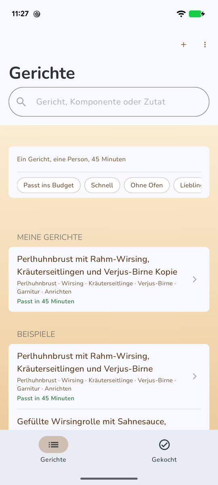
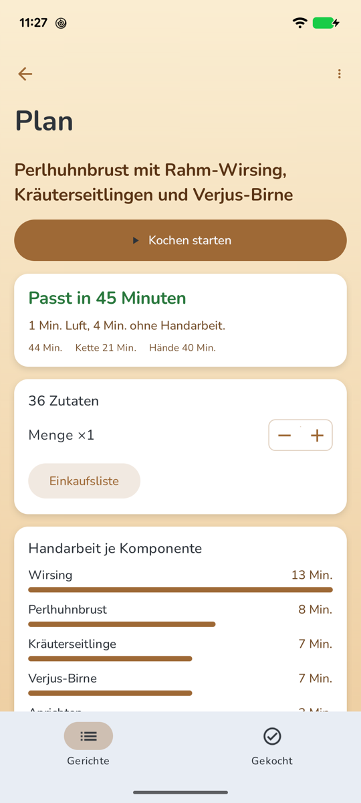
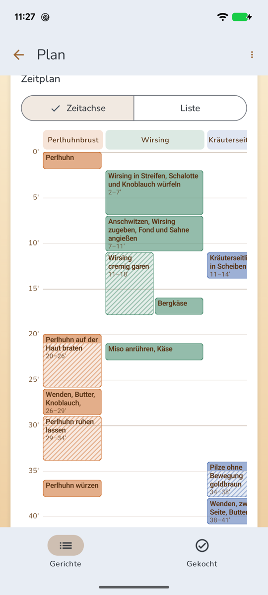
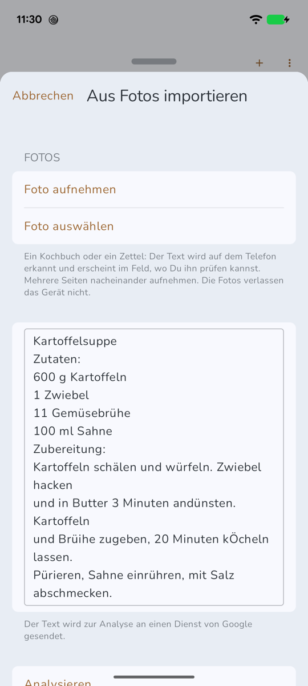
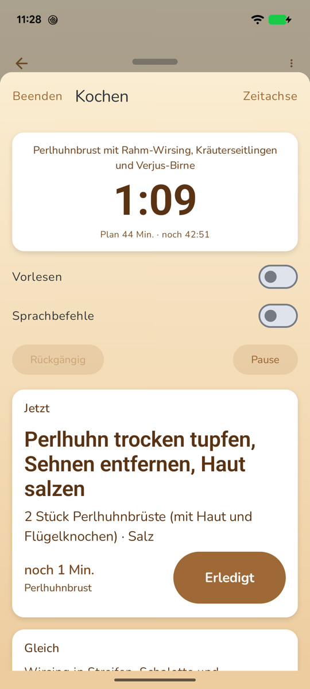
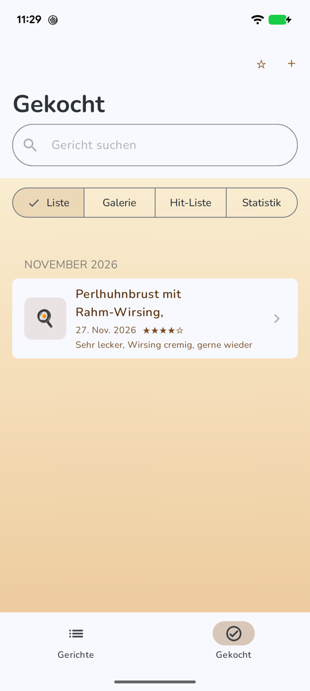
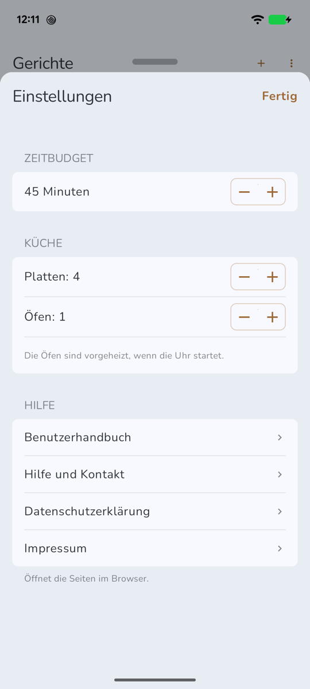

# CookPlanner for Android – User Manual

As of 27 Nov 2026 · Android version 1.0

---

## Contents

1. [What CookPlanner does](#1-what-cookplanner-does)
2. [Requirements](#2-requirements)
3. [Basic terms](#3-basic-terms)
4. [The dish list](#4-the-dish-list)
5. [The plan](#5-the-plan)
6. [Creating and editing a dish](#6-creating-and-editing-a-dish)
7. [Importing](#7-importing)
8. [Composing a menu](#8-composing-a-menu)
9. [Cook mode](#9-cook-mode)
10. [Notifications](#10-notifications)
11. [Cooked](#11-cooked)
12. [Cooking plan as PDF](#12-cooking-plan-as-pdf)
13. [Settings](#13-settings)
14. [Backup and moving to another device](#14-backup-and-moving-to-another-device)
15. [Privacy](#15-privacy)
16. [Frequently asked questions](#16-frequently-asked-questions)
17. [What only the iPhone has](#17-what-only-the-iphone-has)

---

## 1. What CookPlanner does

A dish of meat, side, sauce and garnish, one cook at the stove and a fixed time: CookPlanner lays out the work steps so that **everything is ready at once**, and tells you beforehand whether the time is enough. Its subtitle is “Cooking against the clock”.

- Every step has **hands-on time** (you are busy) and time in which it **runs on its own** (simmering, baking, resting).
- CookPlanner works with **your kitchen**: how many burners, how many ovens and how much time you have.
- The **verdict** says plainly whether the dish fits the time budget – and if not, why and what would help.
- In **cook mode** the app walks you through the kitchen step by step with a clock and replans after every tick.

On top of that: import from text, photos and web pages, ingredients with servings and a shopping list, menus of several courses, a record of every cook with stars, note and photo, measured times for the next plan, reading aloud and voice commands, the cooking plan as a PDF and a cooking yearbook.

CookPlanner Pro does not exist on Android yet: **every feature in this manual is free**, there is nothing to buy.

### Quick start: your first cook against the clock in five steps

1. Under **⋮ → Settings**, set your time budget and your kitchen (burners, ovens).
2. In the dish list, tap one of the **Examples** or create your own with **+ → New dish**.
3. Read the verdict on the plan (“Fits in 35 minutes” or “9 minutes short”) and look at the timeline.
4. Tap **Start cooking**, choose the clock (Challenge, Practice or Relaxed) and tap **Start**.
5. Tick off each step with **Done**; report pots and oven steps with **It’s on**. At the end, **End and keep the record**.

*The dish list: budget and chips at the top, then My dishes and the examples with their verdict.*

---

## 2. Requirements

| Item | Value |
|------|-------|
| Devices | Android phones and tablets |
| Operating system | Android 9.0 or later |
| Languages | German, English, French – the app follows the device language; for other languages it appears in English |
| Appearance | Light and dark mode |
| Internet | Only for importing from text, photos and web pages (the analysis runs in the cloud). Planning, cooking, records and backups work offline |
| Sign-in | None. For the analysis the app signs in anonymously in the background |
| Data | Dishes, records, photos and settings stay on this device only; there is no sync between devices on Android (see [chapter 14](#14-backup-and-moving-to-another-device)) |

The app asks for these permissions only when they are needed:

| Permission | What for | Without it |
|---|---|---|
| Notifications | “up now” and “time is up” banners in cook mode | Cook mode runs, but stays silent while the screen is dark |
| Camera | Photographing a cookbook page, a photo for a record | Photos can still be chosen from files |
| Microphone | Voice commands in cook mode | Voice commands stay off |
| Internet | Recipe analysis, loading a web page | No import; everything else works |

---

## 3. Basic terms

**Dish**
What ends up on the plate, for example “Guinea fowl breast with creamed savoy cabbage, king oyster mushrooms and verjus pear”. A dish has a name, optionally a number of servings, ingredients and steps.

**Component**
A part of the dish that is cooked on its own – meat, cabbage, mushrooms, sauce. In the plan each component gets its own column, and hands-on work is counted per component.

**Step**
A piece of work with a duration: “Cut the cabbage into strips”, “Sear the guinea fowl”. A step belongs to a component, can take a burner or an oven and can wait for other steps.

**Hands and “runs on its own”**
Every step has two times: **Hands** – the minutes in which you are busy – and **then on its own** – the minutes in which the pot simmers or the oven bakes without you. In the time on its own you can do something else; that is exactly what the plan makes use of.

**Time budget**
The minutes in which everything should be ready (35 by default). The verdict measures every dish against it.

**Burners and ovens**
How many burners and ovens your kitchen has. A stove step takes a burner, an oven step an oven, each for its hands-on time and its time on its own. The ovens count as preheated when the clock starts.

**Must go on soon**
Some results cannot wait: seared meat is turned at once, rested meat should not go cold. With “Must go on soon” you say how long a step may wait at most before the next one comes.

**Chain**
The longest sequence of steps that wait for each other. No plan can be shorter than the chain, however cleverly you work in parallel.

**Waits for**
A step only begins when the steps it waits for are done. Without anything chosen, it can begin at once. Plating up usually waits for the last step of every component.

---

## 4. The dish list

The app has two tabs at the bottom: **Dishes** and **Cooked** ([chapter 11](#11-cooked)). The dish list shows “One dish, one cook, 35 minutes” with your budget at the top, then the chips and two sections:

- **My dishes** – what you created, imported or saved as a menu.
- **Examples** – three ready-made dishes to try out. They cannot be changed, but you can use them as a template ([chapter 6](#6-creating-and-editing-a-dish)).

Each row shows the name, the components and the **verdict** in green (“Fits in 35 minutes”) or red (“9 minutes short”). If no plan can be worked out at all – say the dish needs an oven and the kitchen is set to 0 ovens – the reason is shown instead.

### Search

The search field sits above the list. It searches dish, component and ingredient: “cabbage” also finds a dish in which cabbage is only an ingredient.

### Chips

The six fixed chips filter with one tap; a second tap lifts the filter:

| Chip | Shows |
|---|---|
| Fits the budget | Dishes that fit the time budget with your kitchen |
| Quick | Dishes whose plan takes 30 minutes at most |
| No oven | Dishes that only need the stove |
| Favourites | Dishes with at least four stars on average |
| Never cooked | Dishes without a record |
| Not cooked for a while | Dishes not cooked for 60 days, or never |

### Filter and your own collections

Under **⋮ → Filter** you combine several conditions:

- **Duration:** All, Up to 30 minutes, 31 to 45 minutes, 46 to 60 minutes, Over an hour.
- **Equipment:** All, With oven, Stove only, No heat.
- **Origin:** All, Own, Imported, Examples.
- **History:** All, Never cooked, Not cooked for a while, Favourites.
- Switches **Fits the budget** and **Little hands-on work** (your hands are busy for at most 60 percent of the plan).

**Reset filters** clears everything. Enter a **Name** at the bottom and tap **Save collection**: the chosen filters appear as a chip of their own after the six fixed ones. Under **Your own collections** you delete a collection again.

### The “+” and “⋮” menus

| Menu | Entries |
|---|---|
| + | New dish, Import from text, Import from photos, Import from web page, Compose a menu |
| ⋮ | Back up dishes and records, Import dishes, Filter, Settings |

---

## 5. The plan

Tapping a dish opens its **Plan**. At the top is the name, below it the **Start cooking** button ([chapter 9](#9-cook-mode)) and then a series of cards.

*The plan: the verdict with its reason and figures at the top, below it the ingredients with servings and shopping list.*

### The verdict

Large, in green or red: **Fits in N minutes** or **N minutes short**. Below it, the reason:

| Reason | Meaning |
|---|---|
| “N min to spare, N min without hands-on work.” | It fits; this much reserve is left, this long your hands are free |
| “The longest chain takes N minutes …” | The chain is longer than the budget; working in parallel does not help, only shorter steps |
| “The hands-on work alone takes N minutes …” | One cook is not enough; drop or simplify steps |
| “Chain … and hands … fit on their own but collide …” | Hands or equipment are not enough for everything at once – more burners or ovens, or more time |

The small line below gives the length of the plan, the **chain** and the **hands** in minutes.

### Ingredients and servings

The **Ingredients** card shows how many ingredients the dish has. If the recipe gives a number of people, change it with **Serves N** (1 to 24); otherwise there is **Amount ×0.5 to ×4**. Only the amounts change, **the times stay the same**. The choice applies per dish to the plan, cook mode and shopping list, and is kept.

### Shopping list

**Shopping list** opens the ingredients by shelf (Fruit & vegetables, Dairy & eggs, Spices & herbs …), with equal ingredients combined. Tick off what you already have at home; **Everything at home** and **Nothing at home** set all ticks at once. **Share what’s missing** sends the rest as text through Android’s share menu, for example to a notes or shopping app. The ticks are kept per dish.

### How it fits

If a dish does not fit and the hands are not the reason, CookPlanner checks whether shorter cooking times help: steps with a **time span** ([chapter 6](#6-creating-and-editing-a-dish)) are planned at the short end. The **How it fits** card names each step concerned (“Braise the cabbage: 12 instead of 15 minutes”) and says whether that makes it fit the budget or how many minutes are still missing. The dish itself stays unchanged.

### Cooked

If you have cooked the dish in cook mode, the **Cooked** card shows the last five times with date and time taken (or “Relaxed”). With **Take over measured times** you see, per step, the current and the measured time – the median of the ticked times from the last five runs at most. For pots and oven steps the hands-on time stays; only the time on its own adapts. **Apply** writes the times into the dish; for an example the button is called **As own dish** and creates a copy under My dishes.

### Hands-on work per component

A bar per component, the longest at the top: you see which part of the dish keeps you busiest.

### Timeline or list

The **Timeline** card shows the plan either as a **Timeline** chart or as a **List** (the choice is kept).

- **Timeline:** one column per component, time running from top to bottom. Solid bars are hands-on work, striped bars run on their own. Overlapping steps of one component stand side by side. Tap a bar: below the chart you see the step, “Minute 12 to 27”, hands-on time and time on its own and, if any, the oven temperature.
- **List:** every step with its minute, stove or oven and the minutes of hands-on work, in the order of the plan.

*The timeline: one column per component, hands-on work solid, “runs on its own” striped.*

### Keep warm

If a component is ready early and waits ten minutes or more for plating, the **Keep warm** card names it with its waiting time (“Sauce waits 12 minutes”).

### The “⋮” menu on the plan

| Dish | Entries |
|---|---|
| Your own dish | Cooking plan as PDF, Edit, Share, Delete dish |
| Example | Cooking plan as PDF, Use as a template |

---

## 6. Creating and editing a dish

**+ → New dish** opens an empty editor, **⋮ → Edit** on the plan opens it with your own dish. For an example, **⋮ → Use as a template** creates a copy that you adapt in the editor and save as your own dish.

The editor has four sections:

- **Dish:** name and number of people (**Servings not given** if you choose none).
- **Ingredients:** a row per ingredient; **Add ingredient** opens a page of its own.
- **Steps:** a row per step with hands, time on its own and station; **Add step** opens a page of its own.
- **Plan:** the verdict while you type – you see at once what a change does.

**Save** works as soon as the dish has a name and at least one step. **Cancel** discards the changes.

### Ingredient

| Field | Meaning |
|---|---|
| Ingredient | The name, e.g. “Savoy cabbage” |
| Amount and unit | As in the recipe; **Choose unit** or **No unit**. No amount for “salt” or “pepper” |
| Note | e.g. “small” or “well aged” |
| Component | Which part of the dish the ingredient belongs to |

**Delete ingredient** removes it. The ingredients make up the shopping list; which ones you handle in a step, you choose at the step.

### Step

| Field | Meaning |
|---|---|
| What to do | The text of the step, e.g. “Sear the guinea fowl skin side down” |
| Component | Type it, or pick an existing one with **Choose component** |
| Hands | Minutes in which you are busy (0 to 120) |
| Then on its own | Minutes in which the step runs without you: simmering, baking, resting (0 to 600) |
| Time span | Only with time on its own: **At least** and **At most** minutes the cooking may take. “How it fits” uses the short end |
| Station | **None**, **Burner** or **Oven**; for the oven, the temperature (50 to 300 °C) |
| Must go on soon | How long the result may wait at most: 0 minutes for turning after searing, 3 for rested meat, 10 for a sauce kept warm |
| Ingredients of this step | Tick the ingredients used here; in cook mode they appear under the step |
| Waits for | Tick the earlier steps that must be done first |

A new step first waits for the previous step of its component, until you change the choice. **Wait for every component** ticks the last step of each component – right for plating up. **Delete step** removes an existing step.

> If steps wait for each other in a circle, the plan says so. Then check the **Waits for** ticks of the steps.

---

## 7. Importing

Instead of typing a dish, let a recipe be taken apart. All three ways are under **+**:

- **Import from text:** paste the recipe text into the field (at least a few lines) and tap **Analyse**.
- **Import from photos:** **Take photo** (camera) or **Choose photo** (files). The text is recognised **on the phone** and added to the field, where you can check and correct it. Take several pages one after another. Then **Analyse**.
- **Import from web page:** enter the address of the recipe page and tap **Analyse**. The page is loaded on the device; only the recipe text goes to the analysis.

*Import from photos: the text recognised on the phone is in the field and can be checked before the analysis.*

The analysis runs on a Google service (Firebase). It takes the recipe apart into steps, estimates hands-on time and time on its own, recognises stove and oven and takes over the ingredients with their amounts. The result shows the name and “N steps, M ingredients”, plus **Please check** with notes on anything uncertain.

- **Check in the editor** opens the dish in the editor ([chapter 6](#6-creating-and-editing-a-dish)). Only **Save** puts it under My dishes.
- **Try again** discards the result and lets you change the text.

On Android there is no monthly limit for analyses. There is a limit per hour; once it is reached, try again later. If an analysis takes too long, it helps to import a long recipe in two parts.

---

## 8. Composing a menu

**+ → Compose a menu** turns several dishes into one plan, for example starter, main course and dessert.

1. Choose a **dish** for every course. **Add a course** adds more courses, **Remove** drops one.
2. Between the courses, set how many **minutes until the next course** pass, or **Together with the next course**. The starter is served that many minutes before the main course, and the main course is cooked while the guests eat.
3. Give the menu a **Name**. Below, you already see how many steps and ingredients it has and how long the plan takes.
4. **Save** stores the menu as a dish of your own under My dishes, with steps such as “Serve starter”.

You cook the menu like any dish; its ingredients make one shared shopping list.

---

## 9. Cook mode

**Start cooking** on the plan opens cook mode. Before the start you choose the **Clock**:

| Clock | What it does |
|---|---|
| Challenge | The clock counts the time budget down, like on the show. When the time is up, it counts on how far over you are |
| Practice | The clock runs from 0:00 – so you learn how long the dish really takes |
| Relaxed | No clock, no overdue: the steps come in order, only pot and oven keep their time |

**Start** sets the clock running. The app remembers your last choice.

*Cook mode: the clock at the top, below it what comes into your hands now.*

### What the screen shows

- **Clock:** time left or time elapsed depending on the mode, plus “plan done at minute N”; after a replan, whether you will be done earlier or later than planned.
- **Now:** the step in your hands with its ingredients and the time left (“3 min left”, “overdue” in red). When your hands are free it says “Hands free, next in N min”; at the end “Done, plate up!”.
- **Next:** the next three steps, with “in N min”.
- **Running on its own:** what is simmering or baking, with its time left. If you take a pot off the stove early, tick it off here.
- **Done:** “N of M steps”.

### Ticking off: Done and It’s on

- **Done** ticks off a step without time on its own.
- **It’s on** is for pot and oven steps: the hands-on part is finished, the pot is on the stove or the oven door is shut. From now the time on its own runs; when it is up, the step is done.

After every tick and every minute, CookPlanner **replans** the rest: if you were faster, everything moves forward; if you were slower, the rest shifts. **Undo** takes back the last tick.

### Pause, timeline, end

- **Pause** stops the clock (“Paused, the clock is stopped”), **Resume** sets it running again.
- **Timeline** at the top shows the running plan as a chart with a red line for **now**; finished steps are faded.
- **End** at the top asks first: **End and keep the record** files the cook under Cooked, **End without a record** discards it, **Keep cooking** goes back. If no step is done yet, there is nothing to keep.

Android’s back key does not close cook mode – so no run carries on unseen in the background. You only leave through **End**.

### Read aloud

With the **Read aloud** switch the app speaks each new step with its ingredients, the oven temperature and the minutes, announces finished pots (“Cabbage: time is up.”) and at the end “Done, plate up!”. It uses Android’s text-to-speech; the setting is kept.

### Voice commands

With the **Voice commands** switch cook mode listens (the first time Android asks for the microphone). While the app itself is speaking, it does not listen.

| Command | Effect |
|---|---|
| “Done” (also “finished”, “complete”) | Ticks off the step in your hands |
| “It’s on” (also “in the oven”, “simmering”) | Pot or oven is running, the time on its own begins |
| “Undo” / “Back” | Takes back the last tick |
| “Read” / “Repeat” | Reads the current step again |
| “What’s next” / “Next step” | Reads the next step |
| “Ingredients” | Reads the current step’s ingredients |
| “How long” / “Time left” | Time left on the step and on the plan |
| “Pause” / “Hold on” | Stops the clock |
| “Carry on” / “Continue” | Sets the clock running again |
| “Stop” / “Quiet” | Stops the speaking |

The commands work in the app’s language; in German, for example, “Erledigt”, “Steht”, “Was kommt”. If the device has no speech recognition, the app says so.

### Screen and restart

While cook mode is open, the screen stays on. If the app is closed (by the system, an update or swiping it away), the next launch opens the run again – up to six hours after the start. **Start cooking** on the same dish also picks up a running run instead of starting anew.

---

## 10. Notifications

While you cook, CookPlanner schedules notifications for the next steps – even when the phone lies locked in a corner:

- **“Component · up now”** with the step as its title, when a step comes into your hands.
- **“Component · time is up”** when a pot or the oven is done.

The app asks for permission the first time you tap **Start** in cook mode. Without it, cook mode shows: “Notifications are off – CookPlanner stays silent while the screen is dark.” You can turn them on in Android’s settings under **Apps → CookPlanner → Notifications**.

Good to know:

- The next 20 notifications are always scheduled; while the app is open, they follow every replan.
- While the app is in the background, the notifications stay at their times.
- **End**, **Pause** and a new run withdraw all pending notifications.
- Some manufacturers’ battery savers delay notifications. If they come late, exempt CookPlanner from battery optimisation.

---

## 11. Cooked

The **Cooked** tab collects every cook you ended with a record or entered by hand.

*Cooked: the records by month, with view, search and stars at the top.*

### Views

| View | Shows |
|---|---|
| List | The records by month, newest first, with a thumbnail |
| Gallery | The photos of all records |
| Hit list | The dishes by stars, what went down best |
| Statistics | How often cooked, different dishes, average stars, against the plan, the last twelve months as bars, cooked most often |

The search field (**Search dish**) filters by name; with the star button ☆ at the top you choose a **Minimum rating** (All, or 1 to 5 stars and up).

### A record

Tap an entry to open it:

- **How was it?** – stars, a note (“less salt next time”) and a photo: **Take photo**, **Choose photo** or **Remove photo**.
- **Took**, **Planned** and **Difference** in minutes.
- **Steps** – for each step, when it was done, how long it took and what was planned. If the cook was ended early, it says how many steps were done.
- **Delete entry** removes the record.

### Add a cooked dish

If you cooked without the stopwatch, add it with **+ → Add a cooked dish**: choose the dish, the date (**Cooked on**), **Save**. The entry gets stars, note and photo like any other, but no times.

### Cooking yearbook

**+ → Cooking yearbook** turns a year into a PDF: a cover with a photo, the year in figures (cooking days, dishes, hours at the stove, rating, within the plan, longest session), the months with their photos, the favourite dishes with best time, what the clock taught, and room for resolutions. Choose the **Year** and the **Name on the cover**, then **Share the cooking yearbook**. Without records there is no book yet.

---

## 12. Cooking plan as PDF

**⋮ → Cooking plan as PDF** on the plan makes an A4 sheet to print, pin up or send:

- A header with name, duration and number of people.
- The **timeline** – one row per component, bars with the step number.
- The **steps** – each with minute, hands, time on its own, stove or oven and its ingredients.
- The dish’s **ingredients**.

With **With clock times** and a **Start**, real times appear on the sheet (“Start 18:30 · ready 19:05”), otherwise minutes from 0. **Share the plan** opens Android’s share menu – to print, save or send.

---

## 13. Settings

**⋮ → Settings** in the dish list:

*The settings: time budget, kitchen and help.*

| Setting | Range | Default |
|---|---|---|
| Time budget | 10 to 180 minutes in steps of 5 | 35 minutes |
| Burners | 1 to 8 | 4 |
| Ovens | 0 to 3 | 1 |

Every change applies at once to all verdicts and plans. The ovens count as preheated when the clock starts. The app remembers further choices where you make them: the view of the timeline, the cook-mode clock, read aloud, servings and shopping ticks per dish, the view and minimum rating under Cooked, your own collections.

### Help

The **Help** section opens in your browser this **user manual**, the **Help and contact** page with frequent questions and the e-mail address, the **privacy policy** and the **legal notice** – each in the app's language.

---

## 14. Backup and moving to another device

On Android all data lives on this device only. A backup protects against loss and takes your dishes to another device – also to an iPhone with CookPlanner; the format is the same.

### Backing up

**⋮ → Back up dishes and records** in the dish list writes a file `….cookplanner` (named after the date) with all your own dishes, all records and their photos. Android asks where with **Save as** – for example the Downloads folder or Google Drive. The app shows no confirmation of its own; Android’s dialog confirms itself.

### Sharing a dish

**⋮ → Share** on the plan of your own dish saves just this dish as a `.cookplanner` file, also through **Save as**. You can then send the file.

### Importing

**⋮ → Import dishes** opens the file picker. CookPlanner adds new dishes and records with photos; what is already there stays unchanged. Afterwards the app reports how many dishes and records were added and how many were already there. A file from a newer version of CookPlanner is refused – update the app first.

> If you uninstall the app, dishes and records are gone. Back up first – and preferably regularly.

---

## 15. Privacy

- **Dishes, records, photos and settings** stay on your device only. The developer has no access to them.
- **Recipe analysis:** only when importing does the recipe text go to a Google service (Firebase Cloud Functions with AI analysis). It is used for the analysis, not for advertising.
- **Photos** for the import never leave the device: the text is recognised on the phone, and only the text goes to the analysis – and only when you tap **Analyse**.
- **Web pages** are loaded on the device; only the recipe text goes to the analysis.
- **Sign-in:** for the analysis the app signs in anonymously with Firebase. There is no account, no name, no email address. A check through Google Play makes sure the request comes from the real app.
- **Voice commands** use Android’s speech recognition, on the device where possible; CookPlanner stores none of it. **Read aloud** uses Android’s text-to-speech.
- No advertising, no tracking.

---

## 16. Frequently asked questions

**Why does the dish say “N minutes short”?**
Read the reason on the plan. If the chain is too long, only shorter steps or a larger budget help; if there is too much hands-on work, simplify steps; if hands or equipment collide, more burners or ovens in the settings help. Look at the **How it fits** card too.

**The dish has no plan at all, only a red sentence.**
Usually it needs an oven or a burner, and the kitchen is set to 0 in the settings. Or steps wait for each other in a circle – then check the **Waits for** ticks.

**Can I change an example?**
Not directly. **⋮ → Use as a template** creates a copy that is yours.

**Do the times change when I cook for more people?**
No, only the amounts. If you notice it takes longer, cook in Practice mode and take over the measured times afterwards.

**Notifications do not come, or come late.**
Check the permission under **Apps → CookPlanner → Notifications** and exempt the app from battery optimisation. Cook mode shows a note when notifications are off.

**I left cook mode by mistake.**
Open the app again, or tap **Start cooking** on the same dish: the run continues, up to six hours after the start.

**The voice commands do not react.**
Check the microphone permission and say the commands briefly and clearly. While the app reads aloud, it does not listen. Without speech recognition on the device there are no voice commands.

**The import reports an error.**
Check the internet connection. With “The hourly analysis limit is reached”, try again later; if it timed out, import a long recipe in two parts. Nothing recognised in the photos? Take them in more light and straight from above.

**How do I take my dishes to a new phone or an iPhone?**
With **Back up dishes and records** on the old device and **Import dishes** on the new one ([chapter 14](#14-backup-and-moving-to-another-device)).

---

## 17. What only the iPhone has

CookPlanner for Android can do almost everything the iPhone app can. A few things depend on Apple services and are missing on Android:

| On the iPhone | On Android |
|---|---|
| iCloud sync between iPhone and iPad | No sync; move devices with the backup file |
| Live Activity on the Lock Screen and in the Dynamic Island | Notifications per step |
| Alarms through AlarmKit for finished pots | “time is up” notifications |
| Siri and Shortcuts (“How much longer”, “Step done”) | Voice commands in cook mode |
| Dishes in Spotlight search | Search in the app |
| Importing a recipe from the browser through “Share” | **+ → Import from web page** with the address |
| Keyboard shortcuts on the iPad | – |
| CookPlanner Pro as a one-time purchase (menu, read aloud and voice commands, cooking yearbook, statistics, your own collections, plan as PDF, measured times, more recipe analyses) | Everything free, nothing to buy |
