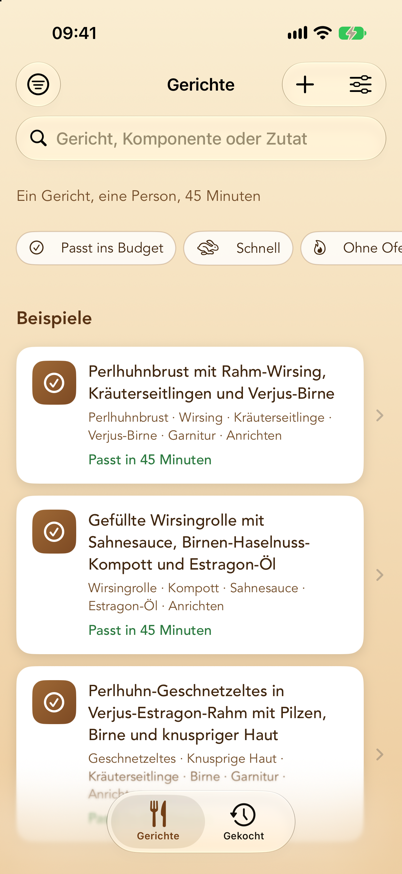
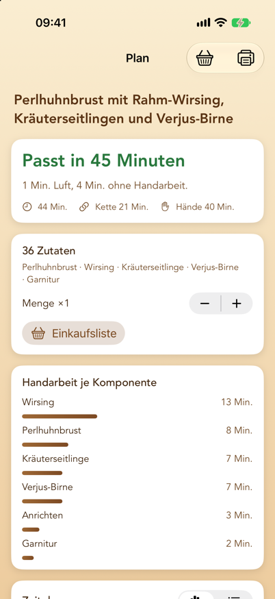
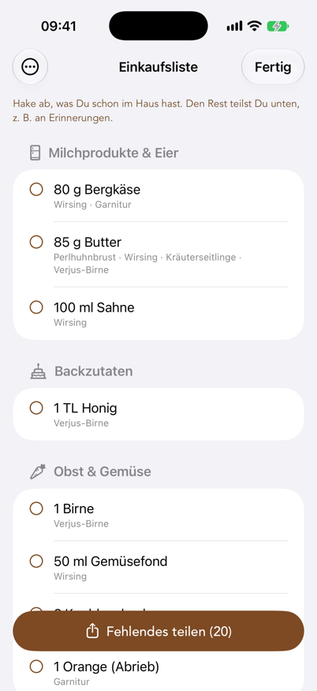
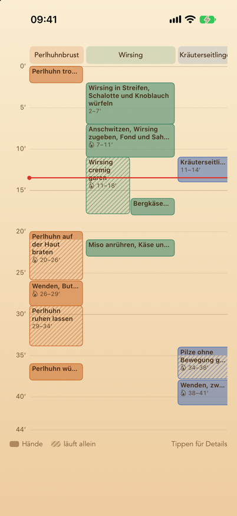
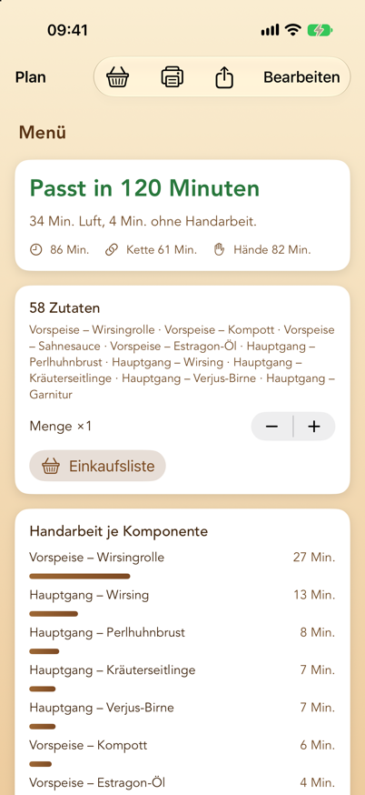
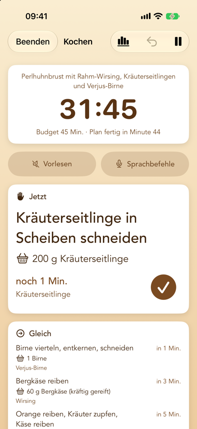
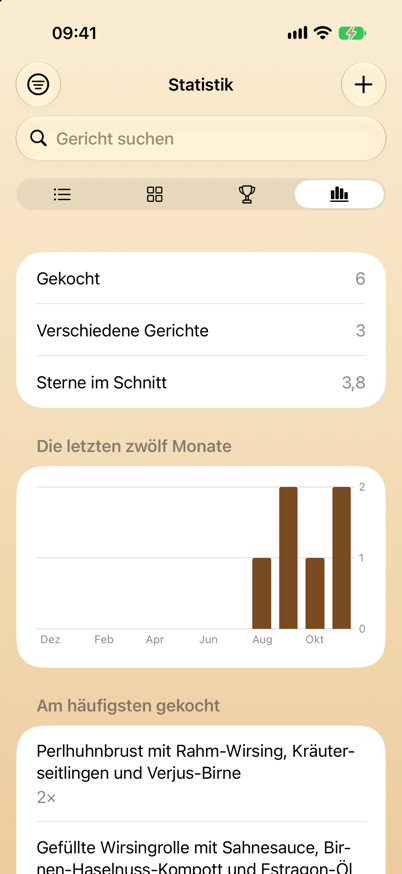

# CookPlanner – Benutzerhandbuch

Stand: 27.11.2026 · App-Version 1.0

---

## Inhalt

1. [Was CookPlanner macht](#1-was-cookplanner-macht)
2. [Voraussetzungen](#2-voraussetzungen)
3. [Grundbegriffe](#3-grundbegriffe)
4. [Die Gerichte-Liste](#4-die-gerichte-liste)
5. [Der Plan](#5-der-plan)
6. [Gericht anlegen und bearbeiten](#6-gericht-anlegen-und-bearbeiten)
7. [Importieren](#7-importieren)
8. [Menü zusammenstellen](#8-menü-zusammenstellen)
9. [Kochmodus](#9-kochmodus)
10. [Mitteilungen, Wecker und Live-Aktivität](#10-mitteilungen-wecker-und-live-aktivität)
11. [Gekocht](#11-gekocht)
12. [Ablaufplan als PDF und Kochjahr-Buch](#12-ablaufplan-als-pdf-und-kochjahr-buch)
13. [Siri, Kurzbefehle, Spotlight und Tastatur](#13-siri-kurzbefehle-spotlight-und-tastatur)
14. [Einstellungen](#14-einstellungen)
15. [Sicherung, iCloud und Gerätewechsel](#15-sicherung-icloud-und-gerätewechsel)
16. [CookPlanner Pro](#16-cookplanner-pro)
17. [Datenschutz](#17-datenschutz)
18. [Häufige Fragen](#18-häufige-fragen)

---

## 1. Was CookPlanner macht

Ein Gericht aus Fleisch, Beilage, Sauce und Garnitur, eine Person am Herd und eine feste Zeit: CookPlanner legt die Arbeitsschritte so, dass **alles zugleich fertig wird**, und sagt Dir vorher, ob die Zeit reicht. Die App heißt im Untertitel „Kochen gegen die Uhr“.

- Jeder Schritt hat **Handarbeit** (Du bist gebunden) und eine Zeit, in der er **von allein läuft** (köcheln, backen, ruhen).
- CookPlanner rechnet mit **Deiner Küche**: wie viele Herdplatten, wie viele Öfen und wie viel Zeit Du hast.
- Das **Urteil** sagt klar, ob das Gericht ins Zeitbudget passt – und wenn nicht, warum und was helfen würde.
- Im **Kochmodus** führt Dich die App mit einer Uhr Schritt für Schritt durch die Küche und plant nach jedem Haken neu. Mitteilungen, Wecker und die Live-Aktivität auf dem Sperrbildschirm sagen Dir Bescheid, auch wenn das iPhone gesperrt auf der Arbeitsfläche liegt.

Dazu kommen: Import aus Text, Fotos und Webseiten (auch direkt aus Safari über **Teilen**), Zutaten mit Portionen und Einkaufsliste, Menüs aus mehreren Gängen, ein Protokoll jedes Kochens mit Sternen, Notiz und Foto, gemessene Zeiten für den nächsten Plan, Vorlesen und Sprachbefehle, Siri und Kurzbefehle, der Ablaufplan als PDF, ein Kochjahr-Buch und der Abgleich über iCloud zwischen iPhone und iPad.

### Schnellstart: In fünf Schritten zum ersten Kochen gegen die Uhr

1. Tippe in der Gerichte-Liste oben rechts auf den Knopf mit den Schiebereglern (**Einstellungen**) und stelle Dein Zeitbudget und Deine Küche ein (Platten, Öfen).
2. Tippe auf eines der **Beispiele** oder lege mit **+ → Neues Gericht** ein eigenes an.
3. Lies auf dem Plan das Urteil („Passt in 35 Minuten“ oder „Fehlen 9 Minuten“) und schau Dir den Zeitplan an.
4. Tippe unten auf dem Plan auf **Kochen starten**, wähle die Uhr (Challenge, Training oder Entspannt) und tippe auf **Start**.
5. Hake jeden Schritt mit dem großen Haken ab; bei Töpfen und Ofenschritten zeigt der Knopf eine Flamme und heißt „Steht, läuft von allein“. Am Ende **Beenden → Beenden und Protokoll sichern**.

*Die Gerichte-Liste: oben Filter, + und Einstellungen, darunter Suche, Budget und Chips, dann die Gerichte mit ihrem Urteil.*

---

## 2. Voraussetzungen

| Punkt | Wert |
|-------|------|
| Geräte | iPhone und iPad |
| Betriebssystem | iOS 26 bzw. iPadOS 26 oder neuer |
| Sprachen | Deutsch, Englisch, Französisch – die App folgt der Sprache des Geräts |
| Darstellung | Hell- und Dunkelmodus |
| Internet | Nur für den Import aus Text, Fotos und Webseiten (die Analyse läuft in der Cloud) und für den iCloud-Abgleich. Planen, Kochen, Protokolle und Sicherung gehen offline |
| Anmeldung | Kein Konto bei CookPlanner. Für die Analyse meldet sich die App im Hintergrund anonym an |
| iCloud | Optional: Mit derselben Apple-ID gleichen sich iPhone und iPad ab ([Kapitel 15](#15-sicherung-icloud-und-gerätewechsel)) |

Die App fragt die folgenden Berechtigungen erst, wenn sie gebraucht werden:

| Berechtigung | Wofür | Ohne sie |
|---|---|---|
| Mitteilungen | „jetzt dran“ und „die Zeit ist um“ im Kochmodus | Der Kochmodus läuft, meldet sich aber bei gesperrtem iPhone nicht |
| Wecker (AlarmKit) | Ein Wecker, wenn ein Topf oder der Ofen fertig ist – auch im Stummmodus und im Fokus | Statt des Weckers kommt eine Mitteilung |
| Kamera | **Seiten scannen** beim Import, **Foto aufnehmen** für ein Protokoll | Fotos lassen sich weiter aus der Mediathek wählen |
| Mikrofon und Spracherkennung | Sprachbefehle im Kochmodus | Sprachbefehle bleiben aus |

Für **Fotos auswählen** braucht die App keine Berechtigung: Die Fotoauswahl von iOS gibt nur die Bilder heraus, die Du antippst.

---

## 3. Grundbegriffe

**Gericht**
Was am Ende auf dem Teller liegt, zum Beispiel „Perlhuhnbrust mit Rahm-Wirsing, Kräuterseitlingen und Verjus-Birne“. Ein Gericht hat einen Namen, optional eine Personenzahl, Zutaten und Schritte.

**Komponente**
Ein Teil des Gerichts, der für sich gekocht wird – Fleisch, Wirsing, Pilze, Sauce. Im Plan bekommt jede Komponente ihre eigene Spalte, und die Handarbeit wird je Komponente gezählt.

**Schritt**
Eine Arbeit mit Dauer: „Wirsing in Streifen schneiden“, „Perlhuhn anbraten“. Ein Schritt gehört zu einer Komponente, kann eine Herdplatte oder einen Ofen belegen und auf andere Schritte warten.

**Hände und „läuft allein“**
Jeder Schritt hat zwei Zeiten: **Hände** – die Minuten, in denen Du gebunden bist – und **danach allein** – die Minuten, in denen der Topf köchelt oder der Ofen backt, ohne Dich. In der Zeit allein kannst Du anderes tun; genau das nutzt der Plan.

**Zeitbudget**
Die Minuten, in denen alles fertig sein soll (Voreinstellung 35). Das Urteil misst jedes Gericht daran.

**Platten und Öfen**
Wie viele Herdplatten und Öfen Deine Küche hat. Ein Schritt am Herd belegt eine Platte, ein Ofenschritt einen Ofen, jeweils für Hände und Zeit allein. Die Öfen gelten als vorgeheizt, wenn die Uhr startet.

**Muss bald weitergehen**
Manche Ergebnisse vertragen kein Warten: Fleisch nach dem Anbraten wird gleich gewendet, geruhtes Fleisch soll nicht kalt werden. Mit „Muss bald weitergehen“ gibst Du an, wie lange ein Schritt höchstens liegen darf, bevor der nächste kommt.

**Kette**
Die längste Folge von Schritten, die aufeinander warten. Kürzer als die Kette kann kein Plan werden, egal wie geschickt parallel gearbeitet wird.

**Warten auf**
Ein Schritt beginnt erst, wenn die Schritte fertig sind, auf die er wartet. Ohne Angabe kann er sofort beginnen. Das Anrichten wartet typischerweise auf den letzten Schritt jeder Komponente.

---

## 4. Die Gerichte-Liste

Die App hat unten zwei Tabs: **Gerichte** und **Gekocht** ([Kapitel 11](#11-gekocht)). Die Gerichte-Liste zeigt oben das Suchfeld, darunter „Ein Gericht, eine Person, 35 Minuten“ mit Deinem Budget, die Chips und dann zwei Abschnitte:

- **Meine Gerichte** – was Du angelegt, importiert oder als Menü gesichert hast.
- **Beispiele** – drei fertige Gerichte zum Ausprobieren. Sie lassen sich nicht ändern, aber als Vorlage übernehmen ([Kapitel 6](#6-gericht-anlegen-und-bearbeiten)).

Jede Zeile zeigt den Namen, die Komponenten und das **Urteil** in Grün („Passt in 35 Minuten“) oder Rot („Fehlen 9 Minuten“). Lässt sich gar kein Plan rechnen – etwa weil das Gericht einen Ofen braucht und die Küche auf 0 Öfen steht –, steht dort der Grund. Ein Tipp öffnet den Plan ([Kapitel 5](#5-der-plan)).

| Geste | Bei eigenen Gerichten | Bei Beispielen |
|---|---|---|
| Nach links wischen | **Löschen** | – |
| Lange drücken | **Bearbeiten**, **Löschen** | **Als Vorlage übernehmen** |

### Suche

Das Suchfeld (**Gericht, Komponente oder Zutat**) steht immer über der Liste. Gesucht wird in Gericht, Komponente und Zutat: „Wirsing“ findet auch ein Gericht, in dem Wirsing nur als Zutat vorkommt. Findet sich nichts, steht dort „Keine passenden Gerichte“.

### Chips

Die sechs festen Chips filtern mit einem Tipp, ein zweiter Tipp hebt den Filter wieder auf:

| Chip | Zeigt |
|---|---|
| Passt ins Budget | Gerichte, die mit Deiner Küche ins Zeitbudget passen |
| Schnell | Gerichte, deren Plan höchstens 30 Minuten dauert |
| Ohne Ofen | Gerichte, die nur den Herd brauchen |
| Lieblinge | Gerichte mit im Schnitt mindestens vier Sternen |
| Noch nie gekocht | Gerichte ohne Protokoll |
| Lange nicht gekocht | Gerichte, die seit 60 Tagen oder noch nie gekocht wurden |

### Filter und eigene Sammlungen

Der Filter-Knopf oben links öffnet ein Menü mit mehreren Bedingungen; ist ein Filter aktiv, ist der Knopf ausgefüllt:

- **Dauer:** Alle, Bis 30 Minuten, 31 bis 45 Minuten, 46 bis 60 Minuten, Über eine Stunde.
- **Geräte:** Alle, Mit Ofen, Nur Herd, Ohne Hitze.
- **Herkunft:** Alle, Eigene, Importiert, Beispiele.
- **Verlauf:** Alle, Noch nie gekocht, Lange nicht gekocht, Lieblinge.
- Schalter **Passt ins Budget** und **Wenig Handarbeit** (die Hände sind höchstens 60 Prozent des Plans gebunden).

Ist ein Filter gesetzt, stehen oben im Menü **Filter zurücksetzen** und **Sammlung sichern**. Mit **Sammlung sichern** gibst Du einen Namen ein, und die gewählten Filter erscheinen als eigener Chip hinter den sechs festen. Lange drücken auf diesen Chip bietet **Umbenennen** und **Sammlung löschen**. Eigene Sammlungen gehören zu CookPlanner Pro ([Kapitel 16](#16-cookplanner-pro)); Suche, Filter und die festen Chips sind frei.

### Die Knöpfe oben

| Knopf | Einträge |
|---|---|
| Filter (links) | Dauer, Geräte, Herkunft, Verlauf, Passt ins Budget, Wenig Handarbeit, Filter zurücksetzen, Sammlung sichern |
| + | Neues Gericht, Aus Text importieren, Aus Fotos importieren, Aus Webseite importieren, Menü zusammenstellen |
| Schieberegler | Einstellungen ([Kapitel 14](#14-einstellungen)) |

---

## 5. Der Plan

Ein Tipp auf ein Gericht öffnet seinen **Plan**. Oben steht der Name, darunter folgen die Karten, ganz unten der Knopf **Kochen starten** ([Kapitel 9](#9-kochmodus)). In der Leiste oben stehen, je nach Gericht:

| Knopf | Wirkung |
|---|---|
| Korb | **Einkaufsliste** (wenn das Gericht Zutaten hat) |
| Drucker | **Ablaufplan als PDF** ([Kapitel 12](#12-ablaufplan-als-pdf-und-kochjahr-buch)) |
| Teilen | **Gericht teilen** als `.cookplanner`-Datei (nur eigene Gerichte, [Kapitel 15](#15-sicherung-icloud-und-gerätewechsel)) |
| Bearbeiten | Öffnet den Editor (nur eigene Gerichte) |

*Der Plan: oben das Urteil „Passt in 45 Minuten“ mit Begründung und Zahlen, darunter die Zutaten mit Menge und Einkaufsliste und die Handarbeit je Komponente.*

### Das Urteil

Groß in Grün oder Rot: **Passt in N Minuten** oder **Fehlen N Minuten**. Darunter steht, warum:

| Begründung | Bedeutung |
|---|---|
| „N Min. Luft, N Min. ohne Handarbeit.“ | Es passt; so viel Reserve bleibt, so lange hast Du die Hände frei |
| „Die längste Kette dauert N Minuten …“ | Die Kette ist länger als das Budget; parallel arbeiten hilft nicht, nur kürzere Schritte |
| „Die Handarbeit allein dauert N Minuten …“ | Eine Person reicht nicht; Schritte streichen oder vereinfachen |
| „Kette … und Hände … passen einzeln, kollidieren aber …“ | Hände oder Geräte reichen nicht für alles zugleich – mehr Platten oder Öfen oder mehr Zeit |

Die kleine Zeile darunter nennt die Dauer des Plans, die **Kette** und die **Hände** in Minuten. Lässt sich kein Plan rechnen, zeigt die Seite „Kein Plan“ mit dem Grund und bei eigenen Gerichten den Knopf **Bearbeiten**.

### Zutaten und Portionen

Die Karte zeigt, wie viele Zutaten das Gericht hat und zu welchen Komponenten sie gehören. Nennt das Rezept eine Personenzahl, stellst Du mit **Für N Personen** um (1 bis 24); sonst gibt es **Menge ×0,5 bis ×4**. Nur die Mengen ändern sich, **die Zeiten bleiben gleich**. Die Wahl gilt je Gericht für Plan, Kochmodus und Einkaufsliste und bleibt gespeichert.

### Einkaufsliste

**Einkaufsliste** (Knopf in der Karte oder Korb oben) öffnet die Zutaten nach Regalen (Milchprodukte & Eier, Backzutaten, Obst & Gemüse, Gewürze & Kräuter …); gleiche Zutaten mehrerer Komponenten stehen in einer Zeile, die Mengen zusammengezählt. Hake ab, was Du schon im Haus hast; der Knopf **…** oben links bietet **Alles im Haus** und **Nichts im Haus**. **Fehlendes teilen (N)** unten schickt den Rest als Text weiter, eine Zutat je Zeile – etwa an Erinnerungen, Notizen oder eine Nachricht. Die Haken bleiben je Gericht gespeichert.

*Die Einkaufsliste: Zutaten nach Regalen, darunter klein die Komponenten; unten „Fehlendes teilen (20)“.*

### So passt es

Passt ein Gericht nicht und liegt es nicht an den Händen, prüft CookPlanner, ob kürzere Garzeiten helfen: Schritte mit einer **Zeitspanne** ([Kapitel 6](#6-gericht-anlegen-und-bearbeiten)) werden am kurzen Ende geplant. Die Karte **So passt es** nennt jeden betroffenen Schritt („Wirsing schmoren: 12 statt 15 Minuten“) und sagt, ob es damit ins Budget passt oder wie viele Minuten auch dann noch fehlen. Das Gericht selbst bleibt unverändert.

### Handarbeit je Komponente

Balken je Komponente, die längste oben: So siehst Du, welcher Teil des Gerichts Dich am meisten bindet.

### Zeitplan: Zeitachse oder Liste

Die Karte **Zeitplan** zeigt den Plan wahlweise als **Zeitachse** oder **Liste** (Umschalter rechts in der Karte; die Wahl bleibt gespeichert).

- **Zeitachse:** je Komponente eine Spalte, die Zeit läuft von oben nach unten in Minuten. Volle Balken sind Handarbeit, gestreifte Balken laufen allein; ein Flammen-Symbol steht für Herd oder Ofen. Überlappen sich Schritte einer Komponente, stehen sie nebeneinander. **Tippen für Details:** Ein Tipp auf einen Balken öffnet ein kleines Fenster mit dem vollen Namen, der Komponente, „Minute 12 bis 27“, den Minuten Hände und allein und gegebenenfalls der Ofentemperatur.
- **Liste:** jeder Schritt mit seinen Minuten von–bis, Hand- und Herd- oder Ofen-Symbol, Komponente, Zeitspanne und Ofentemperatur, in der Reihenfolge des Plans.

*Die Zeitachse: eine Spalte je Komponente, Handarbeit voll, „läuft allein“ gestreift. Im Kochmodus markiert die rote Linie, wo Du gerade stehst.*

### Gekocht

Hast Du das Gericht schon im Kochmodus gekocht oder eingetragen, zeigt die Karte **Gekocht** die letzten fünf Male mit Datum, Sternen und gebrauchter Zeit; ein Tipp öffnet das Protokoll, lange drücken bietet **Protokoll löschen**. Gibt es gemessene Zeiten, erscheint **Gemessene Zeiten für N Schritte übernehmen**: Du siehst je Schritt die bisherige und die gemessene Zeit – den Median der abgehakten Zeiten aus den letzten bis zu fünf Durchgängen. Bei Töpfen und Ofenschritten bleibt die Handarbeit, nur die Zeit allein passt sich an; entspannt gekochte Durchgänge zählen nicht. **Übernehmen** schreibt die Zeiten ins Gericht; bei einem Beispiel heißt der Knopf **Als eigenes Gericht** und legt eine Kopie unter Meine Gerichte an. Das Messen ist frei, das Übernehmen gehört zu CookPlanner Pro.

### Warm halten

Wird eine Komponente früh fertig und wartet zehn Minuten oder länger auf das Anrichten, nennt die Karte **Warm halten** sie mit der Wartezeit („Sauce wartet 12 Minuten“).

---

## 6. Gericht anlegen und bearbeiten

**+ → Neues Gericht** öffnet den Editor leer, **Bearbeiten** auf dem Plan (oder lange drücken in der Liste) mit dem eigenen Gericht. Bei einem Beispiel legt **Als Vorlage übernehmen** (lange drücken in der Liste) eine Kopie an, die Du im Editor anpasst und als eigenes Gericht sicherst.

Der Editor hat vier Abschnitte:

- **Gericht:** Name und Personenzahl (1 bis 12; **Portionen nicht angegeben**, wenn Du keine Zahl wählst).
- **Zutaten:** eine Zeile je Zutat, **Zutat hinzufügen** öffnet ein eigenes Blatt.
- **Schritte:** eine Zeile je Schritt mit Händen, Zeit allein, Gerät und dem, worauf er wartet; **Schritt hinzufügen** öffnet ein eigenes Blatt. Ab zwei Schritten steht rechts über der Liste **Bearbeiten**, um Schritte zu verschieben oder zu löschen.
- **Plan:** das Urteil, während Du tippst – so siehst Du sofort, was eine Änderung bewirkt.

Zutaten und Schritte löschst Du auch mit einem Wisch nach links. **Sichern** geht, sobald das Gericht einen Namen und mindestens einen Schritt hat. **Abbrechen** verwirft die Änderungen.

### Zutat

| Feld | Bedeutung |
|---|---|
| Name | Der Name, z. B. „Wirsing“ |
| Menge und Einheit | Wie im Rezept; der Knopf neben der Einheit bietet gängige Einheiten und **Ohne Einheit**. Ohne Menge für „Salz“ oder „Pfeffer“ |
| Komponente | Zu welchem Teil des Gerichts die Zutat gehört; eintippen oder mit **Komponente wählen** eine vorhandene nehmen |
| Hinweis | z. B. „klein“ oder „kräftig gereift“ |

**Zutat löschen** entfernt sie. Die Zutaten bilden die Einkaufsliste; welche Du in einem Schritt in die Hand nimmst, wählst Du beim Schritt.

### Schritt

| Feld | Bedeutung |
|---|---|
| Was zu tun ist | Der Text des Schritts, z. B. „Perlhuhn auf der Haut anbraten“ |
| Komponente | Eintippen oder mit **Komponente wählen** eine vorhandene nehmen |
| Hände | Minuten, in denen Du gebunden bist (0 bis 120) |
| Danach allein | Minuten, in denen der Schritt ohne Dich läuft: kochen, backen, ruhen (0 bis 600) |
| Zeitspanne | Nur mit Zeit allein: **Mindestens** und **Höchstens** Minuten, die die Garzeit dauern darf. „So passt es“ nutzt das kurze Ende |
| Gerät | **Keins**, **Platte** oder **Ofen**; beim Ofen die Temperatur (50 bis 300 °C in Zehnerschritten) |
| Muss bald weitergehen | Schalter; dann „Liegt höchstens N Min.“ (0 bis 60): 0 Minuten für Wenden nach dem Anbraten, 3 für geruhtes Fleisch, 10 für eine warm gestellte Sauce |
| Zutaten dieses Schritts | Haken bei den Zutaten, die hier verarbeitet werden; im Kochmodus stehen sie unter dem Schritt |
| Wartet auf | Haken bei den Schritten, die vorher fertig sein müssen |

Ein neuer Schritt folgt zunächst dem vorherigen Schritt seiner Komponente, bis Du die Auswahl änderst. **Auf alle Komponenten warten** setzt die Haken beim letzten Schritt jeder Komponente – richtig für das Anrichten. **Schritt löschen** entfernt einen bestehenden Schritt.

> Warten Schritte im Kreis aufeinander, sagt der Plan „Die Schritte warten im Kreis aufeinander“. Prüfe dann bei den Schritten die Angaben unter **Wartet auf**.

---

## 7. Importieren

Statt ein Gericht abzutippen, lässt Du es aus einem Rezept zerlegen. Die Wege liegen unter **+**, dazu kommt das Teilen aus Safari:

- **Aus Text importieren:** Rezepttext ins Feld tippen oder mit **Einfügen** übernehmen (mindestens ein paar Zeilen) und **Analysieren** tippen.
- **Aus Fotos importieren:** **Seiten scannen** öffnet die Dokumentenkamera von iOS – sie findet die Seitenränder und nimmt mehrere Seiten nacheinander auf. **Fotos auswählen** nimmt bis zu vier Bilder aus der Mediathek. Der Text wird **auf dem iPhone** erkannt und im Feld angehängt, wo Du ihn prüfen und korrigieren kannst; die Fotos verlassen das Gerät nicht. Dann **Analysieren**. Beide Knöpfe gibt es auch beim Textimport, unter dem Textfeld.
- **Aus Webseite importieren:** die **Adresse der Rezeptseite** eingeben oder einfügen und **Analysieren** tippen. Die Seite wird auf dem Gerät geladen, nur der Rezepttext geht zur Analyse.
- **Aus Safari teilen:** Auf einer Rezeptseite in Safari (oder einer anderen App, die Links teilt) **Teilen → CookPlanner** wählen. Das Blatt „Rezept in CookPlanner importieren“ zeigt die Seite; **Importieren** öffnet CookPlanner, und die Analyse beginnt sofort. Lässt sich die App von dort nicht öffnen, öffne sie selbst – der Import startet dann von allein.

Die Analyse läuft bei einem Dienst von Google (Firebase). Sie zerlegt das Rezept in Schritte, schätzt Handarbeit und Zeit allein, schlägt Reihenfolge und Abhängigkeiten vor, erkennt Herd und Ofen und übernimmt die Zutaten samt Mengen. Das Ergebnis zeigt unter **Gefunden** den Namen, „N Schritte, M Komponenten“ und gegebenenfalls die Personenzahl, dazu **Hinweise der Analyse** zu Unsicherem.

- **Prüfen und bearbeiten** öffnet das Gericht im Editor ([Kapitel 6](#6-gericht-anlegen-und-bearbeiten)). Erst mit **Sichern** landet es unter Meine Gerichte.
- **Anderen Text analysieren** bzw. **Andere Seite analysieren** verwirft das Ergebnis.

Pro Stunde ist die Zahl der Analysen begrenzt; ist sie erreicht, versuche es später noch einmal. Ist CookPlanner Pro im Angebot, gibt es ohne Pro eine feste Zahl kostenloser Analysen im Monat; die App sagt nach jeder Analyse, wie viele noch übrig sind ([Kapitel 16](#16-cookplanner-pro)). Von Hand anlegen geht immer. Dauert eine Analyse zu lange, hilft es, ein langes Rezept in zwei Teilen zu importieren.

---

## 8. Menü zusammenstellen

**+ → Menü zusammenstellen** (auf dem iPad auch ⇧⌘N) macht aus mehreren Gerichten einen gemeinsamen Plan, etwa Vorspeise, Hauptgang und Dessert. Das Menü gehört zu CookPlanner Pro.

1. Gib dem Menü oben einen **Namen** (sonst heißt es „Menü“).
2. Wähle für jeden Gang ein **Gericht** – eigene Gerichte und Beispiele, keine anderen Menüs. Die Gänge heißen von selbst Vorspeise, Hauptgang und Dessert; jeden Namen kannst Du überschreiben. **Gang hinzufügen** ergänzt weitere Gänge (bis zu fünf), **Entfernen** streicht einen.
3. Gib zwischen den Gängen an, wie viele **Minuten bis zum nächsten Gang** vergehen (0 bis 90 in Fünferschritten), oder **Zusammen mit dem nächsten Gang**. Die Vorspeise kommt so viele Minuten vor dem Hauptgang auf den Tisch, und der Hauptgang wird gekocht, während die Gäste essen.
4. Unter **Plan** stehen schon das Urteil, die Begründung und „N Schritte, M Zutaten, Plan N Min.“.
5. **Sichern** legt das Menü als eigenes Gericht unter Meine Gerichte an, mit Schritten wie „Vorspeise servieren“.

*Ein gesichertes Menü: „Passt in 120 Minuten“, die Zutaten und die Handarbeit je Komponente, jeweils mit dem Gang davor.*

Das Menü kochst Du wie jedes Gericht; die Komponenten heißen dort „Vorspeise – Wirsingrolle“ oder „Hauptgang – Perlhuhnbrust“, und seine Zutaten ergeben eine gemeinsame Einkaufsliste.

---

## 9. Kochmodus

**Kochen starten** unten auf dem Plan (auf dem iPad auch ⌘⏎) öffnet den Kochmodus bildschirmfüllend. Vor dem Start wählst Du die **Uhr**:

| Uhr | Was sie tut |
|---|---|
| Challenge | Die Uhr zählt das Zeitbudget rückwärts, wie in der Sendung. Ist die Zeit um, zählt sie weiter, wie viel drüber |
| Training | Die Uhr läuft ab 0:00 – so lernst Du, wie lange das Gericht wirklich dauert |
| Entspannt | Keine Uhr, kein Überfällig: Die Schritte kommen der Reihe nach, nur Topf und Ofen behalten ihre Zeit |

Mit **Start** läuft die Uhr; beim ersten Mal fragt iOS nach Mitteilungen und Weckern ([Kapitel 10](#10-mitteilungen-wecker-und-live-aktivität)). Die App merkt sich Deine letzte Wahl.

*Der Kochmodus: oben die Uhr (31:45), darunter Vorlesen und Sprachbefehle, die Karte „Jetzt“ mit Zutat, Restzeit und Haken und die Liste „Gleich“.*

### Was der Bildschirm zeigt

- **Uhr:** je nach Modus Restzeit oder gelaufene Zeit, dazu „Budget 45 Min. · Plan fertig in Minute 44“; nach einer Neuplanung, ob Du früher oder später als geplant fertig wirst; nach Ablauf „Zeit um – 2:10 drüber“.
- **Jetzt:** der Schritt in Deinen Händen, groß, mit seinen Zutaten, der Komponente und der Restzeit („noch 3 Min.“, rot „überfällig“). Sind die Hände frei, steht dort „Hände frei, in N Min. weiter“; am Ende „Fertig, anrichten!“.
- **Gleich:** die nächsten drei Schritte mit ihren Zutaten und „in N Min.“.
- **Läuft von allein:** was gerade köchelt oder backt, mit der Restzeit. Nimmst Du einen Topf früher vom Herd, hakst Du ihn hier ab.
- **Erledigt:** „N von M Schritten“ und darunter jeder abgehakte Schritt mit der Uhrzeit der Stoppuhr, der neueste oben.

Auf dem iPad und anderen breiten Bildschirmen wird der aktuelle Schritt noch größer, damit Du ihn aus der Entfernung liest.

### Abhaken: Haken und Flamme

- Der große **Haken** rechts in der Karte „Jetzt“ (**Schritt erledigt**) hakt einen Schritt ohne Zeit allein ab.
- Bei Topf- und Ofenschritten zeigt der Knopf eine **Flamme** (**Steht, läuft von allein**): Die Hände sind fertig, der Topf steht auf dem Herd oder die Ofentür ist zu. Ab jetzt läuft die Zeit allein; ist sie um, ist der Schritt fertig.

Nach jedem Haken und jede Minute plant CookPlanner den Rest **neu**: Warst Du schneller, rückt alles vor; warst Du langsamer, verschiebt sich der Rest.

### Die Knöpfe oben

| Knopf | Wirkung |
|---|---|
| Beenden (links) | Fragt „Kochen beenden?“: **Beenden und Protokoll sichern** legt das Kochen unter Gekocht ab, **Beenden ohne Protokoll** verwirft es, **Weiterkochen** kehrt zurück. Ist noch kein Schritt erledigt, gibt es nichts festzuhalten |
| Zeitachse | Der laufende Plan als Diagramm mit einer roten Linie für **jetzt**; erledigte Schritte sind blass |
| Rückgängig | Nimmt den letzten Haken zurück |
| Pause / Weiter | Hält die Uhr an („Pause, die Uhr steht“) und lässt sie weiterlaufen |

Nach **Beenden und Protokoll sichern** öffnet sich das neue Protokoll sofort, damit Du Sterne und ein Foto vergeben kannst ([Kapitel 11](#11-gekocht)).

### Vorlesen

Mit dem Knopf **Vorlesen** spricht die App jeden neuen Schritt mit seinen Zutaten, der Ofentemperatur und den Minuten, meldet fertige Töpfe („Wirsing: die Zeit ist um.“) und am Ende „Fertig, anrichten!“. Die Einstellung bleibt gespeichert. Vorlesen gehört zu CookPlanner Pro.

### Sprachbefehle

Mit dem Knopf **Sprachbefehle** hört der Kochmodus zu (beim ersten Mal fragt iOS nach Mikrofon und Spracherkennung). Darunter steht, welche Wörter gehen, und was zuletzt gehört wurde. Während die App selbst spricht, hört sie nicht zu; geht die App in den Hintergrund, endet das Zuhören. Die Spracherkennung läuft auf dem Gerät. Sprachbefehle gehören zu CookPlanner Pro.

| Befehl | Wirkung |
|---|---|
| „Erledigt“ (auch „Fertig“, „Abhaken“) | Hakt den Schritt in den Händen ab; bei einem Topf setzt er ihn auf |
| „Steht“ (auch „Kocht“, „Im Ofen“, „Ist drin“) | Topf oder Ofen läuft, die Zeit allein beginnt |
| „Zurück“ / „Rückgängig“ | Nimmt den letzten Haken zurück |
| „Vorlesen“ / „Nochmal“ | Liest den aktuellen Schritt noch einmal |
| „Was kommt“ / „Nächster Schritt“ | Liest den nächsten Schritt |
| „Zutaten“ | Liest die Zutaten des aktuellen Schritts |
| „Wie lange“ | Restzeit des Schritts und des Plans |
| „Pause“ | Hält die Uhr an |
| „Weitermachen“ / „Fortsetzen“ | Lässt die Uhr weiterlaufen |
| „Stopp“ / „Ruhe“ | Beendet das Sprechen |

Die Befehle gelten in der Sprache der App; auf Englisch heißt es z. B. „Done“, „It’s on“, „What’s next“. Steht die Spracherkennung für die Sprache auf dem Gerät nicht bereit, sagt die App es.

### Bildschirm und Neustart

Solange der Kochmodus offen ist, bleibt der Bildschirm an. Wird die App beendet (vom System, durch ein Update oder weggewischt), öffnet der nächste Start den Lauf wieder – bis zu sechs Stunden nach dem Start. Was Du inzwischen über Siri abgehakt hast, übernimmt der Kochmodus, sobald er wieder vorn ist.

---

## 10. Mitteilungen, Wecker und Live-Aktivität

Während Du kochst, hält CookPlanner Dich auf drei Wegen auf dem Laufenden – auch wenn das iPhone gesperrt in der Ecke liegt. Alle drei sind frei.

### Mitteilungen

- **„Komponente · jetzt dran“** mit dem Schritt als Titel, wenn ein Schritt in die Hände kommt.
- **„Komponente · die Zeit ist um“**, wenn ein Topf oder der Ofen fertig ist (ohne Wecker, siehe unten).

Die Mitteilungen kommen mit Ton, auch wenn die App gerade vorn ist. Sie folgen jeder Neuplanung; geplant werden immer die nächsten bis zu 60. **Pause** und **Beenden** ziehen alle ausstehenden Mitteilungen zurück, ein neuer Lauf räumt die Banner des letzten weg.

### Wecker für Topf und Ofen

Ist in den Einstellungen **Wecker für Topf und Ofen** an (Voreinstellung), stellt CookPlanner über AlarmKit für jeden Topf- und Ofenschritt einen echten Wecker auf das Ende seiner Zeit: „Wirsing: Wirsing cremig garen · die Zeit ist um“ mit dem Knopf **Stopp**. Der Wecker klingelt auch, wenn das iPhone stumm ist oder ein Fokus läuft; für diesen Schritt gibt es dann keine zusätzliche Mitteilung. Die Wecker folgen dem Plan wie die Mitteilungen: Ein erledigter Schritt verliert seinen Wecker, ein verschobener bekommt die neue Zeit, **Pause** und **Beenden** nehmen alle zurück. Ohne Wecker kommt eine Mitteilung.

Erlaubst Du weder Mitteilungen noch Wecker, zeigt der Kochmodus: „Mitteilungen und Wecker sind aus – gesperrt bleibt das iPhone still. Einschalten unter Einstellungen → CookPlanner.“

### Live-Aktivität

Sobald die Uhr läuft, steht das Gericht auf dem **Sperrbildschirm** und in der **Dynamic Island**:

- der Name des Gerichts und der Countdown bis zum Anrichten,
- was Du gerade tun sollst – den Schritt mit seiner Komponente, „Hände frei“ oder „Fertig, anrichten!“,
- „Gleich 2:15 · nächster Schritt“ mit eigenem Countdown, oder wie viele Töpfe gerade von allein laufen,
- wie viele Schritte erledigt sind („5 von 23“).

Ist die Zeit des nächsten Schritts gekommen, springt die Anzeige von selbst auf „Jetzt dran“ mit diesem Schritt. In der Pause steht „Pause, die Uhr steht“ mit den restlichen Minuten. Mit **Beenden** verschwindet die Live-Aktivität.

---

## 11. Gekocht

Der Tab **Gekocht** sammelt jedes Kochen, das Du mit Protokoll beendet, von Hand eingetragen oder aus Fotos übernommen hast. Ist er noch leer, steht dort „Noch nichts gekocht“ mit dem Knopf **Gekocht eintragen**.

*Gekocht in der Darstellung Statistik: oben Filter, Suche, die vier Darstellungen und +, darunter die Zahlen, die letzten zwölf Monate und die am häufigsten gekochten Gerichte.*

### Darstellungen

Der Umschalter unter dem Suchfeld wechselt zwischen vier Darstellungen; der Titel oben zeigt, welche gerade offen ist:

| Darstellung | Zeigt |
|---|---|
| Liste | Die Protokolle nach Monat, neueste zuerst, mit Vorschaubild, Datum, Zeit, Sternen und Notiz |
| Galerie | Die Fotos aller Protokolle |
| Hit-Liste | Die Gerichte nach Sternen im Schnitt, mit „N× gekocht“ – was am besten ankam |
| Statistik | Gekocht, Verschiedene Gerichte, Sterne im Schnitt, Gegen den Plan (Minuten langsamer oder schneller aus vollständigen Durchgängen mit der Stoppuhr), die letzten zwölf Monate als Balken, Am häufigsten gekocht |

Das Suchfeld (**Gericht suchen**) filtert nach dem Namen; der Filter-Knopf oben links wählt eine **Mindestbewertung** (Alle oder ab 1 bis 5 Sternen). In der Liste löschst Du einen Eintrag mit einem Wisch nach links. Die Statistik gehört zu CookPlanner Pro.

### Ein Protokoll

Ein Tipp auf einen Eintrag öffnet ihn:

- **Wie war’s?** – fünf Sterne zum Antippen, eine Notiz („beim nächsten Mal weniger Salz“) und ein Foto: **Foto aufnehmen**, **Foto wählen** bzw. **Anderes Foto** oder **Entfernen**. Ein Tipp auf das Foto vergrößert es.
- **Gebraucht**, **Geplant** und **Unterschied**. Wurde entspannt gekocht, steht dort, dass die Zeiten nicht für die gemessenen Zeiten zählen; wurde vorzeitig beendet, wie viele Schritte erledigt waren.
- **Schritte** – je Schritt, wann er erledigt war, wie lange er gebraucht hat, was geplant war und der Unterschied.

Bei einem nachgetragenen Eintrag lässt sich das Datum (**Gekocht am**) ändern; er trägt den Vermerk „Ohne Stoppuhr eingetragen.“

### Das Menü „+“

| Eintrag | Wirkung |
|---|---|
| Gekocht eintragen | Hast Du ohne Stoppuhr gekocht: Gericht wählen, Datum (**Gekocht am**), Sterne, Notiz und Foto, **Sichern**. Der Eintrag hat keine Zeiten |
| Aus Fotos übernehmen | Macht aus alten Fotos fertiger Gerichte Einträge (siehe unten) |
| Kochjahr-Buch | Das Jahr als PDF ([Kapitel 12](#12-ablaufplan-als-pdf-und-kochjahr-buch)) |

### Aus Fotos übernehmen

Wähle mit **Fotos auswählen** bis zu 30 Fotos aus der Mediathek. Datum und Titel kommen aus den Fotos: Steht der Name eines Gerichts im Titel, ist es schon gewählt; sonst wählst Du es je Foto. Datum und Gericht lassen sich je Foto ändern, **Nicht übernehmen** lässt ein Foto draußen. **N übernehmen** legt die Einträge mit ihren Fotos an.

---

## 12. Ablaufplan als PDF und Kochjahr-Buch

Beide gehören zu CookPlanner Pro.

### Ablaufplan als PDF

Der Drucker-Knopf oben auf dem Plan öffnet **Ablaufplan als PDF**. Das A4-Blatt zum Drucken, Aufhängen oder Verschicken enthält:

- den Kopf mit Name, Urteil und Dauer,
- die **Zeitachse** – je Komponente eine Zeile, Balken mit der Nummer des Schritts,
- den **Ablauf** – jeder Schritt mit vollem Text, Minute, Händen, Zeit allein, Herd oder Ofen und seinen Zutaten,
- die **Zutaten** je Komponente.

Mit **Mit Startzeit** und einem **Start** (Datum und Uhrzeit) steht jeder Schritt mit seiner Uhrzeit im Plan, und das Blatt zeigt „Fertig um 19:05“; ohne Startzeit zählen die Zeiten ab Minute 0. **PDF teilen oder drucken** öffnet das Teilen-Menü – zum Drucken, Sichern in Dateien oder Senden.

### Kochjahr-Buch

**Gekocht → + → Kochjahr-Buch** macht aus einem Jahr ein PDF-Buch: ein Titelblatt mit Foto, das Jahr in Zahlen, die Monate mit ihren Fotos, die Lieblingsgerichte, was die Uhr Dich gelehrt hat, und eine Seite für die Vorsätze fürs nächste Jahr. Wähle **Jahr** und den **Name auf dem Titelblatt**; unter **Inhalt** siehst Du, wie viele Kochvorgänge, Kochtage, Fotos und Lieblingsgerichte hineinkommen. **Kochjahr-Buch teilen** gibt das PDF zum Drucken, Binden oder Verschicken weiter. Ohne Protokolle gibt es noch kein Buch.

---

## 13. Siri, Kurzbefehle, Spotlight und Tastatur

### Siri und Kurzbefehle

CookPlanner bringt vier Befehle mit, die ohne Einrichtung funktionieren. Jeder Satz nennt den Namen der App; Du findest sie auch in der App **Kurzbefehle**.

| Befehl | Beispielsätze | Wirkung |
|---|---|---|
| Was steht an | „Was steht in CookPlanner an“, „Nächster Schritt in CookPlanner“ | Sagt, welcher Schritt gerade in der Hand ist und was als Nächstes kommt |
| Schritt erledigt | „Schritt erledigt in CookPlanner“, „CookPlanner erledigt“, „CookPlanner steht“ | Hakt den Schritt in der Hand ab; einen Topf oder den Ofen setzt es auf, seine Zeit läuft dann |
| Wie lange noch | „Wie lange noch in CookPlanner“ | Sagt, wie lange der Schritt in der Hand, die Töpfe und der ganze Plan noch brauchen |
| Kochen starten | „Koche *Gericht* mit CookPlanner“, „Kochen starten in CookPlanner“ | Öffnet das Gericht und startet den Kochmodus |

Die ersten drei laufen im Hintergrund, auch bei gesperrtem iPhone, und brauchen einen laufenden Kochmodus; sonst antwortet Siri „Gerade kochst Du nichts in CookPlanner.“ Siri ist frei.

### Spotlight

Deine Gerichte und die Beispiele stehen in der Spotlight-Suche von iOS, gefunden über den Namen, die Komponenten und die Zutaten. Ein Tipp auf einen Treffer öffnet den Plan des Gerichts. Neue, geänderte und gelöschte Gerichte folgen von selbst.

### Tastatur auf dem iPad

Mit angeschlossener Tastatur zeigt das iPad die Kürzel, wenn Du ⌘ gedrückt hältst:

| Kürzel | Wirkung |
|---|---|
| ⌘1 / ⌘2 | Tab Gerichte / Gekocht |
| ⌘N | Neues Gericht |
| ⇧⌘N | Menü zusammenstellen |
| ⇧⌘F | Gericht suchen |
| ⌘, | Einstellungen |
| ⌘⏎ | Kochen starten (auf dem Plan eines Gerichts) |

---

## 14. Einstellungen

Der Knopf mit den Schiebereglern oben rechts in der Gerichte-Liste (auf dem iPad ⌘,) öffnet die Einstellungen; **Fertig** schließt sie.

| Einstellung | Bereich | Voreinstellung |
|---|---|---|
| Zeitbudget | 10 bis 180 Minuten in Schritten von 5 | 35 Minuten |
| Platten | 1 bis 8 | 4 |
| Öfen | 0 bis 3 | 1 |
| Wecker für Topf und Ofen | an oder aus | an |

Jede Änderung gilt sofort für alle Urteile und Pläne. Die Öfen sind vorgeheizt, wenn die Uhr startet. Weitere Einstellungen merkt sich die App selbst, wo Du sie triffst: die Darstellung des Zeitplans, die Uhr des Kochmodus, Vorlesen, Portionen und Einkaufshaken je Gericht, die Darstellung und Mindestbewertung unter Gekocht, die eigenen Sammlungen.

Die Einstellungen haben außerdem diese Abschnitte:

- **CookPlanner Pro** – ganz oben, sobald der Kauf angeboten wird ([Kapitel 16](#16-cookplanner-pro)).
- **Sicherung** – **Gerichte und Protokolle sichern** und **Gerichte importieren** ([Kapitel 15](#15-sicherung-icloud-und-gerätewechsel)).
- **Abgleich** – der Stand von iCloud und **Jetzt abgleichen** ([Kapitel 15](#15-sicherung-icloud-und-gerätewechsel)).
- **Hilfe** – öffnet im Browser dieses **Benutzerhandbuch**, die Seite **Hilfe und Kontakt** mit häufigen Fragen und der E-Mail-Adresse, die **Datenschutzerklärung** und das **Impressum**.

---

## 15. Sicherung, iCloud und Gerätewechsel

### Abgleich über iCloud

Bist Du auf iPhone und iPad mit derselben Apple-ID bei iCloud angemeldet, gleichen sich **eigene Gerichte, Kochprotokolle und Fotos** von selbst ab – beim Start, wenn die App nach vorn kommt, und wenn ein anderes Gerät etwas geändert hat. Ebenso wandern die Einstellungen (Budget, Küche, Wecker, Uhr, Vorlesen, Darstellung des Zeitplans), die Portionen je Gericht und die eigenen Sammlungen mit. Ein laufendes Kochen bleibt auf dem Gerät, auf dem Du kochst. Haben zwei Geräte dasselbe geändert, gilt die spätere Änderung.

Der Abschnitt **Abgleich** in den Einstellungen zeigt den Stand:

| Anzeige | Bedeutung |
|---|---|
| Abgeglichen 18:42 | Alles in Ordnung, letzter Abgleich um diese Uhrzeit |
| Angemeldet | iCloud ist bereit, ein Abgleich steht noch aus |
| Nicht angemeldet | Auf dem Gerät ist keine Apple-ID bei iCloud angemeldet; die Daten bleiben nur hier |
| Nicht verfügbar | iCloud ist auf dem Gerät eingeschränkt |
| Wird geprüft … | Die App fragt iCloud gerade |

**Jetzt abgleichen** holt sofort, was andere Geräte geändert haben. Es gibt kein eigenes Konto und keinen Server von CookPlanner: Die Daten liegen in Deinem privaten iCloud-Speicher.

Meldet sich auf dem Gerät ein **anderes iCloud-Konto** an, fragt die App, ob die hier gespeicherten Gerichte und Protokolle **In das Konto übertragen** werden sollen oder ob Du sie **Nur hier behalten** willst. Was im neuen Konto schon liegt, kommt in jedem Fall herunter.

### Sichern

**Einstellungen → Gerichte und Protokolle sichern** erzeugt eine Datei `….cookplanner` mit allen eigenen Gerichten, allen Protokollen und ihren Fotos und öffnet das Teilen-Menü – etwa **In Dateien sichern** für iCloud Drive oder eine Nachricht an Dich selbst. Die Beispiele sind nicht enthalten, sie bringt jede App mit.

### Ein Gericht teilen

Der Teilen-Knopf auf dem Plan eines eigenen Gerichts schickt nur dieses Gericht als `.cookplanner`-Datei weiter, etwa per AirDrop, Nachricht oder Mail.

### Importieren

Eine `.cookplanner`-Datei öffnest Du auf zwei Wegen: mit **Einstellungen → Gerichte importieren** über die Dateiauswahl, oder mit einem Tipp auf die Datei in Mail, Nachrichten oder Dateien – dann öffnet sich CookPlanner von selbst. Die App übernimmt neue Gerichte und Protokolle mit Fotos; was schon da ist, bleibt unverändert. Danach meldet sie, wie viele Gerichte und Protokolle übernommen wurden und wie viele schon da waren. Eine Datei aus einer neueren Version von CookPlanner lehnt die App ab – dann zuerst die App aktualisieren.

### Neues iPhone oder Android

- **Neues iPhone oder iPad:** Mit derselben Apple-ID und iCloud kommen Gerichte und Protokolle von selbst. Ohne iCloud sicherst Du auf dem alten Gerät und importierst auf dem neuen.
- **Android:** CookPlanner gibt es auch für Android, mit demselben Dateiformat. Eine Sicherung vom iPhone lässt sich dort importieren und umgekehrt. Einen Abgleich zwischen iPhone und Android gibt es nicht.

> Ohne iCloud liegen Gerichte und Protokolle nur auf diesem Gerät; löschst Du die App, sind sie weg. Sichere dann vorher – und am besten regelmäßig.

---

## 16. CookPlanner Pro

CookPlanner Pro ist ein **Einmalkauf** – einmal kaufen, dauerhaft nutzen, kein Abo. Der Kauf gilt auf allen Geräten mit Deinem Apple-Konto.

| Pro-Funktion | Was sie bietet |
|---|---|
| Menü aus mehreren Gängen | Vorspeise, Hauptgang und Dessert als ein Plan ([Kapitel 8](#8-menü-zusammenstellen)) |
| Vorlesen und Sprachbefehle | Der Kochmodus liest vor und hört auf Zuruf ([Kapitel 9](#9-kochmodus)) |
| Kochjahr-Buch | Das Kochjahr als PDF-Buch ([Kapitel 12](#12-ablaufplan-als-pdf-und-kochjahr-buch)) |
| Kochstatistik | Die Darstellung Statistik unter Gekocht ([Kapitel 11](#11-gekocht)) |
| Eigene Sammlungen | Filter als eigener Chip sichern ([Kapitel 4](#4-die-gerichte-liste)) |
| Plan als PDF | Der Ablaufplan zum Drucken ([Kapitel 12](#12-ablaufplan-als-pdf-und-kochjahr-buch)) |
| Gemessene Zeiten übernehmen | Die gemessenen Zeiten ins Gericht schreiben ([Kapitel 5](#5-der-plan)) |
| Mehr Rezeptanalysen | Ohne Pro eine feste Zahl Analysen über die Cloud im Monat, mit Pro keine Monatsgrenze |

**Frei bleibt alles, was Du zum Planen und Kochen gegen die Uhr brauchst:** Gerichte von Hand, aus Text, Fotos und Webseiten, der Plan mit Zeitachse und Urteil, Portionen, der Kochmodus in allen drei Uhr-Modi, Mitteilungen, Wecker und Live-Aktivität, die Einkaufsliste, das Protokoll mit dem Messen der Zeiten, Liste, Galerie und Hit-Liste unter Gekocht, Suche, Filter und die festen Chips, iCloud-Abgleich, Sicherung, Siri, Spotlight und die iPad-Tastatur.

### Kaufen, wiederherstellen, Code einlösen

Sobald der Kauf angeboten wird, steht in den Einstellungen ganz oben **CookPlanner Pro** mit „Mehr erfahren“ (nach dem Kauf „Freigeschaltet“); ein Tipp öffnet die Kaufseite mit allen Pro-Funktionen. Ist eine Funktion ohne Pro gesperrt, trägt sie eine kleine Marke **Pro**, und ein Tipp auf sie öffnet dieselbe Kaufseite mit dieser Funktion zuerst. Dort gibt es:

- **Pro freischalten** mit dem Preis – der Kauf läuft über den App Store.
- **Käufe wiederherstellen** – etwa auf einem neuen Gerät; findet sich nichts, meldet die App „Für dieses Apple-Konto wurde kein Kauf gefunden.“
- **Code einlösen** – für einen Angebotscode, mit dem Du Pro geschenkt bekommst. Ein eingelöster Code gilt wie ein Kauf.

Nach dem Kauf steht dort „Pro ist freigeschaltet“.

> Solange CookPlanner Pro nicht angeboten wird, ist der Abschnitt in den Einstellungen nicht zu sehen und **alle Funktionen in diesem Handbuch sind frei nutzbar**. Das gilt auch, wenn die App die Einstellungen für Pro noch nie laden konnte, etwa beim ersten Start ohne Internet.

---

## 17. Datenschutz

- **Gerichte, Protokolle, Fotos und Einstellungen** liegen auf Deinem Gerät und, wenn Du iCloud nutzt, in Deinem privaten iCloud-Speicher bei Apple. Der Entwickler hat keinen Zugriff darauf.
- **Rezeptanalyse:** Nur beim Import geht der Rezepttext an einen Dienst von Google (Firebase Cloud Functions mit KI-Analyse) – und erst, wenn Du **Analysieren** tippst oder beim Teilen aus Safari **Importieren**. Er wird für die Analyse verwendet, nicht für Werbung.
- **Fotos** für den Import verlassen das Gerät nicht: Der Text wird auf dem iPhone erkannt, nur der Text geht zur Analyse.
- **Webseiten** lädt die App auf dem Gerät; zur Analyse geht nur der Rezepttext.
- **Anmeldung:** Für die Analyse und um die Einstellungen für CookPlanner Pro zu lesen, meldet sich die App anonym bei Firebase an. Es gibt kein Konto, keinen Namen, keine E-Mail-Adresse. Eine Prüfung über Apple (App Attest) stellt sicher, dass die Anfrage von der echten App kommt.
- **Sprachbefehle** nutzen die Spracherkennung von iOS auf dem Gerät; CookPlanner speichert nichts davon. **Vorlesen** nutzt die Sprachausgabe von iOS.
- **Käufe** wickelt der App Store ab; CookPlanner erfährt nur, ob Pro gekauft ist.
- Keine Werbung, kein Tracking.

---

## 18. Häufige Fragen

**Warum steht beim Gericht „Fehlen N Minuten“?**
Lies die Begründung auf dem Plan. Ist die Kette zu lang, helfen nur kürzere Schritte oder ein größeres Budget; ist die Handarbeit zu viel, Schritte vereinfachen; kollidieren Hände oder Geräte, helfen mehr Platten oder Öfen in den Einstellungen. Schau auch auf die Karte **So passt es**.

**Das Gericht hat gar keinen Plan, nur einen roten Satz.**
Meist braucht es einen Ofen oder eine Platte, und die Küche steht in den Einstellungen auf 0. Oder Schritte warten im Kreis aufeinander – dann die Angaben unter **Wartet auf** prüfen.

**Kann ich ein Beispiel ändern?**
Nicht direkt. Lange drücken auf das Beispiel in der Liste und **Als Vorlage übernehmen** legt eine Kopie an, die Dir gehört.

**Ändern sich die Zeiten, wenn ich für mehr Personen koche?**
Nein, nur die Mengen. Wenn Du merkst, dass es länger dauert, koche im Modus Training und übernimm danach die gemessenen Zeiten.

**Bei gesperrtem iPhone meldet sich nichts.**
Prüfe in den iOS-Einstellungen unter **CookPlanner** die Mitteilungen und die Wecker. Ein Fokus kann Mitteilungen zurückhalten; der Wecker für Topf und Ofen klingelt trotzdem, wenn er in den Einstellungen der App an ist.

**Ich habe den Kochmodus aus Versehen verlassen.**
Öffne die App wieder: Der Lauf geht weiter, bis zu sechs Stunden nach dem Start.

**Die Sprachbefehle reagieren nicht.**
Prüfe in den iOS-Einstellungen unter **CookPlanner** Mikrofon und Spracherkennung und sprich die Befehle kurz und deutlich. Während die App vorliest, hört sie nicht zu, und im Hintergrund hört sie gar nicht zu.

**Siri sagt „Gerade kochst Du nichts in CookPlanner.“**
„Was steht an“, „Schritt erledigt“ und „Wie lange noch“ brauchen einen laufenden Kochmodus. Starte zuerst das Kochen in der App oder mit „Kochen starten in CookPlanner“.

**Der Import meldet einen Fehler.**
Prüfe die Internetverbindung. Bei „Das stündliche Analyse-Limit ist erreicht“ später noch einmal versuchen; bei einer Zeitüberschreitung ein langes Rezept in zwei Teilen importieren. Auf den Fotos nichts erkannt? Nimm **Seiten scannen** oder fotografiere bei mehr Licht und gerade von oben.

**CookPlanner erscheint nicht im Teilen-Menü von Safari.**
Tippe im Teilen-Menü in der App-Reihe ganz rechts auf **Mehr** und schalte CookPlanner ein. Geteilt werden kann jede Seite mit einer Internetadresse.

**Meine Gerichte sind auf dem iPad nicht da.**
Prüfe auf beiden Geräten unter **Einstellungen → Abgleich**, ob iCloud „Angemeldet“ oder „Abgeglichen“ zeigt und dieselbe Apple-ID angemeldet ist, und tippe auf **Jetzt abgleichen**.

**Wie bringe ich meine Gerichte auf ein Android-Telefon?**
Mit **Gerichte und Protokolle sichern** auf dem iPhone und **Gerichte importieren** in CookPlanner für Android ([Kapitel 15](#15-sicherung-icloud-und-gerätewechsel)).
