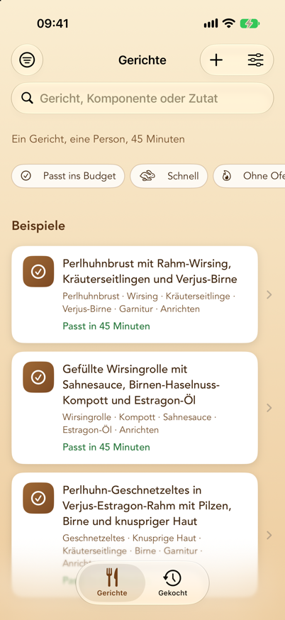
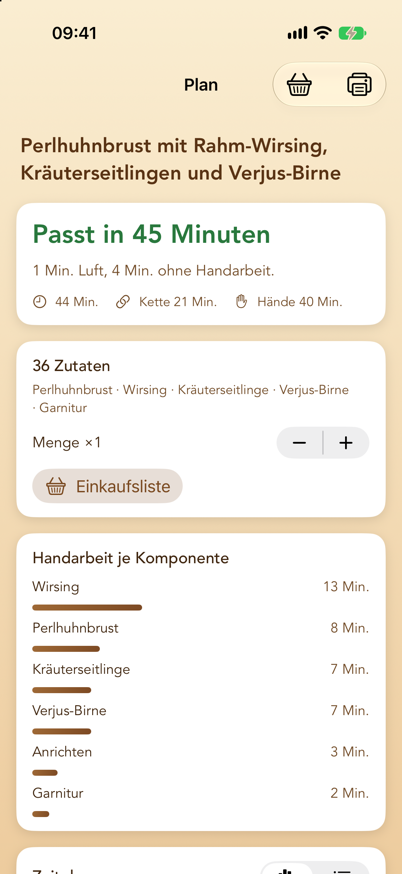
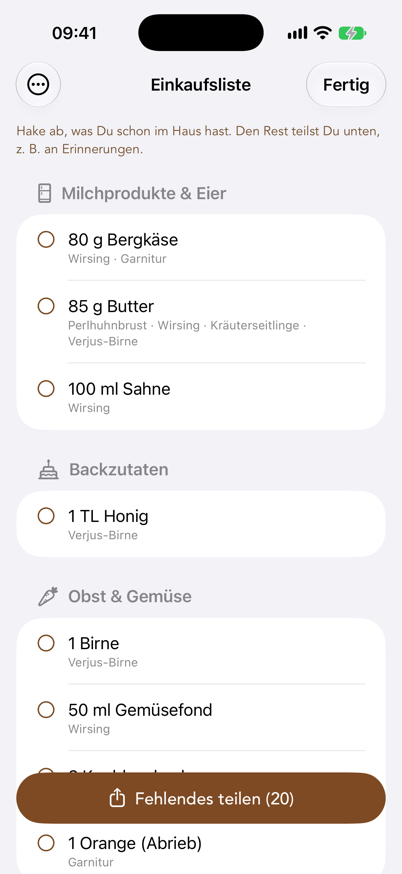
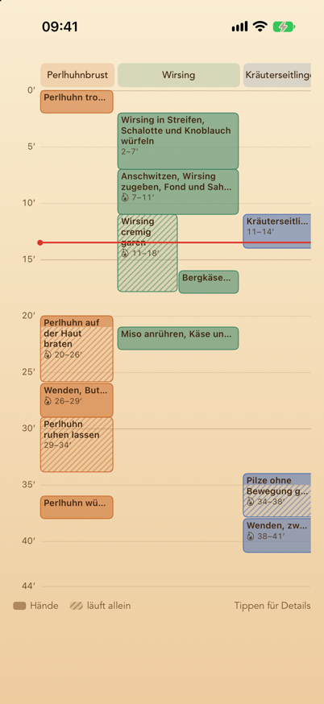
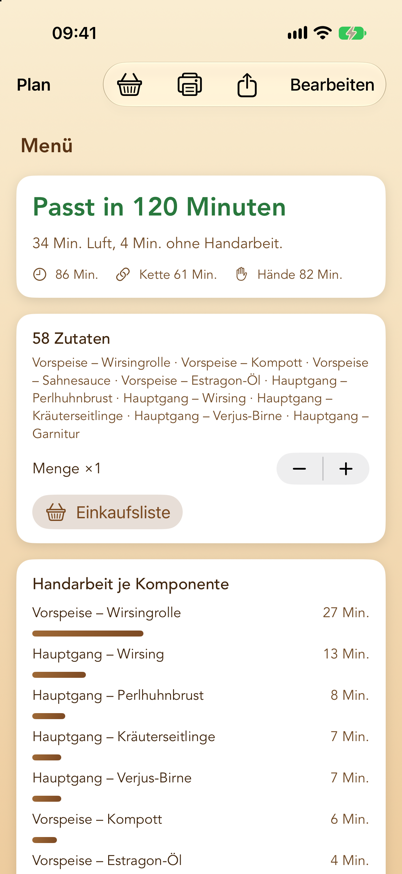
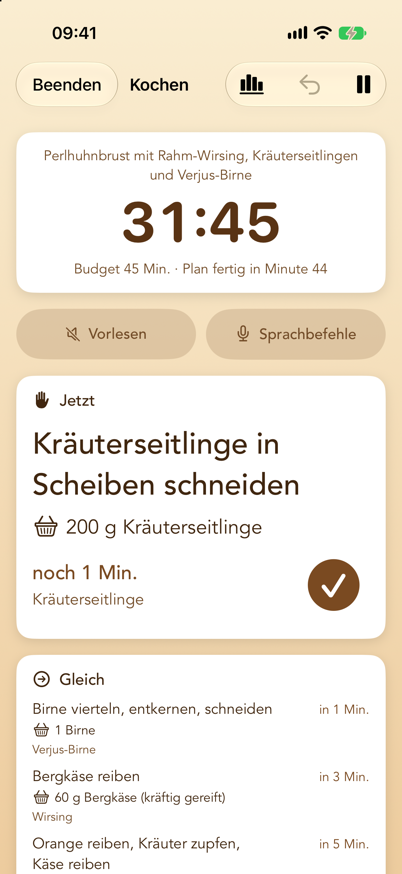
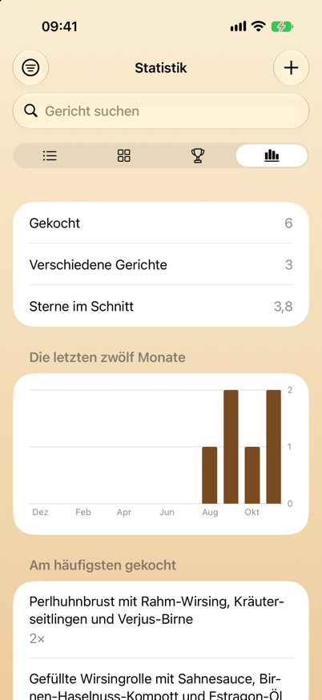

# CookPlanner – Manuel de l’utilisateur

Mise à jour : 27/11/2026 · version 1.0

---

## Sommaire

1. [Ce que fait CookPlanner](#1-ce-que-fait-cookplanner)
2. [Configuration requise](#2-configuration-requise)
3. [Notions de base](#3-notions-de-base)
4. [La liste des plats](#4-la-liste-des-plats)
5. [Le plan](#5-le-plan)
6. [Créer et modifier un plat](#6-créer-et-modifier-un-plat)
7. [Importer](#7-importer)
8. [Composer un menu](#8-composer-un-menu)
9. [Mode cuisine](#9-mode-cuisine)
10. [Notifications, alarmes et activité en direct](#10-notifications-alarmes-et-activité-en-direct)
11. [Cuisiné](#11-cuisiné)
12. [Plan de cuisson en PDF et livre de l’année](#12-plan-de-cuisson-en-pdf-et-livre-de-lannée)
13. [Siri, Raccourcis, Spotlight et clavier](#13-siri-raccourcis-spotlight-et-clavier)
14. [Réglages](#14-réglages)
15. [Sauvegarde, iCloud et changement d’appareil](#15-sauvegarde-icloud-et-changement-dappareil)
16. [CookPlanner Pro](#16-cookplanner-pro)
17. [Confidentialité](#17-confidentialité)
18. [Questions fréquentes](#18-questions-fréquentes)

---

## 1. Ce que fait CookPlanner

Un plat avec viande, garniture, sauce et décoration, une seule personne aux fourneaux et un temps fixé : CookPlanner ordonne les étapes pour que **tout soit prêt en même temps**, et vous dit à l’avance si le temps suffit. Son sous-titre : « Cuisiner contre la montre ».

- Chaque étape a du **travail manuel** (vous êtes occupé) et un temps pendant lequel elle **se fait toute seule** (mijoter, cuire au four, reposer).
- CookPlanner tient compte de **votre cuisine** : combien de feux, combien de fours et combien de temps vous avez.
- Le **verdict** dit clairement si le plat tient dans le temps imparti – et sinon, pourquoi et ce qui aiderait.
- En **mode cuisine**, l’application vous guide pas à pas avec une horloge et replanifie après chaque coche. Notifications, alarmes et activité en direct sur l’écran verrouillé vous préviennent, même quand l’iPhone est verrouillé sur le plan de travail.

En plus : import depuis un texte, des photos et des pages web (aussi directement depuis Safari via **Partager**), ingrédients avec portions et liste de courses, menus de plusieurs services, un relevé de chaque cuisson avec étoiles, note et photo, temps mesurés pour le prochain plan, lecture à voix haute et commandes vocales, Siri et Raccourcis, le plan de cuisson en PDF, un livre de l’année en cuisine et la synchronisation iCloud entre iPhone et iPad.

### Démarrage rapide : votre première cuisine contre la montre en cinq étapes

1. Dans la liste des plats, touchez le bouton avec les curseurs en haut à droite (**Réglages**) et réglez votre temps imparti et votre cuisine (feux, fours).
2. Touchez l’un des **Exemples** ou créez le vôtre avec **+ → Nouveau plat**.
3. Lisez le verdict sur le plan (« Tient en 35 minutes » ou « Il manque 9 minutes ») et regardez le déroulé.
4. Touchez **Commencer à cuisiner** en bas du plan, choisissez l’horloge (Défi, Entraînement ou Détendu) et touchez **Départ**.
5. Cochez chaque étape avec la grande coche ; pour les casseroles et les étapes au four, le bouton montre une flamme et signifie « En place, ça tourne tout seul ». À la fin, **Terminer → Arrêter et garder le relevé**.

*La liste des plats : en haut filtre, + et réglages, puis recherche, temps imparti et puces, puis les plats avec leur verdict.*

---

## 2. Configuration requise

| Élément | Valeur |
|---------|--------|
| Appareils | iPhone et iPad |
| Système | iOS 26 ou iPadOS 26 ou plus récent |
| Langues | Allemand, anglais, français – l’application suit la langue de l’appareil |
| Affichage | Mode clair et mode sombre |
| Internet | Seulement pour l’import depuis un texte, des photos ou des pages web (l’analyse se fait dans le cloud) et pour la synchronisation iCloud. Planifier, cuisiner, les relevés et la sauvegarde fonctionnent hors ligne |
| Connexion | Pas de compte CookPlanner. Pour l’analyse, l’application se connecte de façon anonyme en arrière-plan |
| iCloud | Facultatif : avec le même identifiant Apple, iPhone et iPad se synchronisent ([chapitre 15](#15-sauvegarde-icloud-et-changement-dappareil)) |

L’application ne demande ces autorisations qu’au moment où elle en a besoin :

| Autorisation | Pour quoi | Sans elle |
|---|---|---|
| Notifications | « à faire maintenant » et « le temps est écoulé » en mode cuisine | Le mode cuisine fonctionne, mais reste muet quand l’iPhone est verrouillé |
| Alarmes (AlarmKit) | Une alarme quand une casserole ou le four a terminé – même en silencieux et en mode Concentration | Une notification arrive à la place de l’alarme |
| Appareil photo | **Numériser des pages** à l’import, **Prendre une photo** pour un relevé | Les photos peuvent toujours être choisies dans la photothèque |
| Micro et reconnaissance vocale | Commandes vocales en mode cuisine | Pas de commandes vocales |

**Choisir des photos** ne demande aucune autorisation : le sélecteur de photos d’iOS ne transmet que les images que vous touchez.

---

## 3. Notions de base

**Plat**
Ce qui finit dans l’assiette, par exemple « Suprême de pintade, chou frisé à la crème, pleurotes du panicaut et poire au verjus ». Un plat a un nom, éventuellement un nombre de personnes, des ingrédients et des étapes.

**Composant**
Une partie du plat préparée à part – viande, chou, champignons, sauce. Dans le plan, chaque composant a sa propre colonne, et le travail manuel est compté par composant.

**Étape**
Un travail avec une durée : « Émincer le chou », « Saisir la pintade ». Une étape appartient à un composant, peut occuper un feu ou un four et attendre d’autres étapes.

**Mains et « se fait seul »**
Chaque étape a deux temps : **Mains** – les minutes pendant lesquelles vous êtes occupé – et **ensuite seul** – les minutes pendant lesquelles la casserole mijote ou le four cuit sans vous. Pendant ce temps, vous pouvez faire autre chose ; c’est exactement ce dont le plan profite.

**Temps imparti**
Les minutes dans lesquelles tout doit être prêt (35 par défaut). Le verdict mesure chaque plat à cette aune.

**Feux et fours**
Combien de feux et de fours compte votre cuisine. Une étape sur la plaque occupe un feu, une étape au four un four, chacune pour son travail manuel et son temps seul. Les fours sont considérés comme préchauffés quand le chrono démarre.

**Doit continuer bientôt**
Certains résultats ne supportent pas l’attente : une viande saisie se retourne aussitôt, une viande reposée ne doit pas refroidir. Avec « Doit continuer bientôt », vous indiquez combien de temps une étape peut attendre au plus avant la suivante.

**Chaîne**
La plus longue suite d’étapes qui s’attendent les unes les autres. Aucun plan ne peut être plus court que la chaîne, aussi habilement que vous travailliez en parallèle.

**Attend**
Une étape ne commence que lorsque les étapes qu’elle attend sont terminées. Sans indication, elle peut commencer tout de suite. Le dressage attend en général la dernière étape de chaque composant.

---

## 4. La liste des plats

L’application a deux onglets en bas : **Plats** et **Cuisiné** ([chapitre 11](#11-cuisiné)). La liste des plats affiche en haut le champ de recherche, dessous « Un plat, une personne, 35 minutes » avec votre temps imparti, les puces, puis deux sections :

- **Mes plats** – ce que vous avez créé, importé ou enregistré comme menu.
- **Exemples** – trois plats prêts à essayer. On ne peut pas les modifier, mais on peut les utiliser comme modèle ([chapitre 6](#6-créer-et-modifier-un-plat)).

Chaque ligne montre le nom, les composants et le **verdict** en vert (« Tient en 35 minutes ») ou en rouge (« Il manque 9 minutes »). Si aucun plan ne peut être calculé – par exemple parce que le plat demande un four et que la cuisine est réglée sur 0 four –, la raison s’affiche à la place. Toucher une ligne ouvre le plan ([chapitre 5](#5-le-plan)).

| Geste | Sur vos plats | Sur les exemples |
|---|---|---|
| Balayer vers la gauche | **Supprimer** | – |
| Toucher longuement | **Modifier**, **Supprimer** | **Utiliser comme modèle** |

### Recherche

Le champ de recherche (**Plat, composant ou ingrédient**) se trouve toujours au-dessus de la liste. Il cherche dans le plat, le composant et l’ingrédient : « chou » trouve aussi un plat où le chou n’est qu’un ingrédient. Si rien n’est trouvé, on lit « Aucun plat correspondant ».

### Puces

Les six puces fixes filtrent d’une touche ; une seconde touche lève le filtre :

| Puce | Affiche |
|---|---|
| Tient dans le temps | Les plats qui tiennent dans le temps imparti avec votre cuisine |
| Rapide | Les plats dont le plan dure 30 minutes au plus |
| Sans four | Les plats qui n’ont besoin que des plaques |
| Favoris | Les plats notés en moyenne d’au moins quatre étoiles |
| Jamais cuisiné | Les plats sans relevé |
| Pas cuisiné depuis longtemps | Les plats pas cuisinés depuis 60 jours, ou jamais |

### Filtre et collections personnelles

Le bouton de filtre en haut à gauche ouvre un menu avec plusieurs conditions ; quand un filtre est actif, le bouton est plein :

- **Durée :** Tous, Jusqu’à 30 minutes, 31 à 45 minutes, 46 à 60 minutes, Plus d’une heure.
- **Équipement :** Tous, Avec four, Plaques seulement, Sans cuisson.
- **Origine :** Tous, Personnels, Importés, Exemples.
- **Historique :** Tous, Jamais cuisiné, Pas cuisiné depuis longtemps, Favoris.
- Interrupteurs **Tient dans le temps** et **Peu de travail manuel** (les mains occupées au plus 60 pour cent du plan).

Quand un filtre est posé, le haut du menu propose **Réinitialiser les filtres** et **Enregistrer la collection**. Avec **Enregistrer la collection**, vous saisissez un nom, et les filtres choisis apparaissent comme une puce à part après les six fixes. Un toucher long sur cette puce propose **Renommer** et **Supprimer la collection**. Les collections personnelles font partie de CookPlanner Pro ([chapitre 16](#16-cookplanner-pro)) ; recherche, filtres et puces fixes sont gratuits.

### Les boutons du haut

| Bouton | Entrées |
|---|---|
| Filtre (à gauche) | Durée, Équipement, Origine, Historique, Tient dans le temps, Peu de travail manuel, Réinitialiser les filtres, Enregistrer la collection |
| + | Nouveau plat, Importer depuis un texte, Importer depuis des photos, Importer depuis une page web, Composer un menu |
| Curseurs | Réglages ([chapitre 14](#14-réglages)) |

---

## 5. Le plan

Toucher un plat ouvre son **Plan**. En haut figure le nom, puis viennent les cartes et, tout en bas, le bouton **Commencer à cuisiner** ([chapitre 9](#9-mode-cuisine)). La barre du haut contient, selon le plat :

| Bouton | Effet |
|---|---|
| Panier | **Liste de courses** (si le plat a des ingrédients) |
| Imprimante | **Plan de cuisson en PDF** ([chapitre 12](#12-plan-de-cuisson-en-pdf-et-livre-de-lannée)) |
| Partager | **Partager le plat** en fichier `.cookplanner` (plats personnels seulement, [chapitre 15](#15-sauvegarde-icloud-et-changement-dappareil)) |
| Modifier | Ouvre l’éditeur (plats personnels seulement) |

*Le plan : en haut le verdict « Passt in 45 Minuten » (tient en 45 minutes) avec sa raison et ses chiffres, dessous les ingrédients avec quantité et liste de courses, puis le travail manuel par composant.*

### Le verdict

En grand, en vert ou en rouge : **Tient en N minutes** ou **Il manque N minutes**. Dessous, la raison :

| Raison | Signification |
|---|---|
| « N min de marge, N min sans travail manuel. » | Ça tient ; il reste cette réserve, et vos mains sont libres pendant ce temps |
| « La chaîne la plus longue dure N minutes … » | La chaîne dépasse le temps imparti ; travailler en parallèle n’aide pas, seules des étapes plus courtes aident |
| « Le travail manuel seul prend N minutes … » | Une personne ne suffit pas ; supprimer ou simplifier des étapes |
| « La chaîne … et les mains … tiennent séparément mais se heurtent … » | Mains ou équipement ne suffisent pas pour tout à la fois – plus de feux ou de fours, ou plus de temps |

La petite ligne dessous indique la durée du plan, la **chaîne** et les **mains** en minutes. Si aucun plan ne peut être calculé, la page affiche « Pas de plan » avec la raison et, pour vos plats, un bouton **Modifier**.

### Ingrédients et portions

La carte indique combien d’ingrédients compte le plat et à quels composants ils appartiennent. Si la recette donne un nombre de personnes, changez-le avec **Pour N personnes** (1 à 24) ; sinon, il y a **Quantité ×0,5 à ×4**. Seules les quantités changent, **les temps restent les mêmes**. Le choix vaut par plat pour le plan, le mode cuisine et la liste de courses, et il est conservé.

### Liste de courses

**Liste de courses** (le bouton de la carte ou le panier en haut) ouvre les ingrédients par rayon (Produits laitiers & œufs, Ingrédients de pâtisserie, Fruits & légumes, Épices & herbes …) ; le même ingrédient de plusieurs composants tient sur une ligne, quantités additionnées. Cochez ce que vous avez déjà ; le bouton **…** en haut à gauche propose **Tout est là** et **Rien à la maison**. **Partager ce qui manque (N)** en bas transmet le reste sous forme de texte, un ingrédient par ligne – par exemple vers Rappels, Notes ou un message. Les coches sont conservées par plat.

*La liste de courses : les ingrédients par rayon, les composants en petit dessous ; en bas « Fehlendes teilen (20) » (partager ce qui manque).*

### Pour que ça tienne

Si un plat ne tient pas et que ce ne sont pas les mains qui coincent, CookPlanner vérifie si des temps de cuisson plus courts aident : les étapes avec une **fourchette** ([chapitre 6](#6-créer-et-modifier-un-plat)) sont planifiées au bas de la fourchette. La carte **Pour que ça tienne** nomme chaque étape concernée (« Braiser le chou : 12 au lieu de 15 minutes ») et dit si cela suffit ou combien de minutes manquent encore. Le plat lui-même reste inchangé.

### Travail manuel par composant

Une barre par composant, la plus longue en haut : vous voyez quelle partie du plat vous occupe le plus.

### Déroulé : chronologie ou liste

La carte **Déroulé** montre le plan soit en **Chronologie**, soit en **Liste** (sélecteur à droite de la carte ; le choix est conservé).

- **Chronologie :** une colonne par composant, le temps s’écoule de haut en bas en minutes. Les barres pleines sont du travail manuel, les barres hachurées se font seules ; un symbole de flamme indique plaque ou four. Les étapes d’un composant qui se chevauchent sont côte à côte. **Touchez pour les détails :** toucher une barre ouvre une petite fenêtre avec le nom complet, le composant, « Minute 12 à 27 », les minutes de travail manuel et de temps seul et, le cas échéant, la température du four.
- **Liste :** chaque étape avec ses minutes de–à, les symboles main et plaque ou four, le composant, la fourchette et la température du four, dans l’ordre du plan.

*La chronologie : une colonne par composant, travail manuel plein, « se fait seul » hachuré. En mode cuisine, la ligne rouge marque où vous en êtes.*

### Cuisiné

Si vous avez déjà cuisiné ou saisi le plat, la carte **Cuisiné** montre les cinq dernières fois avec la date, les étoiles et le temps passé ; toucher ouvre le relevé, un toucher long propose **Supprimer le relevé**. S’il existe des temps mesurés, **Reprendre les temps mesurés pour N étapes** apparaît : vous voyez pour chaque étape le temps actuel et le temps mesuré – la médiane des temps cochés sur au plus les cinq derniers passages. Pour les casseroles et les étapes au four, le travail manuel reste ; seul le temps seul s’adapte ; les passages en mode détendu ne comptent pas. **Appliquer** inscrit les temps dans le plat ; pour un exemple, le bouton s’appelle **Comme plat personnel** et crée une copie sous Mes plats. La mesure est gratuite, la reprise des temps fait partie de CookPlanner Pro.

### Tenir au chaud

Si un composant est prêt tôt et attend dix minutes ou plus le dressage, la carte **Tenir au chaud** le nomme avec son temps d’attente (« Sauce attend 12 minutes »).

---

## 6. Créer et modifier un plat

**+ → Nouveau plat** ouvre l’éditeur vide, **Modifier** sur le plan (ou un toucher long dans la liste) l’ouvre avec votre plat. Pour un exemple, **Utiliser comme modèle** (toucher long dans la liste) crée une copie que vous adaptez dans l’éditeur et enregistrez comme plat personnel.

L’éditeur a quatre sections :

- **Plat :** nom et nombre de personnes (1 à 12 ; **Portions non indiquées** si vous n’en choisissez pas).
- **Ingrédients :** une ligne par ingrédient ; **Ajouter un ingrédient** ouvre une feuille à part.
- **Étapes :** une ligne par étape avec mains, temps seul, poste et ce qu’elle attend ; **Ajouter une étape** ouvre une feuille à part. À partir de deux étapes, **Modifier** au-dessus de la liste permet de déplacer ou supprimer des étapes.
- **Plan :** le verdict pendant que vous tapez – vous voyez tout de suite l’effet d’une modification.

Vous pouvez aussi supprimer ingrédients et étapes d’un balayage vers la gauche. **Enregistrer** est possible dès que le plat a un nom et au moins une étape. **Annuler** abandonne les modifications.

### Ingrédient

| Champ | Signification |
|---|---|
| Nom | Le nom, p. ex. « Chou frisé » |
| Quantité et unité | Comme dans la recette ; le bouton à côté de l’unité propose les unités courantes et **Sans unité**. Sans quantité pour « sel » ou « poivre » |
| Composant | La partie du plat à laquelle l’ingrédient appartient ; à saisir, ou à prendre parmi les existants avec **Choisir le composant** |
| Remarque | p. ex. « petit » ou « bien affiné » |

**Supprimer l’ingrédient** le retire. Les ingrédients forment la liste de courses ; ceux que vous utilisez dans une étape se choisissent à l’étape.

### Étape

| Champ | Signification |
|---|---|
| Ce qu’il faut faire | Le texte de l’étape, p. ex. « Saisir la pintade côté peau » |
| Composant | À saisir, ou à prendre parmi les existants avec **Choisir le composant** |
| Mains | Minutes pendant lesquelles vous êtes occupé (0 à 120) |
| Ensuite seul | Minutes pendant lesquelles l’étape se fait sans vous : mijoter, cuire, reposer (0 à 600) |
| Fourchette | Seulement avec un temps seul : **Au moins** et **Au plus** de minutes de cuisson. « Pour que ça tienne » utilise le bas de la fourchette |
| Poste | **Aucun**, **Feu** ou **Four** ; pour le four, la température (50 à 300 °C par pas de 10) |
| Doit continuer bientôt | Un interrupteur ; puis « Attend au plus N min » (0 à 60) : 0 minute pour retourner après avoir saisi, 3 pour une viande reposée, 10 pour une sauce tenue au chaud |
| Ingrédients de cette étape | Cochez les ingrédients utilisés ici ; en mode cuisine, ils apparaissent sous l’étape |
| Attend | Cochez les étapes qui doivent être terminées avant |

Une nouvelle étape suit d’abord l’étape précédente de son composant, jusqu’à ce que vous changiez le choix. **Attendre tous les composants** coche la dernière étape de chaque composant – ce qu’il faut pour le dressage. **Supprimer l’étape** retire une étape existante.

> Si des étapes s’attendent en boucle, le plan affiche « Les étapes s’attendent en boucle ». Vérifiez alors les coches sous **Attend**.

---

## 7. Importer

Au lieu de saisir un plat, faites décomposer une recette. Les voies d’accès se trouvent sous **+**, plus le partage depuis Safari :

- **Importer depuis un texte :** tapez le texte de la recette dans le champ ou reprenez-le avec **Coller** (au moins quelques lignes) et touchez **Analyser**.
- **Importer depuis des photos :** **Numériser des pages** ouvre la caméra de documents d’iOS – elle détecte les bords et prend plusieurs pages l’une après l’autre. **Choisir des photos** prend jusqu’à quatre images de la photothèque. Le texte est reconnu **sur l’iPhone** et ajouté au champ, où vous pouvez le vérifier et le corriger ; les photos ne quittent pas l’appareil. Puis **Analyser**. Les deux boutons existent aussi dans l’import de texte, sous le champ.
- **Importer depuis une page web :** saisissez ou collez l’**Adresse de la page de recette** et touchez **Analyser**. La page est chargée sur l’appareil ; seul le texte de la recette part à l’analyse.
- **Partager depuis Safari :** sur une page de recette dans Safari (ou toute autre app qui partage des liens), choisissez **Partager → CookPlanner**. La feuille « Importer la recette dans CookPlanner » montre la page ; **Importer** ouvre CookPlanner et l’analyse démarre aussitôt. Si l’application ne peut pas s’ouvrir depuis là, ouvrez-la vous-même – l’import y démarre tout seul.

L’analyse est effectuée par un service de Google (Firebase). Elle décompose la recette en étapes, estime le travail manuel et le temps seul, propose l’ordre et les dépendances, reconnaît plaque et four et reprend les ingrédients avec leurs quantités. Sous **Trouvé**, le résultat affiche le nom, « N étapes, M composants » et, le cas échéant, le nombre de personnes, avec les **Remarques de l’analyse** sur ce qui est incertain.

- **Vérifier et modifier** ouvre le plat dans l’éditeur ([chapitre 6](#6-créer-et-modifier-un-plat)). Ce n’est qu’avec **Enregistrer** qu’il rejoint Mes plats.
- **Analyser un autre texte** ou **Analyser une autre page** abandonne le résultat.

Le nombre d’analyses par heure est limité ; une fois la limite atteinte, réessayez plus tard. Quand CookPlanner Pro est proposé, il y a sans Pro un nombre fixe d’analyses gratuites par mois ; après chaque analyse, l’application indique combien il en reste ([chapitre 16](#16-cookplanner-pro)). La saisie à la main reste toujours possible. Si une analyse dure trop longtemps, importez une longue recette en deux parties.

---

## 8. Composer un menu

**+ → Composer un menu** (sur l’iPad aussi ⇧⌘N) réunit plusieurs plats en un seul plan, par exemple entrée, plat principal et dessert. Les menus font partie de CookPlanner Pro.

1. Donnez au menu un **Nom du menu** en haut (sinon il s’appelle « Menu »).
2. Choisissez un **plat** pour chaque service – vos plats et les exemples, pas d’autres menus. Les services s’appellent d’eux-mêmes Entrée, Plat principal et Dessert ; chaque nom peut être remplacé. **Ajouter un service** en ajoute d’autres (jusqu’à cinq), **Supprimer** en retire un.
3. Entre les services, indiquez combien de **minutes avant le service suivant** s’écoulent (0 à 90 par pas de 5), ou **Avec le service suivant**. L’entrée est servie autant de minutes avant le plat principal, et le plat principal se cuisine pendant que les invités mangent.
4. Sous **Plan**, vous voyez déjà le verdict, la raison et « N étapes, M ingrédients, plan N min ».
5. **Enregistrer** range le menu comme plat personnel sous Mes plats, avec des étapes comme « Servir Entrée ».

*Un menu enregistré : « Passt in 120 Minuten » (tient en 120 minutes), les ingrédients et le travail manuel par composant, chacun précédé de son service.*

Le menu se cuisine comme n’importe quel plat ; ses composants s’appellent « Entrée – roulé de chou » ou « Plat principal – suprême de pintade », et ses ingrédients forment une seule liste de courses.

---

## 9. Mode cuisine

**Commencer à cuisiner** en bas du plan (sur l’iPad aussi ⌘⏎) ouvre le mode cuisine en plein écran. Avant le départ, vous choisissez l’**Horloge** :

| Horloge | Ce qu’elle fait |
|---|---|
| Défi | L’horloge décompte le temps imparti, comme à l’émission. Une fois le temps écoulé, elle compte le dépassement |
| Entraînement | L’horloge part de 0:00 – vous apprenez combien de temps le plat prend vraiment |
| Détendu | Pas d’horloge, pas de retard : les étapes viennent dans l’ordre, seuls casserole et four gardent leur temps |

**Départ** lance l’horloge ; la première fois, iOS demande l’accès aux notifications et aux alarmes ([chapitre 10](#10-notifications-alarmes-et-activité-en-direct)). L’application retient votre dernier choix.

*Le mode cuisine : en haut l’horloge (31:45), dessous la lecture à voix haute et les commandes vocales, la carte « Maintenant » avec ingrédient, temps restant et coche, et la liste « Ensuite ».*

### Ce que montre l’écran

- **Horloge :** temps restant ou écoulé selon le mode, avec « Temps imparti 45 min · plan terminé à la minute 44 » ; après une replanification, si vous serez prêt plus tôt ou plus tard que prévu ; une fois le temps écoulé, « Temps écoulé – 2:10 de plus ».
- **Maintenant :** l’étape entre vos mains, en grand, avec ses ingrédients, le composant et le temps restant (« encore 3 min », « en retard » en rouge). Mains libres, on lit « Mains libres, suite dans N min » ; à la fin « Terminé, dressez ! ».
- **Ensuite :** les trois étapes suivantes avec leurs ingrédients et « dans N min ».
- **Se fait tout seul :** ce qui mijote ou cuit, avec le temps restant. Si vous retirez une casserole plus tôt, cochez-la ici.
- **Fait :** « N étapes sur M » et, dessous, chaque étape cochée avec le temps du chronomètre, la plus récente en haut.

Sur l’iPad et les autres grands écrans, l’étape en cours grandit encore, pour se lire de loin.

### Cocher : coche et flamme

- La grande **coche** à droite de la carte « Maintenant » (**Étape terminée**) coche une étape sans temps seul.
- Pour les étapes en casserole et au four, le bouton montre une **flamme** (**En place, ça tourne tout seul**) : le travail manuel est terminé, la casserole est sur le feu ou la porte du four fermée. Le temps seul commence ; une fois écoulé, l’étape est terminée.

Après chaque coche et chaque minute, CookPlanner **replanifie** la suite : si vous avez été plus rapide, tout avance ; plus lent, la suite se décale.

### Les boutons du haut

| Bouton | Effet |
|---|---|
| Terminer (à gauche) | Demande « Arrêter la cuisine ? » : **Arrêter et garder le relevé** range la cuisson sous Cuisiné, **Arrêter sans relevé** l’abandonne, **Continuer** revient en arrière. Si aucune étape n’est encore faite, il n’y a rien à consigner |
| Chronologie | Le plan en cours sous forme de diagramme avec une ligne rouge pour **maintenant** ; les étapes terminées sont pâles |
| Annuler | Retire la dernière coche |
| Pause / Reprendre | Arrête l’horloge (« Pause, le chrono est arrêté ») et la relance |

Après **Arrêter et garder le relevé**, le nouveau relevé s’ouvre aussitôt pour que vous lui donniez des étoiles et une photo ([chapitre 11](#11-cuisiné)).

### Lire à voix haute

Avec le bouton **Lire à voix haute**, l’application énonce chaque nouvelle étape avec ses ingrédients, la température du four et les minutes, annonce les casseroles prêtes (« Chou : le temps est écoulé. ») et, à la fin, « Terminé, dressez ! ». Le réglage est conservé. La lecture à voix haute fait partie de CookPlanner Pro.

### Commandes vocales

Avec le bouton **Commandes vocales**, le mode cuisine écoute (la première fois, iOS demande l’accès au micro et à la reconnaissance vocale). Dessous, l’application indique les mots possibles et ce qu’elle a entendu en dernier. Tant que l’application parle elle-même, elle n’écoute pas ; quand elle passe en arrière-plan, l’écoute s’arrête. La reconnaissance vocale se fait sur l’appareil. Les commandes vocales font partie de CookPlanner Pro.

| Commande | Effet |
|---|---|
| « C’est fait » (aussi « Terminé », « Fini ») | Coche l’étape entre vos mains ; pour une casserole, la lance |
| « C’est parti » (aussi « Sur le feu », « Au four ») | Casserole ou four en route, le temps seul commence |
| « Annuler » / « Retour » | Retire la dernière coche |
| « Lire » / « Répète » | Relit l’étape en cours |
| « Et après » / « Étape suivante » | Lit l’étape suivante |
| « Ingrédients » | Lit les ingrédients de l’étape en cours |
| « Combien de temps » / « Temps restant » | Temps restant de l’étape et du plan |
| « Pause » | Arrête l’horloge |
| « On continue » / « Reprendre » | Relance l’horloge |
| « Stop » / « Silence » | Arrête la lecture |

Les commandes valent dans la langue de l’application ; en allemand, par exemple, « Erledigt », « Steht », « Was kommt ». Si la reconnaissance vocale n’est pas disponible pour cette langue sur l’appareil, l’application le dit.

### Écran et redémarrage

Tant que le mode cuisine est ouvert, l’écran reste allumé. Si l’application est fermée (par le système, une mise à jour ou d’un glissement), le prochain lancement rouvre la cuisson – jusqu’à six heures après le départ. Ce que vous avez coché entre-temps avec Siri est repris dès que le mode cuisine revient au premier plan.

---

## 10. Notifications, alarmes et activité en direct

Pendant que vous cuisinez, CookPlanner vous tient au courant de trois façons – même quand l’iPhone est verrouillé dans un coin. Les trois sont gratuites.

### Notifications

- **« Composant · à faire maintenant »** avec l’étape comme titre, quand une étape vous revient.
- **« Composant · le temps est écoulé »** quand une casserole ou le four a terminé (sans alarme, voir plus bas).

Les notifications arrivent avec un son, même quand l’application est au premier plan. Elles suivent chaque replanification ; les 60 prochaines au plus sont toujours programmées. **Pause** et **Terminer** retirent toutes les notifications en attente ; une nouvelle cuisson efface les bannières de la précédente.

### Alarmes pour casseroles et four

Si **Alarmes pour casseroles et four** est activé dans les réglages (par défaut), CookPlanner règle via AlarmKit une vraie alarme pour la fin de chaque étape en casserole ou au four : « Chou : Cuire le chou jusqu’à ce qu’il soit crémeux · le temps est écoulé » avec un bouton **Arrêter**. L’alarme sonne même si l’iPhone est en silencieux ou en mode Concentration ; cette étape ne reçoit alors pas de notification en plus. Les alarmes suivent le plan comme les notifications : une étape terminée perd son alarme, une étape décalée reçoit la nouvelle heure, **Pause** et **Terminer** les retirent toutes. Sans alarme, vous recevez une notification.

Si vous n’autorisez ni notifications ni alarmes, le mode cuisine affiche : « Notifications et alarmes sont désactivées – verrouillé, l’iPhone reste muet. À activer dans Réglages → CookPlanner. »

### Activité en direct

Dès que l’horloge tourne, le plat apparaît sur l’**écran verrouillé** et dans la **Dynamic Island** :

- le nom du plat et le compte à rebours jusqu’au dressage,
- ce que vous devez faire maintenant – l’étape avec son composant, « Mains libres » ou « Terminé, dressez ! »,
- « Bientôt 2:15 · étape suivante » avec son propre compte à rebours, ou combien de casseroles se font toutes seules,
- combien d’étapes sont faites (« 5 sur 23 »).

Quand l’heure de l’étape suivante arrive, l’affichage passe de lui-même à « À faire maintenant » avec cette étape. Pendant une pause, on lit « Pause, l’horloge est arrêtée » avec les minutes restantes. **Terminer** retire l’activité en direct.

---

## 11. Cuisiné

L’onglet **Cuisiné** rassemble chaque cuisson terminée avec relevé, saisie à la main ou ajoutée depuis des photos. Tant qu’il est vide, on lit « Rien cuisiné pour l’instant » avec le bouton **Ajouter un plat cuisiné**.

*Cuisiné dans l’affichage Statistiques : en haut filtre, recherche, les quatre affichages et +, dessous les chiffres, les douze derniers mois et les plats les plus cuisinés.*

### Affichages

Le sélecteur sous le champ de recherche passe d’un affichage à l’autre ; le titre en haut indique celui qui est ouvert :

| Affichage | Montre |
|---|---|
| Liste | Les relevés par mois, les plus récents d’abord, avec vignette, date, temps, étoiles et note |
| Galerie | Les photos de tous les relevés |
| Palmarès | Les plats par étoiles en moyenne, avec « cuisiné N× » – ce qui a le mieux plu |
| Statistiques | Cuisiné, Plats différents, Étoiles en moyenne, Par rapport au plan (minutes plus lent ou plus rapide, sur les passages complets au chronomètre), les douze derniers mois en barres, Les plus cuisinés |

Le champ de recherche (**Rechercher un plat**) filtre par nom ; le bouton de filtre en haut à gauche choisit une **Note minimale** (Tous, ou à partir de 1 à 5 étoiles). Dans la liste, vous supprimez une entrée d’un balayage vers la gauche. Les statistiques font partie de CookPlanner Pro.

### Un relevé

Touchez une entrée pour l’ouvrir :

- **C’était comment ?** – cinq étoiles à toucher, une note (« moins de sel la prochaine fois ») et une photo : **Prendre une photo**, **Choisir une photo** ou **Autre photo**, ou **Supprimer**. Toucher la photo l’agrandit.
- **Durée réelle**, **Prévu** et **Écart**. Pour une cuisson en mode détendu, il est indiqué que les temps ne comptent pas pour les temps mesurés ; pour une cuisson arrêtée avant la fin, combien d’étapes étaient faites.
- **Étapes** – pour chaque étape, quand elle a été terminée, combien de temps elle a pris, ce qui était prévu et l’écart.

Pour une entrée saisie après coup, la date (**Cuisiné le**) peut être modifiée ; elle porte la mention « Saisi sans chronomètre. »

### Le menu « + »

| Entrée | Effet |
|---|---|
| Ajouter un plat cuisiné | Si vous avez cuisiné sans chronomètre : choisissez le plat, la date (**Cuisiné le**), étoiles, note et photo, **Enregistrer**. L’entrée n’a pas de temps |
| Ajouter depuis des photos | Fait des entrées à partir d’anciennes photos de plats terminés (voir plus bas) |
| Livre de l’année en cuisine | L’année en PDF ([chapitre 12](#12-plan-de-cuisson-en-pdf-et-livre-de-lannée)) |

### Ajouter depuis des photos

Avec **Choisir des photos**, prenez jusqu’à 30 photos de la photothèque. La date et le titre viennent des photos : si le nom d’un plat figure dans le titre, il est déjà choisi ; sinon, choisissez-le pour chaque photo. Date et plat se modifient pour chaque photo ; **Ne pas reprendre** laisse une photo de côté. **Ajouter N** crée les entrées avec leurs photos.

---

## 12. Plan de cuisson en PDF et livre de l’année

Les deux font partie de CookPlanner Pro.

### Plan de cuisson en PDF

Le bouton imprimante en haut du plan ouvre **Plan de cuisson en PDF**. La feuille A4 à imprimer, afficher ou envoyer contient :

- l’en-tête avec nom, verdict et durée,
- la **chronologie** – une ligne par composant, des barres avec le numéro de l’étape,
- le **déroulé** – chaque étape avec son texte complet, minute, mains, temps seul, plaque ou four et ses ingrédients,
- les **ingrédients** par composant.

Avec **Avec une heure de début** et un **Départ** (date et heure), chaque étape figure avec son heure et la feuille indique « Prêt à 19:05 » ; sans heure de début, les temps comptent depuis la minute 0. **Partager ou imprimer le PDF** ouvre le menu de partage – pour imprimer, enregistrer dans Fichiers ou envoyer.

### Livre de l’année en cuisine

**Cuisiné → + → Livre de l’année en cuisine** fait d’une année un livre PDF : une couverture avec photo, l’année en chiffres, les mois avec leurs photos, les plats préférés, ce que l’horloge vous a appris et une page pour les résolutions de l’année suivante. Choisissez l’**Année** et le **Nom sur la couverture** ; sous **Contenu**, vous voyez combien de sessions, de jours de cuisine, de photos et de plats préférés y entrent. **Partager le livre de l’année** transmet le PDF pour l’imprimer, le relier ou l’envoyer. Sans relevés, il n’y a pas encore de livre.

---

## 13. Siri, Raccourcis, Spotlight et clavier

### Siri et Raccourcis

CookPlanner apporte quatre commandes qui fonctionnent sans réglage. Chaque phrase nomme l’application ; vous les trouvez aussi dans l’app **Raccourcis**.

| Commande | Exemples de phrases | Effet |
|---|---|---|
| Qu’est-ce qui est en cours | « Qu’est-ce qui est en cours dans CookPlanner », « Étape suivante dans CookPlanner » | Dit quelle étape est en cours et ce qui vient ensuite |
| Étape terminée | « Étape terminée dans CookPlanner », « CookPlanner terminé », « CookPlanner c’est parti » | Coche l’étape en cours ; une casserole ou le four est lancé, son temps court ensuite |
| Combien de temps encore | « Combien de temps dans CookPlanner », « CookPlanner combien de temps encore » | Dit combien de temps il reste pour l’étape en cours, les casseroles et tout le plan |
| Commencer à cuisiner | « Cuisiner *plat* avec CookPlanner », « Commencer à cuisiner dans CookPlanner » | Ouvre le plat et lance le mode cuisine |

Les trois premières fonctionnent en arrière-plan, même iPhone verrouillé, et demandent un mode cuisine en cours ; sinon Siri répond « Vous ne cuisinez rien dans CookPlanner pour l’instant. » Siri est gratuit.

### Spotlight

Vos plats et les exemples figurent dans la recherche Spotlight d’iOS, trouvés par le nom, les composants et les ingrédients. Toucher un résultat ouvre le plan du plat. Les plats nouveaux, modifiés et supprimés suivent d’eux-mêmes.

### Clavier sur l’iPad

Avec un clavier branché, l’iPad affiche les raccourcis quand vous maintenez ⌘ :

| Raccourci | Effet |
|---|---|
| ⌘1 / ⌘2 | Onglet Plats / Cuisiné |
| ⌘N | Nouveau plat |
| ⇧⌘N | Composer un menu |
| ⇧⌘F | Rechercher un plat |
| ⌘, | Réglages |
| ⌘⏎ | Commencer à cuisiner (sur le plan d’un plat) |

---

## 14. Réglages

Le bouton avec les curseurs en haut à droite de la liste des plats (sur l’iPad ⌘,) ouvre les réglages ; **OK** les ferme.

| Réglage | Plage | Par défaut |
|---|---|---|
| Temps imparti | 10 à 180 minutes par pas de 5 | 35 minutes |
| Feux | 1 à 8 | 4 |
| Fours | 0 à 3 | 1 |
| Alarmes pour casseroles et four | activé ou désactivé | activé |

Chaque modification vaut aussitôt pour tous les verdicts et plans. Les fours sont préchauffés quand le chrono démarre. L’application retient d’autres choix là où vous les faites : l’affichage du déroulé, l’horloge du mode cuisine, la lecture à voix haute, les portions et les coches de courses par plat, l’affichage et la note minimale sous Cuisiné, vos propres collections.

Les réglages ont en outre ces sections :

- **CookPlanner Pro** – tout en haut, dès que l’achat est proposé ([chapitre 16](#16-cookplanner-pro)).
- **Sauvegarde** – **Sauvegarder plats et relevés** et **Importer des plats** ([chapitre 15](#15-sauvegarde-icloud-et-changement-dappareil)).
- **Synchronisation** – l’état d’iCloud et **Synchroniser maintenant** ([chapitre 15](#15-sauvegarde-icloud-et-changement-dappareil)).
- **Aide** – ouvre dans le navigateur ce **manuel de l’utilisateur**, la page **Aide et contact** avec les questions fréquentes et l’adresse e-mail, la **Politique de confidentialité** et les **Mentions légales**.

---

## 15. Sauvegarde, iCloud et changement d’appareil

### Synchronisation via iCloud

Si vous êtes connecté à iCloud avec le même identifiant Apple sur l’iPhone et l’iPad, **vos plats, relevés et photos** se synchronisent d’eux-mêmes – au lancement, quand l’application revient au premier plan et quand un autre appareil a modifié quelque chose. Les réglages (temps imparti, cuisine, alarmes, horloge, lecture à voix haute, affichage du déroulé), les portions par plat et vos propres collections suivent aussi. Une cuisson en cours reste sur l’appareil sur lequel vous cuisinez. Si deux appareils ont modifié la même chose, la modification la plus récente l’emporte.

La section **Synchronisation** des réglages indique l’état :

| Affichage | Signification |
|---|---|
| Synchronisé 18:42 | Tout va bien, dernière synchronisation à cette heure |
| Connecté | iCloud est prêt, une synchronisation est encore à venir |
| Non connecté | Aucun identifiant Apple n’est connecté à iCloud sur l’appareil ; les données restent seulement ici |
| Indisponible | iCloud est restreint sur l’appareil |
| Vérification … | L’application interroge iCloud en ce moment |

**Synchroniser maintenant** récupère aussitôt ce que les autres appareils ont modifié. Il n’y a ni compte ni serveur CookPlanner : les données se trouvent dans votre stockage iCloud privé.

Si un **autre compte iCloud** se connecte sur l’appareil, l’application demande si les plats et relevés enregistrés ici doivent y être transférés (**Transférer vers ce compte**) ou si vous voulez les **Garder seulement ici**. Ce qui se trouve déjà dans le nouveau compte est téléchargé dans tous les cas.

### Sauvegarder

**Réglages → Sauvegarder plats et relevés** crée un fichier `….cookplanner` avec tous vos plats, tous les relevés et leurs photos et ouvre le menu de partage – par exemple **Enregistrer dans Fichiers** pour iCloud Drive, ou un message à vous-même. Les exemples ne sont pas inclus ; chaque application les apporte.

### Partager un plat

Le bouton de partage sur le plan d’un plat personnel transmet seulement ce plat comme fichier `.cookplanner`, par exemple par AirDrop, Messages ou Mail.

### Importer

Vous ouvrez un fichier `.cookplanner` de deux façons : avec **Réglages → Importer des plats** par le sélecteur de fichiers, ou en touchant le fichier dans Mail, Messages ou Fichiers – CookPlanner s’ouvre alors de lui-même. L’application ajoute les nouveaux plats et relevés avec leurs photos ; ce qui existe déjà reste inchangé. Ensuite, elle indique combien de plats et de relevés ont été ajoutés et combien étaient déjà là. Un fichier d’une version plus récente de CookPlanner est refusé – mettez d’abord l’application à jour.

### Nouvel iPhone ou Android

- **Nouvel iPhone ou iPad :** avec le même identifiant Apple et iCloud, plats et relevés arrivent d’eux-mêmes. Sans iCloud, sauvegardez sur l’ancien appareil et importez sur le nouveau.
- **Android :** CookPlanner existe aussi pour Android, avec le même format de fichier. Une sauvegarde de l’iPhone s’y importe et inversement. Il n’y a pas de synchronisation entre iPhone et Android.

> Sans iCloud, plats et relevés se trouvent uniquement sur cet appareil ; si vous supprimez l’application, ils disparaissent. Sauvegardez avant – et de préférence régulièrement.

---

## 16. CookPlanner Pro

CookPlanner Pro est un **achat unique** – un seul achat, pour toujours, sans abonnement. L’achat vaut sur tous les appareils de votre compte Apple.

| Fonction Pro | Ce qu’elle apporte |
|---|---|
| Menu en plusieurs plats | Entrée, plat principal et dessert en un seul plan ([chapitre 8](#8-composer-un-menu)) |
| Lecture à voix haute et commandes vocales | Le mode cuisine lit à voix haute et vous écoute ([chapitre 9](#9-mode-cuisine)) |
| Livre de l’année en cuisine | Votre année en cuisine en livre PDF ([chapitre 12](#12-plan-de-cuisson-en-pdf-et-livre-de-lannée)) |
| Statistiques de cuisine | L’affichage Statistiques sous Cuisiné ([chapitre 11](#11-cuisiné)) |
| Vos propres collections | Enregistrer des filtres en puce ([chapitre 4](#4-la-liste-des-plats)) |
| Plan en PDF | Le plan de cuisson à imprimer ([chapitre 12](#12-plan-de-cuisson-en-pdf-et-livre-de-lannée)) |
| Reprendre les durées mesurées | Inscrire les temps mesurés dans le plat ([chapitre 5](#5-le-plan)) |
| Plus d’analyses de recettes | Sans Pro, un nombre fixe d’analyses dans le cloud par mois ; avec Pro, pas de limite mensuelle |

**Tout ce qu’il faut pour planifier et cuisiner contre la montre reste gratuit :** plats à la main, depuis un texte, des photos et des pages web, le plan avec chronologie et verdict, les portions, le mode cuisine avec les trois horloges, notifications, alarmes et activité en direct, la liste de courses, le relevé avec la mesure des temps, Liste, Galerie et Palmarès sous Cuisiné, recherche, filtres et puces fixes, synchronisation iCloud, sauvegarde, Siri, Spotlight et le clavier de l’iPad.

### Acheter, restaurer, utiliser un code

Dès que l’achat est proposé, **CookPlanner Pro** apparaît tout en haut des réglages avec « En savoir plus » (après l’achat, « Débloqué ») ; toucher ouvre la page d’achat avec toutes les fonctions Pro. Si une fonction est bloquée sans Pro, elle porte un petit badge **Pro**, et la toucher ouvre la même page avec cette fonction en premier. Vous y trouvez :

- **Débloquer Pro** avec le prix – l’achat passe par l’App Store.
- **Restaurer les achats** – par exemple sur un nouvel appareil ; si rien n’est trouvé, l’application indique « Aucun achat n’a été trouvé pour ce compte Apple. »
- **Utiliser un code** – pour un code d’offre qui vous offre Pro. Un code utilisé compte comme un achat.

Après l’achat, la page indique « Pro est débloqué ».

> Tant que CookPlanner Pro n’est pas proposé, la section n’apparaît pas dans les réglages et **toutes les fonctions de ce manuel sont librement utilisables**. Il en va de même si l’application n’a encore jamais pu charger ses réglages Pro, par exemple au premier lancement sans Internet.

---

## 17. Confidentialité

- **Plats, relevés, photos et réglages** restent sur votre appareil et, si vous utilisez iCloud, dans votre stockage iCloud privé chez Apple. Le développeur n’y a pas accès.
- **Analyse de recette :** ce n’est qu’à l’import que le texte de la recette part vers un service de Google (Firebase Cloud Functions avec analyse par IA) – et seulement quand vous touchez **Analyser**, ou **Importer** lors d’un partage depuis Safari. Il sert à l’analyse, pas à la publicité.
- Les **photos** pour l’import ne quittent pas l’appareil : le texte est reconnu sur l’iPhone, et seul le texte part à l’analyse.
- Les **pages web** sont chargées sur l’appareil ; seul le texte de la recette part à l’analyse.
- **Connexion :** pour l’analyse et pour lire les réglages de CookPlanner Pro, l’application se connecte de façon anonyme à Firebase. Il n’y a ni compte, ni nom, ni adresse e-mail. Une vérification par Apple (App Attest) garantit que la requête vient de la véritable application.
- Les **commandes vocales** utilisent la reconnaissance vocale d’iOS sur l’appareil ; CookPlanner n’en garde rien. **Lire à voix haute** utilise la synthèse vocale d’iOS.
- Les **achats** sont gérés par l’App Store ; CookPlanner apprend seulement si Pro a été acheté.
- Pas de publicité, pas de pistage.

---

## 18. Questions fréquentes

**Pourquoi le plat indique-t-il « Il manque N minutes » ?**
Lisez la raison sur le plan. Si la chaîne est trop longue, seules des étapes plus courtes ou un temps imparti plus grand aident ; s’il y a trop de travail manuel, simplifiez des étapes ; si mains ou équipement entrent en collision, davantage de feux ou de fours dans les réglages aident. Regardez aussi la carte **Pour que ça tienne**.

**Le plat n’a pas de plan du tout, seulement une phrase en rouge.**
Le plus souvent, il lui faut un four ou un feu, et la cuisine est réglée sur 0. Ou des étapes s’attendent en boucle – vérifiez alors les coches sous **Attend**.

**Puis-je modifier un exemple ?**
Pas directement. Un toucher long sur l’exemple dans la liste puis **Utiliser comme modèle** crée une copie qui vous appartient.

**Les temps changent-ils si je cuisine pour plus de personnes ?**
Non, seulement les quantités. Si vous constatez que c’est plus long, cuisinez en mode Entraînement, puis reprenez les durées mesurées.

**Rien ne se manifeste quand l’iPhone est verrouillé.**
Vérifiez les notifications et les alarmes dans les Réglages d’iOS sous **CookPlanner**. Un mode Concentration peut retenir les notifications ; l’alarme pour casseroles et four sonne quand même si elle est activée dans les réglages de l’application.

**J’ai quitté le mode cuisine par erreur.**
Rouvrez l’application : la cuisson continue, jusqu’à six heures après le départ.

**Les commandes vocales ne réagissent pas.**
Vérifiez le micro et la reconnaissance vocale dans les Réglages d’iOS sous **CookPlanner** et dites les commandes brièvement et clairement. Pendant la lecture à voix haute, l’application n’écoute pas, et en arrière-plan elle n’écoute pas du tout.

**Siri répond « Vous ne cuisinez rien dans CookPlanner pour l’instant. »**
« Qu’est-ce qui est en cours », « Étape terminée » et « Combien de temps encore » demandent un mode cuisine en cours. Lancez d’abord la cuisson dans l’application ou avec « Commencer à cuisiner dans CookPlanner ».

**L’import signale une erreur.**
Vérifiez la connexion Internet. Avec « La limite horaire d’analyses est atteinte », réessayez plus tard ; en cas de délai dépassé, importez une longue recette en deux parties. Rien de reconnu sur les photos ? Utilisez **Numériser des pages**, ou photographiez avec plus de lumière, bien à plat depuis le dessus.

**CookPlanner n’apparaît pas dans le menu de partage de Safari.**
Dans le menu de partage, touchez **Plus** au bout de la rangée d’apps et activez CookPlanner. Toute page avec une adresse web peut être partagée.

**Mes plats ne sont pas sur l’iPad.**
Sur les deux appareils, vérifiez sous **Réglages → Synchronisation** qu’iCloud affiche « Connecté » ou « Synchronisé » et que le même identifiant Apple est connecté, puis touchez **Synchroniser maintenant**.

**Comment transférer mes plats vers un téléphone Android ?**
Avec **Sauvegarder plats et relevés** sur l’iPhone et **Importer des plats** dans CookPlanner pour Android ([chapitre 15](#15-sauvegarde-icloud-et-changement-dappareil)).
