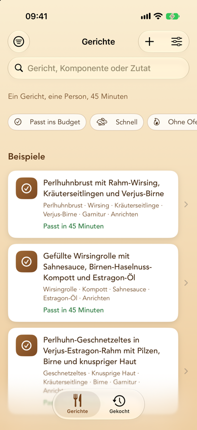
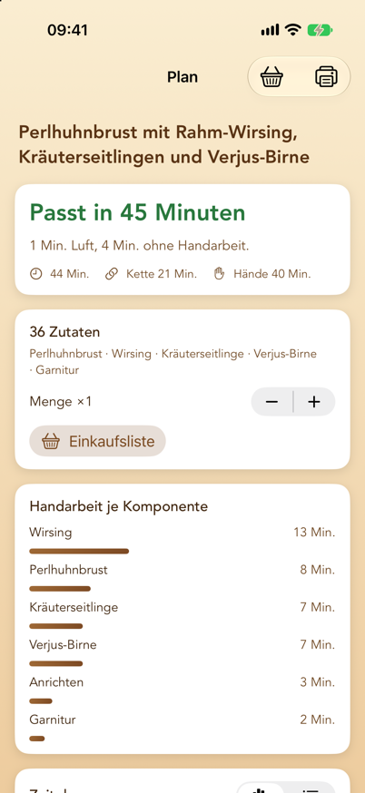
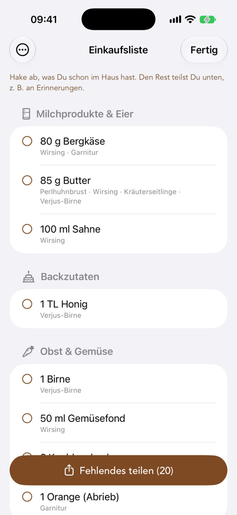
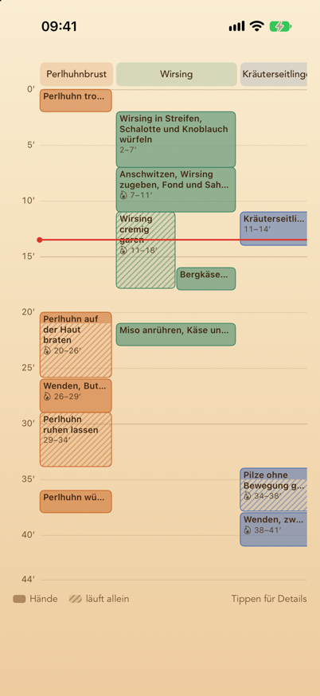
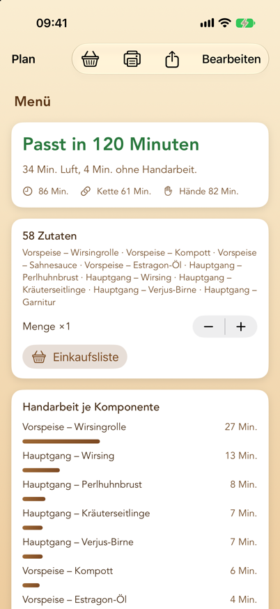
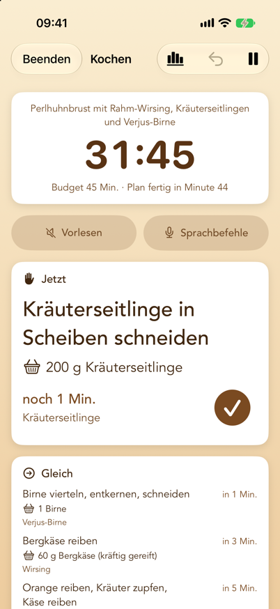
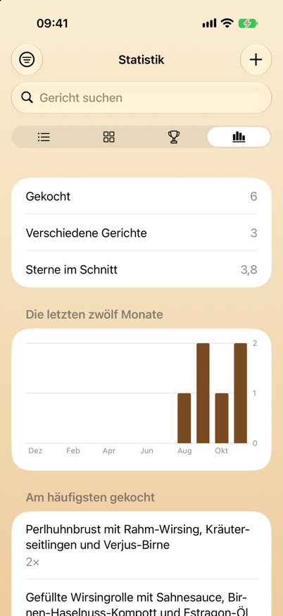

# CookPlanner – User Manual

As of 27 Nov 2026 · App version 1.0

---

## Contents

1. [What CookPlanner does](#1-what-cookplanner-does)
2. [Requirements](#2-requirements)
3. [Basic terms](#3-basic-terms)
4. [The dish list](#4-the-dish-list)
5. [The plan](#5-the-plan)
6. [Creating and editing a dish](#6-creating-and-editing-a-dish)
7. [Importing](#7-importing)
8. [Composing a menu](#8-composing-a-menu)
9. [Cook mode](#9-cook-mode)
10. [Notifications, alarms and Live Activity](#10-notifications-alarms-and-live-activity)
11. [Cooked](#11-cooked)
12. [Cooking plan as PDF and cooking yearbook](#12-cooking-plan-as-pdf-and-cooking-yearbook)
13. [Siri, Shortcuts, Spotlight and keyboard](#13-siri-shortcuts-spotlight-and-keyboard)
14. [Settings](#14-settings)
15. [Backup, iCloud and moving to another device](#15-backup-icloud-and-moving-to-another-device)
16. [CookPlanner Pro](#16-cookplanner-pro)
17. [Privacy](#17-privacy)
18. [Frequently asked questions](#18-frequently-asked-questions)

---

## 1. What CookPlanner does

A dish of meat, side, sauce and garnish, one cook at the stove and a fixed time: CookPlanner lays out the work steps so that **everything is ready at once**, and tells you beforehand whether the time is enough. Its subtitle is “Cooking against the clock”.

- Every step has **hands-on time** (you are busy) and time in which it **runs on its own** (simmering, baking, resting).
- CookPlanner works with **your kitchen**: how many burners, how many ovens and how much time you have.
- The **verdict** says plainly whether the dish fits the time budget – and if not, why and what would help.
- In **cook mode** the app walks you through the kitchen step by step with a clock and replans after every tick. Notifications, alarms and the Live Activity on the Lock Screen keep you informed even while the iPhone lies locked on the counter.

On top of that: import from text, photos and web pages (also straight from Safari through **Share**), ingredients with servings and a shopping list, menus of several courses, a record of every cook with stars, note and photo, measured times for the next plan, reading aloud and voice commands, Siri and Shortcuts, the cooking plan as a PDF, a cooking yearbook and iCloud sync between iPhone and iPad.

### Quick start: your first cook against the clock in five steps

1. In the dish list, tap the button with the sliders at the top right (**Settings**) and set your time budget and your kitchen (burners, ovens).
2. Tap one of the **Examples** or create your own with **+ → New dish**.
3. Read the verdict on the plan (“Fits in 35 minutes” or “9 minutes short”) and look at the timeline.
4. Tap **Start cooking** at the bottom of the plan, choose the clock (Challenge, Practice or Relaxed) and tap **Start**.
5. Tick off each step with the large check mark; for pots and oven steps the button shows a flame and means “On, running on its own”. At the end, **End → End and keep the record**.

*The dish list: filter, + and settings at the top, then search, budget and chips, then the dishes with their verdict.*

---

## 2. Requirements

| Item | Value |
|------|-------|
| Devices | iPhone and iPad |
| Operating system | iOS 26 or iPadOS 26 or later |
| Languages | German, English, French – the app follows the device language |
| Appearance | Light and dark mode |
| Internet | Only for importing from text, photos and web pages (the analysis runs in the cloud) and for iCloud sync. Planning, cooking, records and backups work offline |
| Sign-in | No CookPlanner account. For the analysis the app signs in anonymously in the background |
| iCloud | Optional: with the same Apple ID, iPhone and iPad stay in sync ([chapter 15](#15-backup-icloud-and-moving-to-another-device)) |

The app asks for these permissions only when they are needed:

| Permission | What for | Without it |
|---|---|---|
| Notifications | “up now” and “time is up” in cook mode | Cook mode runs, but stays silent while the iPhone is locked |
| Alarms (AlarmKit) | An alarm when a pot or the oven is done – even on silent and in a Focus | A notification comes instead of the alarm |
| Camera | **Scan pages** when importing, **Take photo** for a record | Photos can still be chosen from the library |
| Microphone and speech recognition | Voice commands in cook mode | Voice commands stay off |

**Choose photos** needs no permission: the iOS photo picker hands over only the pictures you tap.

---

## 3. Basic terms

**Dish**
What ends up on the plate, for example “Guinea fowl breast with creamed savoy cabbage, king oyster mushrooms and verjus pear”. A dish has a name, optionally a number of servings, ingredients and steps.

**Component**
A part of the dish that is cooked on its own – meat, cabbage, mushrooms, sauce. In the plan each component gets its own column, and hands-on work is counted per component.

**Step**
A piece of work with a duration: “Cut the cabbage into strips”, “Sear the guinea fowl”. A step belongs to a component, can take a burner or an oven and can wait for other steps.

**Hands and “runs on its own”**
Every step has two times: **Hands** – the minutes in which you are busy – and **then on its own** – the minutes in which the pot simmers or the oven bakes without you. In the time on its own you can do something else; that is exactly what the plan makes use of.

**Time budget**
The minutes in which everything should be ready (35 by default). The verdict measures every dish against it.

**Burners and ovens**
How many burners and ovens your kitchen has. A stove step takes a burner, an oven step an oven, each for its hands-on time and its time on its own. The ovens count as preheated when the clock starts.

**Must go on soon**
Some results cannot wait: seared meat is turned at once, rested meat should not go cold. With “Must go on soon” you say how long a step may wait at most before the next one comes.

**Chain**
The longest sequence of steps that wait for each other. No plan can be shorter than the chain, however cleverly you work in parallel.

**Waits for**
A step only begins when the steps it waits for are done. Without anything chosen, it can begin at once. Plating up usually waits for the last step of every component.

---

## 4. The dish list

The app has two tabs at the bottom: **Dishes** and **Cooked** ([chapter 11](#11-cooked)). The dish list shows the search field at the top, below it “One dish, one cook, 35 minutes” with your budget, the chips and then two sections:

- **My dishes** – what you created, imported or saved as a menu.
- **Examples** – three ready-made dishes to try out. They cannot be changed, but you can use them as a template ([chapter 6](#6-creating-and-editing-a-dish)).

Each row shows the name, the components and the **verdict** in green (“Fits in 35 minutes”) or red (“9 minutes short”). If no plan can be worked out at all – say the dish needs an oven and the kitchen is set to 0 ovens – the reason is shown instead. A tap opens the plan ([chapter 5](#5-the-plan)).

| Gesture | On your own dishes | On examples |
|---|---|---|
| Swipe left | **Delete** | – |
| Touch and hold | **Edit**, **Delete** | **Use as a template** |

### Search

The search field (**Dish, component or ingredient**) always sits above the list. It searches dish, component and ingredient: “cabbage” also finds a dish in which cabbage is only an ingredient. If nothing is found, it says “No matching dishes”.

### Chips

The six fixed chips filter with one tap; a second tap lifts the filter:

| Chip | Shows |
|---|---|
| Fits the budget | Dishes that fit the time budget with your kitchen |
| Quick | Dishes whose plan takes 30 minutes at most |
| No oven | Dishes that only need the stove |
| Favourites | Dishes with at least four stars on average |
| Never cooked | Dishes without a record |
| Not cooked for a while | Dishes not cooked for 60 days, or never |

### Filter and your own collections

The filter button at the top left opens a menu with several conditions; while a filter is active, the button is filled:

- **Duration:** All, Up to 30 minutes, 31 to 45 minutes, 46 to 60 minutes, Over an hour.
- **Equipment:** All, With oven, Stove only, No heat.
- **Origin:** All, Own, Imported, Examples.
- **History:** All, Never cooked, Not cooked for a while, Favourites.
- Switches **Fits the budget** and **Little hands-on work** (your hands are busy for at most 60 percent of the plan).

While a filter is set, the top of the menu offers **Reset filters** and **Save collection**. With **Save collection** you enter a name, and the chosen filters appear as a chip of their own after the six fixed ones. Touch and hold that chip for **Rename** and **Delete collection**. Your own collections are part of CookPlanner Pro ([chapter 16](#16-cookplanner-pro)); search, filters and the fixed chips are free.

### The buttons at the top

| Button | Entries |
|---|---|
| Filter (left) | Duration, Equipment, Origin, History, Fits the budget, Little hands-on work, Reset filters, Save collection |
| + | New dish, Import from text, Import from photos, Import from web page, Compose a menu |
| Sliders | Settings ([chapter 14](#14-settings)) |

---

## 5. The plan

Tapping a dish opens its **Plan**. The name is at the top, then come the cards, and at the very bottom the **Start cooking** button ([chapter 9](#9-cook-mode)). The bar at the top holds, depending on the dish:

| Button | Effect |
|---|---|
| Basket | **Shopping list** (if the dish has ingredients) |
| Printer | **Cooking plan as PDF** ([chapter 12](#12-cooking-plan-as-pdf-and-cooking-yearbook)) |
| Share | **Share dish** as a `.cookplanner` file (your own dishes only, [chapter 15](#15-backup-icloud-and-moving-to-another-device)) |
| Edit | Opens the editor (your own dishes only) |

*The plan: the verdict “Passt in 45 Minuten” (fits in 45 minutes) with its reason and figures at the top, below it the ingredients with amount and shopping list, and the hands-on work per component.*

### The verdict

Large, in green or red: **Fits in N minutes** or **N minutes short**. Below it, the reason:

| Reason | Meaning |
|---|---|
| “N min to spare, N min without hands-on work.” | It fits; this much reserve is left, this long your hands are free |
| “The longest chain takes N minutes …” | The chain is longer than the budget; working in parallel does not help, only shorter steps |
| “The hands-on work alone takes N minutes …” | One cook is not enough; drop or simplify steps |
| “Chain … and hands … fit on their own but collide …” | Hands or equipment are not enough for everything at once – more burners or ovens, or more time |

The small line below gives the length of the plan, the **chain** and the **hands** in minutes. If no plan can be worked out, the page shows “No plan” with the reason and, for your own dishes, an **Edit** button.

### Ingredients and servings

The card shows how many ingredients the dish has and which components they belong to. If the recipe gives a number of people, change it with **Serves N** (1 to 24); otherwise there is **Amount ×0.5 to ×4**. Only the amounts change, **the times stay the same**. The choice applies per dish to the plan, cook mode and shopping list, and is kept.

### Shopping list

**Shopping list** (the button in the card or the basket at the top) opens the ingredients by shelf (Dairy & eggs, Baking supplies, Fruit & vegetables, Spices & herbs …); the same ingredient of several components is one line, with the amounts added up. Tick off what you already have at home; the **…** button at the top left offers **Everything at home** and **Nothing at home**. **Share what’s missing (N)** at the bottom passes the rest on as text, one ingredient per line – for example to Reminders, Notes or a message. The ticks are kept per dish.

*The shopping list: ingredients by shelf, the components in small print below; at the bottom “Fehlendes teilen (20)” (share what’s missing).*

### How it fits

If a dish does not fit and the hands are not the reason, CookPlanner checks whether shorter cooking times help: steps with a **time span** ([chapter 6](#6-creating-and-editing-a-dish)) are planned at the short end. The **How it fits** card names each step concerned (“Braise the cabbage: 12 instead of 15 minutes”) and says whether that makes it fit the budget or how many minutes are still missing. The dish itself stays unchanged.

### Hands-on work per component

A bar per component, the longest at the top: you see which part of the dish keeps you busiest.

### Timeline or list

The **Timeline** card shows the plan either as a **Timeline** chart or as a **List** (switch at the right of the card; the choice is kept).

- **Timeline:** one column per component, time running from top to bottom in minutes. Solid bars are hands-on work, striped bars run on their own; a flame symbol stands for stove or oven. Overlapping steps of one component stand side by side. **Tap for details:** tapping a bar opens a small window with the full name, the component, “Minute 12 to 27”, the minutes hands-on and on its own and, if any, the oven temperature.
- **List:** every step with its minutes from–to, hand and stove or oven symbols, component, time span and oven temperature, in the order of the plan.

*The timeline: one column per component, hands-on work solid, “runs on its own” striped. In cook mode the red line marks where you are now.*

### Cooked

If you have cooked or entered the dish, the **Cooked** card shows the last five times with date, stars and time taken; a tap opens the record, touch and hold offers **Delete record**. If there are measured times, **Take measured times for N steps** appears: you see, per step, the current and the measured time – the median of the ticked times from the latest five runs at most. For pots and oven steps the hands-on time stays; only the time on its own adapts; relaxed runs do not count. **Apply** writes the times into the dish; for an example the button is called **As own dish** and creates a copy under My dishes. Measuring is free; taking the times over is part of CookPlanner Pro.

### Keep warm

If a component is ready early and waits ten minutes or more for plating, the **Keep warm** card names it with its waiting time (“Sauce waits 12 minutes”).

---

## 6. Creating and editing a dish

**+ → New dish** opens an empty editor, **Edit** on the plan (or touch and hold in the list) opens it with your own dish. For an example, **Use as a template** (touch and hold in the list) creates a copy that you adapt in the editor and save as your own dish.

The editor has four sections:

- **Dish:** name and number of people (1 to 12; **Servings not given** if you choose none).
- **Ingredients:** a row per ingredient; **Add ingredient** opens a sheet of its own.
- **Steps:** a row per step with hands, time on its own, station and what it waits for; **Add step** opens a sheet of its own. From two steps on, **Edit** above the list lets you move or delete steps.
- **Plan:** the verdict while you type – you see at once what a change does.

You can also delete ingredients and steps by swiping left. **Save** works as soon as the dish has a name and at least one step. **Cancel** discards the changes.

### Ingredient

| Field | Meaning |
|---|---|
| Name | The name, e.g. “Savoy cabbage” |
| Amount and unit | As in the recipe; the button next to the unit offers common units and **No unit**. No amount for “salt” or “pepper” |
| Component | Which part of the dish the ingredient belongs to; type it or pick an existing one with **Choose component** |
| Note | e.g. “small” or “well aged” |

**Delete ingredient** removes it. The ingredients make up the shopping list; which ones you handle in a step, you choose at the step.

### Step

| Field | Meaning |
|---|---|
| What to do | The text of the step, e.g. “Sear the guinea fowl skin side down” |
| Component | Type it, or pick an existing one with **Choose component** |
| Hands | Minutes in which you are busy (0 to 120) |
| Then on its own | Minutes in which the step runs without you: simmering, baking, resting (0 to 600) |
| Time span | Only with time on its own: **At least** and **At most** minutes the cooking may take. “How it fits” uses the short end |
| Station | **None**, **Burner** or **Oven**; for the oven, the temperature (50 to 300 °C in steps of 10) |
| Must go on soon | A switch; then “Waits at most N min” (0 to 60): 0 minutes for turning after searing, 3 for rested meat, 10 for a sauce kept warm |
| Ingredients of this step | Tick the ingredients used here; in cook mode they appear under the step |
| Waits for | Tick the steps that must be done first |

A new step first follows the previous step of its component, until you change the choice. **Wait for every component** ticks the last step of each component – right for plating up. **Delete step** removes an existing step.

> If steps wait for each other in a circle, the plan says “The steps wait for one another in a circle”. Then check the **Waits for** ticks of the steps.

---

## 7. Importing

Instead of typing a dish, let a recipe be taken apart. The ways in are under **+**, plus sharing from Safari:

- **Import from text:** type the recipe text into the field or bring it in with **Paste** (at least a few lines) and tap **Analyse**.
- **Import from photos:** **Scan pages** opens the iOS document camera – it finds the page edges and takes several pages one after another. **Choose photos** takes up to four pictures from the library. The text is recognised **on the iPhone** and added to the field, where you can check and correct it; the photos never leave the device. Then **Analyse**. Both buttons are also offered in the text import, below the text field.
- **Import from web page:** enter or paste the **Address of the recipe page** and tap **Analyse**. The page is loaded on the device; only the recipe text goes to the analysis.
- **Share from Safari:** on a recipe page in Safari (or any other app that shares links), choose **Share → CookPlanner**. The sheet “Import recipe into CookPlanner” shows the page; **Import** opens CookPlanner and the analysis starts at once. If the app cannot be opened from there, open it yourself – the import then starts on its own.

The analysis runs on a Google service (Firebase). It takes the recipe apart into steps, estimates hands-on time and time on its own, suggests order and dependencies, recognises stove and oven and takes over the ingredients with their amounts. Under **Found** the result shows the name, “N steps, M components” and, if given, the number of people, plus **Notes from the analysis** on anything uncertain.

- **Check and edit** opens the dish in the editor ([chapter 6](#6-creating-and-editing-a-dish)). Only **Save** puts it under My dishes.
- **Analyse another text** or **Analyze another page** discards the result.

The number of analyses per hour is limited; once the limit is reached, try again later. While CookPlanner Pro is on offer, there is a fixed number of free analyses per month without Pro; after every analysis the app says how many are left ([chapter 16](#16-cookplanner-pro)). Creating dishes by hand always works. If an analysis takes too long, it helps to import a long recipe in two parts.

---

## 8. Composing a menu

**+ → Compose a menu** (on the iPad also ⇧⌘N) turns several dishes into one plan, for example starter, main course and dessert. Menus are part of CookPlanner Pro.

1. Give the menu a **Name** at the top (otherwise it is called “Menu”).
2. Choose a **dish** for every course – your own dishes and the examples, no other menus. The courses are called Starter, Main course and Dessert by themselves; you can overwrite each name. **Add a course** adds more courses (up to five), **Remove** drops one.
3. Between the courses, set how many **minutes until the next course** pass (0 to 90 in steps of 5), or **Together with the next course**. The starter is served that many minutes before the main course, and the main course is cooked while the guests eat.
4. Under **Plan** you already see the verdict, the reason and “N steps, M ingredients, plan N min”.
5. **Save** stores the menu as a dish of your own under My dishes, with steps such as “Serve Starter”.

*A saved menu: “Passt in 120 Minuten” (fits in 120 minutes), the ingredients and the hands-on work per component, each with its course in front.*

You cook the menu like any dish; its components are called “Starter – cabbage roll” or “Main course – guinea fowl breast”, and its ingredients make one shared shopping list.

---

## 9. Cook mode

**Start cooking** at the bottom of the plan (on the iPad also ⌘⏎) opens cook mode full screen. Before the start you choose the **Clock**:

| Clock | What it does |
|---|---|
| Challenge | The clock counts the time budget down, like on the show. When the time is up, it counts on how far over you are |
| Practice | The clock runs from 0:00 – so you learn how long the dish really takes |
| Relaxed | No clock, no overdue: the steps come in order, only pot and oven keep their time |

**Start** sets the clock running; the first time, iOS asks about notifications and alarms ([chapter 10](#10-notifications-alarms-and-live-activity)). The app remembers your last choice.

*Cook mode: the clock (31:45) at the top, below it Read aloud and Voice commands, the “Now” card with ingredient, time left and check mark, and the “Next” list.*

### What the screen shows

- **Clock:** time left or time elapsed depending on the mode, plus “Budget 45 min · plan done at minute 44”; after a replan, whether you will be done earlier or later than planned; once it has run out, “Time’s up – 2:10 over”.
- **Now:** the step in your hands, in large type, with its ingredients, the component and the time left (“3 min left”, “overdue” in red). When your hands are free it says “Hands free, next in N min”; at the end “Done, plate up!”.
- **Next:** the next three steps with their ingredients and “in N min”.
- **Running on its own:** what is simmering or baking, with its time left. If you take a pot off the stove early, tick it off here.
- **Done:** “N of M steps” and below it every ticked step with the stopwatch time, newest at the top.

On the iPad and other wide screens the current step grows even larger, so you can read it from a distance.

### Ticking off: check mark and flame

- The large **check mark** at the right of the “Now” card (**Step done**) ticks off a step without time on its own.
- For pot and oven steps the button shows a **flame** (**On, running on its own**): the hands-on part is finished, the pot is on the stove or the oven door is shut. From now the time on its own runs; when it is up, the step is done.

After every tick and every minute, CookPlanner **replans** the rest: if you were faster, everything moves forward; if you were slower, the rest shifts.

### The buttons at the top

| Button | Effect |
|---|---|
| End (left) | Asks “End cooking?”: **End and keep the record** files the cook under Cooked, **End without a record** discards it, **Keep cooking** goes back. If no step is done yet, there is nothing to keep |
| Timeline | The running plan as a chart with a red line for **now**; finished steps are faded |
| Undo | Takes back the last tick |
| Pause / Resume | Stops the clock (“Paused, the clock is stopped”) and sets it running again |

After **End and keep the record**, the new record opens at once so you can give it stars and a photo ([chapter 11](#11-cooked)).

### Read aloud

With the **Read aloud** button the app speaks each new step with its ingredients, the oven temperature and the minutes, announces finished pots (“Cabbage: time is up.”) and at the end “Done, plate up!”. The setting is kept. Read aloud is part of CookPlanner Pro.

### Voice commands

With the **Voice commands** button cook mode listens (the first time, iOS asks for the microphone and speech recognition). Below it, the app shows which words work and what it heard last. While the app itself is speaking, it does not listen; when the app goes to the background, listening ends. Speech recognition runs on the device. Voice commands are part of CookPlanner Pro.

| Command | Effect |
|---|---|
| “Done” (also “finished”, “complete”) | Ticks off the step in your hands; for a pot it puts it on |
| “It’s on” (also “in the oven”, “simmering”) | Pot or oven is running, the time on its own begins |
| “Undo” / “Back” | Takes back the last tick |
| “Read” / “Repeat” | Reads the current step again |
| “What’s next” / “Next step” | Reads the next step |
| “Ingredients” | Reads the current step’s ingredients |
| “How long” / “Time left” | Time left on the step and on the plan |
| “Pause” / “Hold on” | Stops the clock |
| “Carry on” / “Continue” | Sets the clock running again |
| “Stop” / “Quiet” | Stops the speaking |

The commands work in the app’s language; in German, for example, “Erledigt”, “Steht”, “Was kommt”. If speech recognition for the language is not available on the device, the app says so.

### Screen and restart

While cook mode is open, the screen stays on. If the app is closed (by the system, an update or swiping it away), the next launch opens the run again – up to six hours after the start. Whatever you ticked off through Siri in the meantime is taken over as soon as cook mode is back in front.

---

## 10. Notifications, alarms and Live Activity

While you cook, CookPlanner keeps you informed in three ways – even when the iPhone lies locked in a corner. All three are free.

### Notifications

- **“Component · up now”** with the step as its title, when a step comes into your hands.
- **“Component · time is up”** when a pot or the oven is done (without alarms, see below).

The notifications come with sound, even while the app is in front. They follow every replan; the next 60 at most are always scheduled. **Pause** and **End** withdraw all pending notifications; a new run clears the banners of the last one.

### Alarms for pots and oven

If **Alarms for pots and oven** is on in the settings (the default), CookPlanner uses AlarmKit to set a real alarm for the end of every pot and oven step: “Cabbage: Cook the cabbage until creamy · time is up” with a **Stop** button. The alarm rings even when the iPhone is on silent or a Focus is on; that step then gets no extra notification. The alarms follow the plan like the notifications: a finished step loses its alarm, a moved one gets the new time, **Pause** and **End** withdraw them all. Without alarms you get a notification.

If you allow neither notifications nor alarms, cook mode shows: “Notifications and alarms are off – locked, the iPhone stays silent. Turn them on under Settings → CookPlanner.”

### Live Activity

As soon as the clock runs, the dish appears on the **Lock Screen** and in the **Dynamic Island**:

- the dish name and the countdown to plating,
- what you should be doing now – the step with its component, “Hands free” or “Done, plate up!”,
- “Next 2:15 · next step” with its own countdown, or how many pots are running on their own,
- how many steps are done (“5 of 23”).

When the next step’s time has come, the display switches to “Up now” with that step by itself. During a pause it shows “Paused, the clock stands” with the minutes left. **End** removes the Live Activity.

---

## 11. Cooked

The **Cooked** tab collects every cook you ended with a record, entered by hand or added from photos. While it is still empty, it says “Nothing cooked yet” with an **Add a cooked dish** button.

*Cooked in the Statistics view: filter, search, the four views and + at the top, then the figures, the last twelve months and the dishes cooked most often.*

### Views

The switch below the search field moves between four views; the title at the top shows which one is open:

| View | Shows |
|---|---|
| List | The records by month, newest first, with thumbnail, date, time, stars and note |
| Gallery | The photos of all records |
| Hit list | The dishes by average stars, with “cooked N×” – what went down best |
| Statistics | Cooked, Different dishes, Average stars, Against the plan (minutes slower or faster, from complete stopwatch runs), the last twelve months as bars, Cooked most often |

The search field (**Search dish**) filters by name; the filter button at the top left chooses a **Minimum rating** (All, or 1 to 5 stars and up). In the list you delete an entry by swiping left. Statistics are part of CookPlanner Pro.

### A record

Tap an entry to open it:

- **How was it?** – five stars to tap, a note (“less salt next time”) and a photo: **Take photo**, **Choose photo** or **Other photo**, or **Remove**. Tapping the photo enlarges it.
- **Took**, **Planned** and **Difference**. For a relaxed cook it says that the times do not count towards the measured times; for a cook ended early, how many steps were done.
- **Steps** – for each step, when it was done, how long it took, what was planned and the difference.

For an entry added afterwards, the date (**Cooked on**) can be changed; it carries the note “Entered without the stopwatch.”

### The “+” menu

| Entry | Effect |
|---|---|
| Add a cooked dish | If you cooked without the stopwatch: choose the dish, the date (**Cooked on**), stars, note and photo, **Save**. The entry has no times |
| Add from photos | Turns old photos of finished dishes into entries (see below) |
| Cooking yearbook | The year as a PDF ([chapter 12](#12-cooking-plan-as-pdf-and-cooking-yearbook)) |

### Add from photos

With **Choose photos**, pick up to 30 photos from the library. Date and title come from the photos: if a dish’s name is in the title, it is already chosen; otherwise choose it per photo. Date and dish can be changed per photo; **Leave out** keeps a photo out. **Add N** creates the entries with their photos.

---

## 12. Cooking plan as PDF and cooking yearbook

Both are part of CookPlanner Pro.

### Cooking plan as PDF

The printer button at the top of the plan opens **Cooking plan as PDF**. The A4 sheet to print, pin up or send contains:

- the header with name, verdict and duration,
- the **timeline** – one row per component, bars with the step number,
- the **steps** – each with its full text, minute, hands, time on its own, stove or oven and its ingredients,
- the **ingredients** per component.

With **With a start time** and a **Start** (date and time), every step appears with its clock time and the sheet shows “Ready at 19:05”; without a start time, times count from minute 0. **Share or print the PDF** opens the share menu – to print, save to Files or send.

### Cooking yearbook

**Cooked → + → Cooking yearbook** turns a year into a PDF book: a cover with a photo, the year in figures, the months with their photos, the favourite dishes, what the clock taught you, and a page for next year’s resolutions. Choose the **Year** and the **Name on the cover**; under **Contents** you see how many cooking sessions, cooking days, photos and favourite dishes go in. **Share the cooking yearbook** passes the PDF on to print, bind or send. Without records there is no book yet.

---

## 13. Siri, Shortcuts, Spotlight and keyboard

### Siri and Shortcuts

CookPlanner brings four commands that work without any setup. Every phrase names the app; you also find them in the **Shortcuts** app.

| Command | Example phrases | Effect |
|---|---|---|
| What's up | “What’s up in CookPlanner”, “Next step in CookPlanner” | Says which step is in your hands right now and what comes next |
| Step done | “Step done in CookPlanner”, “CookPlanner done”, “CookPlanner it’s on” | Ticks off the step in your hands; a pot or the oven is put on, its time runs from then |
| How long | “How long in CookPlanner”, “CookPlanner how much longer” | Says how long the step in your hands, the pots and the whole plan still need |
| Start cooking | “Cook *dish* with CookPlanner”, “Start cooking in CookPlanner” | Opens the dish and starts cook mode |

The first three run in the background, even with the iPhone locked, and need cook mode to be running; otherwise Siri answers “You are not cooking anything in CookPlanner right now.” Siri is free.

### Spotlight

Your dishes and the examples are in iOS Spotlight search, found by name, components and ingredients. Tapping a result opens the dish’s plan. New, changed and deleted dishes follow by themselves.

### Keyboard on the iPad

With a keyboard attached, the iPad shows the shortcuts when you hold ⌘:

| Shortcut | Effect |
|---|---|
| ⌘1 / ⌘2 | Dishes / Cooked tab |
| ⌘N | New dish |
| ⇧⌘N | Compose a menu |
| ⇧⌘F | Search dish |
| ⌘, | Settings |
| ⌘⏎ | Start cooking (on a dish’s plan) |

---

## 14. Settings

The button with the sliders at the top right of the dish list (on the iPad ⌘,) opens the settings; **Done** closes them.

| Setting | Range | Default |
|---|---|---|
| Time budget | 10 to 180 minutes in steps of 5 | 35 minutes |
| Burners | 1 to 8 | 4 |
| Ovens | 0 to 3 | 1 |
| Alarms for pots and oven | on or off | on |

Every change applies at once to all verdicts and plans. The ovens are preheated when the clock starts. The app remembers further choices where you make them: the view of the timeline, the cook-mode clock, read aloud, servings and shopping ticks per dish, the view and minimum rating under Cooked, your own collections.

The settings also have these sections:

- **CookPlanner Pro** – at the very top, as soon as the purchase is offered ([chapter 16](#16-cookplanner-pro)).
- **Backup** – **Back up dishes and records** and **Import dishes** ([chapter 15](#15-backup-icloud-and-moving-to-another-device)).
- **Sync** – the iCloud status and **Sync now** ([chapter 15](#15-backup-icloud-and-moving-to-another-device)).
- **Help** – opens in your browser this **user manual**, the **Help and contact** page with frequent questions and the e-mail address, the **Privacy Policy** and the **Legal Notice**.

---

## 15. Backup, iCloud and moving to another device

### Sync through iCloud

If you are signed in to iCloud with the same Apple ID on iPhone and iPad, **your own dishes, cooking records and photos** sync by themselves – at launch, when the app comes to the front, and when another device has changed something. The settings (budget, kitchen, alarms, clock, read aloud, timeline view), the servings per dish and your own collections travel along too. A cook under way stays on the device you are cooking on. If two devices changed the same thing, the later change wins.

The **Sync** section in the settings shows the status:

| Display | Meaning |
|---|---|
| Synced 18:42 | All is well, last sync at this time |
| Signed in | iCloud is ready, a sync is still to come |
| Not signed in | No Apple ID is signed in to iCloud on the device; the data stays here only |
| Not available | iCloud is restricted on the device |
| Checking … | The app is asking iCloud right now |

**Sync now** fetches at once what other devices have changed. There is no CookPlanner account and no CookPlanner server: the data lives in your private iCloud storage.

If a **different iCloud account** signs in on the device, the app asks whether the dishes and records stored here should be uploaded to it (**Upload to this account**) or whether you want to **Keep here only**. Whatever is already in the new account comes down either way.

### Backing up

**Settings → Back up dishes and records** creates a file `….cookplanner` with all your own dishes, all records and their photos and opens the share menu – for example **Save to Files** for iCloud Drive, or a message to yourself. The examples are not included; every copy of the app brings them along.

### Sharing a dish

The share button on the plan of your own dish passes on just this dish as a `.cookplanner` file, for example by AirDrop, Messages or Mail.

### Importing

You open a `.cookplanner` file in two ways: with **Settings → Import dishes** through the file picker, or by tapping the file in Mail, Messages or Files – CookPlanner then opens by itself. The app adds new dishes and records with photos; what is already there stays unchanged. Afterwards it reports how many dishes and records were added and how many were already there. A file from a newer version of CookPlanner is refused – update the app first.

### New iPhone or Android

- **New iPhone or iPad:** with the same Apple ID and iCloud, dishes and records arrive by themselves. Without iCloud, back up on the old device and import on the new one.
- **Android:** CookPlanner also exists for Android, with the same file format. A backup from the iPhone can be imported there and vice versa. There is no sync between iPhone and Android.

> Without iCloud, dishes and records live on this device only; if you delete the app, they are gone. Back up first then – and preferably regularly.

---

## 16. CookPlanner Pro

CookPlanner Pro is a **one-time purchase** – buy once, use for good, no subscription. The purchase applies on every device with your Apple Account.

| Pro feature | What it offers |
|---|---|
| Menu of several courses | Starter, main course and dessert as one plan ([chapter 8](#8-composing-a-menu)) |
| Read aloud and voice commands | Cook mode reads aloud and listens to you ([chapter 9](#9-cook-mode)) |
| Cooking yearbook | Your year of cooking as a PDF book ([chapter 12](#12-cooking-plan-as-pdf-and-cooking-yearbook)) |
| Cooking statistics | The Statistics view under Cooked ([chapter 11](#11-cooked)) |
| Your own collections | Save filters as a chip of your own ([chapter 4](#4-the-dish-list)) |
| Plan as PDF | The cooking plan to print ([chapter 12](#12-cooking-plan-as-pdf-and-cooking-yearbook)) |
| Take over measured times | Write the measured times into the dish ([chapter 5](#5-the-plan)) |
| More recipe analyses | Without Pro a fixed number of cloud analyses a month; with Pro no monthly limit |

**Everything you need to plan and cook against the clock stays free:** dishes by hand, from text, photos and web pages, the plan with timeline and verdict, servings, cook mode in all three clock modes, notifications, alarms and the Live Activity, the shopping list, the record with the measuring of times, List, Gallery and Hit list under Cooked, search, filters and the fixed chips, iCloud sync, backup, Siri, Spotlight and the iPad keyboard.

### Buying, restoring, redeeming a code

As soon as the purchase is offered, **CookPlanner Pro** appears at the very top of the settings with “Learn more” (after buying, “Unlocked”); a tap opens the purchase page with all Pro features. If a feature is locked without Pro, it carries a small **Pro** badge, and tapping it opens the same page with that feature first. There you find:

- **Unlock Pro** with the price – the purchase goes through the App Store.
- **Restore purchases** – for example on a new device; if nothing is found, the app says “No purchase was found for this Apple Account.”
- **Redeem code** – for an offer code that gives you Pro as a gift. A redeemed code counts like a purchase.

After buying, the page says “Pro is unlocked”.

> As long as CookPlanner Pro is not offered, the section does not appear in the settings and **every feature in this manual can be used freely**. The same holds if the app has never been able to load its Pro settings, for example on a first launch without internet.

---

## 17. Privacy

- **Dishes, records, photos and settings** stay on your device and, if you use iCloud, in your private iCloud storage at Apple. The developer has no access to them.
- **Recipe analysis:** only when importing does the recipe text go to a Google service (Firebase Cloud Functions with AI analysis) – and only when you tap **Analyse**, or **Import** when sharing from Safari. It is used for the analysis, not for advertising.
- **Photos** for the import never leave the device: the text is recognised on the iPhone, and only the text goes to the analysis.
- **Web pages** are loaded on the device; only the recipe text goes to the analysis.
- **Sign-in:** for the analysis and to read the settings for CookPlanner Pro, the app signs in anonymously with Firebase. There is no account, no name, no email address. A check through Apple (App Attest) makes sure the request comes from the real app.
- **Voice commands** use iOS speech recognition on the device; CookPlanner stores none of it. **Read aloud** uses iOS text-to-speech.
- **Purchases** are handled by the App Store; CookPlanner only learns whether Pro has been bought.
- No advertising, no tracking.

---

## 18. Frequently asked questions

**Why does the dish say “N minutes short”?**
Read the reason on the plan. If the chain is too long, only shorter steps or a larger budget help; if there is too much hands-on work, simplify steps; if hands or equipment collide, more burners or ovens in the settings help. Look at the **How it fits** card too.

**The dish has no plan at all, only a red sentence.**
Usually it needs an oven or a burner, and the kitchen is set to 0 in the settings. Or steps wait for each other in a circle – then check the **Waits for** ticks.

**Can I change an example?**
Not directly. Touch and hold the example in the list and choose **Use as a template** to create a copy that is yours.

**Do the times change when I cook for more people?**
No, only the amounts. If you notice it takes longer, cook in Practice mode and take over the measured times afterwards.

**Nothing comes through while the iPhone is locked.**
Check notifications and alarms in the iOS Settings under **CookPlanner**. A Focus can hold notifications back; the alarm for pots and oven rings anyway if it is on in the app’s settings.

**I left cook mode by mistake.**
Open the app again: the run continues, up to six hours after the start.

**The voice commands do not react.**
Check microphone and speech recognition in the iOS Settings under **CookPlanner** and say the commands briefly and clearly. While the app reads aloud, it does not listen, and in the background it does not listen at all.

**Siri says “You are not cooking anything in CookPlanner right now.”**
“What's up”, “Step done” and “How long” need cook mode to be running. Start cooking in the app first, or with “Start cooking in CookPlanner”.

**The import reports an error.**
Check the internet connection. With “The hourly analysis limit is reached”, try again later; if it timed out, import a long recipe in two parts. Nothing recognised in the photos? Use **Scan pages**, or take them in more light and straight from above.

**CookPlanner does not appear in Safari’s share menu.**
In the share menu, tap **More** at the right end of the app row and turn CookPlanner on. Any page with a web address can be shared.

**My dishes are not on the iPad.**
On both devices, check under **Settings → Sync** that iCloud shows “Signed in” or “Synced” and that the same Apple ID is signed in, then tap **Sync now**.

**How do I take my dishes to an Android phone?**
With **Back up dishes and records** on the iPhone and **Import dishes** in CookPlanner for Android ([chapter 15](#15-backup-icloud-and-moving-to-another-device)).
